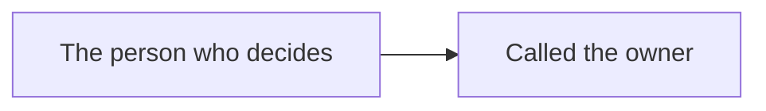
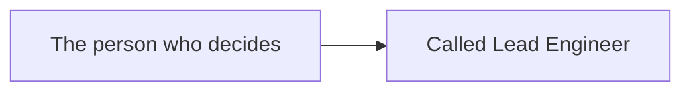
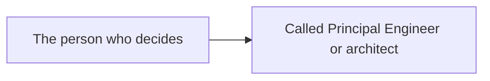
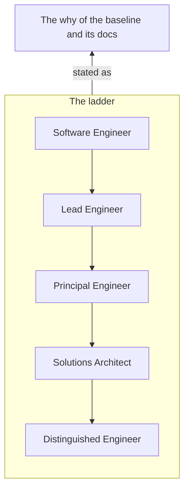
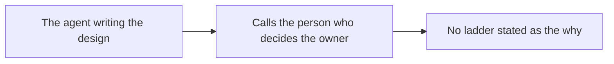
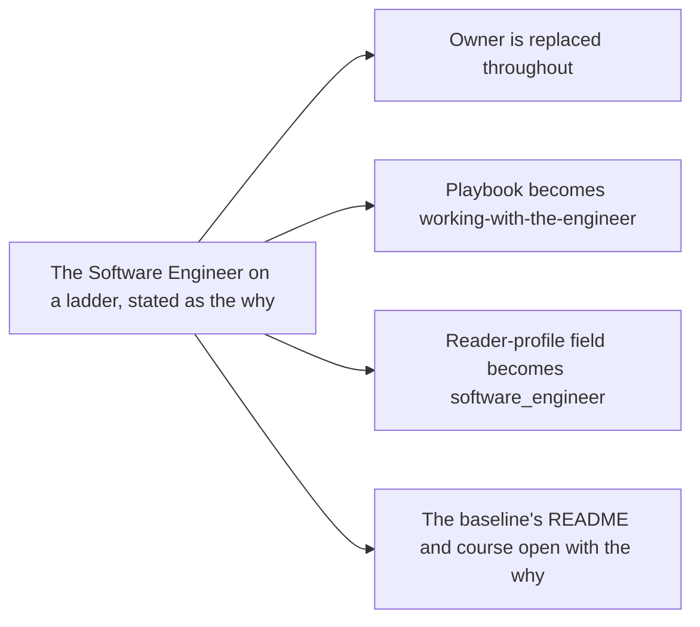

# The Software Engineer and the ladder as the baseline's why

Status: Draft
Date: 2026-11-14
Deciders: the Software Engineer

## Context

The agent that was writing the design had called the person who decides "the owner". The Software Engineer asked what that meant and said they would prefer something more technical (lead engineer, principal engineer, an architect, or "C", as typed), though "owner also doesn't matter". They then set the frame: the goal is to behave as a Distinguished Engineer, taking on the responsibilities of the Principal Engineer and the Solutions Architect, along the ladder Software Engineer, Lead Engineer, Principal Engineer, Solutions Architect, Distinguished Engineer. "We can classify the owner as 'Software Engineer' and use the above flow as the central foundation. That is the WHY for the docs to be honest."

## Decision drivers

Not recorded.

## Options

### Option 1: Keep "owner"

The person who decides stays "the owner".

*The name stays as it is; notice that the Software Engineer said they would prefer something more technical, though "owner also doesn't matter".*

- **Pros:** Not recorded.
- **Cons:** The Software Engineer asked what "owner" meant and said they would prefer something more technical, though "owner also doesn't matter".
- **Evidence:** Not recorded.

### Option 2: Lead Engineer

The person who decides is called Lead Engineer.

*The person who decides is renamed Lead Engineer; notice that lead engineer is on the Software Engineer's list of more technical names.*

- **Pros:** Lead engineer is on the Software Engineer's list of more technical names than "owner".
- **Cons:** Not recorded.
- **Evidence:** Not recorded.

### Option 3: Principal Engineer or architect

The person who decides is called Principal Engineer or architect.

*The person who decides is renamed Principal Engineer or architect; notice that both are on the Software Engineer's list of more technical names.*

- **Pros:** Principal engineer and an architect are on the Software Engineer's list of more technical names than "owner".
- **Cons:** Not recorded.
- **Evidence:** Not recorded.

### Option 4: The Software Engineer on a ladder toward Distinguished Engineer

The person who decides is called the Software Engineer, who sits on a ladder toward Distinguished Engineer, and the ladder is stated as the why of the baseline.

*The ladder runs from Software Engineer up to Distinguished Engineer and is stated as the why of the baseline; notice that the goal is to behave as a Distinguished Engineer.*

- **Pros:** The Software Engineer's own words: "We can classify the owner as 'Software Engineer' and use the above flow as the central foundation. That is the WHY for the docs to be honest."
- **Cons:** Not recorded.
- **Evidence:** Not recorded.

### Option 5: Do nothing

The person who decides stays "the owner", as in the Context, and no ladder is stated.

*Doing nothing keeps the name the Software Engineer questioned; notice that no ladder is stated as the why of the docs.*

- **Pros:** Not recorded.
- **Cons:** The Software Engineer asked what "owner" meant and said they would prefer something more technical, though "owner also doesn't matter".
- **Evidence:** Not recorded.

## Comparison

| Option | Name for the person who decides | Ladder stated as the why of the baseline | Other trade-offs recorded |
|---|---|---|---|
| Keep "owner" | Owner | Not recorded. | The Software Engineer would prefer something more technical, though "owner also doesn't matter" |
| Lead Engineer | Lead Engineer | Not recorded. | On the Software Engineer's list of more technical names |
| Principal Engineer or architect | Principal Engineer or architect | Not recorded. | On the Software Engineer's list of more technical names |
| The Software Engineer on a ladder toward Distinguished Engineer | Software Engineer | Stated as the why of the baseline | "That is the WHY for the docs to be honest." |
| Do nothing | Owner | Not recorded. | The Software Engineer would prefer something more technical, though "owner also doesn't matter" |

## Decision

The pick, made by the Software Engineer, is the Software Engineer on a ladder toward Distinguished Engineer, with the ladder stated as the why of the baseline. The recorded reason is the Software Engineer's own: "We can classify the owner as 'Software Engineer' and use the above flow as the central foundation. That is the WHY for the docs to be honest."

The mapping of each rung to the baseline's parts (design 1, section 1.1, the table's two right-hand columns) is the call of the agent that wrote design 1.

## Consequences

"Owner" is replaced throughout. The playbook becomes `working-with-the-engineer` and the reader-profile field becomes `software_engineer`; these two names are calls of the agent that wrote design 1. The baseline's README and course open with the why.

*The decision renames the person who decides everywhere and puts the why first; notice that the README and the course open with it.*

## Revisit when

Not recorded.

## Links

- Design 1, Appendix A, 0031: [design 1](../superpowers/specs/2026-11-14-baseline-standard-design.md)
- Decision trail, entry 0031: [decision trail](../superpowers/specs/2026-11-14-baseline-decision-trail.md)
