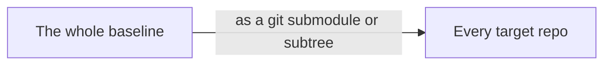
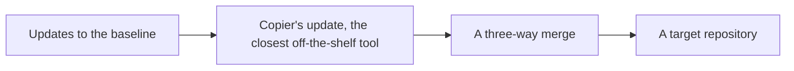
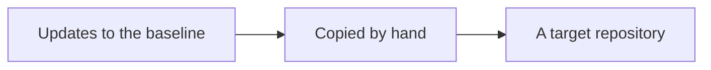
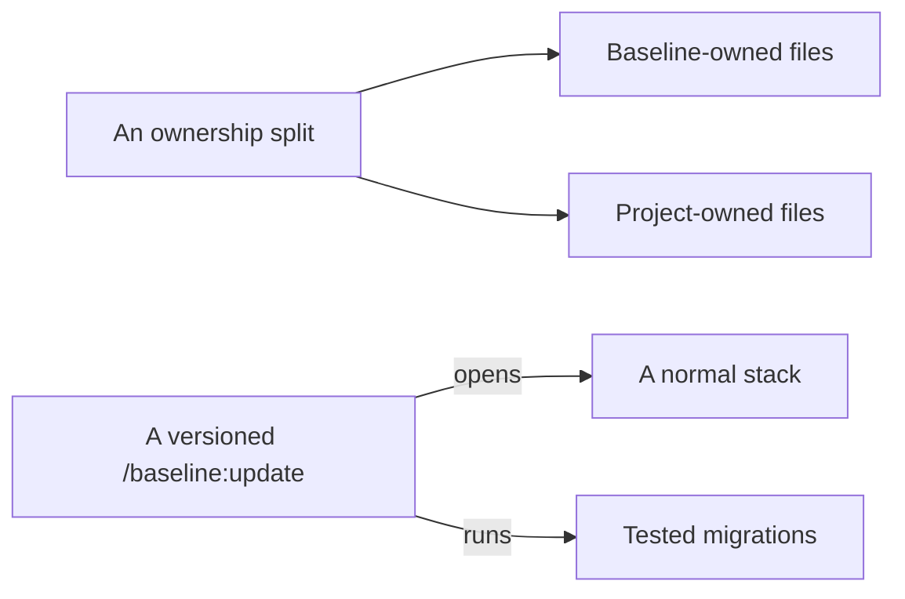
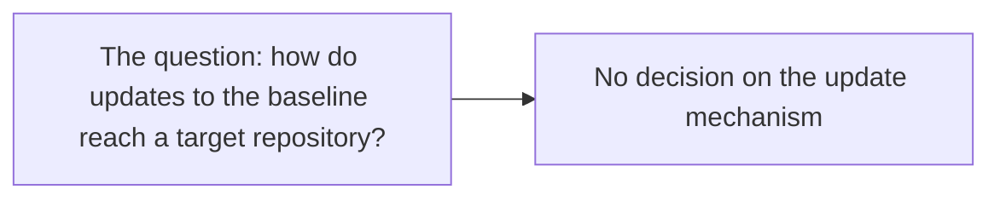
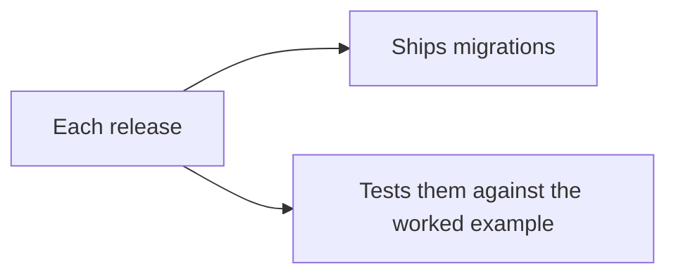

# The update mechanism

Status: Draft

Date: 2026-11-14

Deciders: the Software Engineer

## Context

The Software Engineer asked how updates to the baseline reach a target repository.

## Decision drivers

Not recorded.

## Options

### Option 1: A git submodule or subtree

The baseline reaches a target repository as a git submodule or subtree.

*The baseline reaches every target repo as a git submodule or subtree; notice that the whole baseline goes in.*

- **Pros:** Not recorded.
- **Cons:** Drags the whole baseline into every repo; conflicts on edited files.
- **Evidence:** Not recorded.

### Option 2: Copier's `update`

Copier's `update`, the closest off-the-shelf tool, does a three-way merge.

*Copier's update brings an update to a target repository through a three-way merge; notice that the merge sits between the baseline and the target repository.*

- **Pros:** Not recorded. That it is the closest off-the-shelf tool and does a three-way merge is given above as how it works.
- **Cons:** Unnecessary given an ownership split; unable to produce a stack of one-kind PRs.
- **Evidence:** Not recorded.

### Option 3: Manual copying

Updates reach a target repository by manual copying.

*Updates are copied by hand into a target repository; notice that the copying is manual.*

- **Pros:** Not recorded.
- **Cons:** Drifts.
- **Evidence:** Not recorded.

### Option 4: An ownership split with a versioned `/baseline:update` that opens a normal stack and runs tested migrations

The files are split into baseline-owned and project-owned files, and a versioned `/baseline:update` opens a normal stack and runs tested migrations.

*The files are split into baseline-owned and project-owned, and a versioned update opens a normal stack and runs tested migrations; notice that the update opens a normal stack.*

- **Pros:** Not recorded. The reason Appendix A gives for the pick is under Decision.
- **Cons:** Not recorded.
- **Evidence:** Not recorded.

### Option 5: Do nothing

No decision is made on how updates reach a target repository. The Context records the Software Engineer's question, and with no decision it has no answer.

*Doing nothing leaves the question without an answer; notice that the Context records the question and no answer.*

- **Pros:** Not recorded.
- **Cons:** The question in the Context stays without an answer: how updates to the baseline reach a target repository.
- **Evidence:** Not recorded.

## Comparison

The trail records no drivers for this decision, so the table has no driver columns; the pros and cons the trail gives for an option are in the last column. The consequence it records for the pick is given under Consequences; the trail does not call it an advantage or a drawback.

| Option | How updates reach a target repository | Other trade-offs recorded |
|---|---|---|
| A git submodule or subtree | As a git submodule or subtree | Cons: drags the whole baseline into every repo; conflicts on edited files |
| Copier's `update` | By a three-way merge | Cons: unnecessary given an ownership split; unable to produce a stack of one-kind PRs |
| Manual copying | By copying manually | Cons: drifts |
| An ownership split with a versioned `/baseline:update` that opens a normal stack and runs tested migrations | Baseline-owned and project-owned files; a versioned `/baseline:update` that opens a normal stack and runs tested migrations | Not recorded. |
| Do nothing | No decision is made | The question in the Context stays without an answer, as given under Cons |

## Decision

The Software Engineer picked the ownership split with a versioned `/baseline:update` that opens a normal stack and runs tested migrations. The trail gives no reason for the pick. Appendix A states it as an ownership split plus an update stack and gives the reason "safe and testable". The trail records a drawback for each of the other three options, given under their Cons.

The trail's evidence for the decision: Not recorded. Why the pick beats the other options, beyond Appendix A's reason: Not recorded.

## Consequences

Each release ships migrations and tests them against the worked example.

*Each release ships migrations and tests them; notice that the tests run against the worked example.*

## Revisit when

Not recorded.

## Links

- Design 1, Appendix A, 0025: [design 1](../superpowers/specs/2026-11-14-baseline-standard-design.md)
- Decision trail, entry 0025: [decision trail](../superpowers/specs/2026-11-14-baseline-decision-trail.md)
