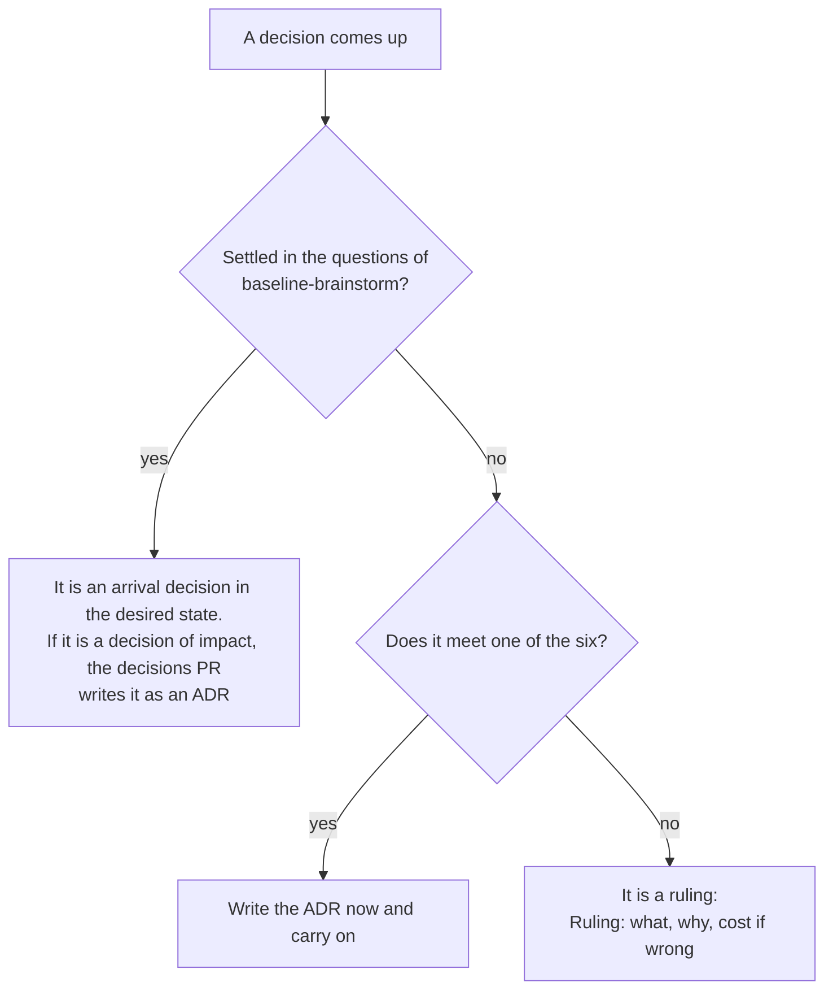

# Architecture decision records

## When to read this

An **architecture decision record**, or **ADR**, is one file for one decision, written as the desired output in tight text. Read this when you make a decision and have to tell whether it needs an ADR, and when you write, change or remove one.

ADRs and coding standards are the only documents that steer the code agents write. Both are living documents: edit, rewrite or delete them in place, and git history is the record. There is no draft or accepted status and no append-only rule.

## When to write one

Write an ADR for a **decision of impact**, and test every decision you make against these six.

- A new technology or dependency.
- A data model or a public interface.
- A security or trust boundary.
- The deployment topology.
- A contract between two parts of the system, such as a front end and a back end.
- Anything hard to reverse.

*A decision of impact gets an ADR at once, and a smaller call stays a ruling. The six are a test and not a gate: write the ADR and carry on.*

A dependency is a decision of impact, but a dependency bump that the tests show is safe is a ruling.

## How to write one

1. **Copy `baseline/adr/TEMPLATE.md`** into `baseline/adr/<NNNN>-<slug>.md`, where the number is the next one after the highest in the folder. Because: the numbers give an order and quote easily.
2. **State the decision as the desired output,** in one or two plain sentences. Then say why in a line or two, and add a diagram or a snippet only where it says more than words.
3. **Do not record the alternatives here.** They live in the arrival decisions of the desired state and in the course that `baseline-documentation` writes.
4. **Write it in the decisions PR,** the PR above the desired state, so the Software Engineer reviews it before the code. A decision of impact that comes up during coding goes in as a new commit there, or as a PR of its own on top, and the PRs above are rebased as `stacks.md` says.
5. **Change an ADR by editing it.** When a decision changes, rewrite the ADR so that it states the decision as it now stands. When it no longer holds, delete it. Because: an ADR is read to steer code now, and an outdated one steers it wrongly.

The 35 ADRs of the first design are in `docs/adr/` as an archive. They are not steering documents.
