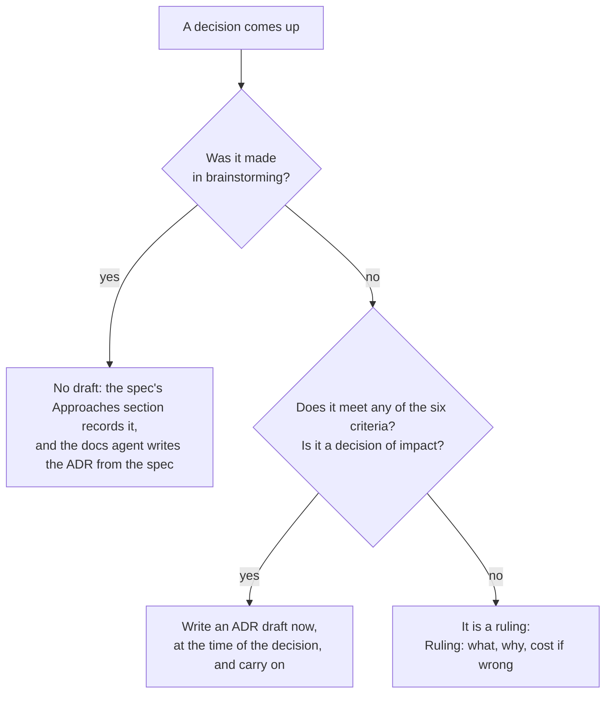
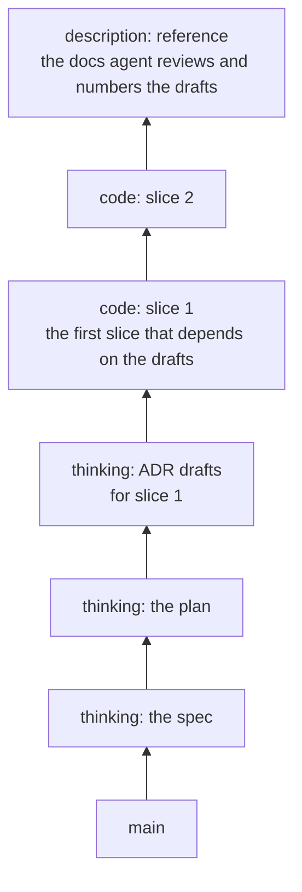
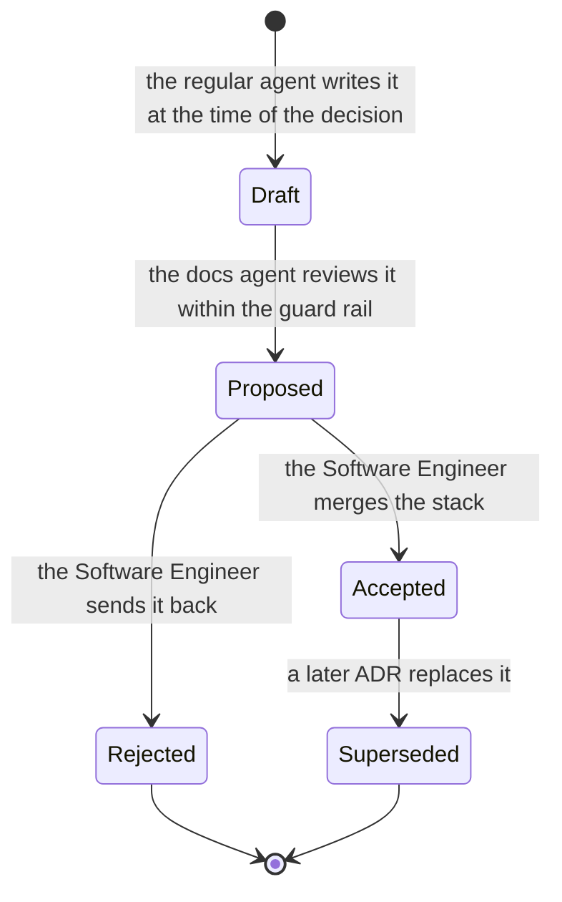
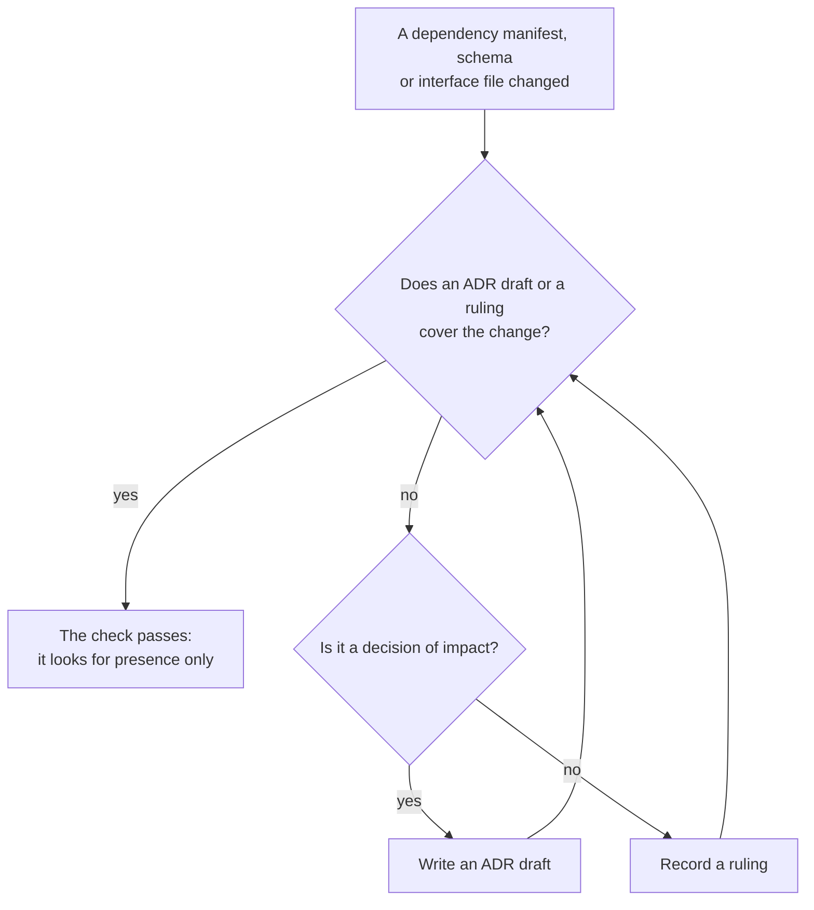

# Architecture decision records

## When to read this

An **architecture decision record**, or **ADR**, is one file for one decision. It records the problem, the options that were explored with the evidence for each, the choice and why it beats the others, and what follows from it. This playbook says when to write an ADR draft, how to write one, how an ADR moves from draft to accepted, how far the docs agent may go in reviewing a draft, and the check that a changed dependency, schema or interface is covered by an ADR or a ruling.

Read it when you make or adopt a decision and have to tell whether it needs a draft, when you write a draft, when you review drafts as the docs agent, when you change a dependency manifest, a schema or an interface file, and when you are asked what state an ADR is in.

Some words are used throughout, and the rest of the baseline assumes them.

- The **regular agent** is the agent that works on a task: it brainstorms, plans, builds and writes ADR drafts. The **docs agent** is a fresh agent that writes the descriptive documents from the finished code and reviews the drafts, and `docs-agent.md` is its brief.
- A **stack** is an ordered series of pull requests (PRs), each based on the one below it and merged from the bottom up (`stacks.md` explains how it is built and opened). A stack holds three kinds of PR. A **thinking PR** holds the prescriptive documents, the ones that say what will be built or how work is done: the spec, the plan, ADRs, standards, the reader profile and the playbooks. A **code PR** holds code and tests. A **description PR** holds the descriptive documents, the ones that say only what exists at the tip of the code, and the docs agent writes them. The **docs section** is the group of description PRs at the top of the stack. Each kind has its own PR because each is easier to review on its own. Mixing kinds is not wrong, only harder to review.
- A **slice** is a logical group of code that becomes one code PR.
- A **ruling** is a decision taken on the Software Engineer's behalf, recorded as `Ruling: what, why, cost if wrong` (`working-with-the-engineer.md`). The execution skills, the skills that carry out a plan task by task, log rulings in that form.
- An **ADR draft** is a decision record that the regular agent writes at the time of a decision, before the docs agent reviews it and gives it a number.

The template for an ADR, and the rules of its form, are in `standard/11-adrs.md`. This playbook does not copy them.

Each rule below is followed by `Because:` and its reason.

## When to write a draft

Write an ADR draft when you make or adopt a **decision of impact**. A decision of impact is any one of these six:

- **A new technology or dependency.** Something the project did not use before, such as a language, a framework, a service or a package.
- **A data model or public interface.** How the data is shaped, or what other code or other people can call.
- **A security or trust boundary.** Where one party's data or authority ends and another's begins.
- **The deployment topology.** Where and how the parts of the system run.
- **A contract between stacks.** What two technology stacks, such as a front end and a back end, promise each other.
- **Anything hard to reverse.** A choice that is costly or impossible to take back once other work depends on it.

**Test every decision you make against these six, as you make it.** Because: a ruling records what, why and what it costs, while a decision of impact also needs its options recorded at the time it is made, so that the reasoning is not written after the fact.

**Smaller calls stay rulings.** A new dependency is a decision of impact, but a dependency bump that tests show is safe is a ruling. Because: brainstorming already gates the big decisions, and what is left in the middle of the build is rulings, which the execution skills own and report.

**The six criteria are a test and not a gate: write the draft and carry on.** Nothing waits for an approval before the code. Because: brainstorming already gates the big decisions, the execution skills run continuously, and a gate of the baseline's own would collide with that. The Software Engineer sees the draft when they review the stack.

**A decision made in brainstorming needs no draft.** The spec's Approaches section already records the options, the trade-offs, the pick and why, and the docs agent writes those ADRs from the spec. Because: brainstorming requires the approaches and the Software Engineer's pick before any design exists, so a draft would only say again what the spec records.

**A change to a decision is a new ADR draft,** and not only an edit of the spec. Because: a decision is recorded in an ADR, so a spec edit alone would leave that record unchanged.

*A decision that meets one of the six criteria gets a draft at once, and the path ends in carrying on, because the criteria are a test and not a gate.*

## How to write one

1. **Write the draft when you make the decision, not afterwards.** Because: an ADR records the options that were explored at the time, and an ADR whose options were written after the decision, to justify it, is backfilled rationale, which is a failure even when everything else works.
2. **Name the file `docs/adr/draft-<slug>.md`, with no number.** Because: the docs agent gives the number when it publishes the ADR, so two stacks in flight cannot collide.
3. **Follow the template in `standard/11-adrs.md`, part by part, in its order.** Keep the header lines, which are the status, the date and the deciders, each in its own paragraph with a blank line between them. Because: every ADR then has the same parts in the same places, and in a Markdown file GitHub joins consecutive lines into one, so the header would otherwise read as one line.
4. **Explore at least two real options, and add "do nothing" as one more.** For each option, show how it works, list its pros and cons, and give the evidence you gathered: a spike, a benchmark, documentation or a cost. Because: "options explored" is the Software Engineer's bar for a decision record, and the draft is where it is met.
5. **Where you have no evidence for an option, say so, and do not fill the gap afterwards with a pro, a con or a number you did not have at the time.** Because: reasoning written after the decision, to justify it, is the backfilled rationale that the draft exists to prevent.
6. **Draw one diagram for each option and one more that shows the impact of the decision.** Give each a one-line italic caption that says what it shows and the one thing to notice, and set no colours of your own. Because: a diagram answers a question that the text cannot answer as well, and a hard-coded colour can make it unreadable in one theme.
7. **Commit the draft on its own, apart from any code.** When the stack is cut, it goes in a small thinking PR directly beneath the first slice that depends on it, one such PR for each slice that has any drafts. Because: the reviewer reads the thinking first, and each PR stays one kind.

*The drafts sit in a small PR directly beneath the first slice that depends on them, and their review and numbering come last, in the docs section.*

## The lifecycle

An ADR has one of five statuses: Draft, Proposed, Accepted, Rejected, or Superseded by the number of the ADR that replaced it.

*The merge of the stack is the acceptance, and the only way out of Accepted is a later ADR that replaces it.*

| Status | What it means | What moves it on |
|---|---|---|
| Draft | The regular agent wrote it at the time of the decision. | The docs agent reviews it within the guard rail and numbers it, and it becomes Proposed. |
| Proposed | Reviewed and numbered, and waiting for the Software Engineer. | The Software Engineer merges the stack and it becomes Accepted, or sends it back and it becomes Rejected. |
| Accepted | The decision stands, and the ADR is append-only. | A later ADR replaces it, and its status becomes Superseded by the number of that ADR. |
| Rejected | The Software Engineer sent it back. | Nothing: it ends here. |
| Superseded by NNNN | A later ADR replaced it. | Nothing: it ends here. |

1. **The Software Engineer's merge of the stack is the acceptance of the ADRs in it.** Neither you nor the docs agent decides that an ADR is Accepted or Rejected: the status records the Software Engineer's merge or send-back. Because: accepting or rejecting an ADR is the Software Engineer's call, and the merge of a stack is theirs.
2. **An Accepted ADR is append-only.** A change to it is a new ADR that supersedes it, and its status and its links are the only edits it takes. Because: an ADR records why a decision was made at the time, and a rewrite would replace that record with a later view.
3. **Drafts are unnumbered, and the docs agent gives the number when it publishes the ADR.** It renames `draft-<slug>.md` to `<number>-<slug>.md` and puts the number in the title, and `docs-agent.md` says where the number comes from. Because: two stacks in flight cannot collide when no draft has a number until it is published.
4. **After the merge, the Software Engineer, or an agent at their ask, changes the status of each ADR in the merged stack from Proposed to Accepted.** The merge is the acceptance, and this edit records it. Because: accepting an ADR is the Software Engineer's call, so recording it is theirs to make or to ask for.

## The guard rail for the docs agent

The docs agent reviews every draft before it is published, and the guard rail says how far that review may go.

| The docs agent may | The docs agent may not |
|---|---|
| Clean up the draft. | Rewrite the decision. |
| Add to it, marking each addition "Added at review". | Rewrite the drivers. |
| Review it. | Rewrite the options. |
| Give it its number and move it to Proposed. | Rewrite the rationale. |
| Flag where the built code departs from the decision. | Edit the ADR so that it matches the code. |

**Where the built code departs from the decision, the docs agent flags that for the Software Engineer and does not edit the ADR to match.** Because: the guard rail keeps decision-time reasoning from being backfilled, and an ADR edited to match the code would no longer say what was decided at the time.

**When it is doubtful whether an edit is a clean-up or a rewrite, the docs agent treats it as a rewrite, leaves the text as it is and flags it.** This follows from what the guard rail is for. Because: an edit that might change the decision, the drivers, the options or the rationale is the edit that the guard rail exists to stop.

The review edits and the numbering ride in a description PR. A description PR may edit ADR files, and this is the one crossover of kinds that the baseline names. Because: the review and the numbering are made after the build, when the docs section is written, and they are the docs agent's work.

If you are the regular agent, write the decision, the drivers, the options and the rationale as you want them to stand. Because: the docs agent does not rewrite them.

## The presence check

A changed dependency manifest, schema or interface file must be covered by an ADR or a ruling. The baseline requires its checker to make this check over the whole change, from `main` to the tip of the stack, at the top of the stack. It is an ADR check and not a dependency policy: it checks presence only, not approval.

*A changed manifest, schema or interface file passes once an ADR draft or a ruling covers it, and the check stops at presence, so it never asks whether the decision was right.*

1. **When you change a dependency manifest, a schema or an interface file, make sure that an ADR draft or a ruling covers the change.** A decision of impact has a draft, and a smaller change has a ruling. Because: the check at the top of the stack looks for one of the two, and a change with neither has no recorded reason.
2. **Expect the check to look for presence only.** It does not judge whether the decision was right, and it does not approve it. Because: the baseline sets no dependency policy, since security, dependency and release policy are per-project standards, and the Software Engineer's merge of the stack is the approval.
3. **Where the baseline's checker does not exist yet, make the same check by hand before you report.** `git diff --name-only main...HEAD` lists every file the stack changed. For each dependency manifest, schema or interface file in that list, find the ADR draft or the ruling that covers it. This follows from the presence check. Because: the check exists so that a change of this kind cannot reach the top of the stack without a recorded reason, and a check made by hand has the same job.
