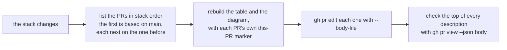

# PR descriptions

## When to read this

A PR description is what a human reviewer reads first. Read this when you open a PR, when you write or change a description, and again every time the stack changes, because every description carries a table of the whole stack (`stacks.md` says how a stack is built).

A PR is labelled with how it is read: **thinking** for the documents that say what will be built or how work is done (the desired state, ADRs, standards, these playbooks), **code** for code and tests, and **description** for the documents that say what was built. The label tells the reviewer which way to read. It is not a rule that a PR holds one kind.

## The header every PR starts with

1. **Which PR this is, as "n of N".**
2. **A table of the whole stack:** each PR's number, kind and one-line purpose.
3. **A stack diagram when the stack has three or more PRs,** with the PR being read as the rounded node.
4. **The kind:** thinking, code or description.

```markdown
## Stack

PR 3 of 4

| PR | Kind | Purpose |
|---|---|---|
| #40 | thinking | The desired state |
| #41 | code | The layout in baseline-init |
| #43 (this PR) | code | baseline-brainstorm |
| #44 | code | baseline-documentation |

<a stack diagram in Mermaid, flowchart BT, main at the bottom>

## Kind

code
```

## A thinking PR

After the header, four short parts: **What the artifact is**, **Produced by** (the skill or the person), **Read this first**, and **Decisions it contains**, one line each.

## A code PR

After the header, eleven parts, in this order.

1. **Implements.** The desired state, and the ADRs and standards this PR follows.
2. **Why.** Two to four sentences.
3. **What changes.** Grouped by idea, not by file.
4. **How it works.** Diagrams where they help, each in Mermaid with a one-line italic caption that says the one thing to notice. Set no colours of your own. A PR that changes the database shows the schema after the PR as an ER diagram, with the change marked `+`, `~` and `-`.
5. **How to review.** Where to start, the reading order, and what to skim.
6. **How it was verified.** The commands run and their results, what was tried by hand, and what was not verified.
7. **Risks and rollout.** Migrations, deploy order (data, then back end, then client), rollback and data-loss risk.
8. **Rulings I made,** each with what it costs if wrong.
9. **Ideas introduced.** One line per new concept.
10. **Out of scope and follow-ups.**
11. **Docs owed.** What the documentation run will have to cover for this change.

Because: the reviewer gets the reason in a few lines and the evidence after it, and a statement that nobody ran or measured, and that is not marked as unverified, misleads the reader.

## A documentation PR

After the header, three parts: **What is documented and how it was checked** (the commands run and the diagrams rendered), **Not verified**, and **Flags raised** (the kinds and where). The documents themselves are written by `baseline-documentation`.

## Keeping the stack tables current

Every description carries the table of the whole stack, so the tables are wrong as soon as the stack changes. Refresh them when the PRs are first created, because their numbers do not exist before; when a PR is added; and when a PR's purpose changes.



*Every description is rebuilt and applied again, not only the new one, because each carries the whole stack.*

Keep the description in a scratch file outside the tracked files, and apply it with `gh pr edit <number> --body-file <file>`. That replaces the whole description, so start from the current one when it holds something CI keeps up to date. Add no attribution line to a description.
