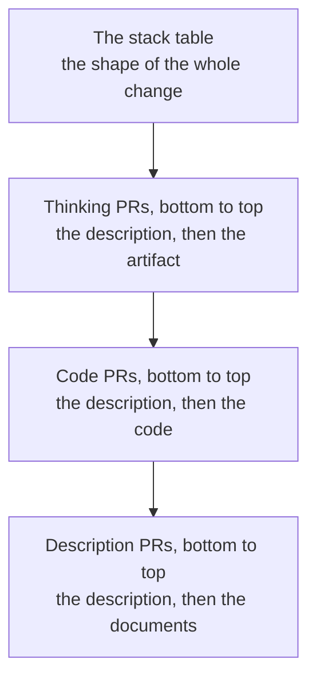
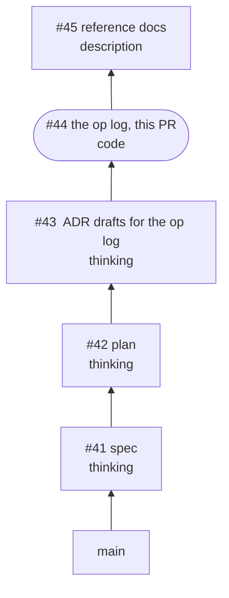
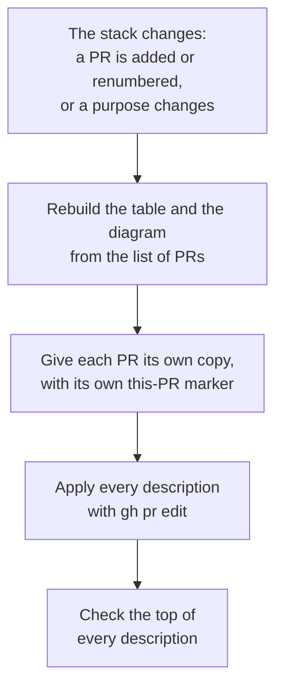

# PR descriptions

## When to read this

A PR description is what a human reviewer reads first. This playbook covers the descriptions of the pull requests (PRs) in a **stack**: an ordered series of PRs in which each PR is based on the one below it and merged from the bottom up (`stacks.md` explains how a stack is built and opened). Read it when you open a PR, when you write or change a description, and again every time the stack changes, because every description carries a table of the whole stack.

There is no length limit, and a description should be readable in one sitting, after the thinking PRs. The agent that built the slice writes the descriptions of thinking and code PRs, and the docs agent writes the descriptions of description PRs. Because: each of them knows what it produced, how it was checked and what was left unchecked, and the description is where that is recorded.

A stack holds three kinds of PR, and the rest of the baseline assumes the words for them.

- A **thinking PR** holds the prescriptive documents, the ones that say what will be built or how work is done: the spec, the plan, decision records (ADRs), standards, the reader profile and the playbooks.
- A **code PR** holds code and tests.
- A **description PR** holds the descriptive documents, the ones that say only what exists at the tip of the code: features, architecture, the course, deployment, the README and reference pages. The docs agent, a fresh agent that works from the finished code, writes them.

Each kind has its own PR because each is easier to review on its own, and each is read in a different way: thinking for intent and soundness, code for correctness, and descriptions for whether they match the code. That is why a description has a form for each kind, and why every description starts with the same header.



*A reviewer reads the thinking first, then the code, then the documents that describe it, and in every PR the description comes before the diff.*

Each rule below is followed by `Because:` and its reason.

## The header every PR starts with

Every description starts with the same header, whatever the kind of the PR: the stack and the kind.

1. **Which PR this is, as "n of N".** Because: a reviewer who arrives from a link needs to know where in the stack they are.
2. **A table of the whole stack:** each PR's kind, link and one-line purpose. The table also shows how the code is grouped into slices, the logical groups of code that become code PRs. Because: the reviewer sees the shape of the whole change before reading any code.
3. **A stack diagram, when the stack has three or more PRs.** Because: from three PRs up, the order and what builds on what is easier to see drawn than read, and with two PRs the table says it all.
4. **The kind:** thinking, code or description. Because: each kind is read in a different way, so the reviewer should know which way to read before they start.

Mark the PR being read in both the table and the diagram. Because: the reviewer then sees at once where this PR sits among the others.

In PR 4 of a made-up stack of five, the header carries this table and this diagram. `#41` is how GitHub writes a link to PR 41 in a description.

| PR | Kind | Purpose |
|---|---|---|
| #41 | thinking | The spec, as brainstorming produced it |
| #42 | thinking | The plan, as writing-plans produced it |
| #43 | thinking | ADR drafts for the op log |
| #44 (this PR) | code | The op log: the table and the replay |
| #45 | description | Reference documents for the op log |



*The PR being read is the rounded node, with everything it builds on below it and everything built on it above.*

When the stack so far has only PRs 1 and 2, the table lists those two and says that the stack grows as the build proceeds. Because: the table must show the stack as it is, and the later PRs do not exist yet.

The header as a skeleton, which the three forms below start from:

````markdown
## Stack

PR <n> of <N>

| PR | Kind | Purpose |
|---|---|---|
| #<number> | <thinking, code or description> | <one line> |

<the stack diagram, when the stack has three or more PRs>

## Kind

<thinking, code or description>
````

## Thinking PRs

A thinking PR holds an artifact that a skill or a person produced and that is committed as produced: the spec, the plan, a set of ADR drafts, any other kept skill artifact (a document a skill produced and that stays in the repository), a standards update, the reader profile or a playbook. Its description is short. After the shared header it has four parts.

1. **What the artifact is.** Because: the reviewer should know what they are about to read before they read it.
2. **Which skill or tool produced it**, for example `superpowers:brainstorming` for a spec or `superpowers:writing-plans` for a plan. Because: the artifact is committed as produced, so the reviewer needs to know what produced it.
3. **What to read first.** Because: a thinking PR is read for intent and soundness, so the reviewer should start where those are best judged.
4. **The decisions it contains.** Because: soundness is judged on the decisions, so the reviewer should be able to find the ones to challenge without reading everything.

There is no verification part. Because: the artifact is committed untouched, so there is nothing for you to have verified.

````markdown
<the header, as above, with the kind set to thinking>

## What the artifact is

<one or two sentences>

## Produced by

<the skill or tool, for example superpowers:brainstorming>

## Read this first

<the part to start with>

## Decisions it contains

<the decisions, one line each>
````

## Code PRs

A code PR holds code and tests, and docstrings and comments count as code. The agent that built the slice writes its description, and the full template has eleven parts. After the shared header, use all eleven, in this order.

1. **Implements.** Links to the spec, the plan and the ADRs this PR follows. Because: a future reader can then follow why, how and what through the history, and the baseline's check verifies that these links resolve.
2. **Why.** Two to four sentences. Because: the reviewer gets the reason in a few lines, and the longer reasoning lives in the spec and ADRs that "Implements" links.
3. **What changes.** Grouped by idea, not by file. Because: the diff already lists the files, so the description's job is to explain the change, one idea at a time.
4. **How it works.** Diagrams where they help (flow, sequence, state), and the schema diagram when the database changes (see "Database changes" below). Draw each diagram in Mermaid with a one-line italic caption that says what it shows and the one thing to notice, and set no colours of your own, except the approved palette. Because: a diagram answers a question that the text cannot answer as well. A hard-coded colour can make it unreadable in one theme, and the Software Engineer reads in dark while other readers use light.
5. **How to review.** Where to start, the reading order, and what to skim. Because: a skim list says which parts are mechanical, which saves the reviewer's attention for what matters.
6. **How it was verified.** The commands run and their results, what was tried by hand, and what was not verified. Report verification in whatever terms the project and its skills use. Because: a statement about behaviour, output or numbers that nobody ran or measured, and that is not marked as unverified, misleads the reader, and what counts as verification is the project's decision, not the baseline's.
7. **Risks and rollout.** Migrations, deploy order (data, then back end, then client), rollback and data-loss risk. Because: the Software Engineer decides what merges and ships, so they need to know what can go wrong and in what order things have to happen.
8. **Rulings I made.** The list of rulings that the execution skill gathered, each with what it costs if wrong. An execution skill is a skill that carries out a plan task by task, and `working-with-the-engineer.md` explains rulings. Because: the Software Engineer did not take these decisions, so they see each one with its cost, and the docs agent builds its list of deviations from the plan from these lists.
9. **Ideas introduced.** One line per new concept, with a link to its lesson once the docs section exists. Because: a PR description is a teaching resource for the team, and a line per concept tells a reader what is new even before the lesson exists.
10. **Out of scope and follow-ups.** What a reader might expect and does not get, and what comes next. Because: the reviewer should not look for what was left out on purpose, and a follow-up that is written down is not forgotten.
11. **Docs owed.** The list of what the docs section will cover for this change, which the project's tooling generates. Where nothing generates it yet, write it from the change, one line for each document the change touches. Because: the docs section is written after the build by another agent, so this list is where what the change owes the documents is recorded at the time of the change.

### Database changes

- **A PR that changes the database gets a colour-coded diagram of the schema after the PR, with the changes highlighted against the PR's base.** In a stack the base is the PR below, so each PR shows only its own change. Because: the reviewer should see what this PR changes in the schema and nothing else.
- **CI keeps the diagram up to date inside a marked block in the description, refreshed on every push, so leave the block alone.** If migrations changed and the block is missing, the PR fails. Because: a block that CI regenerates cannot drift from the migrations, and a hand edit is overwritten at the next push.
- **Mark a column or relationship change in the diagram text with `+`, `~` and `-`.** Green means added, red means removed, amber means changed and plain means unchanged, but Mermaid colours whole tables only, not individual columns or relationship lines, so `+` marks something added, `~` something changed and `-` something removed. Because: colour never carries the meaning alone. How GitHub's own bundled Mermaid renders the colours of an entity has not yet been confirmed. If it does not render them, the fallback is a flowchart-based diagram of the schema, which styles reliably, and the markers still say what changed.

### The code PR skeleton

````markdown
<the header, as above, with the kind set to code>

## Implements

<links to the spec, the plan and the ADRs this PR follows>

## Why

<two to four sentences>

## What changes

<grouped by idea, not by file>

## How it works

<diagrams where they help, and the schema diagram when the database changes>

## How to review

<where to start, the reading order, what to skim>

## How it was verified

<commands and results, what was tried by hand, what was not verified>

## Risks and rollout

<migrations, deploy order, rollback, data-loss risk>

## Rulings I made

<the execution skill's list, each with what it costs if wrong>

## Ideas introduced

<one line per new concept, with a link to its lesson once the docs section exists>

## Out of scope and follow-ups

<what a reader might expect and does not get, and what comes next>

## Docs owed

<what the docs section will cover for this change>
````

## Description PRs

A description PR holds the docs section: reference documents, lessons, system chapters, reference pages and the docs agent's review edits to ADRs. The docs agent writes its description. After the shared header it has four parts.

1. **What is documented and how it was checked:** the excerpts verified, the commands run and the diagrams rendered. Because: a descriptive document says only what exists at the tip, so the reviewer needs to see how each claim was checked against the code or a real run.
2. **Not verified:** anything the docs agent could not check. Because: a claim that could not be checked has to say so, or the reader takes it as checked.
3. **Deviations from the plan,** taken from the "Rulings I made" lists. Because: the execution skills promise those lists are exhaustive, while the plan file's history shows only the edits that were actually made, and the docs agent does not read the plan.
4. **Flagged code:** places where the code was unclear to a fresh reader. The fix is made in the code PR it belongs to and never in a description PR. Because: a description PR is read for whether it matches the code, so a code change in it would not be reviewed as code, and a place that is unclear to a fresh reader is a place where the code does not say what it should.

````markdown
<the header, as above, with the kind set to description>

## What is documented and how it was checked

<the documents, and the excerpts verified, commands run and diagrams rendered>

## Not verified

<anything the docs agent could not check>

## Deviations from the plan

<taken from the Rulings I made lists>

## Flagged code

<places where the code was unclear to a fresh reader, and the code PR each fix belongs in>
````

## Keeping stack tables current

Every description carries the table of the whole stack, so the tables are wrong as soon as the stack changes. Refresh them when the PRs are first created, because their numbers do not exist before; when a PR is added to the stack; and when a PR's purpose changes. When the docs section is in, also add the lesson links to "Ideas introduced" in the code PR descriptions. Because: the lessons do not exist before then.

**Rebuild the header and apply it to every PR in the stack, not only the new one.** Because: each PR carries the whole stack, and a table that disagrees with the real stack misleads the reviewer, who reads it first to see the shape.



*Every description is rebuilt and applied again, not only the new one, because each carries the whole stack.*

1. **List the stack in order.** `gh pr list --json number,headRefName,baseRefName,title,isDraft` does not list the PRs in stack order. The PR whose base is `main` is first, and each next PR is the one based on the previous PR's branch. Because: the table has to show the stack from the bottom to the top, and the bases are what define that order.
2. **Build each PR's own copy of the header.** Every PR gets the same table and diagram, with "(this PR)" and the rounded node moved to that PR and its own "n of N". Because: each description marks its own place in the stack.
3. **Write each description to a file, then apply it.** Put the header and that PR's own parts in a scratch file kept outside the tracked files (scratch files are git-ignored and never a PR), and run `gh pr edit <number> --body-file <file>`. Because: `gh pr edit` takes the whole description from the file, so the file is the one place where a description lives while you work on it.
4. **Check the top of every description.** `gh pr view <number> --json body --jq .body` must show the new header on each PR. Because: a PR whose update did not apply would keep showing an old table.

`gh pr edit --body-file` replaces the whole description. For a PR that has the schema diagram block, start from its current description (`gh pr view <number> --json body --jq .body`) and replace only the header, so the block survives. Because: CI refreshes the block only on the next push, and a PR whose migrations changed fails when its block is missing.
