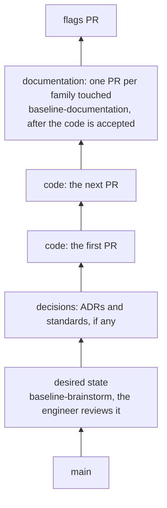
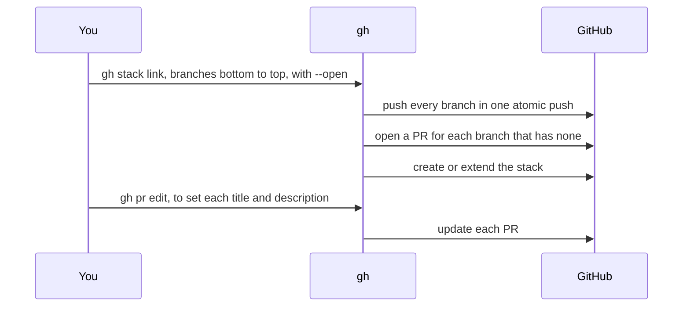

# Stacks

## When to read this

Work here is delivered as a **stack**: an ordered series of pull requests (PRs) in which each PR is based on the one below it, so each PR shows only its own change. Read this when you open, grow, amend or repair a stack, and when you are asked for a small change.



*The desired state is at the bottom and merging goes bottom-up. How the code is cut is the agent's call. The documentation sits on top because it describes the accepted code.*

## The rules

1. **A stack is two or more PRs in one repository,** each based on the one below it, merged from the bottom up. A project is one repository: a stack cannot span repositories, and in one repository an agent sees the whole product. Anything published separately, an SDK for example, is a folder that CI publishes as a package.
2. **Nothing merges, deploys or publishes unless the Software Engineer asks,** and opening a PR is publishing. `gh stack merge` is never run unless they ask.
3. **The order is the flow of `AGENTS.md`:** the desired state first, then the decisions PR, then the code, then the documentation and a flags PR on top.
4. **You decide how the code is cut into PRs:** when to open them, how big, in which order. Keep one idea in a PR, so a refactor or a move goes alone. Record the grouping as a ruling.
5. **Every PR leaves the repository working:** it builds and the project's own checks pass. GitHub evaluates required checks for every PR of a stack.
6. **Branch names are `<topic>/<nn>-<slug>`,** numbered in stack order, for example `baseline-v2/01-desired-state` and `baseline-v2/02-layout`.
7. **Commits use conventional prefixes** (`feat:`, `fix:`, `docs:`, `test:`, `refactor:`, `chore:`), are small and logical, and the message says why. They carry no attribution line.
8. **Everything is a PR.** The one exception is the very first commit of a new repository, because there is nothing yet to branch from.

## gh stack

`gh stack` is the GitHub CLI extension for stacked PRs. This repository uses `gh stack link` over branches made with plain git. `link` keeps no local record: you give it branch names, bottom to top, and it creates or updates the stack on GitHub.

```bash
gh stack link topic/01-desired-state topic/02-layout topic/03-brainstorm --open
```

It pushes every branch in one atomic push, opens a PR for each branch that has none (based on the branch below it, the first on the default branch), reuses the PRs that exist, creates or extends the stack and, with `--open`, marks the PRs ready. It needs at least two branches.



*One command pushes, opens and registers the stack. Titles and descriptions are set afterwards with `gh pr edit`.*

- **Check the result** with `gh pr list --json number,headRefName,baseRefName,isDraft`: the first PR's base is `main`, every other PR's base is the branch below it, and no PR is a draft.
- **Grow the stack** by listing every branch again, bottom to top. PRs that exist are reused and none is removed. After it grows, refresh every description (`pr-descriptions.md`).
- **Do not use** `gh stack add`, `submit`, `sync` and `rebase`. They work from a local record that these branches do not have.
- `gh stack view` is an extra look, not a check. Rely on `gh pr list`.

## Cutting the branches

Start each branch from the one below it (`git switch -c topic/02-layout` while on `topic/01-desired-state`), or build on one line and name commits with `git branch <name> <commit>`. Either way, check the chain: for each pair of neighbours `git merge-base --is-ancestor <lower> <upper>` exits 0. Check that every branch passes the tests (rule 5).

## Amending the desired state

When the Software Engineer confirms a deviation, the amendment is a commit on the bottom branch, the one that holds the desired state. Then rebase each branch above it, bottom to top, and push.

```bash
git rebase --onto <bottom branch> <old tip of the bottom branch> <next branch>
git rebase --onto <next branch> <old tip of the next branch> <the one above>
git push origin <bottom branch>
git push --force-with-lease origin <the branches above>
```

Run the tests at the top, check that every PR's head on GitHub matches your local branch, and refresh the descriptions. This is the one rewrite of pushed history that needs no further yes, because the Software Engineer's confirmation of the deviation covers it. Any other repair that rewrites pushed history waits for their yes, and a cross-cutting fix goes in as a new PR on top. Because: they may be reading the PRs as they stand.

## Small changes

A change with no desired state, such as a one-line fix, is a single PR: open an ordinary PR with `gh pr create`. A stack is two or more PRs, so there is no `gh stack` step.
