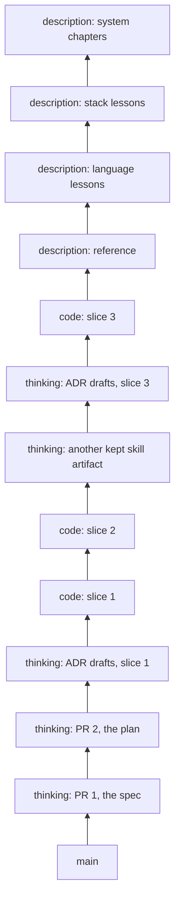
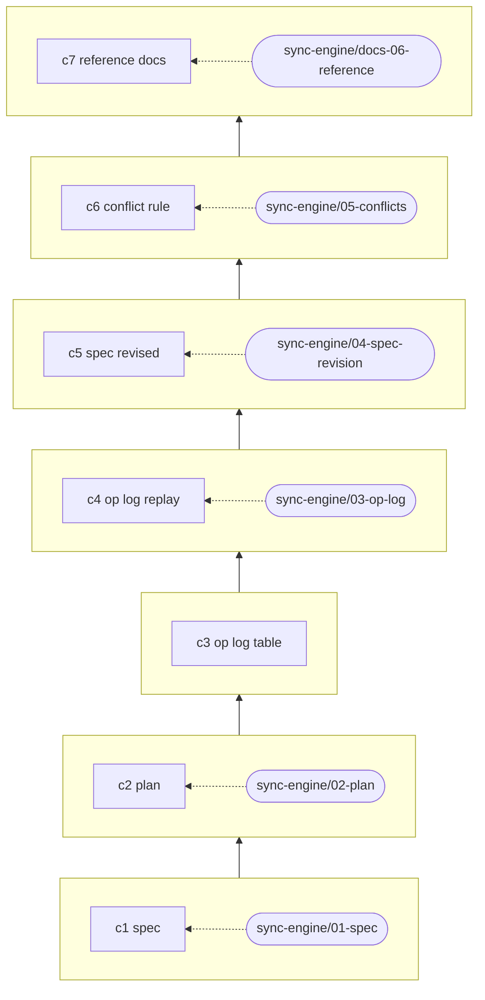
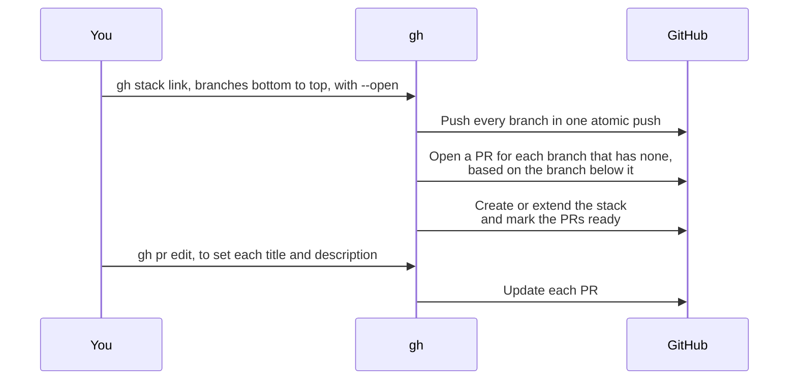

# Stacks

## When to read this

Work in this baseline is delivered as a **stack**: an ordered series of pull requests (PRs) in which each PR is based on the one below it, so each PR shows only its own change. Read this before you commit work that will become a PR, when you cut, open or grow a stack, when a skill has produced a spec, a plan or any other document, when you are unsure which PR a change belongs in, and when you are asked for a small change.

A stack holds three kinds of PR.

- A **thinking PR** holds the prescriptive documents, the ones that say what will be built or how work is done: the spec, the plan, decision records (ADRs), standards, the reader profile and the playbooks.
- A **code PR** holds code and tests.
- A **description PR** holds the descriptive documents, the ones that say only what exists at the tip of the code: features, architecture, the course, deployment, the README and reference pages. The docs agent, a fresh agent that works from the finished code, writes them.

Each kind has its own PR because each is easier to review on its own: a reviewer reads thinking for intent and soundness, code for correctness, and descriptions for whether they match the code. Mixing kinds in one PR is not wrong, only harder to review, so the baseline asks that the kinds be separated when PRs are opened, and a mixed PR gets a notice that never blocks it.

Two other playbooks cover neighbouring topics: `pr-descriptions.md` for what goes in a PR's description, and `working-with-the-engineer.md` for who decides what.

## What gh stack is

### A stack on GitHub

A PR is based on a branch, and an ordinary PR is based on `main`. In a stack, the first PR is based on `main`, the second is based on the first PR's branch, the third on the second's, and so on to the top. This chain of bases is why each PR shows only the changes it adds on top of the PR below. The PR nearest `main` is the **bottom** of the stack, the last PR is the **top**, and a PR is merged only after the ones below it.

GitHub has a native feature for stacked PRs, in public preview. Its documented rules are: a stack is two or more PRs in the same repository, merged bottom-up, with linear history, and required checks are evaluated for every PR in the stack. These are the rules as GitHub documents them, and they have not yet been confirmed against GitHub's actual behaviour.

A stack lives in one repository, and a project is one repository, with no exceptions. Because: a stack cannot span repositories, and in one repository an agent sees the whole product, with front-end and back-end PRs in the same stack. Anything that must be published separately, an SDK for example, is a folder in the repository that CI publishes as a package.



*Main is at the bottom and merging goes bottom-up: thinking sits below the code it governs, and the description PRs sit on top because they describe the final built state.*

"Slice", "ADR drafts" and "kept skill artifact" are explained at the start of "The rules" below.

### The tool

`gh stack` is the GitHub CLI extension for stacked PRs: it builds a stack on your machine, pushes it, opens the PRs and registers the stack with GitHub. `gh stack --version` prints the installed version (for example `gh stack version 0.3.0`, the version whose help the commands in this playbook are taken from), `gh stack --help` lists every command, and `gh stack <command> --help` explains one. The feature is in public preview, so the help is the authority if a command behaves differently from what is written here.

It has two ways of working.

- `gh stack add`, `submit`, `sync` and `rebase` work from a local record of the stack that `gh stack` keeps on your machine: they create branches, rebase them onto each other, push them and open PRs. `gh stack init` starts a stack on your machine, and its help says that existing branches are adopted automatically and missing ones are created.
- `gh stack link` keeps no local record. You give it branch names and it creates or updates the stack on GitHub from them. Its help says it is designed for branches that are managed outside `gh stack`.

**This baseline uses `gh stack link` over branches made with plain git.** The branches of a stack here are pointers into one linear history, made with `git branch` (see "Cutting the stack from linear history"). Because: `link` is the command meant for branches that `gh stack` did not create, and a pointer needs nothing but its name to be linked. Two points were open, and both were checked on 2026-11-18 with `gh stack` 0.3.0, in a throwaway repository. Branches cut as pointers into one linear history link cleanly: `gh stack link` pushed them in one atomic push, created a PR for each branch based on the branch below it (the first on `main`), and created the stack, and it did the same for the first two PRs of this baseline's own repository. `gh stack view` was run in three states. Right after the link, on the branch that the commits were made on, it said that the branch is not part of a stack. After `gh stack checkout <stack number>` had imported the stack, it listed the stack's branches with their PRs. After `gh stack unstack --local` had removed the local tracking, it said that the current branch is not part of a stack on each of the stack's own branches too. What GitHub documents about stacks, at the start of this playbook, was not checked. Rely on the `gh pr list` check in "Opening and updating the stack" to check a link, and use `gh stack view` as an extra look.

`gh stack link` takes branch names in stack order, bottom to top:

```bash
gh stack link sync-engine/01-spec sync-engine/02-plan sync-engine/03-op-log --open
```

It does four things.

1. It pushes every branch to the remote in one atomic push, so all of them update or none does.
2. It opens a PR for each branch that has none, based on the branch below it (the first is based on the repository's default branch, and `--base <branch>` changes that), and it reuses the PR of a branch that already has one.
3. It creates the stack on GitHub, or adds the new PRs to the stack they already belong to. It never removes a PR that is in a stack.
4. With `--open`, it marks the PRs ready for review, so none is left as a draft.

It needs at least two branches, because a stack is two or more PRs. "Opening and updating the stack" below shows the commands in use.

Other commands you will see in `gh stack --help`:

- `gh stack view` lists the stack's branches and the status of each PR. This baseline uses it as an extra look at a stack after linking it, and the paragraph on `gh stack link` above says what it showed for a stack made that way when this was checked.
- `gh stack add`, `submit`, `sync`, `rebase`, `push`, `modify` and `checkout` work on a stack that `gh stack` tracks locally, and `up`, `down`, `top`, `bottom`, `trunk` and `switch` move between its branches. `gh stack init` creates such a stack and, its help says, adopts existing branches. This baseline does not use them to build or update a stack. Because: it makes its branches as pointers with plain git and links them with `gh stack link`, the command whose help says it is designed for branches that are managed outside `gh stack`.
- `gh stack unstack` removes a stack on GitHub and from local tracking. It is not part of the normal flow.
- `gh stack merge` merges a stack on GitHub in one atomic operation. Never run it unless the Software Engineer asks. Because: nothing merges, deploys or publishes unless the Software Engineer asks.

## The rules

A **slice** is a logical group of code that becomes one code PR. An **ADR draft** is a decision record that the agent writes at the time of a decision, before the docs agent reviews it and gives it a number (`adrs.md`). A **kept skill artifact** is a document that a skill produced and that stays in the repository, such as a spec or a plan. The **execution skills** are the skills that carry out a plan task by task; in superpowers they are `subagent-driven-development` and `executing-plans`.

### The three kinds of PR

| Kind | Holds | Kept out, for easier review |
|---|---|---|
| **Thinking** | The spec, the plan, ADR drafts, any other kept skill artifact, standards updates, the reader profile, and the playbooks. Committed as produced. | Code. |
| **Code** | Code and tests. Docstrings and comments count as code. | Any of the project's doc families: the documents the docs agent writes (features, architecture reference, course, deployment docs, README and reference pages). |
| **Description** | The docs section: reference docs, lessons, system chapters, reference pages, and the docs agent's review edits to ADRs. | Code. If writing a document exposes a bug or unclear code, the fix goes in the code PR it belongs to, and the docs are rebased and re-verified. |

**Keep each PR to one kind.** Because: each kind is easier to review on its own. A reviewer reads thinking for intent and soundness, code for correctness, and descriptions for whether they match the code, so a PR of one kind can be read one way from top to bottom. A PR that mixes kinds is allowed. The baseline's check lists its files by kind in a notice that never blocks it, and the notice says where the PR could be split.

**How the kind is decided.** The kind comes from the paths a PR touches, so no naming rule is needed. In `baseline.yml`, `artifact_map` lists where skills write their spec, plan and other documents (thinking), and `stack_folders` lists the folders whose changes are code. The documents of the docs section are description. The other prescriptive documents (ADR drafts, `docs/standards/`, `docs/reader-profile.md`, `docs/agents/` and `AGENTS.md`) are thinking. One crossover is allowed: a description PR may edit ADR files, for the docs agent's review edits and numbering.

**When something changes later.** A skill may revise its own spec or plan in a later loop, and a code change may call for a document change. Nothing forbids either. When the PRs are opened, the change goes in its own PR of the matching kind, at the point in the stack where it happened (rule 8).

### The thirteen rules of the stack

1. **The spec is PR 1.** When brainstorming finishes and the Software Engineer approves the spec, commit it untouched and point the stack's first branch at that commit. Because: thinking goes below the code it governs so the reviewer reads the intent first, and an untouched spec is what the skill produced and the Software Engineer approved.
2. **The plan is PR 2.** When the plan is written, commit it untouched and point the stack's second branch at that commit. Because: the plan is thinking too and sits below the code it governs, and PR 2 stays as first written even if the plan is revised later (rule 8).
3. **Open PRs 1 and 2 immediately.** Where the project's `AGENTS.md` or the conversation asks for the Software Engineer's yes before anything is opened, open them once they have said yes. Because: they contain only documents and nothing merges early, and the Software Engineer can read and comment while the build runs.
4. **ADR drafts are small PRs of their own**, one per slice that has any, directly beneath the first slice that depends on them. Because: the reviewer reads the thinking first, and each PR stays one kind.
5. **Any other kept skill artifact gets its own PR**, as produced, in the order produced, below the code it governs. An artifact produced mid-build sits between the slices around it. The skill decides where the file is written, and the artifact map only records the path. Scratch files (a skill's execution ledger, briefs, review packages) are git-ignored and never a PR. Because: every kept artifact can then be reviewed on its own. The skills run untouched, so they decide where they write, and scratch files are working material, not artifacts.
6. **You decide how code is grouped into logical slices.** The grouping appears in the stack table at the top of every PR description, so the reviewer sees the shape before reading any code. There is no approval step for the layout. Because: the plan stays untouched, so it carries no layout, and how the stack is grouped is a ruling that you make. The stack table shows the Software Engineer the result before any code.
7. **The docs section is last**, in reading order from foundational to integrated: reference, language lessons, stack lessons, system chapters. The docs agent writes it. Because: the docs describe what was built, so they sit on top of the final built state, and a reader moves from the foundation to the integrated whole.
8. **Plan and spec edits made during the build get their own PR.** A skill may revise its spec or plan in a later loop, and nothing stops it. When the stack is cut, the revision becomes its own thinking PR at the point in the stack where it happened, below the code that needed it. PR 2 stays as first written. A change to a decision is also a new ADR draft, not only a spec edit. Because: the reviewer reads the changed thinking first and then the code that needed it. The skill is neither stopped nor edited, and a decision is recorded in an ADR, so a spec edit alone would leave that record unchanged.
9. **Code PRs carry an "Implements" line** linking the spec, the plan and the ADRs they follow, and the docs link back to the PRs. Because: a future reader can then follow why, how and what through the history.
10. **Approve the whole stack, docs section included, then merge it bottom-up in one sitting.** Nothing merges, deploys or publishes unless the Software Engineer asks. Because: the docs section describes what the lower PRs built, so the stack is complete only with it, and GitHub merges a stack from the bottom up, as it documents.
11. **A change with no spec stays a single code PR.** If it affects documents, it becomes a two-PR stack: the code PR, then a description PR from the docs agent. A change with no documentary impact needs no description PR. "Small changes" below shows how. Because: this keeps each PR to one kind, which is what makes it quick to review, and one PR that carried its own docs would put two kinds in it.
12. **Cut the stack's branches as pointers into the linear commit history** that the execution skills produce, at the slice boundaries you chose. No re-commit and no edit to the plan is needed. If a commit mixes kinds, or a thinking commit sits inside a slice, split or move it when you cut. Keeping each commit to one kind makes the cut pointer-only. Because: the skills commit task by task on one branch and are not changed to do otherwise, so the stack has to be made from the history they produce, and a pointer leaves that history exactly as produced.
13. **Every PR leaves the repository working:** it builds, and the project's own checks pass. What those checks are is the project's decision. Because: GitHub documents that required checks are evaluated for every PR in a stack and that a stack merges from the bottom up, so each PR has to stand on its own.

### Conventions

- **Branch names** are `<topic>/<nn>-<slug>`, numbered in stack order, for example `sync-engine/01-spec`, `sync-engine/02-plan` and `sync-engine/03-op-log`. Description branches are `<topic>/docs-<nn>-<slug>`, and their number continues the stack's. Because: the number gives the stack order at a glance, and the `docs-` prefix marks a description PR.
- **Commits** use conventional prefixes (`feat(scope):`, `fix(scope):`, `docs:`, `test:`, `refactor:`), are small and logical, and the message says why. Plan tasks keep the commit messages the plan gives them. Because: the history is cut into PRs later, and small logical commits make the cut pointer-only. The message says why so that a future reader can follow the history, and the plan is left as produced.
- **Attribution:** never add an attribution line to a commit or a PR description, that is, no co-author trailer and no "generated with" line. Because: the Software Engineer does not want them, and Claude Code adds such lines by default, so the rule has to be stated explicitly.
- **One idea per PR:** a refactor or a move goes in its own PR, apart from any behaviour change. Because: each diff can then be read for what it is.
- **Size guide:** about 400 changed lines for a code PR, not counting tests and generated files. Thinking and description PRs are exempt. Because: a code PR is read for correctness, line by line, so it has to stay small enough to review properly. Thinking and description PRs are read for intent and for whether they match the code, not line by line.
- **Stack tooling** is `gh stack`: the stack is registered as a native GitHub stack and its PRs are marked ready. A repair that rewrites pushed history waits for the Software Engineer's yes. A cross-cutting fix goes in as a new PR on top. Because: a native stack is what GitHub merges bottom-up with required checks on every PR, as it documents, and a draft is not ready for the review the stack exists for. A rewrite of pushed history replaces commits the Software Engineer may be reading, and a fix on top leaves every PR below as they read it.
- **Everything is a PR.** The one exception is the very first commit of a new repository, the bootstrap, since there is nothing yet to branch from. The foundation itself (CI, the document skeleton, the first code) is then its own stack. Because: a PR needs something to be based on, and a new repository has nothing before its first commit.

## Cutting the stack from linear history

The execution skills commit task by task on one branch, called here the **build branch**, so its commits form one line with no merges and no side branches. You cut the stack from that line. A **pointer** is a branch name that points at one commit of the line. Cutting means making one pointer per PR, with `git branch <name> <commit>`, at the slice boundaries you chose. The PR for a pointer holds the commits after the pointer below it, up to its own commit. No commit is copied, re-made or edited, and the plan is not touched.



*Each branch name points at the last commit of its PR, so the PR for 03-op-log holds c3 and c4; the spec revision (c5) has a pointer of its own, below the code (c6) that needed it.*

Cut like this:

1. **Note the tip** of the build branch with `git rev-parse HEAD`. Because: you compare against it in step 5.
2. **List the commits and read the kind of each from the paths it touches.** The base is the branch the stack is based on, `main` here. Because: the kind of a PR comes from the paths it touches, so the paths are what tell you where each commit belongs.

   ```bash
   git log --reverse --name-only --format='%h %s' main..HEAD
   ```

3. **Choose the slices.** Group the code commits into logical slices, in the order they were built, at about 400 changed lines each, and put a refactor or a move in a slice of its own. Record the grouping as a ruling. Because: the grouping is yours to decide, and the ruling shows the Software Engineer where to look.
4. **Route every commit** with the table below, splitting or moving commits until each one holds a single kind. Because: keeping each commit to one kind makes the cut pointer-only, and a PR of one kind is easier to review.
5. **After any split or move, check that the tree did not change.** `git diff <the tip you noted> HEAD` must print nothing. Because: splitting and moving change the order of the work, not the work. They should touch only commits that have not been pushed, and a repair that rewrites pushed history waits for the Software Engineer's yes (see "Opening and updating the stack").
6. **Cut the pointers**, bottom to top, named by the branch-name convention: `git branch sync-engine/03-op-log <commit>`. Because: a pointer is all the cut needs, and the number in each name fixes its place in the stack.
7. **Check the chain.** For each pair of neighbouring pointers, `git merge-base --is-ancestor <lower> <upper>` must exit with status 0, and when you have cut the whole stack the top pointer must be the tip: `git rev-parse <top pointer>` equals `git rev-parse HEAD`. Because: a stack whose branches are not in one chain cannot be linked with the right bases.
8. **Check that every pointer leaves the repository working.** Check out each one in turn with `git switch --detach <pointer>` and run the project's checks. If one fails, move the boundary so that the PR stands on its own. Because: every PR leaves the repository working, and GitHub documents that required checks are evaluated for each PR in the stack.

### Where each commit goes

| The commit holds | It goes in | Because |
|---|---|---|
| More than one kind | A split first, then each part is routed on its own | Keeping each commit to one kind makes the cut pointer-only. |
| The spec | PR 1 | Thinking goes below the code it governs. |
| The plan | PR 2 | The plan is committed next, untouched. |
| A later revision of the spec or the plan | Its own thinking PR, at the point where it happened, below the code that needed it | The reviewer reads the changed thinking first, and PR 2 stays as first written. |
| An ADR draft | A small PR directly beneath the first slice that depends on it | The reviewer reads the thinking first, and each PR stays one kind. |
| Another kept skill artifact | Its own PR, as produced, in the order produced, below the code it governs | Every kept artifact can be reviewed on its own. |
| A refactor or a move | Its own PR, apart from any behaviour change | Each diff can then be read for what it is. |
| Any other code and tests | The slice they belong to | A slice is a logical group of code that stands on its own. |
| A descriptive document | Not made during the build: the docs agent writes the docs section on top | Documents written during the build would describe what was meant, not what was built. |

### Late and mixed changes

- **A skill revised its spec or plan in a later loop.** Keep the revision as a commit of its own and give it its own pointer, as c5 has in the picture, below the code that needed it. If it shares a commit with code, split them. If it comes after the code that needed it, move it below that code. If the revision changes a decision, write a new ADR draft as well. Because: the reviewer reads the changed thinking first, and PR 2 stays as first written.
- **A code change calls for a document change.** The document change gets its own PR of the matching kind, at the point in the stack where it happened. A standards update or a playbook change is a thinking PR. A descriptive document is the docs agent's, in the docs section. Because: each PR stays one kind.

## Opening and updating the stack

**Open PRs 1 and 2 as soon as the plan is committed** (rule 3), after the Software Engineer's yes where the project asks for one. Point the first two branches at the spec and plan commits, then link them. The base branch, `main` here, must already be on the remote, because the first PR is based on it.

```bash
git branch sync-engine/01-spec <the spec commit>
git branch sync-engine/02-plan <the plan commit>
gh stack link sync-engine/01-spec sync-engine/02-plan --open
```

Right after you commit the spec, plain `git branch sync-engine/01-spec` names that commit, because `git branch` starts at the current commit when you give it none.



*One command, `gh stack link`, pushes the branches, opens each PR on the branch below it and registers the stack; titles and descriptions are set afterwards with `gh pr edit`.*

**Check the result.** The `gh pr list` check is the one to rely on, and `gh stack view` is an extra look.

```bash
gh pr list --json number,headRefName,baseRefName,isDraft
gh stack view
```

It is done when the `gh pr list` output shows that the first PR's base is `main`, every other PR's base is the branch below it, and no PR is a draft. Because: a PR shows its changes against its base, so a wrong base shows the reviewer the wrong diff, and a draft is not ready for review. `gh stack view` lists the stack's branches and the status of each PR, but when this was checked it listed a stack made with `gh stack link` after `gh stack checkout <stack number>` had imported the stack and not before (see "The tool"), so nothing here depends on it.

**Set every title and description** with `gh pr edit <number> --title "<title>" --body-file <file>`, as `pr-descriptions.md` says. Because: the description is what the reviewer reads first and it carries the stack table, and the numbers the table needs exist only after the PRs do.

**Open the rest of the stack when the docs section is in.** Cut the remaining pointers when the build is finished. At the finish menu keep the branch as it is (see the seam "Finish menu"). When the docs section is in, publish the whole stack with `gh stack link`, listing every branch from the first to the last, bottom to top, with `--open`. PRs 1 and 2 already exist and are reused. Because: the stack is complete only with its docs section on top, and this playbook adds no ask of its own before the stack is published. A project that wants an ask before any push says so in the conversation or in `AGENTS.md`, and the conversation wins for that task.

**Grow the stack** by listing every branch again, bottom to top (PRs that already exist are reused), or by giving the stack's number first, which appends the branches after it to the top of that stack:

```bash
gh stack link sync-engine/01-spec sync-engine/02-plan sync-engine/03-op-log sync-engine/04-conflicts --open
gh stack link 7 sync-engine/04-conflicts --open
```

Here 7 is the stack's number as GitHub shows it. Because: both forms reuse the PRs that already exist and never remove one, so nothing that is open is lost or duplicated. After the stack grows, refresh every PR's description, because each carries the table of the whole stack (`pr-descriptions.md`).

**Fix something after the stack is open.**

- A cross-cutting fix goes in as a new PR on top. Because: it leaves every PR below as the Software Engineer read it.
- A repair that rewrites pushed history waits for the Software Engineer's yes. Because: they may be reading those PRs as they stand, and a rewrite replaces the commits they are reading. After such a repair the docs are re-verified (`docs-agent.md`).

**Merging** is the Software Engineer's. When they ask for it, the whole stack, docs section included, is approved first and then merged bottom-up in one sitting (rule 10).

## Small changes

A **small change** is a change with no spec. A small change **affects documents** when a descriptive document (features, architecture reference, course, deployment docs, README, reference pages) says something the change makes untrue or incomplete.

**A change with no spec stays a single code PR. If it affects documents, it becomes a two-PR stack: the code PR, then a description PR from the docs agent. A change with no documentary impact needs no description PR.** Because: this keeps each PR to one kind, which is what makes it quick to review. A single PR that carried its own docs would put two kinds in one PR and be harder to review.

- For a single code PR, open an ordinary PR. A stack is two or more PRs, so there is no `gh stack` step.
- For a two-PR stack, the code PR's "Docs owed" part lists what the description PR will cover, and a fresh docs agent writes the description PR (`docs-agent.md`). When the docs agent has committed its work on top of the code, point a branch at each commit and link them, bottom to top:

  ```bash
  git branch sync-engine/01-retry-limit <the code commit>
  git branch sync-engine/docs-02-retry-limit <the docs commit>
  gh stack link sync-engine/01-retry-limit sync-engine/docs-02-retry-limit --open
  ```

## Seams with the skills

The baseline sits beside superpowers and any other skill and changes nothing about how they work. A skill writes its documents wherever it writes them. The baseline never tells a skill where to write, and you never edit a document a skill produced to fit the baseline. The baseline reads the paths a skill writes to (the `artifact_map` in `baseline.yml`) and arranges the PRs around them. If a skill revises its own spec or plan in a later loop, that revision gets its own thinking PR at the point in the stack where it happened. Because: the skills are the Software Engineer's way of working, and they run as written.

The seams below are small because the skills already defer to the Software Engineer's instructions: the spec and plan locations are the skill's own defaults, which the Software Engineer may override; finishing a branch says to follow the repository's PR conventions; the worktree skill honours a declared preference; and superpowers ranks `AGENTS.md` above its skills. They were checked against the skill files of superpowers 7.0.2. If a skill changes where or how it writes its documents, check its seam again. Because: a seam holds only while the skill behaves as it did when the seam was checked.

1. **Spec and plan.** `brainstorming` and `writing-plans` write to `docs/superpowers/...` and say "committed", but name no branch. Change nothing about where they write or what they contain. When the stack is cut, the first branch points at the spec commit (PR 1) and the second at the plan commit (PR 2), and a later revision of either gets its own thinking PR. Because: the skills run untouched, and the baseline arranges the PRs around what they produce.
2. **Code commits.** The execution skills commit task by task on one branch. Do nothing during the run, and afterwards cut the stack branches as pointers into that history at the slice boundaries you chose. Because: a linear history is cut by naming commits, so nothing has to be re-committed.
3. **Rulings.** Both execution skills log `Ruling: what, why, cost if wrong`, and `subagent-driven-development` gathers them into a final "Rulings I made" message before it deletes its ledger, which is its scratch record of the run. Do nothing extra, and copy that list into the PR descriptions. Because: it is already the baseline's format.
4. **Doc steps in plans.** `writing-plans` folds documentation steps into task steps. When you execute a plan, skip any step that writes one of the baseline's doc families (features, architecture reference, course, deployment docs, README, reference pages), leave the plan file as produced, and record each skipped step as a ruling. Because: descriptive documents are written only by the docs agent from the finished tip, and the docs agent builds its list of deviations from the rulings, so a skipped step that is not a ruling would never show.
5. **Final reviewer.** Its checklist asks "Documentation complete?". When you ask for the final review, say in the change description that descriptive docs are deferred to the docs section. Because: then it is not flagged, and no fix loop writes docs into code PRs, where they would describe what the building agent meant.
6. **Finish menu.** The menu runs straight after the final review, before the docs exist. The Software Engineer's pick at it is "Keep the branch as-is" until the docs are in, and then the stack is published with `gh stack link`. Option 2, "push and create a PR", is never used for stack work. Because: it would open one PR, where stack work needs a stack.
7. **Generated instruction files.** Some tools generate `AGENTS.md` and `CLAUDE.md` from a source of their own. If a project uses such a tool, put the baseline's content into the generator's source and not into the generated file. Because: a generated file is overwritten each time it is generated, so anything written only there is erased. Laravel Boost may be such a tool, but two points about it have not been confirmed against the real tool: whether it generates these files, and from which source, and whether a standing request for the docs satisfies its rule to create docs only when explicitly asked. Confirm both before relying on them.
8. **Execution stops.** The execution skills stop only for irreversible or destructive operations, security-sensitive actions, outside side effects (a merge, a push to a shared branch, a publish) and a hopelessly broken plan. The baseline adds no stop: write ADR drafts at decision time without stopping, and do not ask for approval of the stack layout. Because: the execution skills run continuously, and a gate of the baseline's own would collide with that. The Software Engineer sees the ADR drafts and the layout when they review the stack.
9. **Between brainstorming and planning.** After the spec is approved, `brainstorming` says to invoke `writing-plans` and no other skill. Do the steps in between with plain git: commit the spec and point the first branch at it, then invoke `writing-plans`. Because: `brainstorming` names `writing-plans` as its only next step, and the baseline adds no skill between them.

When another skill produces a kept document, record the path it writes to in the `artifact_map` of `baseline.yml`, under `other`. Because: the map is how the kind of a PR is inferred. It records where a skill wrote and never tells it where to write, so adding or swapping a tool means editing the map and not the baseline.
