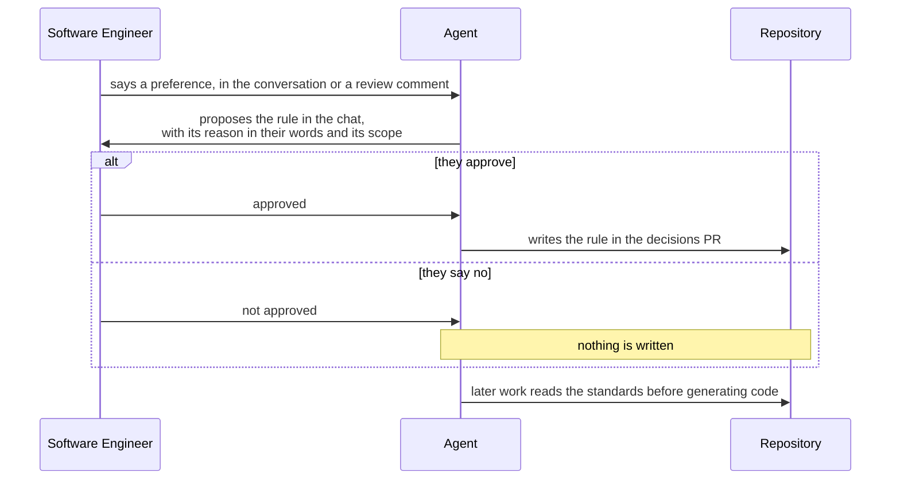

# Standards

## When to read this

A **standard** is a blanket rule about how code is written, with very limited exceptions, approved by the Software Engineer. Together with the ADRs (`adrs.md`) the standards are the only documents that steer the code agents write. They live in `baseline/standards/`, one file for each rule.

Read this when you notice a preference in a conversation or a review comment, before you generate code, when generated code is wrong, and when you are asked to add, change or remove a rule.

## What a standard is

State the end result, and add short snippets where they help. Copy `baseline/standards/TEMPLATE.md`, which has the rule in one line, the end result, snippets and exceptions.

```csharp
public sealed record CreateOrder(Guid CustomerId, IReadOnlyList<OrderLine> Lines);   // yes
public sealed class CreateOrderDto { public Guid CustomerId { get; set; } }          // no
```

*The rule: payloads and contracts are records, not classes.*

A standard answers "how is code written, always". A decision with a real choice behind it (use Postgres, not DynamoDB) is an ADR. A one-off choice that touches one place and is easy to change needs neither.

## How a preference becomes a standard



*A rule is written only after their yes, and the branch for a no ends with nothing written.*

1. **Notice a preference.** Those are the places where they say how they want the work done.
2. **Propose the rule in the chat, and ask.** Give the rule, the reason in their words and the scope, which is the whole project or one folder. Put it as a question with your recommendation first. Where they have not said why, ask for the reason, and do not supply one of your own.
3. **Write nothing until they approve.** Nothing is inferred silently. If the answer is no, nothing is written.
4. **Write the approved rule** in `baseline/standards/` in the decisions PR, with the reason in the commit message or the PR description and the conversation or PR where it came up as the source.
5. **Read `baseline/standards/` before you generate code,** and name a standard where it shaped what you wrote, for example in the PR description.

## When generated code is wrong

Do not patch the code. Fix the standard or the ADR that guided it, and regenerate the code in a fresh context.

1. **Find the standard or ADR that guided the code,** or see that none covered the case.
2. **Put the fix to the Software Engineer,** and write it only when they approve. For a standard, propose the corrected or the new rule. For an ADR, rewrite it in place (`adrs.md`).
3. **Regenerate the code in a fresh context,** one that has not seen the wrong code.
4. **If the new code is still wrong, the text is still wrong:** go back to the first step.

Because: a patch repairs one result and leaves the text that produced it unchanged, so the next generation can repeat the mistake.

## Changing and removing a rule

Edit a standard in place when it changes. Remove one whose reason is gone, in the decisions PR, and let git keep the history. If you meet a rule whose reason no longer holds, say so and let the Software Engineer decide. The 22 files of `standard/` are the first design, kept as an archive, and they are not rules.
