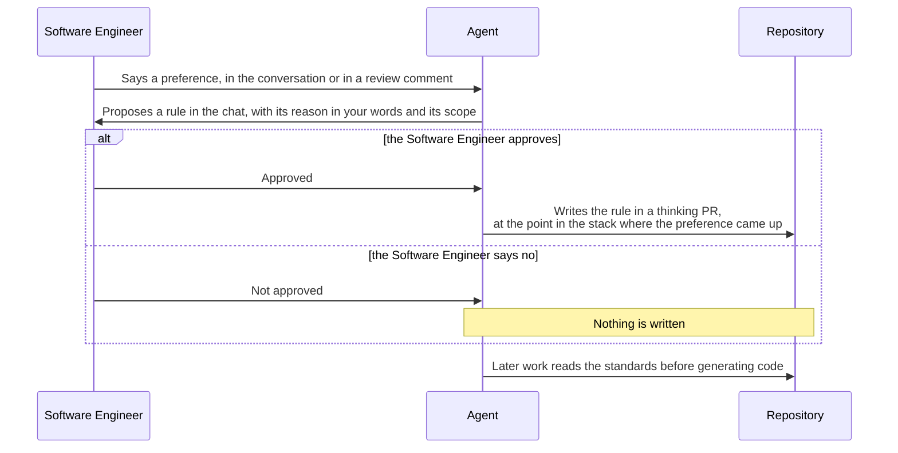
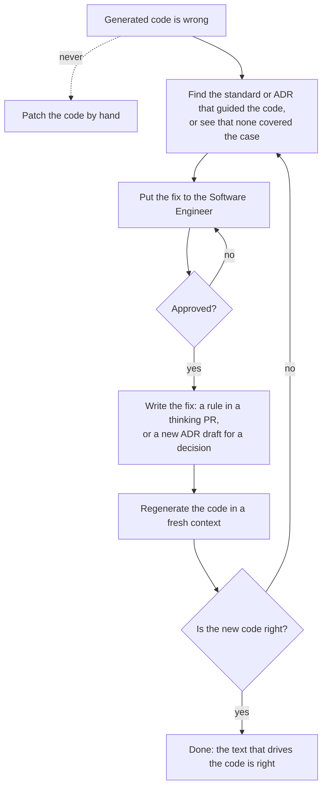

# Standards

## When to read this

`docs/standards/` holds a project's **standards**: preferences the Software Engineer has approved, each written as a rule that says what to do and why. Together with the architecture decision records (ADRs), which record one decision each with the options that were explored (`adrs.md`), the standards are, in the Software Engineer's words, "the only kind that drive code". Code is generated with them in mind. This playbook says what belongs in the folder, how a preference becomes a standard, what to do when generated code is wrong, and what each rule records.

Read it when you notice a preference in a conversation or a review comment, before you generate code, when generated code is wrong, when you are asked to add, change or remove a rule, and, if you are the docs agent, when you write a lesson that shows code a standard shaped.

The folder exists only if the project opted in at the start. The intake, the set of questions asked when a project starts, asks once whether to build standards from the Software Engineer's preferences over time. A yes is recorded as `standards_enabled: true` in `baseline.yml` and in the header of `docs/reader-profile.md`, and it creates an empty folder with a `README.md` that explains how it fills. A no means there is no folder. Do not create one yourself. Because: the answer is part of the reader profile, and changing the reader profile is the Software Engineer's call.

Some words are used throughout, and the rest of the baseline assumes them.

- A **stack** is an ordered series of pull requests (PRs), each based on the one below it and merged from the bottom up (`stacks.md` explains how it is built and opened). A **thinking PR** holds the prescriptive documents, the ones that say what will be built or how work is done: the spec, the plan, ADRs, standards, the reader profile and the playbooks. A **code PR** holds code and tests. Each kind has its own PR because each is easier to review on its own. Mixing kinds is not wrong, only harder to review.
- A **slice** is a logical group of code that becomes one code PR.
- A **stack folder** is a folder that holds the code of one technology stack, such as a front end or a back end. `baseline.yml` lists them under `stack_folders`. It is not a stack of PRs.
- The **docs agent** is a fresh agent that writes the descriptive documents from the finished code, and `docs-agent.md` is its brief. The descriptive documents are the ones that say only what exists at the tip of the code, and they go in **description PRs**, which together make up the **docs section** at the top of the stack. In the lessons the docs agent writes, the part called "In this codebase" shows verbatim excerpts of the real code and walks through them line by line.

Each rule below is followed by `Because:` and its reason.

## What belongs in docs/standards/

Preferences that belong to one project and change as the project does:

- coding style;
- verification and release levels;
- security and secrets handling;
- dependency and update policy;
- privacy rules;
- base-image policy;
- slicing preferences, which are how work is cut into the slices of a stack.

The folder holds a `README.md` and one file for each topic, `docs/standards/<topic>.md`.

**The baseline fixes none of these, and none of them is enforced by the baseline.** Because: the baseline is the same for every kind of project and cannot know a project's kind or goals, so a rule that depends on them is the project's standard and not the baseline's.

**The folder is named for standards and not for coding style.** Because: it also holds verification, dependency, security and release preferences.

**Put a project-specific wish in `docs/standards/` or in `baseline.yml`, and never in a baseline-owned file such as a playbook.** Because: a baseline update replaces the baseline-owned files, while the standards and the project's own configuration are the project's and an update never touches them.

What does not belong in the folder:

- **A decision with options and evidence.** That is an ADR. Because: an ADR keeps why a decision was made at the time and is not rewritten once it is accepted, while a rule is removed when its reason is gone, so the two answer different questions.
- **A change to how a skill works.** The skills run untouched, and a standard reaches an agent through a pointer in `AGENTS.md`, never by editing a skill. Because: the baseline sits beside the skills and changes nothing about how they work.
- **A rule that depends on the reader's level.** How much a document explains belongs to the reader profile. Because: the reader profile shapes documents only and never the code, and a standard drives code, so a standard is the same whoever reads the documents.

## How a preference becomes a standard

A rule enters the folder in the order shown below, and only the Software Engineer's approval writes it.



*A rule is written only after the Software Engineer's yes, and the branch for a no ends with nothing written.*

1. **Notice a preference.** It comes up in a conversation or in a review comment. Because: those are the places where the Software Engineer says how they want the work done, and the folder is built from what they say over time.
2. **Propose a rule in the chat, and ask.** The proposal gives the rule, the reason in the Software Engineer's words and the scope, which is the whole project or one stack folder. Put it in the numbered form of `working-with-the-engineer.md`: an item that names the options, add the rule or not, with your recommendation first and one reason. Where the Software Engineer has not said why, ask for the reason in the same message, and do not supply one of your own. Because: the reason and the scope are what the Software Engineer needs in order to answer and what a later reader needs to judge whether the rule still holds, and the numbered form is how every decision is put to them.
3. **Write nothing until the Software Engineer approves.** Only their approval writes a rule. Nothing is inferred silently, and if the answer is no, nothing is written. Because: a standard steers every later generation of code, so a rule that nobody approved would steer it wrongly and no one would notice.
4. **Write the approved rule as a thinking PR, at the point in the stack where the preference came up.** Commit it on its own, apart from code, so that when the stack is cut it gets a PR of its own (`stacks.md`). Because: a standard says how work is done, so it is read for intent and soundness, and at that point in the stack the reviewer reads it before the code that follows it.
5. **Read `docs/standards/` before you generate code, when the folder exists, and cite a standard where it shaped what you wrote.** Agents find the folder through a pointer in `AGENTS.md`. Name the standard where you explain the choice it shaped, for example in the description of the PR. The docs agent cites the standards that shaped the code it shows, in the "In this codebase" part of its lessons. Because: standards and ADRs are the only documents that drive code, so code generated without reading them ignores the preferences the Software Engineer approved. `AGENTS.md` is the primary instruction file for the repository, so a pointer there reaches every agent, and the skills run untouched, so a standard never reaches an agent by editing a skill.

## When generated code is wrong

Do not patch the code. Fix the standard or the ADR that guided it, and regenerate the code "in a fresh context", as the Software Engineer puts it. The Software Engineer decides the fix, and you write it once they approve.



*The loop runs through the text that drives the code and never through a patch, and new code that is still wrong sends you back to the text.*

1. **Do not patch the generated code.** Because: a patch repairs one result and leaves the text that produced it unchanged, so the next generation can repeat the mistake.
2. **Find the standard or the ADR that guided the code, or see that none covered the case.** Because: standards and ADRs are the only documents that drive code, so the cause is in them or in their absence.
3. **Put the fix to the Software Engineer, and write it only when they approve.** For a standard, propose the corrected or the new rule as in "How a preference becomes a standard". For an ADR, a decision that has to change is a new ADR draft, because an accepted ADR is not rewritten (`adrs.md`). Because: only the Software Engineer's approval writes a standard, and an ADR is append-only once it is accepted.
4. **Regenerate the code in a fresh context, one that has not seen the wrong code.** Because: a fresh context reads the corrected text and not the earlier mistake.
5. **Put the regenerated code in the code PR it belongs to.** If that PR is already pushed, `stacks.md` says what to do: a repair that rewrites pushed history waits for the Software Engineer's yes, and a cross-cutting fix goes in as a new PR on top. Because: each PR stays one kind, and the corrected standard goes in a thinking PR of its own.

If the new code is still wrong, the text is still wrong, so go back to the second step.

## What a rule records

State each rule as what to do, and record four things beside it. Because: each record answers a question that a later reader asks, as the table shows.

| Record | What it holds | Because |
|---|---|---|
| Reason | Why the Software Engineer wants the rule, in their words. | A later reader needs it to judge whether the rule still applies. |
| Scope | The whole project, or one stack folder. | An agent applies a rule where it applies and nowhere else. |
| Date | The date the Software Engineer approved the rule. | It places the rule in time, so a reader can check whether the project has changed since. |
| Source | The PR or the conversation where the preference came up. | The rule can be traced back to what prompted it. |

A made-up rule, to show the four records beside it:

```text
Rule: A function that can fail returns a typed error and never a bare string.
Reason: "I want to match on the error, not parse a message." (the Software Engineer)
Scope: the whole project
Date: 2027-01-15
Source: a review comment on PR 12
```

**Remove a rule whose reason is gone, in a thinking PR, and let git keep the history.** If you meet a rule whose reason no longer holds, say so and let the Software Engineer decide. Because: a rule without a living reason is an unexplained constraint on every later generation of code, and removing it loses nothing, since git keeps it.
