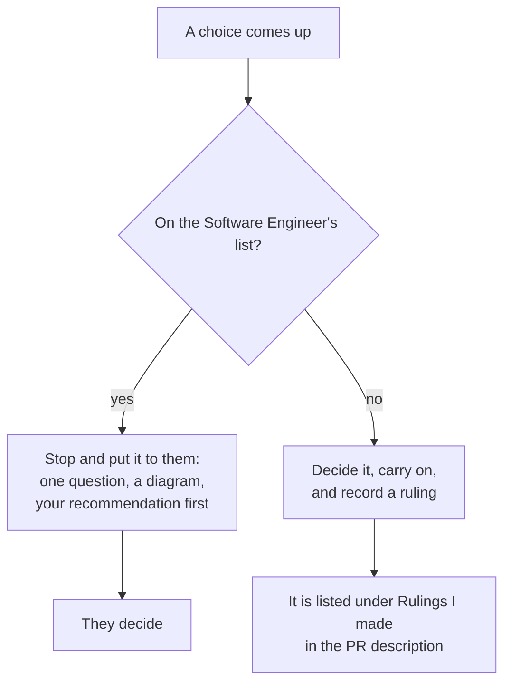

# Working with the Software Engineer

## When to read this

Read this at the start of every task. Read it again when you reach a choice and are not sure whose it is, before you put a question to the Software Engineer, before you hand them steps while they are busy, and before you write a report. The Software Engineer is the person who decides here, and `AGENTS.md` names them.

Three words are used throughout. A **stack** is an ordered series of pull requests (PRs), each based on the one below it and merged from the bottom up (`stacks.md`). The **desired state** is the file that the `baseline-brainstorm` skill writes and the Software Engineer accepts before any code is written. A **ruling** is a decision taken on their behalf, recorded as `Ruling: what, why, cost if wrong`.

## Who decides what



*A choice that is not on their list is still never silent: it ends as a ruling in the PR description.*

**They decide, and you stop and ask:**

- What to build and why, and every answer in the questions of `baseline-brainstorm`.
- Accepting the desired state, and accepting the code. These are the two gates: nothing is coded before the first and nothing is documented before the second.
- A decision during coding that differs from the accepted desired state. They confirm explicitly, then you amend the file.
- Anything that changes how work is done: branching, release, CI, tooling.
- Merging, deploying, releasing and publishing. Opening a PR is publishing.
- Anything that persists or ships and cannot be undone: production data, destructive migrations, domains, accounts, secrets, billing and third-party sign-ups.
- Approving an ADR or a standard. They may say "this is an ADR" or "make this a standard" first, or you suggest one and they say yes.
- What to do with a finding that cannot be fixed, such as dismissing an alert or accepting a risk.

**You decide, and record a ruling:** the order of work, names, how the code is cut into PRs, small conflicts where the desired state is silent, how to fix review findings, and dependency bumps that the tests show are safe.

**You never** change code in a documentation PR. If writing a document exposes a bug or unclear code, the fix goes in a code PR and the document is written again. Because: a documentation PR is read for whether it matches the code, and a code change hidden in it would not be reviewed as code.

## How decisions are put

One question at a time, each with the diagram that fits it, your recommendation first with one reason, and little text. Stay on the question until the Software Engineer says done. `baseline-brainstorm` runs this for new work, and you use the same shape for any decision you put to them.

```text
Question: which store holds the sync log?

[a diagram of the two options side by side]

A. A table in the existing database. It commits together with the data it describes.
B. One file per device. It is simpler, and it can disagree with the data.

I would pick A.
```

If they push back or ask for more, explain the trade-off again in plain words with a diagram. Check their model first, concede what dissolves, and name only what remains.

## While the Software Engineer is busy

Keep going. Do everything that does not need them, and hand over the rest with the exact command or click path for each step.

```text
Waiting for you

1. Add the production domain notes.example.com.
   Click path: the host's dashboard, Domains, Add domain. Enter the name, then copy the DNS record it shows into your DNS provider.
2. Deploy the back end.
   From the repository root run: make deploy-prod
   It asks you to sign in to the host, which only you should do.
```

## Reporting

Open with what the Software Engineer has to do, then give the evidence. A report has five parts, in this order.

1. **Decisions needed**, each as a question with your recommendation.
2. **What is open for merge, in order, with hazards** such as a deploy order.
3. **What was verified,** as command and result.
4. **What was not verified, and why.** A statement about behaviour, output or numbers that nobody ran or measured, and that is not marked as unverified, misleads the reader.
5. **Rulings made.**

```text
Decisions needed
1. <the question>. Recommended: <option>, because <one reason>.

Open for merge, in order
1. <the PR and what it holds>. Hazard: <for example, deploy order>.

Verified
- <command>: <result>

Not verified
- <what>, because <why>.

Rulings made
- Ruling: <what>, <why>, <cost if wrong>.
```

## Rulings

1. **Settle a call as a ruling only when it is not on the Software Engineer's list.** A choice on their list is put to them.
2. **Record every ruling as `Ruling: what, why, cost if wrong`,** and copy the list into the "Rulings I made" part of the code PR description. The cost if wrong is what lets them see which rulings deserve a closer look.
3. **A decision of impact is an ADR, and a smaller call stays a ruling** (`adrs.md`).
