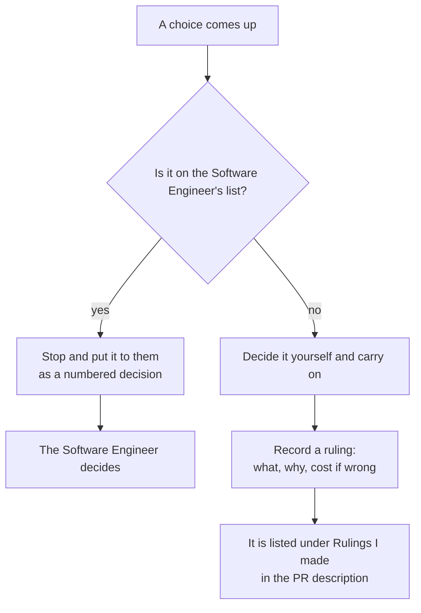
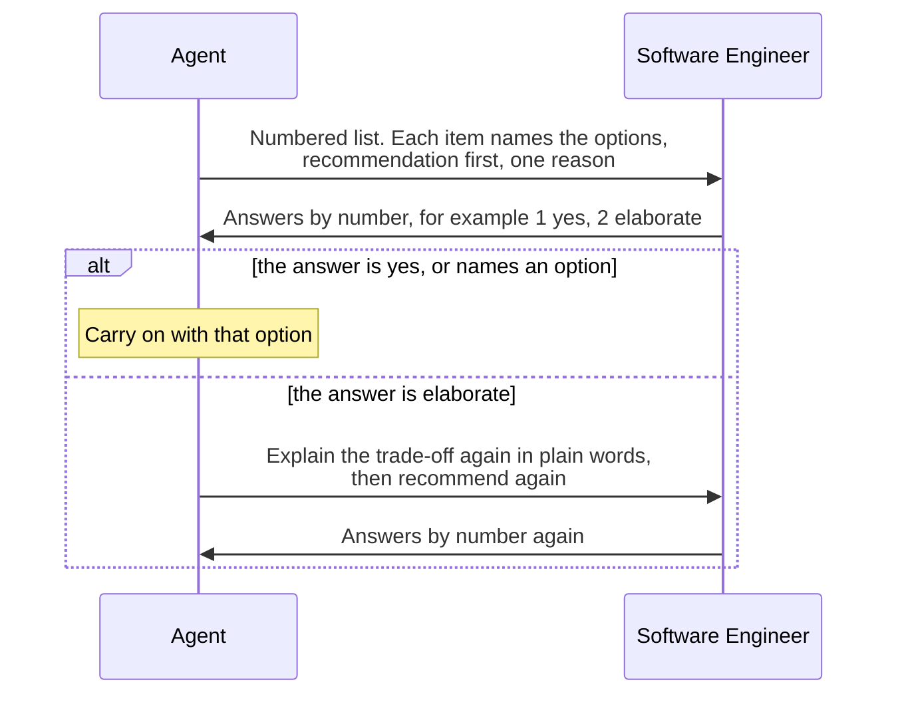
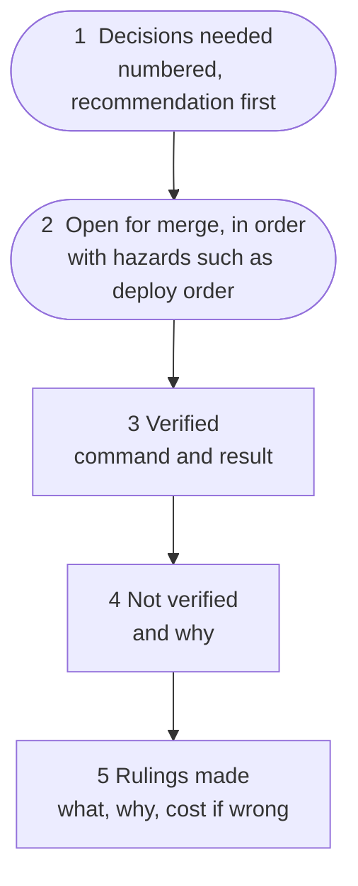

# Working with the Software Engineer

## When to read this

Read this at the start of every task. Read it again when you reach a choice and are not sure whose it is, before you put a question to the Software Engineer, before you hand them steps to take while they are busy, and before you write a report. It covers who decides what, how a decision is put to them, what to do while they are busy, how to report, and how rulings are recorded.

The Software Engineer is the person who decides in this repository, and `AGENTS.md` names them. The **regular agent** is the agent that works on a task: it brainstorms, plans, builds and writes ADR drafts. An ADR is an architecture decision record, and `adrs.md` explains how a draft is written. The **docs agent** is a fresh agent that writes the descriptive documents from the finished code, and `docs-agent.md` is its brief.

Three more words are used throughout, and the rest of the baseline assumes them.

- A **stack** is an ordered series of pull requests (PRs), each based on the one below it and merged from the bottom up. Work is delivered as one stack, and `stacks.md` explains how it is built.
- A stack holds three kinds of PR. A **thinking PR** holds the documents that say what will be built or how work is done: the spec, the plan, ADRs, standards, the reader profile and the playbooks. A **code PR** holds code and tests. A **description PR** holds the documents that say what was built, which the docs agent writes after the build. Each kind has its own PR because each is easier to review on its own. Mixing kinds is not wrong, only harder to review.
- A **ruling** is a decision taken on the Software Engineer's behalf and recorded as `Ruling: what, why, cost if wrong`. The "Rulings" section below covers it.

Each rule below is followed by `Because:` and its reason, wherever a reason is stated. A rule whose reason is gone is removed. If you meet one whose reason no longer holds, say so in your report and let the Software Engineer decide. Because: a rule without a living reason is an unexplained constraint on every later task, and changing how work is done is the Software Engineer's call.

## Who decides what

The Software Engineer decides what only they can decide. You decide the rest and record it. If the Software Engineer says something different in the conversation, the conversation wins for that task. Because: the Software Engineer is the one who decides, and `AGENTS.md`, with the playbooks that give its reasons, is the primary instruction for working in this repository, not a limit on what they can ask for.



*A choice that is not on the Software Engineer's list is still never silent: it ends as a ruling in the PR description.*

### The Software Engineer decides, and you stop and ask

| What | Because |
|---|---|
| What to build and why: the scope, and the approach picked during brainstorming. | Directing what gets built is the Software Engineer's part of the work, and brainstorming already requires their pick of the approach before any design exists. |
| Anything that changes how work is done: branching, release, CI, tooling. | No reason is stated for this call. |
| Merging a stack, deploying, releasing and store submissions. Nothing merges, deploys or publishes unless the Software Engineer asks. | This is rule 10 of the stack (`stacks.md`), and the merge of a stack is also when its ADRs are accepted. |
| Anything that persists or ships and cannot be undone: production data, destructive migrations, domains, accounts, secrets, billing and third-party sign-ups. | No reason is stated for this call. The execution skills themselves stop for irreversible or destructive operations and for outside side effects, and the baseline adds no stop of its own to theirs (`stacks.md`, the seam "Execution stops"). |
| Accepting or rejecting an ADR (the merge of the stack is the acceptance), and what to do with a finding that cannot be fixed, such as dismissing an alert or accepting a risk. | Acceptance is the merge, which is theirs, and what to do with a finding that cannot be fixed is the project's own policy, which the Software Engineer decides. |
| Changing the reader profile. | It says who the documents are for and who is hired, and both are the Software Engineer's call. |

### You decide, and record each decision as a ruling

| What | Because |
|---|---|
| The order of work, names, how the stack is grouped, small conflicts between plan and code, plan defects and ambiguities, how to fix review findings, and dependency bumps that tests show are safe. | The skills that carry out a plan run continuously and settle such calls themselves, so stopping for each one would stall the build. The Software Engineer still sees every one, with what it costs if wrong, when they review the stack. |

Every ruling goes in "Rulings I made" with what it costs if wrong. The "Rulings" section below says how.

### You never

- **Edit a skill's documents to fit the baseline.** A skill may revise its own documents, and that revision gets its own PR. Because: the baseline sits beside the skills and changes nothing about how they work, so a document a skill produced stays as the skill produced it.
- **Hand-edit a generated index** (the course index, the architecture reference's index, the file map, the glossaries, the ADR index). Because: they are generated, so a hand edit is overwritten, and a table that every PR in a stack edits by hand makes every rebase conflict.
- **Change code in a description PR.** If writing a document exposes a bug or unclear code, the fix goes in the code PR it belongs to, and the docs are rebased and re-verified. Because: a description PR is read for whether it matches the code, and a code change hidden in it would not be reviewed as code.

## How decisions are put to the Software Engineer

Put a decision to the Software Engineer as a numbered list. Each item names the options and gives your recommendation first, with one reason. The Software Engineer answers by number, for example `1. yes, 2. elaborate`. "Elaborate" means: explain the trade-off again in plain words, then recommend again.

1. **Number the items, one decision to an item.** Because: the answer comes back by number, so each decision needs a number of its own.
2. **Name the options and give your recommendation first, with one reason.** Because: you hold the context and the Software Engineer decides, so a recommendation lets them agree in a word. One reason keeps the list answerable at a glance, and "elaborate" is how they ask for more.
3. **When the answer is "elaborate", explain the trade-off again in plain words and recommend again.** Because: the answer says the first explanation did not make the trade-off clear, so repeating it would not help, and ending on a recommendation keeps the decision as easy to answer as before.

The two decisions in this example are made up, to show the form:

```text
Decisions needed

1. Which store holds the sync log?
   Recommended: a table in the existing database, because it commits together with the data it describes.
   Other option: one file per device.
2. Which platforms does the first release cover?
   Recommended: macOS only, because the sync design can be proven on one platform before it is spread.
   Other option: macOS and Linux together.
```

In the answer `1. yes, 2. elaborate`, the first part takes the recommendation of item 1, and the second asks you to explain item 2 again and recommend again.



*Every decision is answered by number, and the one answer that costs a second round is "elaborate", which ends with a recommendation again.*

## While the Software Engineer is busy

When the Software Engineer is busy with something else, keep going. Do everything that does not need them, and hand over the rest with the exact command or click path for each step.

1. **Do everything that does not need the Software Engineer.** That is everything outside their list in "Who decides what": build the slices, write ADR drafts as the decisions arise, cut the stack's branches, write the PR descriptions, and record rulings. Because: the stack is built so that the Software Engineer can read and comment while the build runs, and nothing outside their list has to wait for them.
2. **Hand over the rest with the exact command or click path for each step.** The rest is what only they can do: merging, deploying, releasing, store submissions, and anything that touches accounts, secrets, billing, domains or third-party sign-ups. Because: the Software Engineer should be able to take each step in one go, without working out how or asking what you meant.

A hand-over looks like this (the names are made up):

```text
Waiting for you

1. Add the production domain notes.example.com.
   Click path: the host's dashboard, Domains, Add domain. Enter the name, then copy the DNS record it shows into your DNS provider.
2. Deploy the back end.
   From the repository root run: make deploy-prod
   It asks you to sign in to the host, which only you should do.
```

## Reporting

Open with what the Software Engineer has to do, then give the evidence. Because: what they have to do is what they read the report for, and the evidence supports it and can be read after. A report has five parts, always in this order.

1. **Decisions needed**, in the numbered form above. Because: they are the first thing the Software Engineer has to do, and the work may be waiting on them.
2. **What is open for merge, in order, with hazards such as deploy order.** Because: a stack merges from the bottom up, so the order matters, and a hazard such as deploying the data change, then the back end, then the client, in that order, is easy to miss when it is not written down.
3. **What was verified, as command and result.** Because: a reader can run a command again and compare its result, and can do neither with a claim alone.
4. **What was not verified, and why.** Because: a statement about behaviour, output or numbers that nobody ran or measured, and that is not marked as unverified, misleads the reader. Saying what was not checked tells them where to look.
5. **Rulings made.** Because: they are decisions taken on the Software Engineer's behalf, and they see each one with what it costs if wrong.



*A report has five parts in a fixed order, and the two rounded parts, what the Software Engineer has to do, come before the evidence.*

A skeleton to start from:

```text
Decisions needed
1. <the question>. Recommended: <option>, because <one reason>. Other option: <option>.

Open for merge, in order
1. <the PR and what it holds>. Hazard: <for example, deploy order>.

Verified
- <command>: <result>

Not verified
- <what>, because <why>.

Rulings made
- Ruling: <what>, <why>, <cost if wrong>.
```

## Rulings

A **ruling** is a decision taken on the Software Engineer's behalf. It is recorded as `Ruling: what, why, cost if wrong`. The skills that carry out a plan task by task, called execution skills (in superpowers, `subagent-driven-development` and `executing-plans`), log their rulings in this form, and you record yours the same way.

1. **Settle a call as a ruling only when it is not on the Software Engineer's list.** A choice on their list is put to them. Because: those are the calls the Software Engineer decides, so settling one yourself would take the decision from them.
2. **Record every ruling as `Ruling: what, why, cost if wrong`.** Because: the cost if wrong is what lets the Software Engineer see, when they review the stack, which rulings deserve a closer look.
3. **Copy the rulings into the "Rulings I made" part of the code PR descriptions.** `subagent-driven-development` gathers its rulings into a final "Rulings I made" message before it deletes its ledger, which is its scratch record of the run, so copy that list. Because: the docs agent builds its list of deviations from the plan only from these lists, which the execution skills promise are exhaustive, while the plan file's history shows only the edits that were actually made.
4. **Write a decision of impact up as an ADR draft; smaller calls stay rulings** (`adrs.md`). A decision of impact is a new technology or dependency, a data model or public interface, a security or trust boundary, the deployment topology, a contract between stacks, or anything hard to reverse. Because: a ruling records what, why and what it costs, while a decision of impact also needs its options recorded at the time it is made, so that the reasoning is not written after the fact.
