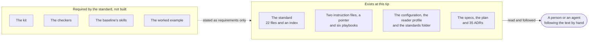
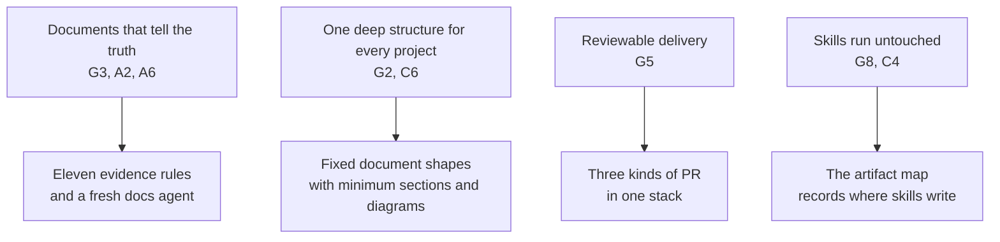
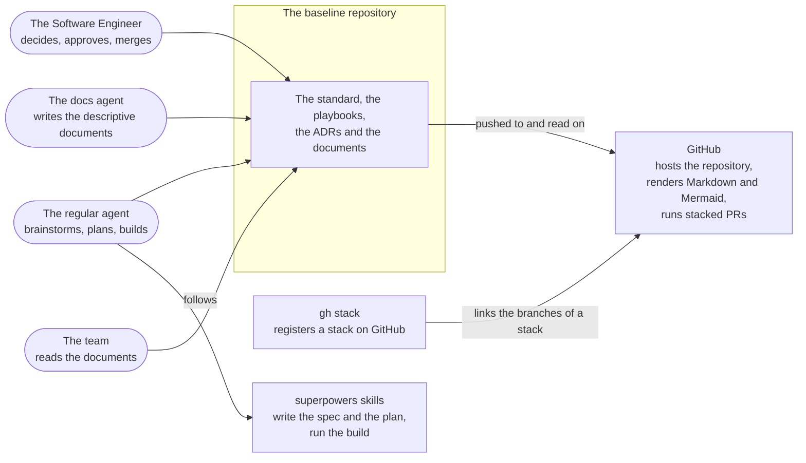
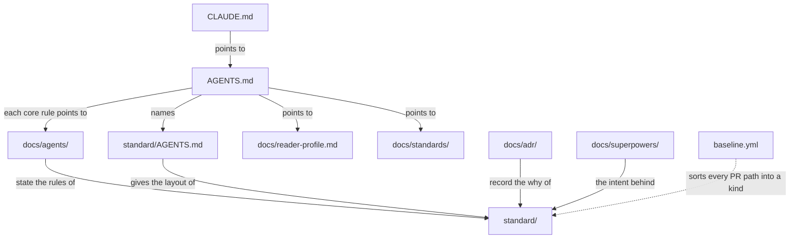

# Overview

This file holds two of the thirteen minimum sections of the architecture reference: "What the system is" and "The big picture". The other files of the folder hold the rest, and [the index](README.md) says which file holds which section. Every sentence here was checked against the repository at commit `cb4fb22`, the finished tip of the first stack, and every reason is taken from [design 1](../superpowers/specs/2026-11-14-baseline-standard-design.md) or from the [ADRs](../adr/README.md).

## What the system is

The baseline is a standard for documenting and delivering a software project of any kind, in any technology. It fixes which documents a project has and who writes them, how work is delivered through pull requests (PRs), and how a project's approved preferences become the standards that drive code ([standard/README.md](../../standard/README.md)). It exists for the Software Engineer, the person who decides on a project, whose goal is to behave as a Distinguished Engineer by taking on, rung by rung, the responsibilities of the Lead Engineer, the Principal Engineer and the Solutions Architect ([standard/01-why-and-scope.md](../../standard/01-why-and-scope.md), ADR [0031](../adr/0031-software-engineer-and-the-ladder.md)).

At this tip the system is made of text. What exists is:

- **The standard**: 22 numbered Markdown files and an index in `standard/`. It is the product of this repository, and `baseline.yml` lists `standard` among the stack folders, so a change to it is a code change.
- **The rules for agents**: `AGENTS.md`, the two-line `CLAUDE.md` that points to it, `standard/AGENTS.md` with the commands and the layout of the standard's folder, and six playbooks in `docs/agents/` that state the standard's rules as instructions with the reason beside each.
- **The project's own configuration and inputs**: `baseline.yml`, the reader profile in `docs/reader-profile.md` and the standards folder `docs/standards/`, which holds only its README because no standard has been approved yet.
- **The thinking behind it**: design 1, its decision trail and three revisions in `docs/superpowers/specs/`, the plan in `docs/superpowers/plans/`, and 35 ADRs in `docs/adr/`.

The tooling that is to apply the standard does not exist: the kit, the checkers and the baseline's own skills. The standard states what each must do as a requirement and says that nothing in it claims that any repository runs it today ([standard/22-tooling-requirements.md](../../standard/22-tooling-requirements.md)). The worked example of design 2 does not exist either. Everything the baseline does today, a person or an agent does by reading the standard and the playbooks and following them by hand.

*The baseline today is the text in the first box, applied by hand, and the one thing to notice is that the second box reaches the text only by a dotted arrow: the standard states the tooling as requirements, and nothing in this repository runs it.*

### The technology choices

| Choice | What it is | The record of the choice |
|---|---|---|
| GitHub-flavoured Markdown, read on GitHub | Every document is Markdown that GitHub renders, in dark and light themes. | ADR [0022](../adr/0022-reading-venue.md), constraint C2 |
| Mermaid for diagrams | Every diagram in the repository is a Mermaid block in a Markdown file, with an approved palette as the only hard-coded colour. | ADR [0020](../adr/0020-diagram-tooling-and-theme.md) |
| A Markdown standard, a kit and thin skills | The delivery design: the standard works without the skills. Only the standard exists. | ADR [0003](../adr/0003-delivery-standard-kit-skills.md) |
| Stacked PRs with `gh stack` | Work goes to GitHub as a stack of PRs, registered with `gh stack link`. | No ADR. Design 1 states it as constraint C3, and ADRs [0007](../adr/0007-docs-at-top-of-stack.md), [0009](../adr/0009-one-kind-per-pr.md) and [0013](../adr/0013-one-repo-per-project.md) rest on it. |
| YAML for configuration and headers | `baseline.yml` and the header of the reader profile are YAML. | No ADR. Design 1 marks the field names as the writer's call (sections 7.4 and 15.1). |
| Claude Code as the primary agent harness | The baseline's skills are to be a Claude Code plugin; the standard does not depend on it. | Constraint C5, and ADR [0003](../adr/0003-delivery-standard-kit-skills.md) |
| Python, with Node only for rendering Mermaid | The language that the checkers are to be written in. No checker exists, so no Python is in the repository. | ADR [0026](../adr/0026-checker-language.md) |

### The quality goals

Four of the standard's goals and constraints drive the design more than the others ([standard/01-why-and-scope.md](../../standard/01-why-and-scope.md)).

- **Documents that tell the truth about the code (goal G3, anti-goals A2 and A6).** A descriptive document says only what exists at the tip and is checked against the code or a real run, which is why a fresh docs agent writes them and why eleven evidence rules exist ([07-evidence-and-checks.md](07-evidence-and-checks.md)).
- **One structure for every project, complete and deep (goal G2, constraint C6).** The baseline does not change by kind of project, and there is no length budget on a document.
- **Reviewable delivery (goal G5).** Thinking, code and description go in PRs of their own kind, so each can be read one way ([03-the-stack-model.md](03-the-stack-model.md)).
- **The skills run untouched (goal G8, constraint C4).** The baseline reads where a skill writes and arranges the PRs around it, and never edits what a skill produced.

*Each quality goal leads to one mechanism of the standard, and the one thing to notice is that every mechanism on the right is text that a person or an agent follows, because no tool enforces any of them at this tip.*

## The big picture

### Context

The repository is read and followed by people and agents, and it leans on GitHub, `gh stack` and the superpowers skills, which it describes but does not contain.

*Four kinds of reader use the repository and three outside systems carry it, and the one thing to notice is that the superpowers skills are reached only through the regular agent that follows them: the baseline never touches a skill.*

### Containers

A Markdown repository has no deployable units or datastores. Its parts are folders and files, and what connects them is a pointer from one file to another and the rule that infers a PR's kind from the paths it touches. The table says what each part holds, and the diagram after it shows how the parts point to each other.

| Part | What it holds |
|---|---|
| `CLAUDE.md` | A two-line pointer to `AGENTS.md`. |
| `AGENTS.md` | The primary instruction for working in the repository: who decides, seven core rules with their reasons, the six playbooks and the repo map. |
| `docs/agents/` | The six playbooks. |
| `standard/AGENTS.md` | The instructions for working in `standard/`: no commands, because nothing in it is built or run, the layout of the folder and the rule for links between its numbered files. |
| `standard/` | The product: 22 numbered files and the index, `standard/README.md`. |
| `docs/reader-profile.md` | Who the documents are written for, as a YAML header and the text that explains it. |
| `docs/standards/` | The project's approved preferences. It holds only its README. |
| `docs/adr/` | The 35 ADRs and their index. |
| `docs/superpowers/` | Design 1, its decision trail and three revisions under `specs/`, and the plan under `plans/`, as the skills wrote them. |
| `baseline.yml` | The baseline's configuration for this repository: the pinned version, the artifact map, the stack folders and whether standards are enabled. |

*The parts are connected by pointers, from the pointer file to the instruction file to the playbooks, which state the standard's rules, and the one thing to notice is the dotted arrow from the configuration file: it connects no file to another, it sorts the paths of every PR into thinking, code or description.*

The links are plain relative links in Markdown, and GitHub follows them. The rule behind the dotted arrow is in [03-the-stack-model.md](03-the-stack-model.md).
