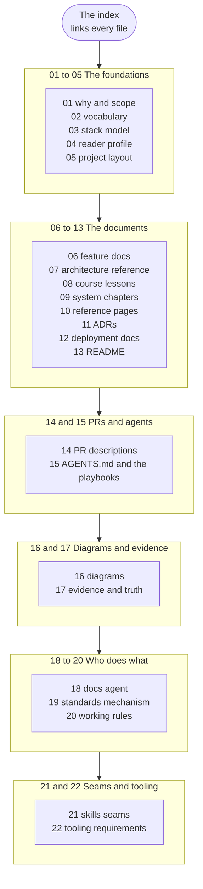
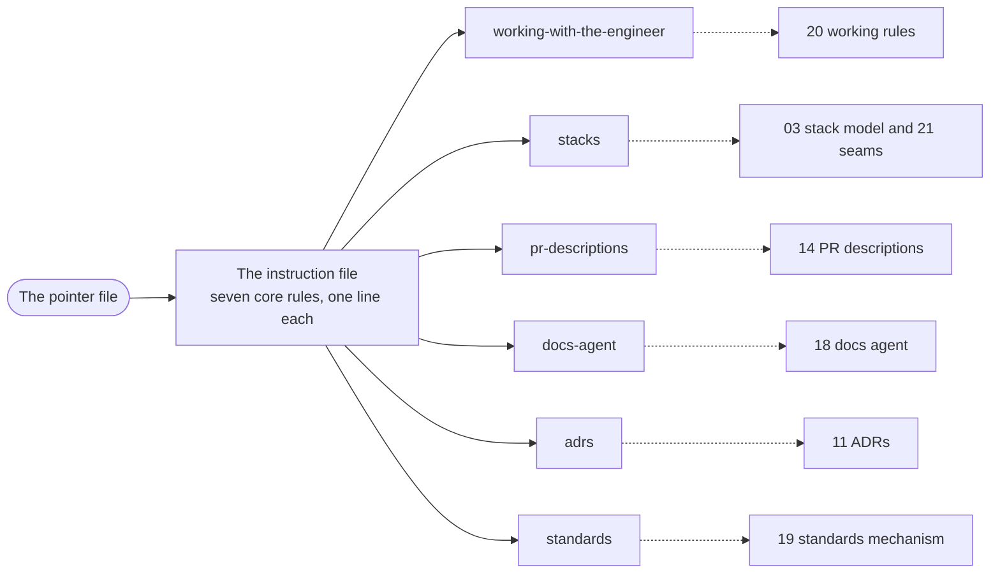
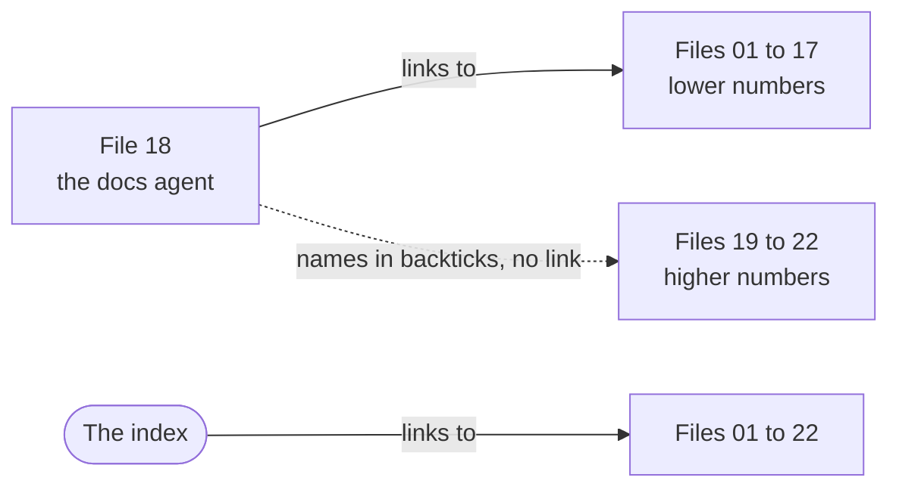

# The standard and its files

This file holds the section "Components" of the architecture reference. In a Markdown product the modules are files, and a dependency is a link or a citation from one file to another. [01-overview.md](01-overview.md) gives the purpose and the big picture.

## Components

### The module map

The standard is 22 numbered files and an index in `standard/`. The index, [standard/README.md](../../standard/README.md), groups the files in six groups, and the number of a file is its place in the reading order. The playbooks in `docs/agents/` are a second set of modules: each states the rules of one subject as instructions to an agent, with the reason beside every rule, and names the standard file that sets the same subject in full ([standard/15-agents-md-and-playbooks.md](../../standard/15-agents-md-and-playbooks.md)).

*The 22 files fall in six groups read in number order, and the one thing to notice is that the index sits outside the groups: it is the one file that links to all of them.*

### Each module's responsibility

| File | What it is responsible for |
|---|---|
| `01-why-and-scope.md` | Who the baseline is for, the ladder that is its why, what it is, what success looks like, the principle that outranks every other, and the goals (G1 to G10), non-goals (N1 to N7), anti-goals (A1 to A9) and constraints (C1 to C7) that other files cite by id. |
| `02-vocabulary.md` | The three roles and every term, each used in one sense throughout. |
| `03-stack-model.md` | The stack of PRs: its picture, the three kinds, how a PR's kind is read from its paths, the thirteen rules and the seven conventions. |
| `04-reader-profile.md` | The reader profile and the intake that creates it, and the three sections that the docs agent generates from it. |
| `05-project-layout.md` | Where every document lives, `baseline.yml`, baseline-owned and project-owned files, and the artifact map. |
| `06-feature-docs.md` | The non-technical feature docs: the overview, the Users and access page and the feature pages. |
| `07-architecture-reference.md` | The technical reference: a folder with a generated index and thirteen minimum sections. |
| `08-course-lessons.md` | The guided course's three tiers, the ten parts of a lesson, its header and the practice standard. |
| `09-course-system-chapters.md` | The ten parts of a system chapter, its labs and its practice. |
| `10-course-reference-pages.md` | The file map, which takes a Markdown file's line from its opening paragraph, the technical glossary assembled from the lessons, the product glossary that the docs agent writes, the "what else it offers" map, and the generated indexes. |
| `11-adrs.md` | The ADR template, the six criteria of a decision of impact, the lifecycle, the docs agent's guard rail and the presence check. |
| `12-deployment-docs.md` | The eleven areas of the deployment docs, the honesty rule and the five diagrams, none of them for an area that does not apply. |
| `13-project-readme.md` | The README's ten parts, the README of each stack folder and the CI job that keeps it true. |
| `14-pr-descriptions.md` | The header every PR description starts with and the form for each kind of PR. |
| `15-agents-md-and-playbooks.md` | `AGENTS.md`, `CLAUDE.md`, the six playbooks, the two rules for all of these files and the third for the playbooks alone, that a playbook holds no Markdown link. |
| `16-diagrams.md` | How diagrams are drawn, the minimum per document, the quality and theme rules, the approved palette and database diagrams. |
| `17-evidence-and-truth.md` | The eleven evidence rules, "Not applicable: why" and the bootstrap exception for indexes. |
| `18-docs-agent.md` | The docs agent: what it reads, what it never reads, what it produces and its six rules. |
| `19-standards-mechanism.md` | How approved preferences become standards in `docs/standards/`. |
| `20-working-rules.md` | Who decides what, how a decision is put to the Software Engineer, what agents do while the Software Engineer is busy, and how a report is built. |
| `21-skills-seams.md` | The nine seams with the skills and how another skill is added. |
| `22-tooling-requirements.md` | What the kit, the checkers and the skills must do: the mechanical checks, the stack gate, the nine commands, the update flow and the checker language. |
| `README.md` | The index and front door of the standard: what it is, the why, how to read it and the contents. |
| `AGENTS.md` | The instructions for working in the folder: no commands, because nothing in it is built or run, its layout, and the rule for links between its numbered files. |

Each file opens with a paragraph that says what it covers. Every file except `02-vocabulary.md` and `03-stack-model.md` then has a paragraph that explains the words it uses before the vocabulary defines them in full; those two define their words where they first use them, and the index has its own "A few words are used before the standard defines them in full" list.

### The playbooks and the instruction files

The rules of the standard reach an agent through `AGENTS.md`, which gives each of its seven core rules in one line with its reason and points to the playbook that explains it. `CLAUDE.md` holds nothing but a pointer to `AGENTS.md`. The standard's folder has its own instruction file, `standard/AGENTS.md`, which the repo map of `AGENTS.md` names; it is the only folder that has one at this tip. The table pairs each playbook with the standard file that sets its subject, as [standard/15-agents-md-and-playbooks.md](../../standard/15-agents-md-and-playbooks.md) pairs them.

| Playbook | Its subject | The standard file for the same subject |
|---|---|---|
| [working-with-the-engineer.md](../agents/working-with-the-engineer.md) | Who decides what, decisions, hand-overs, reports and rulings | `20-working-rules.md` |
| [stacks.md](../agents/stacks.md) | The stack, `gh stack`, cutting and opening a stack, small changes, the seams | `03-stack-model.md` and `21-skills-seams.md` |
| [pr-descriptions.md](../agents/pr-descriptions.md) | The header and the three forms of a PR description | `14-pr-descriptions.md` |
| [docs-agent.md](../agents/docs-agent.md) | The brief of the docs agent | `18-docs-agent.md` |
| [adrs.md](../agents/adrs.md) | ADR drafts, the lifecycle, the guard rail, the presence check | `11-adrs.md` |
| [standards.md](../agents/standards.md) | The standards of a project | `19-standards-mechanism.md` |

*An agent goes from the pointer file to the instruction file to the playbook of its subject, and the one thing to notice is that each playbook has a dotted line to the one or two standard files that set its subject in full.*

### The dependency direction

A file of the standard links, with a Markdown link, only to files with a lower number, and names a file with a higher number in backticks without a link. The index links to all 22. This holds at this tip for every file: a check of the links in every numbered file finds no link to a higher number. The rule is written in [standard/AGENTS.md](../../standard/AGENTS.md), the folder's own instructions, with its reason: every PR of a stack has to leave the repository working, and a link to a higher-numbered file would point at a file that only a later PR adds. The index and `AGENTS.md` have no number, so the rule does not reach them.

*A file links only backward in the reading order, and the one thing to notice is that a forward reference is a dotted line, a name in backticks with no link, so that the files can be read and checked in number order.*

The playbooks hold no Markdown link at all at this tip: each names the other playbooks and the standard files in backticks. `AGENTS.md` is the file that links to each playbook. This is the third of the rules for the files themselves in [standard/15-agents-md-and-playbooks.md](../../standard/15-agents-md-and-playbooks.md), and the repo map of `AGENTS.md` repeats it, with the reason that the playbooks are replaced on update in every project, and a project does not hold some of the files they name, the baseline's own standard, so a link would break there while a name in backticks cannot.
