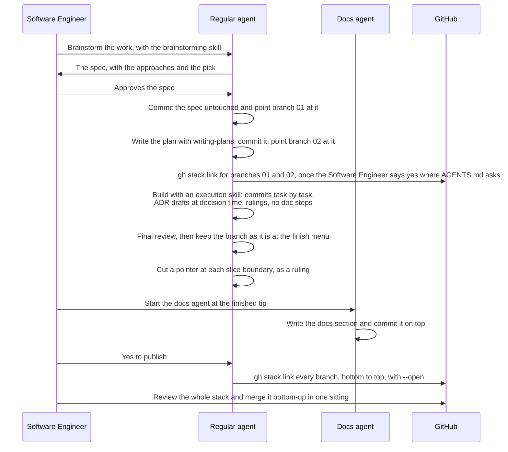
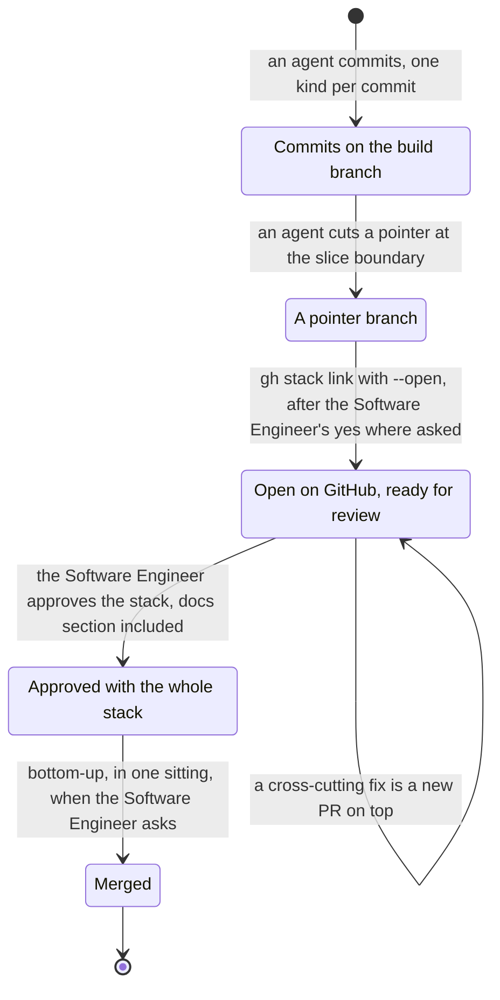
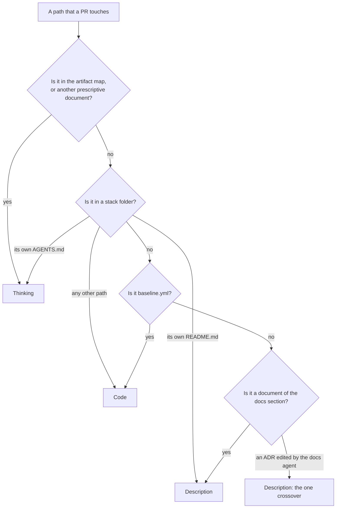
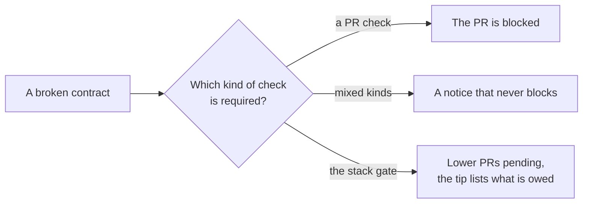

# The stack model

This file holds the parts of three minimum sections that belong to the stack model: one of the key flows, the stack's workflow among the state machines, and its interfaces and contracts. The rules are set in [standard/03-stack-model.md](../../standard/03-stack-model.md), and the playbook [stacks.md](../agents/stacks.md) states them as instructions with the commands. The examples are the baseline's own first stack, whose twenty branches `standard/01-spec` to `standard/20-revision-3-standard` are at this tip.

A **stack** is an ordered series of pull requests (PRs), each based on the one below it and merged from the bottom up. It holds three kinds of PR: a **thinking PR** holds the prescriptive documents, a **code PR** holds code and tests, and a **description PR** holds the descriptive documents that the docs agent writes.

## Key flows

### A feature goes from brainstorm to merged stack

The flow below is the order that the stack model, the seams with the skills ([standard/21-skills-seams.md](../../standard/21-skills-seams.md)) and the working rules ([standard/20-working-rules.md](../../standard/20-working-rules.md)) give together. Every step is done by hand or by an agent following the text, because the commands of the baseline's skills do not exist.

*A feature reaches GitHub in two publishes, the spec and the plan first and the rest of the stack once the docs section is on top, and the one thing to notice is that the Software Engineer's yes comes before each publish in this repository, because its `AGENTS.md` makes opening PRs a kind of publishing.*

In this repository the first publish happened on 2026-11-18: PRs 1 and 2 are open on GitHub as [#1](https://github.com/chandanbsd/baseline-framework/pull/1) and [#2](https://github.com/chandanbsd/baseline-framework/pull/2), created that day, based on `main` and on `standard/01-spec`, and `main`, `standard/01-spec` and `standard/02-plan` are the only branches on the remote (`git ls-remote --heads origin` and `gh pr list --state all`, run on 2026-11-18). The second publish waits for the docs section and for the Software Engineer's yes.

## State machines

### The life of a PR in a stack

A PR of a stack starts as commits on one line of history and ends merged. The states and their order come from rules 3, 10 and 12 of the stack model and from the convention on stack tooling, which marks every PR ready, so no PR of a stack stays a draft.

*A PR moves from commits to a pointer to an open PR to a merge, and the one thing to notice is the loop on Open: once a stack is open, a fix goes on top as a new PR, and a rewrite of pushed history waits for the Software Engineer's yes.*

In this repository PRs 1 and 2 are in the state Open, and PRs 3 to 20 are in the state Cut: their branches exist only in the local repository.

## Interfaces and contracts

The stack model's contracts are formats that the agents and GitHub rely on. No tool checks any of them at this tip, and the standard states the checks as requirements on the tooling ([standard/22-tooling-requirements.md](../../standard/22-tooling-requirements.md)).

| Contract | The format | Where the standard sets it |
|---|---|---|
| Branch names | `<topic>/<nn>-<slug>`, numbered in stack order, and `<topic>/docs-<nn>-<slug>` for a description PR. The first stack's topic is `standard`. | The convention "Branch names" |
| Commits | A conventional prefix (`feat(scope):`, `fix(scope):`, `docs:`, `test:`, `refactor:`), small and logical, a message that says why, no attribution line. The first stack's 36 commits above `main` use `feat(standard):`, `docs(agents):`, `docs(adr):` and `docs:`. | The conventions "Commits" and "Attribution" |
| A PR's kind | Read from the paths the PR touches ("How a PR's kind is read" below). | "How the kind is decided" |
| A PR's description | A header (which PR it is, as "n of N"; the stack table; a stack diagram from three PRs up; the kind) and then the form of its kind: four parts for thinking, eleven for code, four for description. | [standard/14-pr-descriptions.md](../../standard/14-pr-descriptions.md) |
| A ruling | `Ruling: what, why, cost if wrong`, listed under "Rulings I made" in a code PR's description. | [standard/20-working-rules.md](../../standard/20-working-rules.md) |
| `gh stack link` | Takes branch names bottom to top; pushes them in one atomic push, opens a PR for each branch that has none on the branch below it, creates or extends the stack on GitHub and, with `--open`, marks the PRs ready. | "The tool: `gh stack`" |

### How a PR's kind is read

The kind comes from the paths, using two keys of `baseline.yml`. In this repository the artifact map lists `docs/superpowers/specs/**` for the spec and `docs/superpowers/plans/**` for the plan, and `stack_folders` lists `standard`, `kit`, `checkers`, `skills` and `examples`, of which only `standard` exists ([baseline.yml](../../baseline.yml)).

*A path is sorted by asking where it lives, and the one thing to notice is that a stack folder holds paths of all three kinds: its README is description, its AGENTS.md is thinking and everything else in it is code.*

The rule sorts the first stack as the stack table records it. PRs 1 and 2 touch only the artifact map's paths, PRs 3 and 19 only ADR drafts and PR 4 only `AGENTS.md`, `CLAUDE.md` and the playbooks. PRs 14, 16 and 18 each touch a revision document under the artifact map's paths, `AGENTS.md` and playbooks, PR 14 also the reader profile, and PR 18 also `standard/AGENTS.md`, a stack folder's own `AGENTS.md`, which is a thinking path. So all nine are thinking. PRs 5 to 12, 15, 17 and 20 touch only files in `standard/` other than its `AGENTS.md` and, in PR 17, `baseline.yml`, so they are code. PR 13 holds `standard/README.md` beside two code files. That file became a description path only with revision 2, after PR 13 was committed, and it stays as committed: the repo map of `AGENTS.md` says that it keeps its form as the standard's index and that the docs agent only checks it against the tip. The paths were listed with `git diff --name-only` between each pair of neighbouring branches.

### The versioning policy and the error model

The baseline's versions follow semver: a patch for fixes, a minor version for optional additions and a major version for new required structure, with an upgrade guide. A project pins the version it follows in `baseline_version`, which is `0.1.0` in this repository ([standard/README.md](../../standard/README.md)).

When a contract is broken, the standard requires the tooling to answer in one of three ways, and none of them runs today: a check on a PR blocks the PR, a PR that mixes kinds gets a notice that never blocks it, and the stack gate over the whole change leaves the lower PRs pending until the tip passes ([standard/22-tooling-requirements.md](../../standard/22-tooling-requirements.md)).

*The standard requires three answers to a broken contract, and the one thing to notice is that mixing kinds is the only one that never blocks, because a mixed PR is allowed and only harder to review.*
