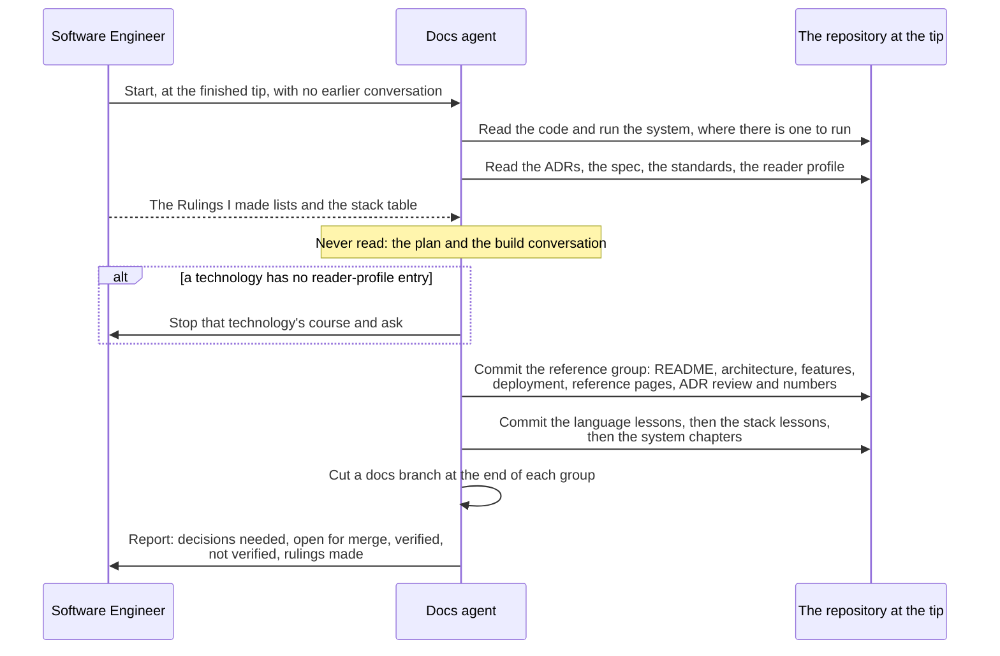
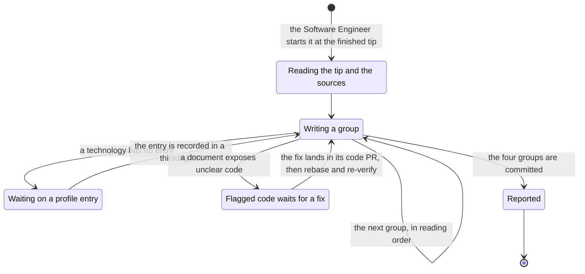
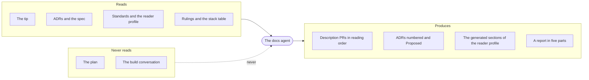

# The docs agent

This file holds the parts of three minimum sections that belong to the docs agent: one of the key flows, its workflow among the state machines, and its contract among the interfaces. The rules are set in [standard/18-docs-agent.md](../../standard/18-docs-agent.md), and the playbook [docs-agent.md](../agents/docs-agent.md) is its brief. ADR [0008](../adr/0008-fresh-docs-agent.md) records why a fresh agent writes the documents, and ADR [0007](../adr/0007-docs-at-top-of-stack.md) why they go at the top of the stack.

The **docs agent** is a fresh agent, started from the finished tip of the stack, that writes every descriptive document: the feature docs, the architecture reference, the guided course, the deployment docs, the README and the reference pages. It exists to guard "what was built, not what was meant".

## Key flows

### The docs agent writes the docs section

The system chapter [The docs agent writes the docs section](../course/system/04-docs-agent-writes-the-docs-section.md) teaches this flow.

*The docs agent reads the tip and the sources the standard names, writes the four groups in reading order and hands over in a report, and the one thing to notice is the dashed message from the Software Engineer: the lists and the table come with the start instruction while the PRs are not open.*

The dashed message is how the docs agent receives the "Rulings I made" lists and the stack table when PRs 3 and up are not open yet. The standard says they are in the PR descriptions. Revision 1 picked handing them over as files, by path, in the instruction that starts the agent ([revision 1, D1](../superpowers/specs/2026-11-18-baseline-standard-revision-1-design.md)), and the first docs run, on 2026-11-18, was started that way and wrote the docs section from them. The standard records that this was tried once and says no more about how the docs agent receives them ([standard/18-docs-agent.md](../../standard/18-docs-agent.md)), and the brief lists what that run reported it lacked ([docs-agent.md](../agents/docs-agent.md)).

## State machines

### The docs agent's workflow

*The docs agent moves from reading to writing group by group, and the one thing to notice is that both side states return to writing: a missing profile entry stops only that technology's course, and flagged code is fixed in its code PR and never by the docs agent.*

While it waits on a profile entry it carries on with everything that does not need the answer ([standard/04-reader-profile.md](../../standard/04-reader-profile.md)).

## Interfaces and contracts

### What it reads, and what it never reads

| It reads | Because |
|---|---|
| The repository at the tip, and the running system | It is the only source of what exists. Where there is nothing to run, as in a product made only of Markdown, the written text is the evidence. |
| Every ADR, the drafts included | They carry the why, and it reviews and numbers the drafts. |
| The spec, found under `spec` in the artifact map | It carries the intent and the why, and never what exists. |
| `docs/standards/`, when the folder exists | A standard may have shaped code that a lesson shows. |
| `docs/reader-profile.md` | Its levels decide which basics a document explains. |
| The "Rulings I made" lists | The deviations list is taken from them. |
| The stack table | It shows the slices before any code is read. |

It never reads the plan, found under `plan` in the artifact map, or the build conversation, because a plan says what was meant and the agent that built the code tends to document what it meant ([standard/18-docs-agent.md](../../standard/18-docs-agent.md)).

*The docs agent turns the sources on the left into the outputs on the right, and the one thing to notice is the dotted arrow marked never: the plan and the build conversation do not reach it.*

### What it produces

| Output | Its form |
|---|---|
| The description PRs, in reading order: reference, language lessons, stack lessons, system chapters | Branches `<topic>/docs-<nn>-<slug>`, numbered on from the last branch of the stack. A group with nothing to write gets no PR. Each description has the header and four parts: what is documented and how it was checked, not verified, deviations from the plan, flagged code. |
| The review of the ADR drafts | Each draft renamed `<id>-<slug>.md`, with the id from its Links or, where the Links give none, the next number that `docs/adr/` has not used, the number in the title, the status moved to Proposed, additions marked "Added at review", in the reference PR. |
| The ADRs of decisions made in brainstorming | Written from the spec's Approaches section, where a decision has no draft. |
| The generated sections of the reader profile | Who can contribute, prerequisites and reading paths by role, with the reading-path map. |
| The product glossary | Written from the terms that the feature pages use, each linked to the lesson or system chapter that teaches it. |
| The indexes, while no generator exists | The course index, the architecture reference's index, the file map, the technical glossary and the ADR index, written as the single writer of the stack. |
| The report | Decisions needed, what is open for merge, what was verified, what was not verified, and rulings made. |

Opening the PRs is publishing in this repository, so the docs agent cuts its branches and waits for the Software Engineer's yes before anything is opened (`AGENTS.md`, rule 4).
