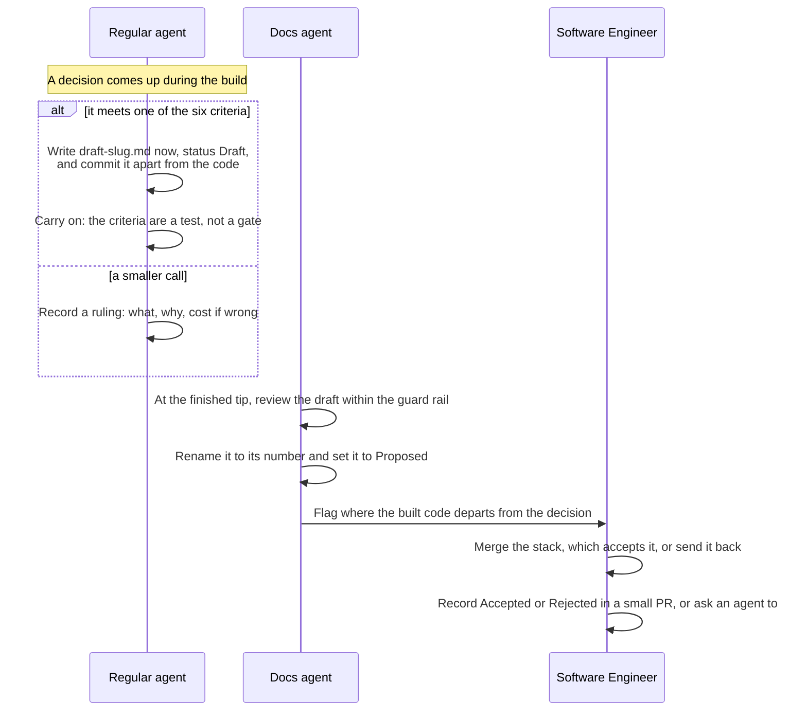
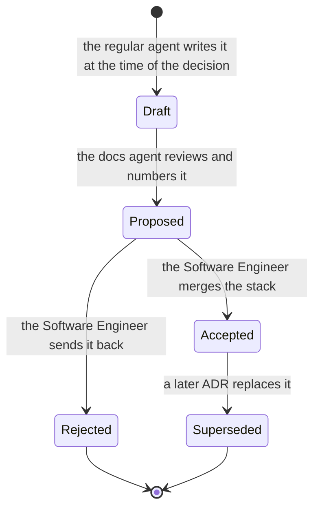
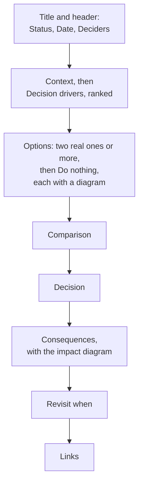

# Decisions and ADRs

This file holds the parts of three minimum sections that belong to the ADR model: one of the key flows, the ADR lifecycle among the state machines, and the ADR's contract among the interfaces. The rules are set in [standard/11-adrs.md](../../standard/11-adrs.md), and the playbook [adrs.md](../agents/adrs.md) states them as instructions. ADRs [0001](../adr/0001-adrs-with-options-explored.md), [0011](../adr/0011-adr-authorship-and-approval.md) and [0012](../adr/0012-adr-placement-in-stack.md) record why the model is as it is.

An **ADR**, an architecture decision record, is one file for one decision, with the options that were explored and the evidence for each. With the standards of a project, ADRs are the only documents that drive code.

## Key flows

### A decision becomes an ADR

The system chapter [A decision becomes an ADR](../course/system/03-decision-to-adr.md) teaches this flow.

A decision comes up in one of two places, and the path to an ADR depends on which. A decision made in brainstorming is already recorded in the spec, so it needs no draft and the docs agent writes its ADR from the spec. A decision made during the build is tested against six criteria: a new technology or dependency, a data model or public interface, a security or trust boundary, the deployment topology, a contract between technology stacks, or anything hard to reverse. A decision that meets one is a **decision of impact** and gets a draft at once. A smaller call stays a **ruling**, recorded as `Ruling: what, why, cost if wrong`.

*A decision of impact becomes a draft at decision time, a reviewed and numbered ADR at the docs section and an accepted one at the merge, and the one thing to notice is that nothing waits for an approval before the code: the regular agent writes the draft and carries on.*

The ADRs of this repository came another way, which the spec set for the baseline's own build: the 31 decisions of the brainstorm, listed in design 1's Appendix A, were written as drafts from the decision trail and committed together in PR 3 (design 1, section 16.5). Each draft names its Appendix A number under its links, which is where its ADR number comes from ([docs-agent.md](../agents/docs-agent.md)). No decision of the brainstorm is without a draft, so the docs agent wrote no ADR from the spec's Approaches section. Four more drafts came with revision 3: decisions of revisions 1 and 2 that extend ADRs 0009, 0011, 0019 and 0025, written after the fact from the revisions' records and committed together in PR 19, directly beneath the code PR of that revision (revision 3, D1 and D2). Their links give no Appendix A number, so the docs agent gave them the next numbers that `docs/adr/` had not used, 0032 to 0035.

## State machines

### The lifecycle of an ADR

*An ADR moves from Draft to Proposed at the docs agent's review and to Accepted at the merge, and the one thing to notice is that the only way out of Accepted is a later ADR: an Accepted ADR is append-only, and only its status and its links are ever edited.*

| Status | What moves it on | Who records the change |
|---|---|---|
| Draft | The docs agent's review within the guard rail | The docs agent, in a description PR |
| Proposed | The Software Engineer's merge of the stack, or a send-back | The Software Engineer, or an agent at their ask, in a small PR |
| Accepted | A later ADR that replaces it | Not stated: the standard says that the replaced ADR's status then reads Superseded by the new ADR's number, and that its status and links are the only edits it takes |
| Rejected | Nothing: it ends here | None |
| Superseded by NNNN | Nothing: it ends here | None |

At commit `bd7b1ce` the 35 ADRs of this repository were drafts. The docs agent's review in the reference PR, the first PR of the docs section, numbered them and moved them to Proposed, and the [index](../adr/README.md) lists them. Where the small PR that records a rejection sits in a stack that has not merged is left open by revision 2 (revision 2, section 4).

## Interfaces and contracts

### The ADR file

| Part of the contract | The format |
|---|---|
| File name | `draft-<slug>.md` while a draft; `NNNN-<slug>.md` once the docs agent publishes it. |
| Title | The name of the decision; `NNNN. Title` once published. |
| Header | Three paragraphs, each on its own line with a blank line between them: `Status:`, `Date:` and `Deciders:`. |
| Parts, in order | Context, Decision drivers (ranked), Options (at least two real ones and "Do nothing", each with how it works as a diagram, pros, cons and evidence), Comparison, Decision, Consequences (with the impact diagram), Revisit when, Links. |
| Diagrams | One for each option and one for the impact, each with a one-line italic caption; no colour except the approved palette. |
| Where nothing was recorded | The part says so ("Not recorded") and is never filled afterwards. |
| The index | `docs/adr/README.md`, generated and never edited by hand. |

*Every ADR has the same parts in the same order, and the one thing to notice is that the options come before the decision, so that a reader sees what was weighed before what was picked.*

### The guard rail on the review

| The docs agent may | The docs agent may not |
|---|---|
| Clean up the draft | Rewrite the decision |
| Add to it, marking each addition "Added at review" | Rewrite the drivers |
| Review it | Rewrite the options |
| Give it its number and move it to Proposed | Rewrite the rationale |
| Flag where the built code departs from the decision | Edit the ADR so that it matches the code |

The review and the numbering ride in a description PR, which is the one crossover of kinds that the standard names: a description PR may edit ADR files.

### The presence check

A changed dependency manifest, schema or interface file must be covered by an ADR or a ruling. The standard requires the checker to make this check over the whole change, from `main` to the tip, and to look for presence only. Where no checker exists, the same check is made by hand with `git diff --name-only main...HEAD` ([adrs.md](../agents/adrs.md)). The first stack changes no dependency manifest and no schema: its 77 tracked files at commit `bd7b1ce` are Markdown files, `baseline.yml` and `.gitignore`. The one file that the tooling is to read, `baseline.yml`, changes only in PR 17, where its comment on `stack_folders` gains the two exceptions that revision 2 recorded (D11), and revision 2 is the record that covers it.
