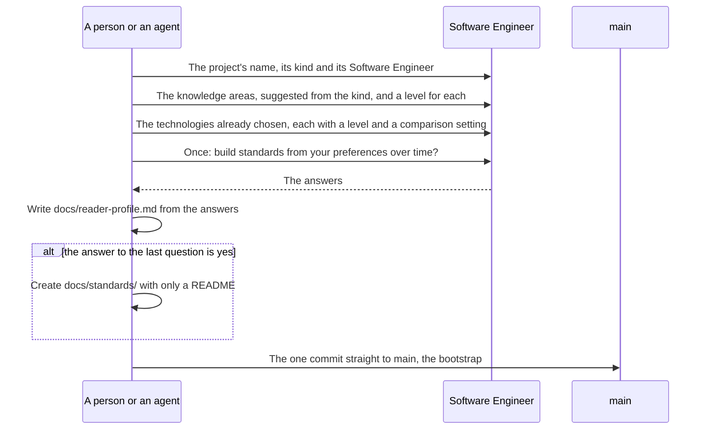
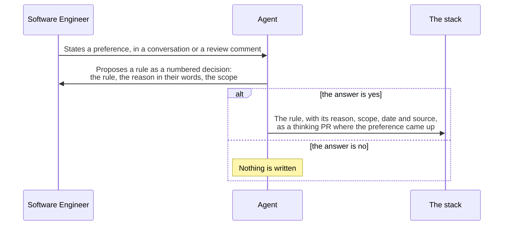
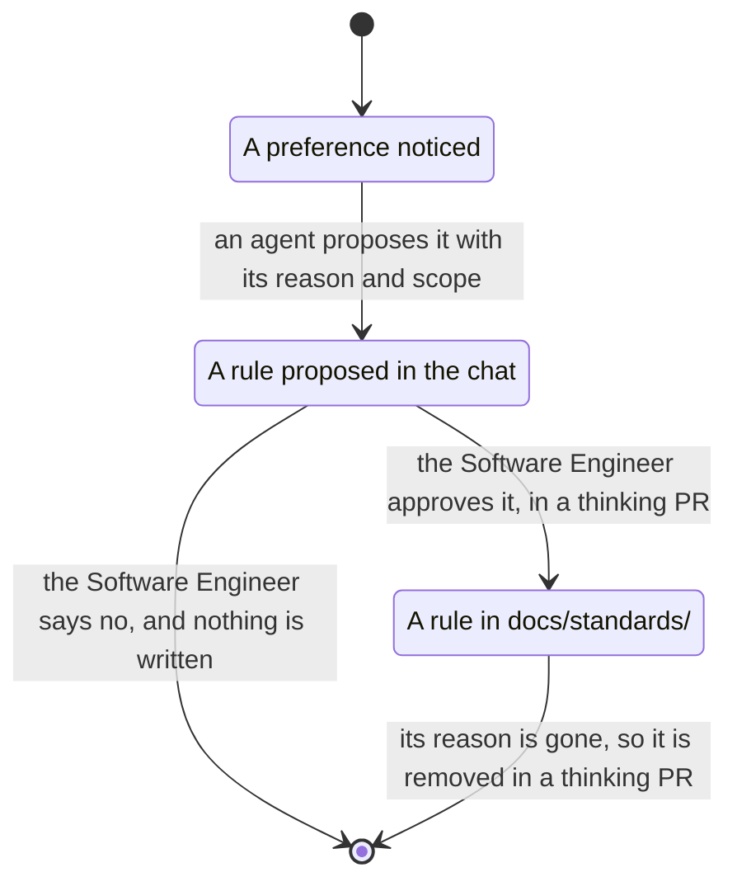
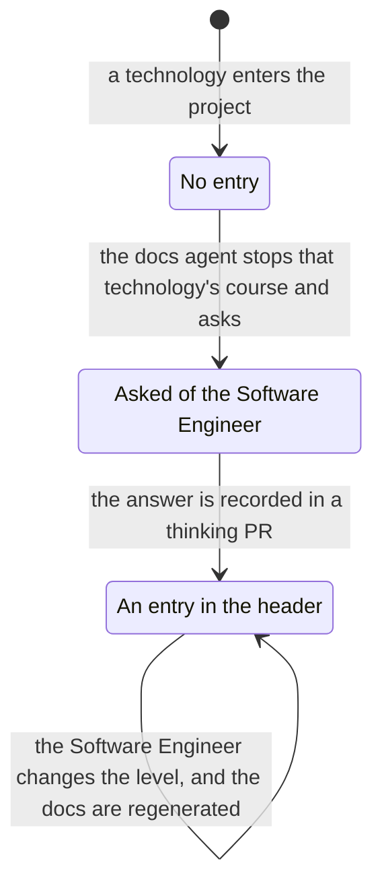
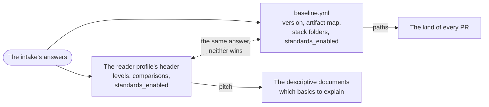

# Standards and the reader profile

This file holds the parts of three minimum sections that belong to a project's own inputs: two of the key flows, the states of a standard and of a profile entry, and the formats of the reader profile, a standard and `baseline.yml`. The rules are set in [standard/04-reader-profile.md](../../standard/04-reader-profile.md), [standard/19-standards-mechanism.md](../../standard/19-standards-mechanism.md) and [standard/05-project-layout.md](../../standard/05-project-layout.md). ADRs [0004](../adr/0004-reader-profile-is-the-target-team.md), [0005](../adr/0005-detail-always-maximum.md), [0006](../adr/0006-comparisons-in-marked-asides.md) and [0024](../adr/0024-standards-folder.md) record why.

The **reader profile** records who a project's documents are written for, with a level for each technology and each knowledge area. It decides which basics a document explains, it is the bar the Software Engineer hires against, and it never changes what is built. A **standard**, written lowercase, is a preference that the Software Engineer has approved, written as a rule in `docs/standards/`. Standards and ADRs are the only documents that drive code.

## Key flows

### A project starts with the intake

The **intake** is the set of questions asked when a project starts. The baseline's skills are to provide it as `/baseline:init`; they do not exist, so it is run by hand: the same questions are put to the Software Engineer in the same order, and the files are written from the answers. This repository's own profile was made this way, and the bootstrap commit on `main`, `47615da`, holds what it produced: `docs/reader-profile.md`, `docs/standards/README.md` and `baseline.yml`, with `.gitignore`.

*The intake asks four groups of questions in a fixed order and ends in the one commit that goes straight to main, and the one thing to notice is that the standards folder exists only on a yes: an agent never creates it on its own.*

Adopting the baseline in an existing repository is the work of `/baseline:adopt`, which is to do the same and have the docs agent document the current code as a docs-only stack. The standard states it as a requirement, and no procedure for doing it by hand is written ([standard/22-tooling-requirements.md](../../standard/22-tooling-requirements.md)).

### A preference becomes a standard

*A preference becomes a rule only through the Software Engineer's answer, and the one thing to notice is that the no branch writes nothing: no rule is ever inferred from what the Software Engineer said.*

This repository has opted in, and its `docs/standards/` holds only its README: no preference has been approved as a rule yet.

## State machines

### A standard

*A rule lives in the folder only between the Software Engineer's approval and the day its reason is gone, and the one thing to notice is that removal is an end and not a supersession: a standard is removed when its reason goes, while an Accepted ADR is replaced only by a new ADR.*

### A technology's entry in the profile

*A technology needs an entry before its course is written, and the one thing to notice is that only the Software Engineer's answer moves it on: the docs agent asks and never writes the entry itself.*

Every technology that this repository uses has an entry at this tip, so no docs agent run has had to stop.

## Interfaces and contracts

### The reader profile's header

The header is a block of YAML front matter, between two `---` lines at the start of `docs/reader-profile.md`, so that a program can read the answers from the same file that a person reads.

| Key | What it holds | This repository's value |
|---|---|---|
| `project` | The project's name | `baseline-framework` |
| `software_engineer` | The person who decides | `Chandan` |
| `standards_enabled` | The answer to the intake's one question about standards | `true` |
| `knowledge_areas` | A list; each entry has a `name` and a `level` | technical writing, average; software delivery process, advanced; AI-agent workflows, average |
| `technologies` | A list; each entry has a `name`, a `level` and a `compare_with` | Markdown, advanced; git and GitHub, advanced; gh stack and stacked PRs, beginner; Mermaid, average; YAML, average; Claude Code and skills, average; each with `compare_with: none` |

A level is `beginner`, `average` or `advanced`, and decides only which basics a document explains. A `compare_with` names a stack the reader knows, which adds marked "Coming from X" asides, or is `none`, a plain word and not YAML's empty value.

### A rule in docs/standards/

Each rule records four things beside it: its reason, in the Software Engineer's words; its scope, the whole project or one stack folder; the date it was approved; and its source, the PR or conversation where the preference came up. The standard fixes the four records and not their layout.

### baseline.yml

`baseline.yml` holds at least four keys, and the tooling may add its own.

| Key | What it holds | This repository's value |
|---|---|---|
| `baseline_version` | The pinned version of the baseline | `0.1.0` |
| `standards_enabled` | The intake's answer about standards, recorded in the reader profile too | `true` |
| `artifact_map` | Where skills write their documents: `spec`, `plan` and `other` | the superpowers paths, and `other` empty |
| `stack_folders` | The folders whose changes are code, apart from each folder's own README and AGENTS.md | `standard`, `kit`, `checkers`, `skills`, `examples` |

*The intake writes two files that two different readers use, and the one thing to notice is the dotted line between them: `standards_enabled` is recorded in both, neither record wins, and how a difference is reported is left to the tooling's design.*

The versioning policy and the error model of these formats are those of the baseline as a whole ([03-the-stack-model.md](03-the-stack-model.md)): no tool reads either file at this tip, and the standard requires the checks to compare the profile with the technologies in the code every night ([standard/22-tooling-requirements.md](../../standard/22-tooling-requirements.md)).
