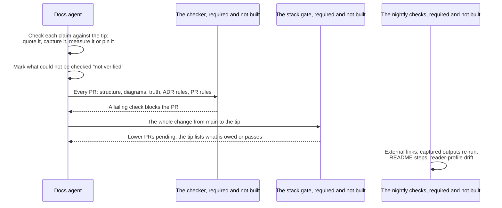
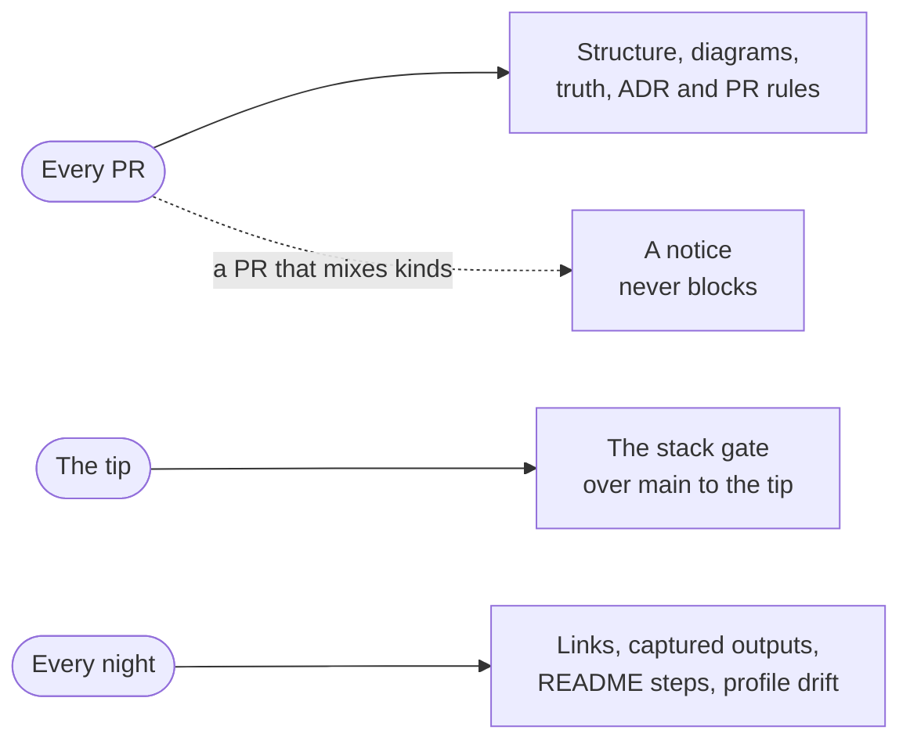
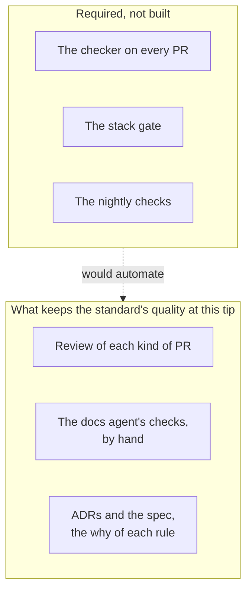

# Evidence and checks

This file holds one of the key flows and the section "Quality" of the architecture reference. The rules are set in [standard/17-evidence-and-truth.md](../../standard/17-evidence-and-truth.md), [standard/16-diagrams.md](../../standard/16-diagrams.md) and [standard/22-tooling-requirements.md](../../standard/22-tooling-requirements.md). ADRs [0019](../adr/0019-generated-indexes.md), [0020](../adr/0020-diagram-tooling-and-theme.md), [0021](../adr/0021-database-diagrams.md) and [0023](../adr/0023-enforcement.md) record why.

## Key flows

### How documents stay true

The standard keeps its documents true in two layers. The first is the eleven evidence rules, which every descriptive document follows and which the docs agent applies as it writes. The second is the checks, which the standard requires the tooling to make on every PR, at the tip of a stack and every night. At this tip only the first layer exists: no checker, CI workflow or generator is in the repository.

*The docs agent's own checking comes first and the required checks follow it, and the one thing to notice is that three of the four participants are marked not built: today the evidence rules hold because the docs agent applies them by hand.*

### The eleven evidence rules

| # | Rule | How it shows at this tip |
|---|---|---|
| 1 | Say only what exists at the tip. | The kit, the checkers and the skills appear in the documents as requirements and limits, never as features. |
| 2 | Quote code verbatim, as a captioned excerpt checked by a script. | No checker exists, so the docs agent checks each captioned excerpt with a script of its own and says so in the PR's description. |
| 3 | Capture output by running it. | Command output in the documents was captured by running the command. |
| 4 | Pin the versions in each document's header. | Each architecture file names its commit in its header, and each feature page names its commit under its title. |
| 5 | Measure performance claims. | No document makes a performance claim. |
| 6 | Say what you could not verify, in a "not verified" note. | Every unchecked statement carries one. |
| 7 | Measure the numbers you quote. | Counts of files, PRs and ADRs were measured with `git`. |
| 8 | Record the seed, the model and the versions of output that is not deterministic, or mark it illustrative. | No document quotes a model's answer. |
| 9 | Never hand-edit a generated index. | The five indexes are written once per PR by the docs agent, the single writer of the stack. |
| 10 | Keep a minimum section that does not apply as one line, `Not applicable: why`. | Sections such as Data in [08-cross-cutting.md](08-cross-cutting.md), and three areas of the deployment docs, which therefore have no diagram. |
| 11 | Where no generator exists, write the indexes in the format the generators will produce, as the single writer of the stack. | This is the baseline's own repository during its first stack, the one case the exception is for. |

The five generated indexes are the course index (`docs/course/README.md`), the architecture reference's index ([README.md](README.md) of this folder), the file map, the technical glossary and the ADR index ([docs/adr/README.md](../adr/README.md)). The product glossary is not one of them: the docs agent writes it from the terms that the feature pages use ([standard/10-course-reference-pages.md](../../standard/10-course-reference-pages.md)). No generator exists, and no format for a generator's output is written anywhere in the repository, so the form of each index is the docs agent's choice.

### The checks the standard requires

| Check | When it is to run | What a failure is to do |
|---|---|---|
| Docs structure, diagrams, truth checks, ADR rules, PR rules | On every PR, scoped to what it contains | Block the PR |
| The mixed-kind notice | On a PR that mixes kinds | Never block |
| The stack gate: new technologies have a profile entry and course files, new source files are on the file map, quoted numbers are measured, changed manifests, schemas and interfaces are covered | At the tip, over the whole change from `main` | Lower PRs pending; the tip lists what is owed or passes |
| External links, captured outputs, the README steps, reader-profile drift | Every night | The standard does not say |

*The standard requires each group of checks to have its own trigger, and the one thing to notice is that none of the boxes runs at this tip: they are what the tooling of design 3 must do.*

## Quality

### Performance budgets

Not applicable: the baseline at this tip is text that people and agents read, and nothing in the repository runs, so there is no operation whose speed could be budgeted or measured.

### The testing strategy

The repository holds no tests, no CI workflow and no checker at commit `bd7b1ce` (`git ls-tree -r --name-only bd7b1ce` lists 77 files, none of them code that runs, and the docs section adds only Markdown). The quality of the standard rests on three things that exist:

- **Review in the stack.** Each kind of PR is read in its own way: thinking for intent and soundness, code for correctness, and descriptions for whether they match the code. The Software Engineer reviews the whole stack before it merges.
- **The evidence rules applied by the docs agent.** The docs agent checks every claim of the documents it writes against the tip and records how in each description PR.
- **The decision records.** The why of every rule is in an ADR or in design 1 and its revisions, so a reviewer can check a rule against the decision behind it.

The checks that would turn these into automated tests are requirements on the tooling ([standard/22-tooling-requirements.md](../../standard/22-tooling-requirements.md)). Until they exist, the checks that the docs agent made by hand are listed, as command and result, in the description of each PR of the docs section.

*Quality today rests on review, hand checks and recorded decisions, and the one thing to notice is that the automated checks sit in a box of their own, joined by a dotted line: they are requirements, not tests that run.*
