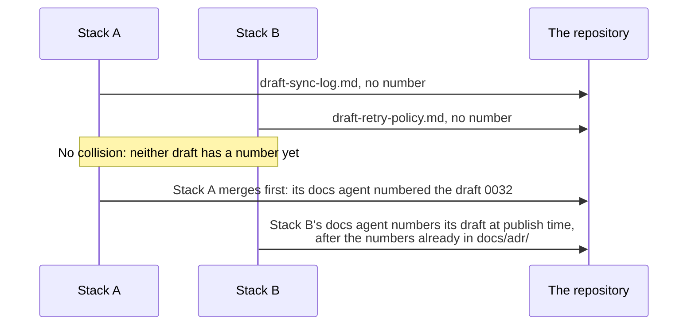
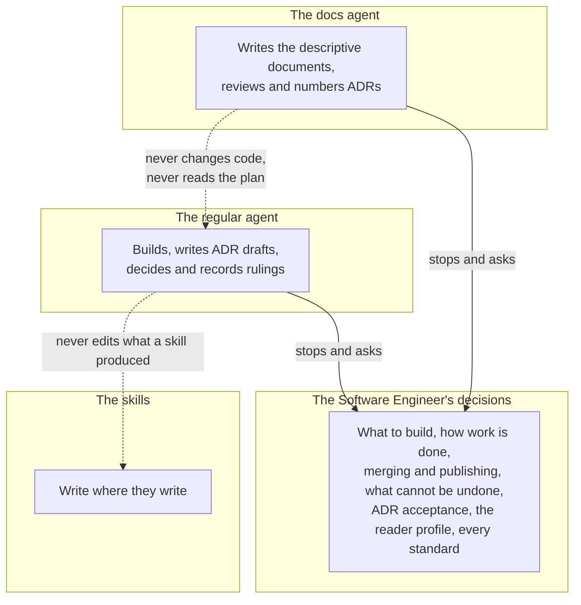
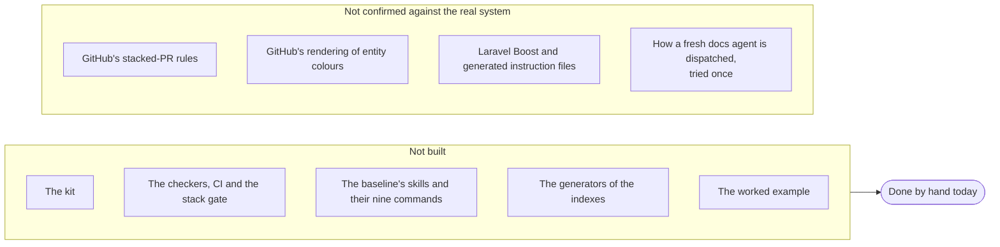
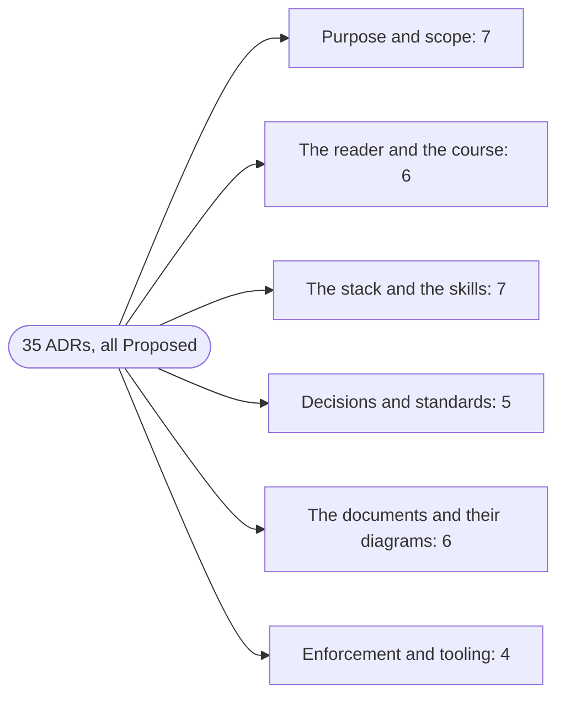

# Cross-cutting sections

This file holds six of the thirteen minimum sections of the architecture reference. Each either describes what exists at commit `cb4fb22` or is one line that says why it does not apply.

## Data

Not applicable: the baseline keeps no data of its own; its only stored state is the files of the repository, which git keeps, so it has no data model, no schema, no data lifecycle and no consistency model, and no current-state database diagram.

## Concurrency and failure model

The baseline runs no process, so it has no threads, no async model and no timeouts. What it does have is work that happens at the same time in more than one place: two stacks of PRs in flight in one repository, and many PRs of one stack that each touch the documents. The standard answers that with four rules, each of which removes a way for two pieces of work to collide.

| Hazard | The rule that removes it | Where it is set |
|---|---|---|
| Two stacks in flight give two ADRs the same number. | Drafts carry no number; the docs agent numbers them when it publishes them. | [standard/11-adrs.md](../../standard/11-adrs.md), "Numbering" |
| Every PR of a stack edits a shared index, so every rebase conflicts. | Indexes are generated and never edited by hand; while no generator exists, one writer in the stack, the docs agent, writes them. | [standard/17-evidence-and-truth.md](../../standard/17-evidence-and-truth.md), rules 9 and 11 |
| A push updates some branches of a stack and not others. | `gh stack link` pushes every branch in one atomic push, so all update or none does. | [standard/03-stack-model.md](../../standard/03-stack-model.md), "The tool" |
| Linking the same stack twice opens duplicate PRs or drops one. | `gh stack link` reuses the PR of a branch that has one, and never removes a PR from a stack. | [standard/03-stack-model.md](../../standard/03-stack-model.md), "The tool" |

*Two stacks in flight cannot collide on an ADR number, and the one thing to notice is that each number is given at publish time by the docs agent of each stack, so neither stack has a number to collide with while both are open.*

The example's names and numbers are made up. A draft whose links give no id takes the next number that `docs/adr/` has not used ([docs-agent.md](../agents/docs-agent.md)).

### Ordering and the invariants

A stack is merged from the bottom up, in one sitting, and only when the Software Engineer asks. Three invariants hold for a stack built to the standard; at this tip nothing checks them mechanically.

- **Each PR builds on the one below it.** The branches form one chain: for each neighbouring pair, `git merge-base --is-ancestor <lower> <upper>` exits with status 0, and the top branch is the tip. For the first stack this holds for all twenty branches, from `main` to `standard/20-revision-3-standard`. Two working branches point into the chain: `standard/build`, where the first build ended, equals PR 17, and `standard/revision-3`, where revision 3 was built, equals PR 20.
- **Each commit holds one kind**, so a stack can be cut with pointers alone.
- **An Accepted ADR is never rewritten**: only its status and its links are edited.

### Failure modes

| Failure | What happens | How it is put right |
|---|---|---|
| A commit mixes kinds | The cut cannot be made with pointers alone. | The agent splits the commit before it cuts, and checks that `git diff` between the old and new tip prints nothing. |
| A lower PR is amended after the docs are written | A document may describe code that changed. | The docs agent rebases the docs and re-verifies every document that quotes or describes the amended code; the checker that is to name the drifted documents does not exist. |
| Pushed history needs rewriting | The Software Engineer may be reading the commits that would be replaced. | The rewrite waits for the Software Engineer's yes; a cross-cutting fix goes on top as a new PR. |

## Security and trust

The baseline holds no secrets and authenticates no one. Its trust boundaries are between the people and agents who work on a project: who may decide what, and what each agent may touch.

*Each box is a boundary of authority, and the one thing to notice is that both agents cross into the Software Engineer's box only by stopping and asking, while the dotted lines are what an agent never does across a boundary.*

### How roles are represented, checked and enforced

The roles are named in text. `AGENTS.md` names the Software Engineer of this repository, Chandan, and `docs/reader-profile.md` records the same name in its header. The regular agent and the docs agent are roles that an agent takes on by following a playbook: an agent started from the docs agent's brief is the docs agent. Nothing checks a role or enforces a right mechanically at this tip; each right holds because the agent follows the text that states it.

The matrix of who can do what lives on the [Users and access page](../features/access.md) of the feature docs, and this reference links to it and does not copy it. The table maps each row of the matrix to the rule that states it and to the test that would prove it.

| Row of the matrix | The rule that states it | The test that proves it |
|---|---|---|
| Decide what to build and why | The Software Engineer's list, [standard/20-working-rules.md](../../standard/20-working-rules.md) | None exists, and the standard requires none. |
| Change how work is done | The same list | None exists, and the standard requires none. |
| Merge a stack, or open its PRs | Rule 10 of the stack; `AGENTS.md`, rule 4 | None exists, and the standard requires none. |
| Accept or reject an ADR | [standard/11-adrs.md](../../standard/11-adrs.md), "The lifecycle" | None exists. The checker is required to verify that every status is valid and that no Accepted ADR is rewritten. |
| Change the reader profile | [standard/04-reader-profile.md](../../standard/04-reader-profile.md), "Changing the file" | None exists. The nightly check is required to report drift between the profile and the code. |
| Approve a standard | [standard/19-standards-mechanism.md](../../standard/19-standards-mechanism.md), "How it fills" | None exists, and the standard requires none. |
| Write an ADR draft | [standard/11-adrs.md](../../standard/11-adrs.md), "Decisions of impact" | None exists. The stack gate is required to check that every changed manifest, schema or interface is covered. |
| Review and number an ADR draft | The guard rail, [standard/11-adrs.md](../../standard/11-adrs.md) | None exists. |
| Write a descriptive document | [standard/18-docs-agent.md](../../standard/18-docs-agent.md), "Purpose" | None exists, and the standard requires none. |
| Change code | [standard/18-docs-agent.md](../../standard/18-docs-agent.md), rule 1 | None exists. The PR rules are required to infer a PR's kind from its paths. |
| Read the plan | [standard/18-docs-agent.md](../../standard/18-docs-agent.md), "What it does not read" | None exists, and none could see what an agent read. |
| Record a ruling | [standard/20-working-rules.md](../../standard/20-working-rules.md), "The agents decide" | None exists. The PR rules are required to check that a description is complete for its kind. |
| Edit a skill's documents to fit the baseline | Constraint C4; [standard/21-skills-seams.md](../../standard/21-skills-seams.md) | None exists, and the standard requires none. |

### Secrets and data protection

No file at this tip holds a credential: the tracked files are Markdown, `baseline.yml`, which holds the four keys of the baseline's configuration, and `.gitignore`, which ignores `.superpowers/` and `.DS_Store`. The repository on GitHub is private (`gh repo view` reports `PRIVATE`). Who has access to it on GitHub was not checked: not verified.

## Operations summary

Not applicable: nothing in the repository runs, so there are no logs, metrics, traces or targets to summarise; the [deployment docs](../deploy/README.md) say where the repository is hosted and that nothing is deployed.

## Known limits

What the baseline does not do at this tip, and the rough edges found while documenting it.

*Two kinds of limit stand between the standard and a project, and the one thing to notice is that everything in the first box is done by hand today, while the second box holds behaviour of outside systems that the standard states only with a hedge.*

**Not built.** The kit, the checkers, CI, the stack gate, the baseline's skills with their nine commands, the generators of the five indexes and the worked example of design 2. The standard states each as a requirement ([standard/22-tooling-requirements.md](../../standard/22-tooling-requirements.md)). Every step that a command would take is done by hand, and the intake is the one with a written by-hand procedure ([standard/04-reader-profile.md](../../standard/04-reader-profile.md)).

**Not confirmed.** That required checks are evaluated for every PR of a stack, that lower PRs show a pending status, and that a stack merges bottom-up on GitHub; whether GitHub's own Mermaid renders the colours of an entity; whether Laravel Boost generates `AGENTS.md` and from which source; and how a fresh docs agent is dispatched in practice, which was tried once, by hand, on 2026-11-18, and is to be proven again before it is relied on ([standard/22-tooling-requirements.md](../../standard/22-tooling-requirements.md)). What was checked is that branches cut as pointers link cleanly with `gh stack link`, and what `gh stack view` shows in three states, on 2026-11-18 with `gh stack` 0.3.0 ([revision 1, section 3](../superpowers/specs/2026-11-18-baseline-standard-revision-1-design.md)).

**The palette in dark.** The approved palette's tinted rows measure 3.6 to 4.4 to 1 contrast in the dark theme, below the 4.5 to 1 that WCAG AA asks of normal text, though they read well, and the final values are the tooling's to confirm ([revision 1, D9](../superpowers/specs/2026-11-18-baseline-standard-revision-1-design.md)).

**Rough edges found while documenting.**

- No format for a generator's output is written anywhere, so the docs agent chose the form of the five indexes.
- A Markdown file's opening paragraph serves as its line in the file map, and the standard leaves to the tooling how the line is cut from it ([standard/10-course-reference-pages.md](../../standard/10-course-reference-pages.md)), so the docs agent wrote each line from the file. The two files that are not Markdown, `.gitignore` and `baseline.yml`, could carry a one-line header comment, and neither has one.
- What an entry of the product glossary links to when no lesson or system chapter teaches its term is left open ([revision 3, section 4](../superpowers/specs/2026-11-18-baseline-standard-revision-3-design.md)).
- Three of the four ADRs that came with revision 3, [0032](../adr/0032-five-generated-indexes.md), [0034](../adr/0034-update-moves-baseline-version.md) and [0035](../adr/0035-pr-kinds-of-baseline-yml-and-folder-files.md), record one real option and "do nothing", where the template asks for at least two real options ([standard/11-adrs.md](../../standard/11-adrs.md)). Each says that its revision recorded no other, and the docs agent's review may not add one.
- The reason of rule 6 of the stack, that the plan carries no layout, does not fit the first build, whose plan laid out the nine slices of the standard's text; whether the reason should change is left open ([revision 3, D7 and section 4](../superpowers/specs/2026-11-18-baseline-standard-revision-3-design.md)).
- The course has a language tier and a stack tier, and a product made only of Markdown has little code in either. Design 1 adapts the baseline's own course to the system-chapter form (section 16.4); the standard's text has no such adaptation.

## Where decisions live

<!-- Generated: the ADRs by area. No generator exists yet, so the docs agent writes this list as the single writer of its stack (standard/17-evidence-and-truth.md, rule 11). Do not edit it by hand. -->

| Area | ADRs |
|---|---|
| Purpose and scope | [0002](../adr/0002-baseline-scope.md), [0003](../adr/0003-delivery-standard-kit-skills.md), [0013](../adr/0013-one-repo-per-project.md), [0022](../adr/0022-reading-venue.md), [0027](../adr/0027-worked-example.md), [0028](../adr/0028-build-order.md), [0031](../adr/0031-software-engineer-and-the-ladder.md) |
| The reader and the course | [0004](../adr/0004-reader-profile-is-the-target-team.md), [0005](../adr/0005-detail-always-maximum.md), [0006](../adr/0006-comparisons-in-marked-asides.md), [0014](../adr/0014-course-scope.md), [0015](../adr/0015-course-tiers.md), [0016](../adr/0016-practice-standard.md) |
| The stack and the skills | [0007](../adr/0007-docs-at-top-of-stack.md), [0008](../adr/0008-fresh-docs-agent.md), [0009](../adr/0009-one-kind-per-pr.md), [0010](../adr/0010-skill-artifacts.md), [0029](../adr/0029-conventions.md), [0030](../adr/0030-agents-md-shape.md), [0035](../adr/0035-pr-kinds-of-baseline-yml-and-folder-files.md) |
| Decisions and standards | [0001](../adr/0001-adrs-with-options-explored.md), [0011](../adr/0011-adr-authorship-and-approval.md), [0012](../adr/0012-adr-placement-in-stack.md), [0024](../adr/0024-standards-folder.md), [0033](../adr/0033-adr-status-recording.md) |
| The documents and their diagrams | [0017](../adr/0017-architecture-reference-form.md), [0018](../adr/0018-feature-docs.md), [0019](../adr/0019-generated-indexes.md), [0020](../adr/0020-diagram-tooling-and-theme.md), [0021](../adr/0021-database-diagrams.md), [0032](../adr/0032-five-generated-indexes.md) |
| Enforcement and tooling | [0023](../adr/0023-enforcement.md), [0025](../adr/0025-update-mechanism.md), [0026](../adr/0026-checker-language.md), [0034](../adr/0034-update-moves-baseline-version.md) |

*The 35 ADRs fall in six areas, and the one thing to notice is that the areas are the docs agent's grouping: an ADR carries no area of its own, so the grouping is a ruling and not part of any ADR.*
