# Flowcharts

| Item | What it says |
|---|---|
| What you will learn | How the standard's flowcharts are built, from direction and node shapes to edge labels, dotted edges and subgraphs, and the rules that keep every one readable in both themes. |
| What you should already know | No earlier lesson. The reader profile records Mermaid at average: you have read Mermaid before, and this lesson explains its idioms and sharp edges. |
| Reading time | 27 minutes, worked out from its length. |
| Files in this codebase | `standard/README.md`, `standard/16-diagrams.md`, `standard/13-project-readme.md`, `standard/03-stack-model.md`, `standard/05-project-layout.md` |
| Versions verified against | Commit `cb4fb22`; every diagram of the lesson, and every diagram it quotes from the standard, rendered in dark and light with mermaid-cli 12.2.0, which bundles Mermaid 12.3.0. |
| Terms introduced | flowchart, node shape, edge label, subgraph, caption, backtick string |

## Orientation

Every document of the baseline carries diagrams beside its text, and Mermaid is the default way to draw them ([standard/16-diagrams.md](../../../../standard/16-diagrams.md)). Of the 87 diagrams in the 22 files of the standard and its index, 75 are flowcharts; the other twelve are seven sequence diagrams, three state diagrams and two entity-relationship diagrams. The 19 diagrams of the playbooks and the 162 of the ADRs are mostly flowcharts too. The counts come from reading every `mermaid` block in those folders, leaving out the four that sit inside the ADR template as text.

So reading and writing a flowchart is the one Mermaid skill every contributor uses. After this lesson you can read any flowchart in the repository line by line, write one that follows the baseline's four quality rules and its theme rules, and see at a glance the mistakes that stop a diagram from drawing at all.

## Mental model

A flowchart is text that Mermaid turns into a drawing. The four views below are the concept, the path from text to picture, the order in which a diagram reaches a reader, and where flowcharts sit in this codebase.

The concept: a flowchart is a set of nodes and the edges between them, laid out in one main direction.

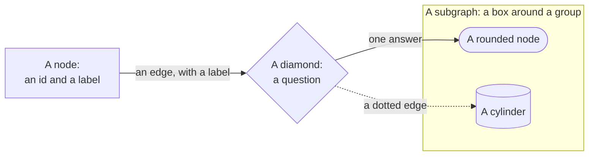

*A flowchart is nodes, edges and boxes around groups, and the one thing to notice is that the shape of a node and the style of an edge carry meaning without any colour.*

The data flow: the text of a block becomes a picture in four steps, and only the last depends on the reader.

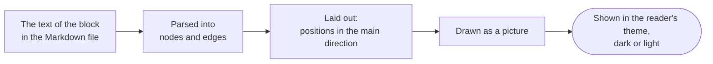

*The same text gives the same layout for every reader, and the one thing to notice is that the theme comes last: a diagram that sets no colour of its own takes the reader's theme at the very end.*

The sequence: who handles a diagram, from the author to the reader.

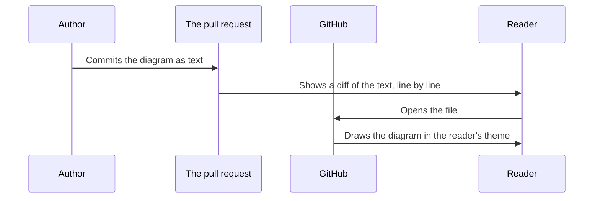

*A diagram travels as text until the moment it is read, and the one thing to notice is that a reviewer can read its diff like any other line of a document.*

Where it sits in this codebase: the standard draws flowcharts in every group of its files, and the files of this lesson are five of them.

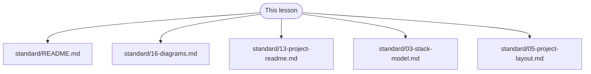

*The lesson draws on five files of the standard, and the one thing to notice is that each node names a real file inside a backtick string, the form that the fourth quality rule asks for.*

## Theory

**The header line.** A flowchart starts with `flowchart` and a direction: `LR` left to right, `RL` right to left, `TB` top to bottom (which `TD` also means) and `BT` bottom to top. The direction is the main axis of the layout. The standard uses `BT` for anything that is built from the bottom up, such as the ladder in its index and every picture of a stack, because a stack of pull requests is merged from the bottom.

**Nodes.** A node is an id followed by its label in brackets. The brackets choose the shape: `A["..."]` a box, `A(["..."])` a rounded box, `A{"..."}` a diamond and `A[("...")]` a cylinder. The standard gives each shape a job: a diamond is a question, a rounded node marks the thing to look at (the goal, the PR being read, what a viewer is shown), and a cylinder is a store such as a database. The id is what edges use; the label is what the reader sees. Ids are short (`A`, `SE`, `PR`) so that the edges stay readable.

**Quoted labels.** Every label in the standard is in double quotes. Quoting makes Mermaid read the whole text as a label, so punctuation such as a colon, a comma or parentheses cannot be mistaken for syntax. Inside a quoted label, `<br/>` breaks the line, and the standard uses it in 71 of its 87 diagrams to keep nodes narrow.

**Edges.** `A --> B` is an arrow. `A -->|"text"| B` is an arrow with a label. `A -.-> B` is a dotted arrow, and `A -.->|"text"| B` or `A -. "text" .-> B` a dotted arrow with a label. The standard gives the dotted arrow one job: a path that is not the normal path, such as what is never done, a side trip, or something that exists only under a condition. Edges can be chained, as in `SE --> LE --> PE`.

**Subgraphs.** `subgraph ID["Label"]` opens a box and `end` closes it. A subgraph may hold nodes, other subgraphs and its own `direction` line, and an edge may start or end at a subgraph's id, which draws the arrow to the whole box. The standard uses subgraphs to group what belongs together, such as the prescriptive and the descriptive documents in its document map.

**The baseline's rules.** Every diagram has a one-line italic caption saying what it shows and the one thing to notice; its labels use the project's glossary terms; it answers a question the text cannot answer as well; and a diagram that names a real file puts the name in backticks. It sets no colour of its own: no `style`, `classDef` or `linkStyle`, and no theme override, except the approved palette. Meaning is carried by shape, label and line style, never by colour alone, because the Software Engineer reads in dark and other readers in light ([standard/16-diagrams.md](../../../../standard/16-diagrams.md)).

## In this codebase

The excerpts are verbatim, and a script compared each one with its file at commit `cb4fb22`. No standard of this project shaped them: `docs/standards/` holds no rule.

### A chain drawn from the bottom up

*Excerpt from [`standard/README.md`](../../../../standard/README.md), lines 26 to 32.*

```text
flowchart BT
    SE["Software Engineer<br/>the person the baseline is for"]
    LE["Lead Engineer"]
    PE["Principal Engineer"]
    SA["Solutions Architect"]
    DE(["Distinguished Engineer<br/>the goal"])
    SE --> LE --> PE --> SA --> DE
```

- `flowchart BT` lays the chart out from the bottom to the top, so the first node of the chain is at the bottom.
- The first four nodes are boxes; `SE` breaks its label over two lines with `<br/>`.
- `DE(["..."])` is the one rounded node: the goal, which the caption under the diagram in the index names as the one thing to notice.
- The last line chains four edges, so the five nodes form one line from `SE` up to `DE`.

### A question and the path that is never taken

*Excerpt from [`standard/16-diagrams.md`](../../../../standard/16-diagrams.md), lines 26 to 33.*

```text
flowchart TD
    A["A diagram is needed"] --> B{"Can Mermaid draw it?"}
    B -->|"yes: the default"| C["Draw it in Mermaid,<br/>as text in the document"]
    B -->|"no: timing or a state-space graph"| D["Use WaveDrom or Graphviz"]
    B -->|"no: a memory layout"| H["Use fenced ASCII:<br/>the drawing is its own source"]
    D --> E["Commit the source<br/>next to the rendered image"]
    E --> F["Required: the checker re-renders the source<br/>to prove that the two match"]
    A -. "never" .-> G["A hand-drawn image<br/>with no source"]
```

- A node can be declared on the line of its first edge: `A` and `B` are both declared in the second line.
- `B{"..."}` is a diamond, so `B` reads as a question, and each edge out of it carries its answer as a label.
- The labels contain colons, which the quotes keep from being read as syntax.
- The last line is the dotted, labelled edge: the path that the rule forbids, drawn so the reader sees it is not a path to take.

### A side trip

*Excerpt from [`standard/13-project-readme.md`](../../../../standard/13-project-readme.md), lines 54 to 62.*

```text
flowchart LR
    A["Change the code"] --> B["Run the system"]
    B --> C["Test the one thing<br/>you changed"]
    C --> D["Test everything"]
    D --> E["Format and lint"]
    E --> F["Build"]
    F -->|"and again"| A
    B -.->|"when a fresh start is needed"| G["Reset local data"]
    G -.-> B
```

- The solid edges form the loop, and `F -->|"and again"| A` closes it.
- The two dotted edges leave the loop and come back to the same node, which is how the diagram shows a step that is taken only when needed.
- This edge uses the `-.->|"..."|` form of a dotted labelled edge, while the previous excerpt used `-. "..." .->`; both draw the same thing.

### Long labels and their sharp edge

*Excerpt from [`standard/03-stack-model.md`](../../../../standard/03-stack-model.md), lines 85 to 92.*

```text
flowchart LR
    P["The paths a PR touches"]
    T["Thinking PR"]
    C["Code PR"]
    D["Description PR<br/>the one crossover: it may also<br/>edit ADR files, for review edits<br/>and numbering"]
    P -->|"a path in the artifact map<br/>(spec, plan, other skill artifacts),<br/>or another prescriptive document<br/>(ADR drafts, standards, reader profile,<br/>playbooks, AGENTS.md of the root<br/>or of a stack folder)"| T
    P -->|"a path in a stack folder<br/>(code and tests, not its README.md<br/>or AGENTS.md), or baseline.yml"| C
    P -->|"a path of the docs section:<br/>features, architecture, course,<br/>deployment, README, reference pages,<br/>or the README.md of a stack folder"| D
```

- The four nodes are declared first, on lines of their own, and the edges follow. This is the other common layout of a flowchart's text.
- The edge labels hold parentheses and commas. Inside quotes they are plain text; without the quotes, a parenthesis would be read as the start of a node shape.
- Each label is broken with `<br/>` every few words, because an edge label is drawn on one line unless it is broken.
- `AGENTS.md` and `baseline.yml` appear in labels without backticks. Here they name kinds of file in any project, not one file of this repository, so the fourth quality rule does not apply to them.

### Subgraphs inside subgraphs

*Excerpt from [`standard/05-project-layout.md`](../../../../standard/05-project-layout.md), lines 16 to 40.*

```text
flowchart TB
    subgraph PRE["Prescriptive: written before or alongside the work"]
        SP["Spec"]
        PL["Plan"]
        subgraph DRV["The only two that drive code"]
            AD["ADRs"]
            ST["Standards"]
        end
        RP["Reader profile"]
        PB["Playbooks and AGENTS.md"]
    end
    CODE["Code"]
    subgraph DESC["Descriptive: written after the build by the docs agent"]
        FE["Feature docs: non-technical, what it can do"]
        AR["Architecture reference: technical, how it is built"]
        CO["Guided course: language, stack, system"]
        DP["Deployment and infrastructure docs"]
        RM["README"]
        RF["Reference pages: file map, glossaries, what else it offers maps"]
    end
    DRV -->|"drive"| CODE
    CODE -->|"the docs agent writes from the finished code"| DESC
    SP -. "why" .-> DESC
    AD -. "why" .-> DESC
    RP -. "pitch and depth of basics" .-> DESC
```

- `DRV` is a subgraph inside `PRE`: the ADRs and the standards are boxed twice, once as prescriptive documents and once as the only two that drive code.
- `DRV -->|"drive"| CODE` starts an edge at a subgraph, so the arrow leaves the inner box, not one node.
- `CODE -->|"..."| DESC` ends an edge at a subgraph: the docs agent writes the whole box of descriptive documents.
- The three dotted edges carry the why and the pitch into the descriptive documents, the reasons that the code alone cannot give.

**Rendered.** Each diagram quoted here was rendered as it stands in its file of the standard, in dark and light, with mermaid-cli 12.2.0, which bundles Mermaid 12.3.0, the renderer that the baseline's own build pinned ([revision 1, D9](../../../superpowers/specs/2026-11-18-baseline-standard-revision-1-design.md)). All of them drew without an error. How GitHub's own Mermaid draws them was not checked: not verified.

## Pitfalls

- **An unquoted label with syntax in it.** `T[Thinking PR (spec)]` puts a parenthesis where Mermaid expects the end of a label, so the diagram does not parse. Quote every label, as the standard does.
- **A subgraph without its `end`.** The box is never closed, so the parser reaches the end of the block still expecting an `end`, and nothing draws. Count `subgraph` lines against `end` lines.
- **A colour for meaning.** `style A fill:#fff,color:#000` looks right in one theme and can be unreadable in the other, and it breaks the theme rule. Carry the meaning by shape, label or a dotted line.
- **A file name without backticks.** A diagram that names a real file of the repository must put it in backticks. Inside a Mermaid label that means the backtick string form, `` A["`standard/16-diagrams.md`"] ``, which Mermaid formats as Markdown; keep such a label to one line, because a backtick string breaks lines differently from `<br/>`.
- **An edge label that is too long.** A label is drawn on one line unless it is broken with `<br/>`, and a long one stretches the whole layout.
- **A caption that only names the diagram.** The first quality rule asks for what it shows and the one thing to notice.

The first two mistakes stop the diagram, and these are the errors mermaid-cli 12.2.0, which bundles Mermaid 12.3.0 printed for them on 2026-11-18. For the unquoted label, `flowchart LR` followed by `    T[Thinking PR (spec)]`:

```text
Error: Parse error on line 2:
...R    T[Thinking PR (spec)]
----------------------^
Expecting 'SQE', 'DOUBLECIRCLEEND', 'PE', '-)', 'STADIUMEND', 'SUBROUTINEEND', 'PIPE', 'CYLINDEREND', 'DIAMOND_STOP', 'TAGEND', 'TRAPEND', 'INVTRAPEND', 'UNICODE_TEXT', 'TEXT', 'TAGSTART', got 'PS'
```

`got 'PS'` names the token Mermaid found where the label should have ended: the opening parenthesis, which it reads as the start of a shape. For a subgraph left open, the block below, the error comes at the block's last line, where an `end` was still expected:

```text
flowchart LR
    subgraph K["Kinds"]
        C["Code PR"]
    P["Paths"] --> C
```

```text
Error: Parse error on line 6:
...  P["Paths"] --> C
---------------------^
Expecting 'SEMI', 'NEWLINE', 'SPACE', 'EOF', 'subgraph', 'end', 'acc_title', 'acc_descr', 'acc_descr_multiline_value', 'AMP', 'COLON', 'STYLE', 'LINKSTYLE', 'CLASSDEF', 'CLASS', 'CLICK', 'DOWN', 'DEFAULT', 'NUM', 'COMMA', 'NODE_STRING', 'BRKT', 'MINUS', 'MULT', 'UNICODE_TEXT', 'direction_tb', 'direction_bt', 'direction_rl', 'direction_lr', 'direction_td', got '1'
```

Each message was followed by the renderer's own stack trace, left out here. In the second message the line number, 6, is past the block's four lines: the parser reports the place where it ran out of text still expecting an `end`. The other four mistakes draw without an error, which is why the baseline's rules, and not the renderer, catch them.

## Under the hood

Mermaid reads the text of the block, builds a graph of nodes and edges, works out a position for each node along the main direction, and draws the result as a picture in the page. GitHub draws a Mermaid block when it shows a Markdown file, which is why the standard can keep every diagram as text in the document (constraint C2 in [standard/01-why-and-scope.md](../../../../standard/01-why-and-scope.md)). Where the standard requires its checker to parse every diagram and render it in both themes, that is a requirement on tooling that does not exist yet ([standard/22-tooling-requirements.md](../../../../standard/22-tooling-requirements.md)).

The theme is applied when the diagram is drawn. A diagram that sets no colour is drawn with the colours of the theme the reader has chosen, and that is the whole reason for the theme rule: a hard-coded colour is fixed at the moment the author writes it, and only one of the two themes was in front of the author. This lesson makes no claim about how fast a diagram draws, because nothing was measured.

## How it fails and scales

- **Failure is all or nothing.** One syntax error stops the whole block from drawing, so a single unquoted parenthesis hides every node of a diagram.
- **Layout moves when the graph changes.** Adding one node or edge can move many others, because positions are worked out for the whole graph. A small change of text can be a large change of picture, which a reviewer sees only by looking at the drawing.
- **Width grows with labels.** The standard keeps nodes narrow with `<br/>` and splits a busy picture over more than one diagram, as its README does with the two diagrams of parts 1 and 5.
- **What to measure.** The standard requires its checker to verify that every diagram parses, renders in both themes and hard-codes no colour outside the palette. Those are the checks to run when the tooling exists.

No size limit is quoted here, because none was measured.

## Summary and cheat sheet

| You want | Write |
|---|---|
| A layout from the bottom up | `flowchart BT` |
| A box, a rounded box, a question, a store | `A["..."]`, `A(["..."])`, `A{"..."}`, `A[("...")]` |
| A line break in a label | `<br/>` inside the quotes |
| An arrow, with a label | `A --> B`, `A -->|"text"| B` |
| A path that is not the normal one | `A -.-> B`, `A -. "text" .-> B` |
| A group, with its own direction | `subgraph ID["Label"]`, `direction LR`, `end` |
| A real file named in a node | `` A["`path/to/file.md`"] ``, on one line |
| Emphasis colour | Only the approved palette, and never meaning by colour alone |

Every diagram: a one-line italic caption, glossary terms in its labels, a question the text cannot answer as well, and no colour of its own.

Further reading: Mermaid's own documentation of flowcharts, at mermaid.js.org, and [standard/16-diagrams.md](../../../../standard/16-diagrams.md).

**What was verified.** Every excerpt, by a script, against its file at commit `cb4fb22`; the counts of diagrams, by reading every block; every diagram of the lesson and every diagram it quotes, by rendering it in dark and light with mermaid-cli 12.2.0, which bundles Mermaid 12.3.0; and the error messages of the pitfalls, by running the broken text. **Not verified.** How GitHub's own Mermaid draws the diagrams.

## Practice

The questions and exercises use the diagrams of this lesson. A model solution passes when the baseline's lint for diagrams accepts it (quotes balanced, every `subgraph` closed, a caption, no colour outside the palette) and it renders in dark and light with mermaid-cli 12.2.0, which bundles Mermaid 12.3.0. Every model solution below passed both on 2026-11-18.

### Ten theory questions

**Question 1 (predict).** In the ladder excerpt from `standard/README.md`, which node is at the bottom of the drawing, and which is drawn rounded?

<details><summary>Worked answer</summary>

`SE` is at the bottom, because `flowchart BT` lays the chain out from the bottom to the top and `SE` is the first node of the chain. `DE` is the only rounded node, because it is the only one written `(["..."])`.

**Common wrong answers.** "`DE` is at the bottom", which reads the text order as the drawing order without the direction. "All nodes are rounded", which mistakes the quotes for the shape.

</details>

**Question 2 (predict).** In the excerpt from `standard/16-diagrams.md`, what does `A -. "never" .-> G` draw?

<details><summary>Worked answer</summary>

A dotted arrow from `A` to `G` with the label "never". The dots are the standard's mark for a path that is not the normal one, here what is never done.

**Common wrong answers.** "A comment", because the line looks unlike the others. "An arrow from `G` to `A`", which reads it backwards.

</details>

**Question 3 (predict).** If the quotes are removed from the first edge label of the excerpt from `standard/03-stack-model.md`, will the diagram still draw?

<details><summary>Worked answer</summary>

No. Without quotes, the parentheses in "(spec, plan, other skill artifacts)" are read as the start of a node shape, and the block does not parse, so nothing in it draws. Rendered with mermaid-cli 12.2.0, the excerpt with that label's quotes removed stops with `Parse error on line 6`, the line of that edge, with the marker under the opening parenthesis.

**Common wrong answers.** "Yes, the label just shows without quotes", which assumes quotes are decoration. "Only that edge disappears", which forgets that one syntax error stops the whole block.

</details>

**Question 4 (diagnose).** A diagram added to a document reads well for the author in dark, but a reader in light sees nodes whose text cannot be read. The block has the line `style B fill:#1f2328,color:#ffffff`. What is the cause?

<details><summary>Worked answer</summary>

A hard-coded colour. The line fixes a dark fill with white text for node `B`, which matches the author's dark theme and clashes with the light one. The theme rule forbids `style` for exactly this reason; remove the line, and carry any meaning by shape or label.

**Common wrong answers.** "GitHub's light theme is broken", which blames the reader's theme for a colour the author fixed. "The node needs a lighter fill", which keeps the hard-coded colour and only moves the problem to the dark theme.

</details>

**Question 5 (diagnose).** A flowchart with two subgraphs does not draw at all, and Mermaid reports a parse error at its last line, expecting `end` among other things. What should you look for first?

<details><summary>Worked answer</summary>

A missing `end`. With two subgraphs and one `end`, that `end` closes the inner one and the outer one stays open, so the parser reaches the end of the block still inside a box. Count the `subgraph` lines against the `end` lines.

**Common wrong answers.** "The direction line is wrong", which changes the layout and would not stop the parse. "The ids clash", which would join nodes, not leave a box open.

</details>

**Question 6 (diagnose).** A reviewer flags a node `` F["standard/16-diagrams.md"] `` in an architecture file of this repository. Which rule is broken, and what is the fix?

<details><summary>Worked answer</summary>

The fourth quality rule: a diagram that names a real file puts the name in backticks, so that the required check can confirm the file exists. The fix is the backtick string form, `` F["`standard/16-diagrams.md`"] ``, on one line.

**Common wrong answers.** "None: the file exists", which confuses the rule with the check. "Put the backticks inside the quotes in the middle of the text", which Mermaid would not read as a backtick string.

</details>

**Question 7 (design trade-offs).** The kind-of-PR diagram in `standard/03-stack-model.md` puts long, detailed text on its edges. When would you move that text into the prose and keep the edges short?

<details><summary>Worked answer</summary>

When the edges stop answering a question the text cannot answer as well. The diagram's job is to show that one set of paths splits three ways; long labels make that harder to see, but they keep the whole rule in one picture that a reader can check against the table. The trade-off is between a picture that is complete and one that is quick to read, and the third quality rule asks which one answers the question better here.

**Common wrong answers.** "Always keep labels short", which ignores that the rule must be complete somewhere. "Always put everything in the diagram", which ignores that a diagram that is hard to read fails its question.

</details>

**Question 8 (design trade-offs).** The document map uses a subgraph inside a subgraph. What would one diagram per box lose, and what would it gain?

<details><summary>Worked answer</summary>

It would lose the arrows between the boxes, which are the point: what drives the code and what carries the why into the documents. It would gain simpler pictures. Because the question is how the groups relate, one diagram with nested boxes answers it better.

**Common wrong answers.** "Nothing: nesting is only style", which misses the edges that start and end at subgraphs. "Nesting is not allowed in Mermaid", which the excerpt disproves.

</details>

**Question 9 (systems reasoning).** The standard forbids hard-coded colours yet allows an approved palette. Why is a fixed palette safe when a free choice of colour is not?

<details><summary>Worked answer</summary>

Because the palette was tested in both themes and is the same everywhere: a translucent tint and a solid border, with no text colour, so the text follows the reader's theme. A free choice is tested, at best, in the author's one theme. The invariant the rule protects is that every diagram is readable in dark and in light, and colour never carries meaning alone.

**Common wrong answers.** "The palette is prettier", which is not the reason. "Colours are always unsafe", which the tested palette disproves.

</details>

**Question 10 (systems reasoning).** The standard keeps diagrams as text in the documents. What does that make possible at the scale of a stack of many pull requests, and what invariant does the required checker add?

<details><summary>Worked answer</summary>

A reviewer sees each diagram's change as a diff in the pull request, and an agent can write and fix it like any other line, so diagrams change in the same stack as the code they describe. The required checker adds that every diagram parses and renders in both themes, so a broken diagram cannot reach the top of the stack once the tooling exists.

**Common wrong answers.** "Text diagrams are smaller files", which is true and beside the point. "The checker already blocks broken diagrams", which states a requirement as if it ran today.

</details>

### Ten programming exercises

The three warm-ups and the four core drills fail until they are solved: the starting text breaks a rule. Each names the idea in this codebase that it prepares for.

**Warm-up 1.** Turn this chain so that it is drawn from the bottom up, and draw its last node rounded. It prepares for the ladder in `standard/README.md`.

```text
flowchart TB
    A["Start"] --> B["Middle"] --> C["Goal"]
```

<details><summary>Model solution</summary>

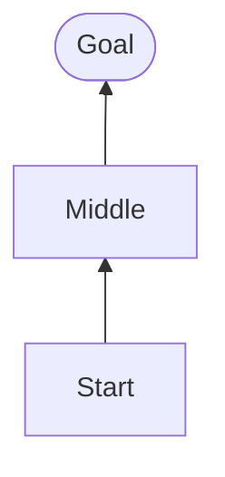

*The chain is drawn from the bottom up with the goal rounded at the top, and the one thing to notice is that only the direction and the brackets of one node changed.*

</details>

**Warm-up 2.** Give both edges out of the question a label, "yes" and "no". It prepares for the decision in `standard/16-diagrams.md`.

```text
flowchart TD
    Q{"Can Mermaid draw it?"} --> M["Mermaid"]
    Q --> O["Another text tool"]
```

<details><summary>Model solution</summary>

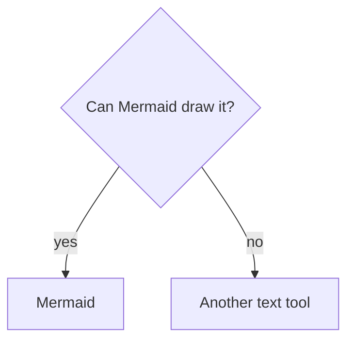

*Each edge out of the question carries its answer, and the one thing to notice is that a diamond without labelled edges would not say which answer leads where.*

</details>

**Warm-up 3.** Write the caption this diagram needs.

```text
flowchart LR
    A["Change"] --> B["Run"] --> C["Test"]
    C -->|"and again"| A
```

<details><summary>Model solution</summary>

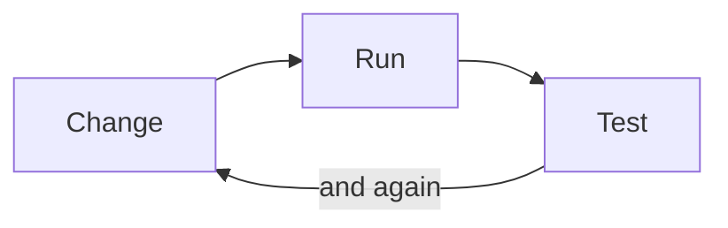

*The loop runs from a change through a run to a test and back, and the one thing to notice is the labelled edge that closes it: the work repeats.*

</details>

**Core 1.** Fix this diagram so that it parses: one label needs quotes and one box needs closing. It prepares for the long labels of `standard/03-stack-model.md`.

```text
flowchart LR
    subgraph K["Kinds"]
        T[Thinking PR (spec, plan)]
        C["Code PR"]
    P["Paths"] --> T
    P --> C
```

<details><summary>Model solution</summary>

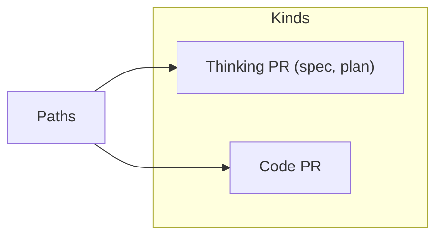

*The paths lead to two kinds of PR grouped in one box, and the one thing to notice is the two fixes: quotes around the label with parentheses and an `end` that closes the box.*

</details>

**Core 2.** Group these four nodes into two boxes, "Prescriptive" and "Descriptive", each laid out left to right, and keep the arrow between the groups. It prepares for the document map in `standard/05-project-layout.md`.

```text
flowchart TB
    S["Spec"]
    A["ADRs"]
    F["Feature docs"]
    R["README"]
    A --> F
```

<details><summary>Model solution</summary>

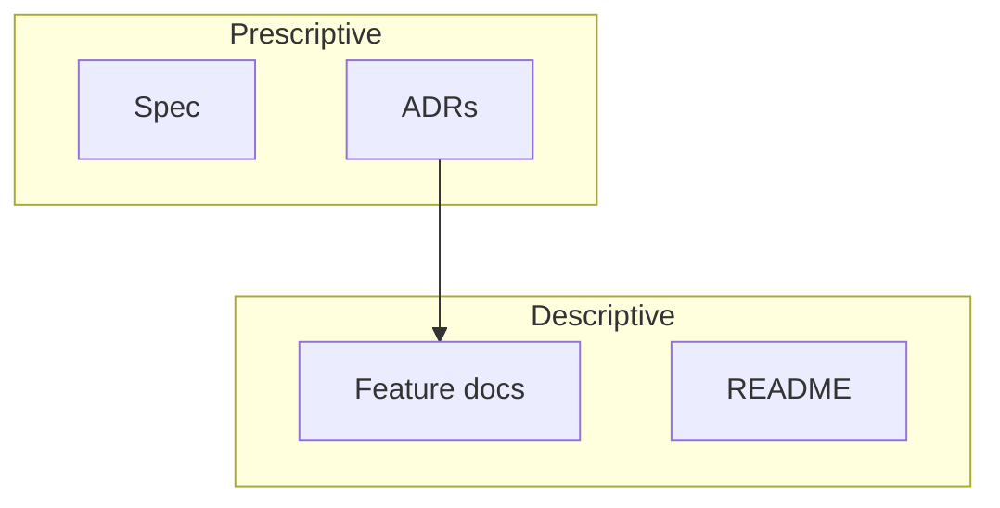

*Two boxes group the documents by when they are written, and the one thing to notice is that each box has its own direction while the arrow still runs from one box to the other.*

</details>

**Core 3.** Add a side trip: from "Run", a dotted arrow labelled "when needed" to a new node "Reset", and a dotted arrow back. It prepares for the daily loop in `standard/13-project-readme.md`.

```text
flowchart LR
    A["Change"] --> B["Run"] --> C["Test"]
```

<details><summary>Model solution</summary>

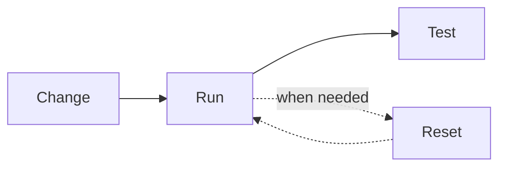

*The reset is a side trip from the run and back, and the one thing to notice is that the dotted edges mark it as a step taken only when needed, apart from the main line.*

</details>

**Core 4.** This diagram uses colour to mark the step that is never taken. Take the colour out and carry the meaning another way. It prepares for the theme rules of `standard/16-diagrams.md`.

```text
flowchart LR
    A["A diagram is needed"] --> B["Draw it in Mermaid"]
    A --> C["A hand-drawn image"]
    style C fill:#f85149,color:#ffffff
```

<details><summary>Model solution</summary>

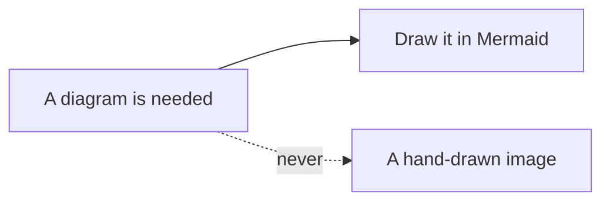

*The forbidden path is a dotted arrow labelled never instead of a red node, and the one thing to notice is that the meaning now survives both themes and a printout, because no colour carries it.*

</details>

**Stretch 1.** Draw the six groups of the standard as a chain, with the index as a rounded node that points to the first group, and one node that names `standard/16-diagrams.md` as a real file. It prepares for the module map in the architecture reference.

<details><summary>Model solution</summary>

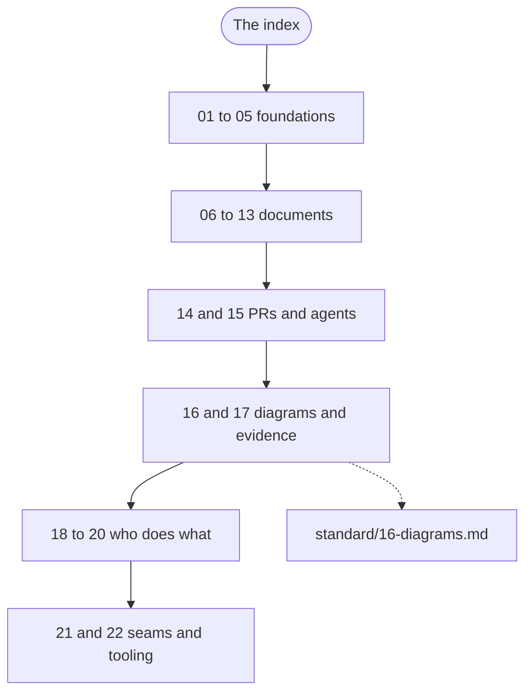

*The six groups form one chain from the index, and the one thing to notice is the real file named in a backtick string on its own node, as the fourth quality rule asks.*

</details>

**Stretch 2.** This diagram uses words that the glossary does not use. Rewrite its labels in the glossary's terms: "pull request", "stack", "docs agent". It prepares for the second quality rule.

```text
flowchart LR
    A["Change request"] --> B["Pile of changes"]
    B --> C["Doc bot"]
```

<details><summary>Model solution</summary>

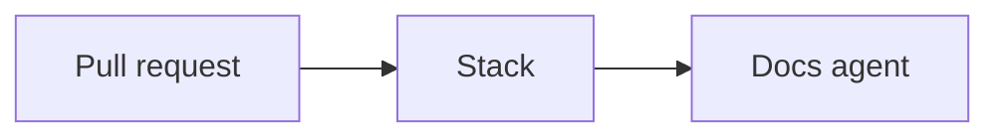

*Each label now uses the glossary's term, and the one thing to notice is that the picture did not change at all: only the words did, so that a reader meets the same term in the diagram as in the text.*

</details>

**Stretch 3.** Redraw the kind-of-PR rule as a decision tree: one diamond for each question, ending in "Thinking", "Code" or "Description". It prepares for the same rule drawn in [the architecture reference](../../../architecture/03-the-stack-model.md).

<details><summary>Model solution</summary>

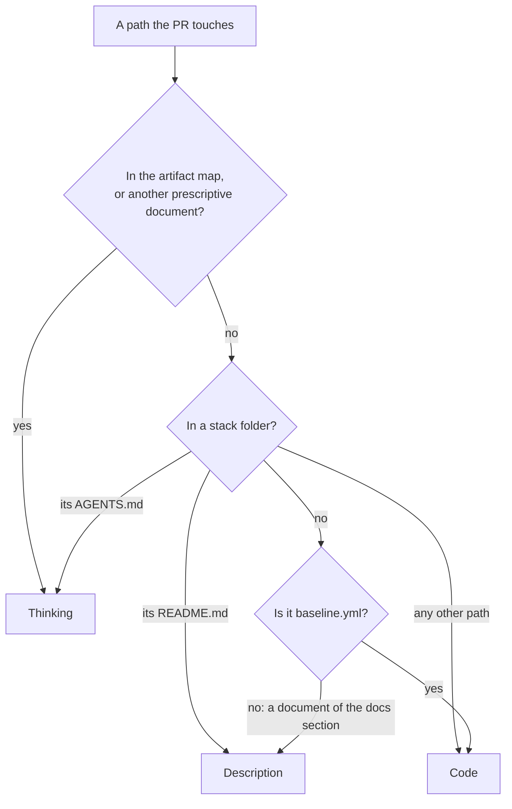

*Each question narrows the path's kind, and the one thing to notice is that a stack folder can send a path to any of the three kinds, which a single fan of three edges hides.*

</details>
