# Sequence and state diagrams

| Item | What it says |
|---|---|
| What you will learn | How the standard draws who does what in what order with sequence diagrams, and what can happen from each status with state diagrams, including notes, alternatives, start and end states and states with plain-language names. |
| What you should already know | [Flowcharts](01-flowcharts.md): quoted labels, `<br/>`, captions and the theme rules. |
| Reading time | 25 minutes, worked out from its length. |
| Files in this codebase | `standard/11-adrs.md`, `standard/06-feature-docs.md`, `standard/17-evidence-and-truth.md` |
| Versions verified against | Commit `bd7b1ce`; every diagram of the lesson, and every diagram it quotes from the standard, rendered in dark and light with mermaid-cli 12.2.0, which bundles Mermaid 12.3.0. |
| Terms introduced | sequence diagram, participant, alt block, state diagram, start and end state |

## Orientation

Two questions come up in the standard again and again that a flowchart answers badly. Who does what, and in what order: the docs agent and the Software Engineer passing work back and forth, or an agent stopping to ask. And what can happen from here: the statuses of an ADR, or how a person gains and loses access. The standard draws the first with sequence diagrams, seven of its 87 diagrams, and the second with state diagrams, three of them. The playbooks add four sequence diagrams and one state diagram. The architecture reference requires a state diagram for every status and workflow and a sequence diagram for each major flow ([standard/07-architecture-reference.md](../../../../standard/07-architecture-reference.md)), so the architecture files of this repository use both.

After this lesson you can read every sequence and state diagram in the repository, and write one that answers its question in the form the standard uses.

## Mental model

The concept: a sequence diagram is about order between participants; a state diagram is about what can follow from each state.

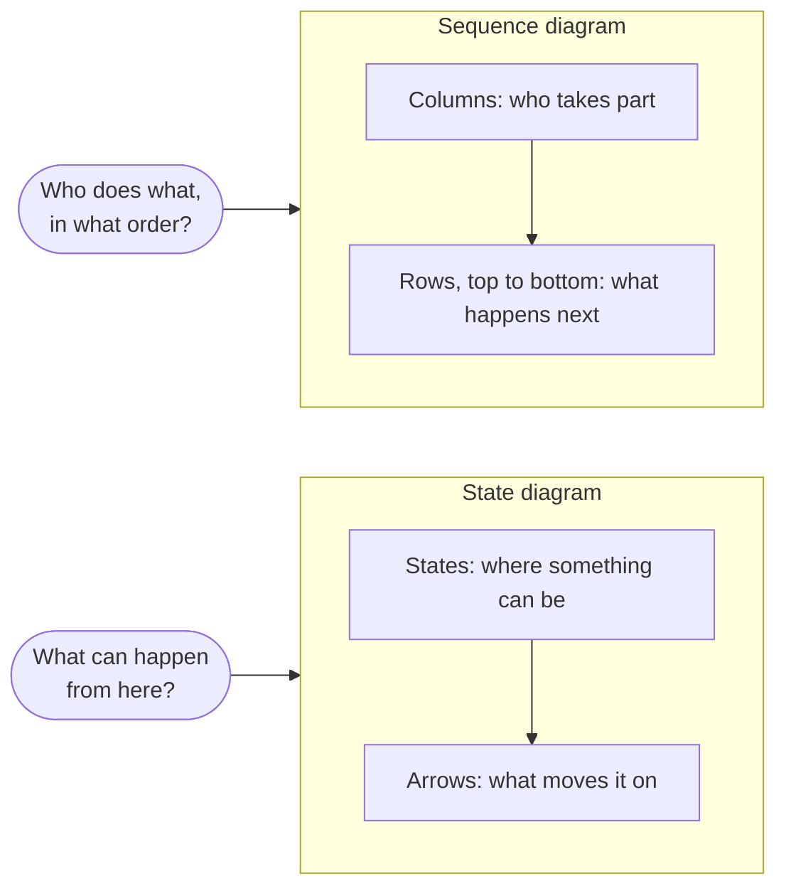

*Each kind of diagram answers one question, and the one thing to notice is that time runs down the page in a sequence diagram, while a state diagram has no time at all, only what may follow what.*

The data flow: how one message travels in a sequence diagram, as the docs agent's work does in `standard/11-adrs.md`.

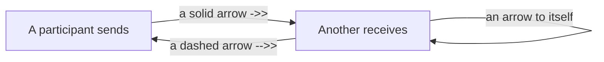

*A message goes from one column to another or back to its own, and the one thing to notice is the arrow to itself: a step that a participant takes alone.*

The state view: the lifecycle of an ADR, the state diagram that this lesson reads first, drawn here in the same form.

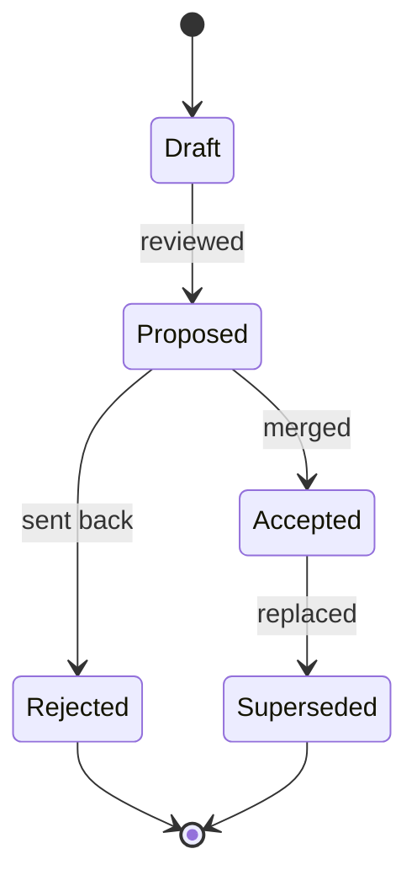

*An ADR has five statuses between a start and an end, and the one thing to notice is that `[*]` appears both as the start and as the end: an arrow leaving it starts, an arrow entering it ends.*

Where it sits in this codebase: the three files of this lesson and the diagrams the lesson reads in each.

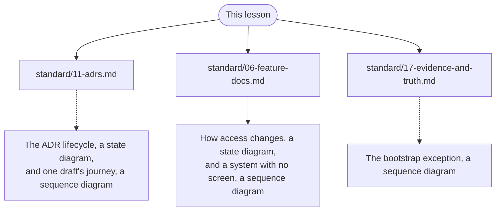

*The lesson reads five diagrams in three files, and the one thing to notice is that the ADR file holds both kinds, because an ADR has both statuses and a flow of work.*

## Theory

**Sequence diagrams.** The block starts with `sequenceDiagram`. Each participant is declared with `participant X as Name`, where `X` is the short id used in the messages and `Name` is what the reader sees; the order of the declarations is the order of the columns. A message is `X->>Y: text`, a solid arrow; `Y-->>X: text` is a dashed arrow, which the standard uses for an answer coming back. `X->>X: text` is a step that `X` takes on its own. Time runs down the page: each message is later than the one above it.

**Notes and alternatives.** `Note over X: text` puts a note on one participant, and `Note over X,Y: text` stretches it across two, which the standard uses for a moment that concerns both, such as "From this point the write is never lost". `alt condition` opens a block of alternatives, `else condition` starts the next branch and `end` closes it; only one branch happens.

**State diagrams.** The block starts with `stateDiagram-v2`, the form the standard uses throughout. A transition is `A --> B: what causes it`. `[*]` is the start point when an arrow leaves it and the end point when an arrow enters it, and a diagram may have both. A state's id cannot contain spaces, so a state with a plain-language name of several words is declared with `state "Waiting for approval" as Waiting`, and the diagram then shows the plain words while the transitions use `Waiting`.

**What each is for.** The standard picks the diagram by the question: the access page of the feature docs requires a state diagram because it "shows, for each state, what can happen next, which the text cannot show as well" ([standard/06-feature-docs.md](../../../../standard/06-feature-docs.md)), and the architecture reference requires a sequence diagram for each major flow. The caption, glossary, question and colour rules of the flowcharts lesson apply unchanged.

## In this codebase

The excerpts are verbatim, and a script compared each one with its file at commit `bd7b1ce`. No standard of this project shaped them: `docs/standards/` holds no rule.

### The lifecycle of an ADR

*Excerpt from [`standard/11-adrs.md`](../../../../standard/11-adrs.md), lines 177 to 184.*

```text
stateDiagram-v2
    [*] --> Draft: the regular agent writes it at the time of the decision
    Draft --> Proposed: the docs agent reviews it within the guard rail
    Proposed --> Accepted: the Software Engineer merges the stack
    Proposed --> Rejected: the Software Engineer sends it back
    Accepted --> Superseded: a later ADR replaces it
    Rejected --> [*]
    Superseded --> [*]
```

- The first transition leaves `[*]`, so `Draft` is where every ADR starts, and its label says who starts it.
- Each label after the colon is the cause of the move: a review, a merge, a send-back, a replacement.
- `Proposed` has two ways out, which is the choice the Software Engineer makes.
- `Accepted` has only one way out, to `Superseded`, which is the append-only rule drawn as a picture.
- The last two lines enter `[*]`, so `Rejected` and `Superseded` are ends. `Accepted` is not: an accepted ADR can still be replaced.

### States with plain-language names

*Excerpt from [`standard/06-feature-docs.md`](../../../../standard/06-feature-docs.md), lines 181 to 193.*

```text
stateDiagram-v2
    state "Waiting for approval" as Waiting
    state "Group leader" as Leader
    [*] --> Visitor
    Visitor --> Waiting: registers
    Waiting --> Member: is approved
    Waiting --> [*]: is turned down
    Member --> Leader: is promoted
    Leader --> Member: steps down
    Member --> Blocked: is blocked
    Leader --> Blocked: is blocked
    Blocked --> Member: is unblocked
    Member --> [*]: leaves the club
```

- The first two lines declare the two states whose names have spaces; every later line uses the ids `Waiting` and `Leader`.
- `Visitor`, `Member` and `Blocked` are single words, so they need no declaration.
- Two different states lead to `[*]`, so the diagram has two ends: being turned down and leaving the club.
- `Blocked` leads back only to `Member`, which the caption under the diagram in the standard names as the one thing to notice.

### One draft's journey, with alternatives

*Excerpt from [`standard/11-adrs.md`](../../../../standard/11-adrs.md), lines 208 to 223.*

```text
sequenceDiagram
    participant R as Regular agent
    participant D as Docs agent
    participant E as Software Engineer
    Note over R: A decision of impact is made
    R->>R: Writes draft-slug.md with the status Draft<br/>and commits it apart from the code
    D->>D: Reads the draft, the spec and the code at the tip
    D->>D: Reviews the draft within the guard rail<br/>and gives it its number
    D->>D: Moves it to Proposed
    D->>E: Flags where the built code departs from the decision
    Note over E: The Software Engineer reviews the whole stack
    alt the stack is merged
        Note over E: The merge is the acceptance: Accepted
    else a draft is sent back
        Note over E: Rejected
    end
```

- Three participants make three columns, in the order declared.
- Four of the messages are arrows to the sender itself: steps the regular agent and the docs agent take alone.
- `D->>E` is the one message between participants: the flag from the docs agent to the Software Engineer.
- The `alt` block has two branches. Each holds only a note, because the merge or the send-back is itself the acceptance or the rejection, not a message to anyone; the caption in the standard says so.
- `<br/>` breaks a long message over two lines, as it does in a flowchart's label.

### A note across two participants

*Excerpt from [`standard/17-evidence-and-truth.md`](../../../../standard/17-evidence-and-truth.md), lines 83 to 92.*

```text
sequenceDiagram
    participant D as Docs agent
    participant I as An index
    participant C as The checks
    participant G as A generator
    Note over D,I: No generator exists yet
    D->>I: Writes the index in the format<br/>the generators will produce
    Note over G: A generator lands
    G->>I: Generates the index
    Note over I,C: The checks reconcile any difference
```

- `Note over D,I` spans two columns: the moment concerns the docs agent and the index.
- A participant can be a thing, not a person: the index and the checks are columns too.
- The notes mark the moments of the story, and the two messages are the only writes.

### An answer coming back

*Excerpt from [`standard/06-feature-docs.md`](../../../../standard/06-feature-docs.md), lines 344 to 351.*

```text
sequenceDiagram
    participant D as Application developer
    participant S as The database
    D->>S: Write a value
    S-->>D: Acknowledged
    Note over D,S: From this point the write is never lost
    D->>S: Read the value
    S-->>D: The value that was written
```

- The requests use the solid arrow `->>` and the answers the dashed `-->>`, so the reader sees at once which way each message goes.
- The note spans both participants and sits between the acknowledgement and the read, which places the guarantee in time.

**Rendered.** Each diagram quoted here was rendered as it stands in its file of the standard, in dark and light, with mermaid-cli 12.2.0, which bundles Mermaid 12.3.0, and drew without an error. How GitHub's own Mermaid draws them was not checked: not verified.

## Pitfalls

- **Spaces in a state id.** `Visitor --> Waiting for approval: registers` raises no error, which makes it the worst kind of mistake: rendered with mermaid-cli 12.2.0, it drew an arrow from `Visitor` to a state called `Waiting`, and two stray states, `for` and `registers`, joined to nothing. Declare the state with `state "Waiting for approval" as Waiting` and use `Waiting`.
- **An `alt` without its `end`.** The parser reaches the end of the block still inside the alternatives, and nothing draws. The broken text of Core 2 below, rendered with mermaid-cli 12.2.0, which bundles Mermaid 12.3.0, stops at its last line:

  ```text
  Error: Parse error on line 8:
  ...draft is sent back
  ---------------------^
  Expecting 'SPACE', 'NEWLINE', 'INVALID', 'create', 'box', 'end', 'autonumber', 'activate', 'deactivate', 'title', 'legacy_title', 'acc_title', 'acc_descr', 'acc_descr_multiline_value', 'loop', 'rect', 'opt', 'alt', 'par', 'par_over', 'critical', 'break', 'else', 'participant', 'participant_actor', 'destroy', 'note', 'links', 'link', 'properties', 'details', 'ACTOR', got '1'
  ```

- **A semicolon in a message.** A semicolon ends a statement in a sequence diagram, so `A->>E: Each decision with its options; each rule with its reason` is cut in two, and the second half is not a message. The docs agent made exactly this mistake while writing the system chapters of this course, and the render caught it:

  ```text
  Error: Parse error on line 4:
  ...rule with its reason
  -----------------------^
  ```

  The rest of the message, the list of arrows the parser expected, is left out here. Use a comma, or "and".
- **Labels on transitions that name no cause.** A state diagram's arrows answer "what moves it on"; a bare arrow leaves the question unanswered.
- **A sequence diagram used for a choice that has no order.** If nothing happens in sequence, a flowchart or a state diagram answers the question better, which the third quality rule asks.
- **Colour in either kind.** The theme rules apply to every diagram, so no `style` and no theme override.

The messages above were printed on 2026-11-18, each followed by the renderer's stack trace, left out here. In the first, the line number, 8, is past the block's six lines: the parser reports the place where it ran out of text still expecting an `end`. The other three mistakes draw without an error, so only a reader or the baseline's rules catch them.

## Under the hood

Mermaid parses a sequence diagram into participants and an ordered list of messages and notes, and draws the columns side by side with the messages in that order down the page; nothing is laid out freely, so the order in the text is the order in the picture. It parses a state diagram into states and transitions and lays them out as a graph, as it lays out a flowchart, so adding one transition can move states around. Both take the reader's theme at the end, as flowcharts do. Nothing about their speed was measured.

## How it fails and scales

- **A sequence diagram grows down.** Each message adds a row, so a long flow becomes a tall picture. The standard keeps each sequence to one flow, and the architecture reference draws one sequence for each major flow rather than one for all.
- **A state diagram grows sideways and tangles.** Every new transition can cross others. The standard's three state diagrams have between five and seven states.
- **A wrong order is silent.** Mermaid draws the messages in the order written, so a message in the wrong place draws without complaint; only a reader catches it.

No size limit is quoted, because none was measured.

## Summary and cheat sheet

| You want | Write |
|---|---|
| A column | `participant X as Name` |
| A message, an answer | `X->>Y: text`, `Y-->>X: text` |
| A step taken alone | `X->>X: text` |
| A note on one, across two | `Note over X: text`, `Note over X,Y: text` |
| Alternatives | `alt condition` ... `else condition` ... `end` |
| A state diagram | `stateDiagram-v2` |
| Start and end | `[*] --> A`, `A --> [*]` |
| A transition with its cause | `A --> B: what moves it on` |
| A state named in plain words | `state "Waiting for approval" as Waiting` |

Further reading: Mermaid's documentation of sequence diagrams and state diagrams, at mermaid.js.org, and [standard/16-diagrams.md](../../../../standard/16-diagrams.md).

**What was verified.** Every excerpt, by a script, against its file at commit `bd7b1ce`; the counts of each kind of diagram, by reading every block; every diagram of the lesson and every diagram it quotes, by rendering it in dark and light with mermaid-cli 12.2.0, which bundles Mermaid 12.3.0; and the behaviour of the pitfalls, by rendering the broken text. **Not verified.** How GitHub's own Mermaid draws the diagrams.

## Practice

A model solution passes when the baseline's lint for diagrams accepts it (quotes balanced, every block closed, a caption, no colour) and it renders in dark and light with mermaid-cli 12.2.0, which bundles Mermaid 12.3.0. Every model solution below passed both on 2026-11-18.

### Ten theory questions

**Question 1 (predict).** In the ADR lifecycle, how many statuses can an ADR end in, and which status can it never end in?

<details><summary>Worked answer</summary>

Two ends: `Rejected` and `Superseded`, because they are the only states with an arrow into `[*]`. An ADR never ends in `Accepted`, which has an arrow out to `Superseded` and none into `[*]`.

**Common wrong answers.** "Three, counting Accepted", which reads "accepted" as final. "One", which counts `[*]` as one state and misses that two arrows enter it.

</details>

**Question 2 (predict).** In the draft's journey from `standard/11-adrs.md`, how many messages go from one participant to another, as opposed to a participant to itself?

<details><summary>Worked answer</summary>

One: `D->>E`, the flag. The other four messages are arrows from a participant to itself, and the notes are not messages.

**Common wrong answers.** "Five", which counts every arrow. "Three, one for each branch of `alt`", which counts the notes inside the alternatives as messages.

</details>

**Question 3 (predict).** If `Waiting for approval --> Member: is approved` replaced the line `Waiting --> Member: is approved` in the access diagram, without the `state` declaration, what would draw?

<details><summary>Worked answer</summary>

Not the intended state, and no error says so. A state id cannot contain spaces, so the line no longer names the declared state. Rendered with mermaid-cli 12.2.0, the same mistake in a smaller diagram drew an arrow to a state called `Waiting`, and the other words as stray states joined to nothing; the approval step is gone from the picture.

**Common wrong answers.** "The long name shows up as the state", which is what the `state ... as` declaration is for. "Nothing changes", which ignores that the id is what joins the transition to the state.

</details>

**Question 4 (diagnose).** A sequence diagram with an `alt` block does not draw at all, and Mermaid reports a parse error at its last line, expecting `end` among other things. What is missing?

<details><summary>Worked answer</summary>

The `end` that closes the `alt` block. Without it, the parser reaches the end of the block still inside the alternatives.

**Common wrong answers.** "An `else` for every message", which misreads `else` as a separator for messages. "The participants are in the wrong order", which changes the columns, not the frame.

</details>

**Question 5 (diagnose).** A reviewer says the sequence diagram of a flow "draws fine but tells the wrong story": the answer appears above the request. Mermaid raised nothing. Why not, and what is the fix?

<details><summary>Worked answer</summary>

Because a sequence diagram draws messages in the order of the text, and the order is not checked: the answer was simply written above the request. The fix is to move the line, since the text order is the time order.

**Common wrong answers.** "Use a dashed arrow for the answer", which marks the direction but not the order. "Mermaid sorts messages by participant", which it does not.

</details>

**Question 6 (diagnose).** An architecture file has a status that the text describes in four steps but no state diagram. Which rule is broken?

<details><summary>Worked answer</summary>

The architecture reference's state-machines section, which asks for every status and workflow drawn as a state diagram, together with the minimum of at least one diagram for each section that applies ([standard/07-architecture-reference.md](../../../../standard/07-architecture-reference.md)).

**Common wrong answers.** "None, the text says it all", which the third quality rule answers: a state diagram shows what can follow each state better than text. "The caption rule", which needs a diagram to apply to.

</details>

**Question 7 (design trade-offs).** The ADR journey puts the acceptance and the rejection in notes inside an `alt` block rather than as messages to a participant. What does that choice gain, and what does it cost?

<details><summary>Worked answer</summary>

It gains truth: the merge is itself the acceptance, so drawing it as a message to someone would show an act that does not happen. It costs a little readability, since notes are easier to miss than arrows; the standard's caption pays that back by naming it as the one thing to notice.

**Common wrong answers.** "Notes are just shorter", which misses the point about what happens. "Messages would be wrong syntax", which they would not.

</details>

**Question 8 (design trade-offs).** When would you draw a workflow as a state diagram rather than as a sequence diagram, using the docs agent's work as the example?

<details><summary>Worked answer</summary>

As a state diagram when the question is what can happen next from where it stands, such as waiting on a profile entry or on a fix; as a sequence diagram when the question is who hands what to whom in what order, such as the start, the report and the review. The architecture reference of this repository draws the docs agent both ways for that reason.

**Common wrong answers.** "Always a sequence, because the agent works in steps", which loses the loops back. "Always a state diagram, because it is shorter", which loses who is involved.

</details>

**Question 9 (systems reasoning).** Why does the append-only rule for ADRs show up as a property of the state diagram's arrows, and what invariant does it express?

<details><summary>Worked answer</summary>

Because `Accepted` has exactly one arrow out, to `Superseded`, and no arrow back to `Draft` or `Proposed`. The invariant is that once accepted, an ADR's decision is never edited again; it can only be replaced by a later ADR. The diagram makes the invariant visible as the absence of arrows.

**Common wrong answers.** "Because Accepted is an end state", which it is not. "The diagram cannot show rules", which ignores that missing arrows are a rule.

</details>

**Question 10 (systems reasoning).** The bootstrap exception's sequence has the docs agent and a generator both writing the same index, at different times. What ordering keeps them from conflicting?

<details><summary>Worked answer</summary>

While no generator exists, only the docs agent writes the index, as the single writer of its stack; when a generator lands, it takes over, and the checks reconcile any difference. The two writers never write in the same period, so the order of the notes in the diagram is the guarantee.

**Common wrong answers.** "They merge their changes", which is the conflict the rule exists to avoid. "The generator writes first", which reverses the story.

</details>

### Ten programming exercises

**Warm-up 1.** Add the dashed answer "Acknowledged" from the store to the writer. It prepares for the system with no screen in `standard/06-feature-docs.md`.

```text
sequenceDiagram
    participant W as Writer
    participant S as Store
    W->>S: Write a value
```

<details><summary>Model solution</summary>

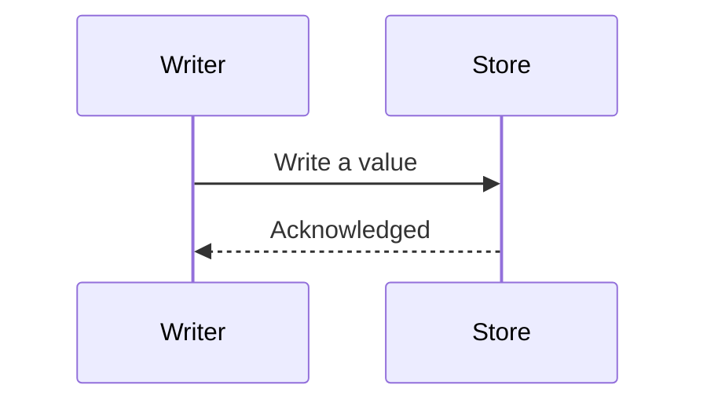

*The writer's request gets a dashed answer back, and the one thing to notice is that the dashed arrow is what tells the reader this message is the reply.*

</details>

**Warm-up 2.** Give each transition its cause: "reviewed", "merged" and "sent back". It prepares for the ADR lifecycle.

```text
stateDiagram-v2
    [*] --> Draft
    Draft --> Proposed
    Proposed --> Accepted
    Proposed --> Rejected
```

<details><summary>Model solution</summary>

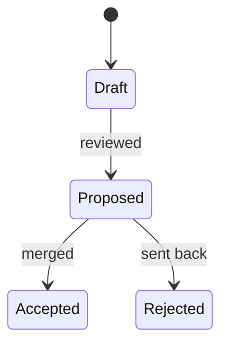

*Each arrow now says what moves the ADR on, and the one thing to notice is that the two arrows out of Proposed are told apart only by their labels.*

</details>

**Warm-up 3.** Put a note across both participants between the two messages: "From this point the write is never lost".

```text
sequenceDiagram
    participant D as Developer
    participant S as Database
    D->>S: Write a value
    S-->>D: Acknowledged
```

<details><summary>Model solution</summary>

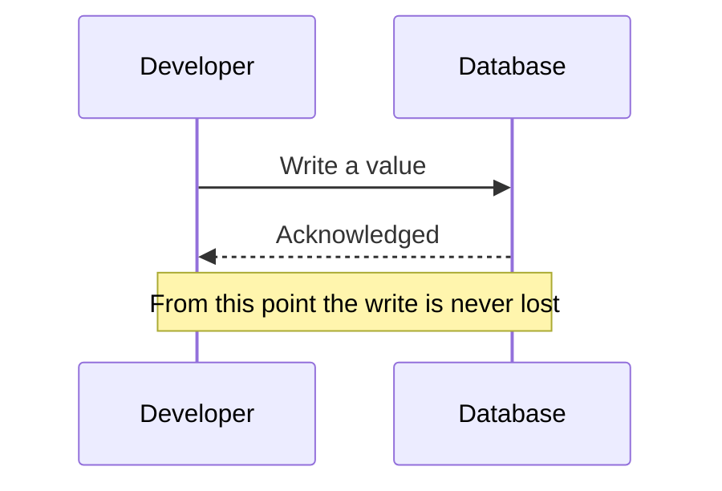

*The note spans both columns after the acknowledgement, and the one thing to notice is that its place in the order is what says when the guarantee begins.*

</details>

**Core 1.** Fix this state diagram: one state has a name with spaces.

```text
stateDiagram-v2
    [*] --> Visitor
    Visitor --> Waiting for approval: registers
    Waiting for approval --> Member: is approved
```

<details><summary>Model solution</summary>

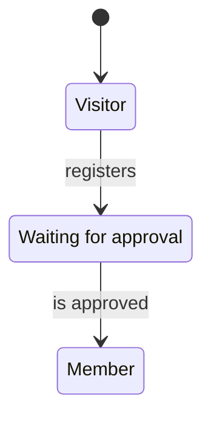

*The long name is declared once and used by its id, and the one thing to notice is that the reader still sees the plain words, while the transitions stay valid.*

</details>

**Core 2.** Close the alternatives and make each branch say its outcome in a note on the Software Engineer.

```text
sequenceDiagram
    participant D as Docs agent
    participant E as Software Engineer
    D->>E: Flags a departure
    alt the stack is merged
    else the draft is sent back
```

<details><summary>Model solution</summary>

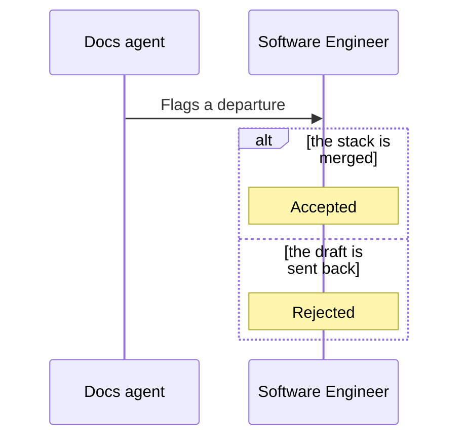

*The alternatives are closed and each branch states its outcome, and the one thing to notice is that the outcomes are notes, because the merge or the send-back is the act itself.*

</details>

**Core 3.** Draw the docs agent's wait on a reader-profile entry as a state diagram: from "Writing" to "Waiting on a profile entry" when a technology has no entry, and back when the entry is recorded. It prepares for the architecture file on the docs agent.

<details><summary>Model solution</summary>

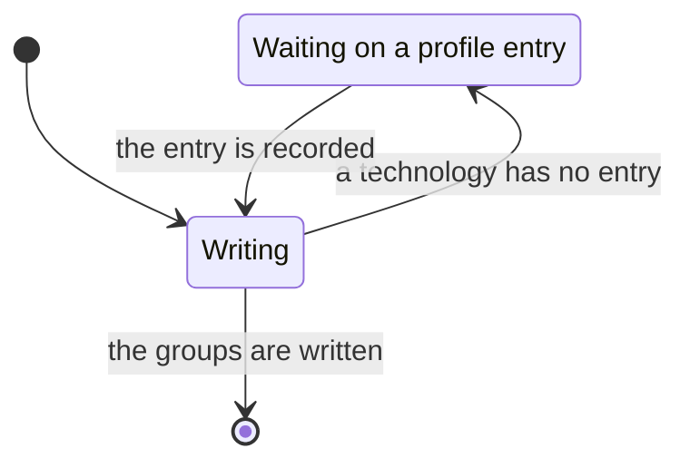

*The docs agent leaves writing only to wait and comes back, and the one thing to notice is that the side state returns to writing: a missing entry pauses one course and ends nothing.*

</details>

**Core 4.** Turn this flowchart, which shows a hand-off in order, into a sequence diagram with three participants.

```text
flowchart LR
    E["Software Engineer"] -->|"starts"| D["Docs agent"]
    D -->|"writes"| T["The repository"]
    D -->|"reports to"| E
```

<details><summary>Model solution</summary>

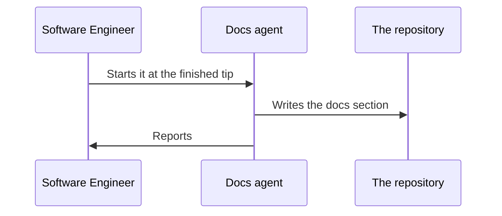

*The same hand-off as a sequence, and the one thing to notice is that the order is now readable top to bottom, which the flowchart left to the reader to work out.*

</details>

**Stretch 1.** Draw the statuses of a rule in a project's standards: a preference is proposed; a no ends it with nothing written; a yes writes it; it is removed when its reason is gone. It prepares for the standards mechanism.

<details><summary>Model solution</summary>

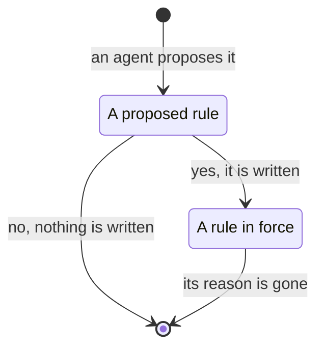

*A rule lives between a yes and the end of its reason, and the one thing to notice is the two different ends: a no and a removal both enter the end point.*

</details>

**Stretch 2.** Draw the publish of a stack as a sequence: the Software Engineer says yes, an agent runs `gh stack link`, GitHub opens the PRs, and the agent checks the bases. Use an `alt` for "a base is wrong" with the fix "cut the stack again". It prepares for the deployment docs.

<details><summary>Model solution</summary>

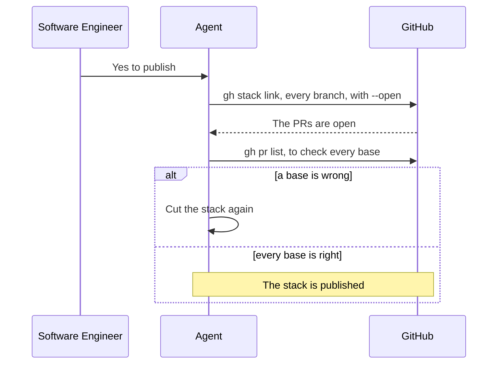

*The publish waits for the Software Engineer and ends in a check, and the one thing to notice is that the alternative on a wrong base is a step the agent takes alone, before anything is merged.*

</details>

**Stretch 3.** The access diagram of the standard lets a blocked person come back only as a member. Add the state "Left" for someone who leaves, from both Member and Group leader, and make it an end. It prepares for the access state diagram of the feature docs.

<details><summary>Model solution</summary>

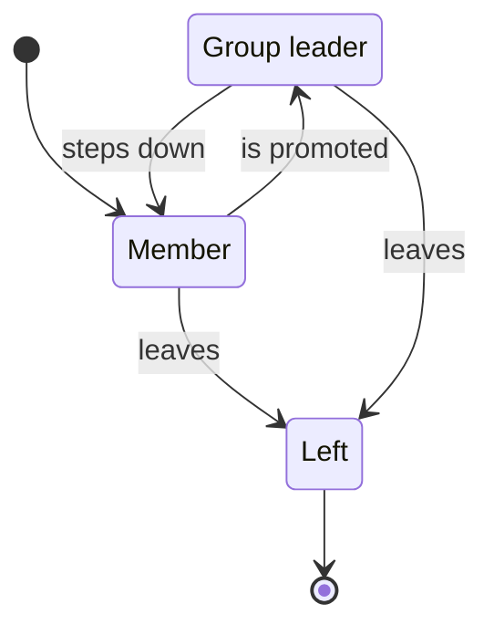

*Both roles can leave, and the one thing to notice is that Left is the only state with an arrow into the end point, so leaving is final while every other move can be undone.*

</details>
