# Entity-relationship diagrams and the palette

| Item | What it says |
|---|---|
| What you will learn | How the standard draws a database schema as an entity-relationship diagram, how it marks what a PR adds, changes and removes, and why the approved palette is the one colour a diagram may set. |
| What you should already know | [Flowcharts](01-flowcharts.md): quoted labels, captions and the theme rules. |
| Reading time | 20 minutes, worked out from its length. |
| Files in this codebase | `standard/16-diagrams.md`, `standard/14-pr-descriptions.md` |
| Versions verified against | Commit `cb4fb22`; every diagram of the lesson, and every diagram it quotes from the standard, rendered in dark and light with mermaid-cli 12.2.0, which bundles Mermaid 12.3.0. |
| Terms introduced | entity-relationship diagram, cardinality, classDef, approved palette, change marker |

## Orientation

The baseline has no database of its own, so this repository draws no schema of a real system. The standard still teaches every project how to draw one, because two of its documents require a database diagram: the data section of the architecture reference carries a current-state diagram generated from the real database, and the description of a PR that changes the database carries a colour-coded diagram of its change ([standard/16-diagrams.md](../../../../standard/16-diagrams.md)). Both are entity-relationship diagrams, and the standard's two examples of them, for the made-up hiking club app, are the only two of its 87 diagrams that set any colour.

That is the second reason for this lesson: the approved palette. The theme rules forbid every hard-coded colour except these three, so how they are defined and applied, and why they are safe in both themes, is what a contributor needs before drawing any diagram with emphasis. After this lesson you can read and write an entity-relationship diagram in the standard's form and apply the palette and the change markers correctly.

## Mental model

The concept: an entity-relationship diagram is tables, their columns and the relationships between them.

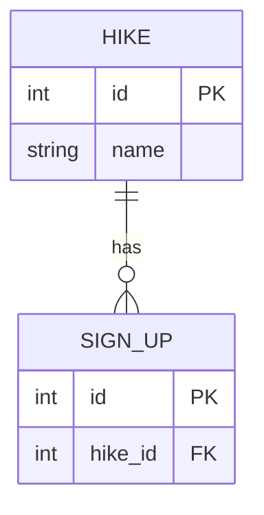

*Two tables and one relationship, and the one thing to notice is the marks on the line: one hike has zero or more sign-ups.*

The data flow: where the two database diagrams come from, as the standard requires them.

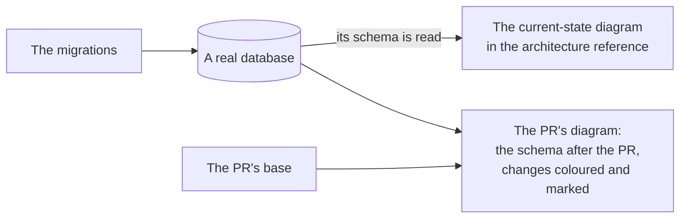

*Both diagrams are made from the real schema, and the one thing to notice is that only the PR's diagram compares two states, the base and the result, which is why only it carries colour.*

The state view: what the palette says about each table of a PR's diagram.

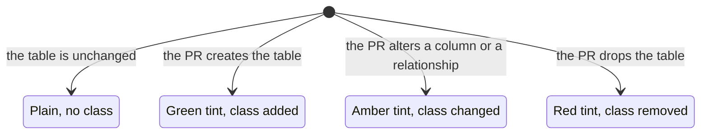

*Every table of a PR's diagram is in one of four states, and the one thing to notice is that unchanged is plain: colour is used only for the three kinds of change, never as decoration.*

Where it sits in this codebase: the two files with entity-relationship diagrams.

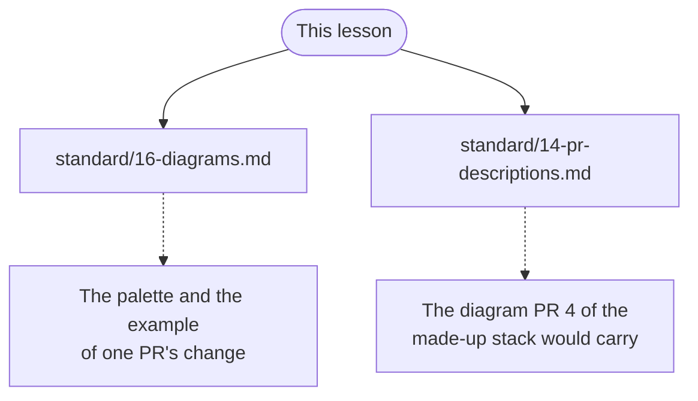

*The lesson reads two files, and the one thing to notice is that both examples are made up: this repository has no database, so no diagram here describes a real schema.*

## Theory

**Entities and attributes.** The block starts with `erDiagram`. An entity is a table, written in capitals with underscores, such as `HIKE_GROUP`. Its attributes go between braces, one per line, as a type and a name, optionally followed by `PK` (primary key) or `FK` (foreign key) and a comment in double quotes.

**Relationships.** `A ||--o{ B : "label"` joins two entities. The marks at each end are the cardinality: `||` is exactly one, `o|` zero or one, `o{` zero or more and `|{` one or more, and the mark nearest an entity says how many of that entity there are. `HIKE_GROUP ||--o{ PROPOSAL : "has"` reads: one hike group has zero or more proposals. The label is in quotes, like every label in the standard.

**The palette.** A `classDef name ...` line defines a named style, and `class ENTITY name` applies it to an entity. The approved palette is exactly three `classDef` lines, for `added`, `removed` and `changed`. Each has a `fill` whose first six hexadecimal digits are the colour of its `stroke` and whose last two, `40`, make the fill translucent: `40` in hexadecimal is 64 of 255, about a quarter. The border is solid and 3px wide, and the palette sets no text colour, so the text keeps the theme's own colour. These are the only hard-coded colours the theme rules allow.

**The markers.** Mermaid colours a whole entity and cannot colour one attribute or one relationship line. So a change to a column or a relationship is marked in the text: `+` added, `~` changed, `-` removed, inside the quoted comment of an attribute or the quoted label of a relationship. Colour then says which tables changed, and the markers say which columns and relationships, so colour never carries the meaning alone.

**Why the palette is safe.** The standard records the test behind it: a first palette of solid fills with white text looked fine in dark and failed in light, where the white text sat on white rows; the tinted palette was rendered in both themes and was legible in each ([standard/16-diagrams.md](../../../../standard/16-diagrams.md)). Its tinted rows measure 3.6 to 4.4 to 1 contrast in dark, below the 4.5 to 1 that WCAG AA asks of normal text, though they read well, and the final values are the tooling's to confirm ([revision 1, D9](../../../superpowers/specs/2026-11-18-baseline-standard-revision-1-design.md)).

## In this codebase

The excerpts are verbatim, and a script compared each one with its file at commit `cb4fb22`. No standard of this project shaped them: `docs/standards/` holds no rule.

### The palette, exactly

*Excerpt from [`standard/16-diagrams.md`](../../../../standard/16-diagrams.md), lines 127 to 129.*

```text
classDef added fill:#2ea04340,stroke:#2ea043,stroke-width:3px
classDef removed fill:#f8514940,stroke:#f85149,stroke-width:3px
classDef changed fill:#d2992240,stroke:#d29922,stroke-width:3px
```

- Each line names a class and sets three things: a fill, a stroke and the stroke's width.
- In `fill:#2ea04340`, `2ea043` is the green of the stroke and `40` makes it a translucent tint.
- No line sets `color`, so the text of a coloured entity follows the reader's theme.

### One PR's change to a schema

*Excerpt from [`standard/16-diagrams.md`](../../../../standard/16-diagrams.md), lines 143 to 175.*

```text
erDiagram
    HIKE_GROUP ||--o{ PROPOSAL : "has"
    PROPOSAL ||--o{ APPROVAL : "+ is decided by"
    PROPOSAL ||--o{ PROPOSAL_COMMENT : "- had"
    HIKE_GROUP {
        int id PK
        string name
    }
    PROPOSAL {
        int id PK
        int group_id FK
        string title
        string status "~ free text before, a fixed set of statuses now"
        int approved_by "- dropped"
    }
    APPROVAL {
        int id PK "+"
        int proposal_id FK "+"
        int leader_id "+"
        string decision "+"
        string note "+"
    }
    PROPOSAL_COMMENT {
        int id PK "-"
        int proposal_id FK "-"
        string body "-"
    }
    class PROPOSAL changed
    class APPROVAL added
    class PROPOSAL_COMMENT removed
    classDef added fill:#2ea04340,stroke:#2ea043,stroke-width:3px
    classDef removed fill:#f8514940,stroke:#f85149,stroke-width:3px
    classDef changed fill:#d2992240,stroke:#d29922,stroke-width:3px
```

- The first three lines are relationships. The second and third carry markers in their labels: `+ is decided by` is a relationship the PR adds, `- had` one it removes.
- `HIKE_GROUP` has no marker and no class: it is unchanged, so it stays plain.
- In `PROPOSAL`, two attributes carry markers in their comments: `status` changed and `approved_by` dropped. The entity itself gets `class PROPOSAL changed`, the amber tint.
- Every attribute of `APPROVAL` is marked `+`, and the entity gets `added`; every attribute of `PROPOSAL_COMMENT` is marked `-`, and the entity gets `removed`.
- The three `classDef` lines at the end are the palette exactly, character for character the lines of the previous excerpt.

### The same form in a PR description

*Excerpt from [`standard/14-pr-descriptions.md`](../../../../standard/14-pr-descriptions.md), lines 316 to 322.*

```text
erDiagram
    HIKE ||--o{ SIGN_UP : "has"
    SIGN_UP ||--o{ REMINDER : "+ has"
    SIGN_UP ||--o{ REMINDER_LOG : "- had"
    HIKE {
        int id PK
        string name
```

- The PR description's example opens the same way: unchanged relationships plain, added and removed ones marked in their labels.
- The rest of this block follows the same pattern as the previous excerpt, with `SIGN_UP` changed, `REMINDER` added and `REMINDER_LOG` removed.

**Rendered.** Each diagram quoted here was rendered as it stands in its file of the standard, in dark and light, with mermaid-cli 12.2.0, which bundles Mermaid 12.3.0, and drew without an error; in both themes the tinted tables and the markers read clearly. How GitHub's own Mermaid renders the colours of an entity has not been confirmed; the standard says so and names a flowchart-based diagram of the schema as the fallback.

## Pitfalls

- **Colour without markers.** A coloured entity says only that the table changed. Without `+`, `~` or `-` in the text, the reader cannot tell which column, and colour has become the only carrier of meaning.
- **A colour that is not the palette.** Any `classDef` other than the three exact lines, or any `style`, breaks the theme rule. Copy the lines; do not retype them.
- **A text colour.** Setting `color` on a class fixes the text to one theme, which is the failure the first palette had.
- **Drawing the current state by hand.** The current-state diagram is generated from the real database and never drawn by hand, because a hand-drawn diagram cannot be checked against the schema.
- **Reading the cardinality from the wrong end.** The mark nearest an entity counts that entity: in `A ||--o{ B`, the `o{` is next to `B`, so there are zero or more `B` for each `A`.

None of these mistakes stops Mermaid. Rendered with mermaid-cli 12.2.0, which bundles Mermaid 12.3.0, the broken palette of Core 1 below, a solid fill and a white text colour, drew without an error. The rules, not the renderer, are what catch them.

## Under the hood

Mermaid parses an entity-relationship diagram into entities, their attributes and the relationships, lays the entities out as a graph and draws each as a table with a header row and a row per attribute. A `class` statement attaches the named style to the entity's drawing, which covers the whole table; that is why a single attribute cannot be coloured. The theme supplies everything the class does not set, including the text colour, so the palette's translucent fill sits over the theme's own row colours. The standard records that rows alternate in an entity, which is where the first palette failed ([standard/16-diagrams.md](../../../../standard/16-diagrams.md)).

## How it fails and scales

- **A large schema becomes unreadable.** The standard splits the current-state diagram by area when the schema is large.
- **Colour that does not render.** If GitHub's Mermaid did not render the classes, the colours would vanish; the markers would still say what changed, which is why they are required.
- **A hand-edited diagram drifts.** The standard requires CI to regenerate the current-state diagram on every PR and to fail the PR when the committed one differs, and to keep the PR's diagram fresh in a marked block of its description. None of that tooling exists yet ([standard/22-tooling-requirements.md](../../../../standard/22-tooling-requirements.md)).

The contrast figures above are the only numbers this lesson quotes, and they are cited from revision 1, where they were measured during the build.

## Summary and cheat sheet

| You want | Write |
|---|---|
| A table | `NAME { type column PK }` |
| A key | `PK` or `FK` after the column |
| A comment on a column | `type column "text"` |
| One to zero or more | `A ||--o{ B : "label"` |
| Added, changed, removed (whole table) | `class NAME added`, `changed`, `removed` |
| Added, changed, removed (a column or a line) | `+`, `~`, `-` in the quoted comment or label |
| The palette | The three `classDef` lines, exactly as in the standard |

Further reading: Mermaid's documentation of entity-relationship diagrams, at mermaid.js.org, and [standard/16-diagrams.md](../../../../standard/16-diagrams.md).

**What was verified.** Every excerpt, by a script; the two `classDef` blocks are character for character the same; every diagram of the lesson and every diagram it quotes, by rendering it in dark and light with mermaid-cli 12.2.0, which bundles Mermaid 12.3.0. **Not verified.** How GitHub renders the classes.

## Practice

A model solution passes when the baseline's lint for diagrams accepts it (quotes balanced, a caption, no colour outside the palette) and it renders in dark and light with mermaid-cli 12.2.0, which bundles Mermaid 12.3.0. Every model solution below passed both on 2026-11-18.

### Ten theory questions

**Question 1 (predict).** In `PROPOSAL ||--o{ APPROVAL : "+ is decided by"`, how many approvals can one proposal have, and what does the `+` say?

<details><summary>Worked answer</summary>

Zero or more, because `o{` is next to `APPROVAL`. The `+` says the PR adds this relationship, since a line cannot be coloured.

**Common wrong answers.** "Exactly one", which reads the `||` next to `PROPOSAL` as belonging to `APPROVAL`. "The `+` means one or more", which mistakes the marker for cardinality.

</details>

**Question 2 (predict).** In the example of one PR's change, which entity is drawn with no tint at all?

<details><summary>Worked answer</summary>

`HIKE_GROUP`, because no `class` statement names it: it is unchanged, so it stays plain.

**Common wrong answers.** "`PROPOSAL`", which ignores `class PROPOSAL changed`. "All of them, in a default colour", which forgets that plain means the theme's own colours.

</details>

**Question 3 (predict).** If `color:#ffffff` were added to the `added` class, in which theme would the text of `APPROVAL` become hard to read?

<details><summary>Worked answer</summary>

In light. White text on a light green tint over light rows has little contrast. That is the failure of the first palette that the standard records.

**Common wrong answers.** "In dark", which is where white text reads well. "Neither, the tint protects it", which ignores that the tint is translucent.

</details>

**Question 4 (diagnose).** A PR's diagram shows `SIGN_UP` amber, but the reviewer cannot tell what changed in it. What is missing?

<details><summary>Worked answer</summary>

The markers. The changed column should carry `~` in its comment and any dropped one `-`, so the text says which columns changed; colour only says that the table did.

**Common wrong answers.** "A stronger colour", which still cannot point at a column. "A second diagram", which the markers make unnecessary.

</details>

**Question 5 (diagnose).** A diagram's `classDef added` line reads `fill:#2ea043,stroke:#2ea043,stroke-width:3px`. Which rule does it break, and what does it look like?

<details><summary>Worked answer</summary>

It is not the approved palette: the fill lost its `40`, so it is a solid green, not a translucent tint. Solid fills were the palette that failed in one theme. Copy the palette's line exactly.

**Common wrong answers.** "None, it is the same green", which misses the transparency. "The stroke is wrong", which is the one part that is right.

</details>

**Question 6 (diagnose).** An architecture file of a project draws its data section's diagram by hand. The schema has since changed and nobody noticed. Which rule, once its tooling exists, would have caught it?

<details><summary>Worked answer</summary>

The rule that the current-state diagram is generated from the real database and that CI regenerates it on every PR and fails the PR when the committed diagram differs. A hand-drawn diagram is outside that check, which is why it is never drawn by hand.

**Common wrong answers.** "The caption rule", which checks wording, not the schema. "Code review", which is exactly what missed it.

</details>

**Question 7 (design trade-offs).** The standard names a flowchart-based diagram of a schema as the fallback if GitHub does not render entity colours. What does the fallback gain and lose?

<details><summary>Worked answer</summary>

It gains colour that renders reliably, since flowcharts style reliably. It loses the table form, with a row per column and the cardinality marks, that makes an entity-relationship diagram quick to read as a schema. The markers survive either way.

**Common wrong answers.** "Nothing is lost", which ignores the table form. "The fallback needs no markers", which forgets that colour never carries meaning alone.

</details>

**Question 8 (design trade-offs).** Why does the standard allow colour in a PR's diagram but not in the current-state diagram?

<details><summary>Worked answer</summary>

Because the PR's diagram compares two states and colour marks the three kinds of change between them, while the current-state diagram shows one state, where there is nothing to mark. Colour is emphasis for change, not decoration.

**Common wrong answers.** "The current-state diagram is generated, so it cannot have colour", which confuses how it is made with what it shows. "No reason", which the palette's meanings answer.

</details>

**Question 9 (systems reasoning).** A stack has three PRs that each change the database. Whose base does each PR's diagram compare against, and why does that keep the diagrams readable?

<details><summary>Worked answer</summary>

Each compares against its own base, the PR below it, so each diagram shows only that PR's change. A reviewer reading PR 3 sees only PR 3's tables in colour, not the sum of all three.

**Common wrong answers.** "Against `main`", which would colour the earlier PRs' changes in every later diagram. "Against the tip", which would show changes that are not in the PR yet.

</details>

**Question 10 (systems reasoning).** The palette's dark-theme contrast is below WCAG AA for normal text, yet the standard keeps it. What makes that acceptable for now, and what would reopen it?

<details><summary>Worked answer</summary>

The rows read well, colour never carries meaning alone because the markers say the same in text, and the final values are explicitly the tooling's to confirm. A measurement by the tooling that shows the rows cannot be read, or a requirement to meet AA, would reopen it.

**Common wrong answers.** "The numbers were wrong", which they were measured. "Contrast does not matter for diagrams", which the theme rules exist to prevent.

</details>

### Ten programming exercises

**Warm-up 1.** Add the relationship "one hike has zero or more sign-ups", labelled "has". It prepares for the PR description's example.

```text
erDiagram
    HIKE {
        int id PK
    }
    SIGN_UP {
        int id PK
        int hike_id FK
    }
```

<details><summary>Model solution</summary>

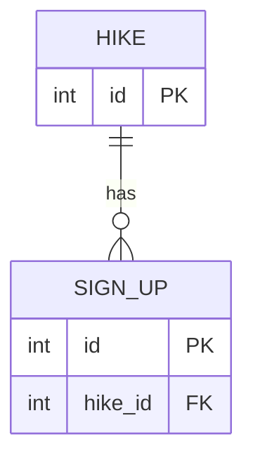

*One hike has zero or more sign-ups, and the one thing to notice is that the `o{` sits next to the side that can be many.*

</details>

**Warm-up 2.** Mark the column `contact` as changed, with the comment "email only before, email or phone now".

```text
erDiagram
    SIGN_UP {
        int id PK
        string contact
    }
```

<details><summary>Model solution</summary>

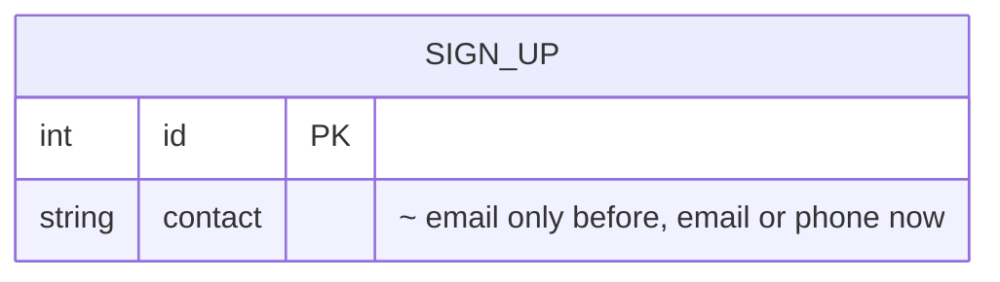

*The changed column carries its marker in its comment, and the one thing to notice is that the text alone says what changed, with no colour at all.*

</details>

**Warm-up 3.** Copy the three palette lines into this diagram and give `REMINDER` the class `added`.

```text
erDiagram
    REMINDER {
        int id PK "+"
    }
```

<details><summary>Model solution</summary>

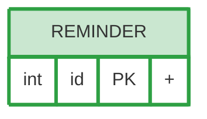

*The new table is tinted green and its column marked added, and the one thing to notice is that the palette lines are copied exactly, the only colours allowed.*

</details>

**Core 1.** Fix this diagram: its colour breaks the theme rule.

```text
erDiagram
    APPROVAL {
        int id PK "+"
    }
    class APPROVAL added
    classDef added fill:#2ea043,color:#ffffff
```

<details><summary>Model solution</summary>

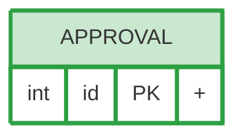

*The class is now the palette's translucent tint with no text colour, and the one thing to notice is that removing `color` is what lets the text follow the reader's theme.*

</details>

**Core 2.** A PR drops the table `REMINDER_LOG`. Draw it removed: every column marked, the relationship to `SIGN_UP` marked, and the class applied with the palette.

<details><summary>Model solution</summary>

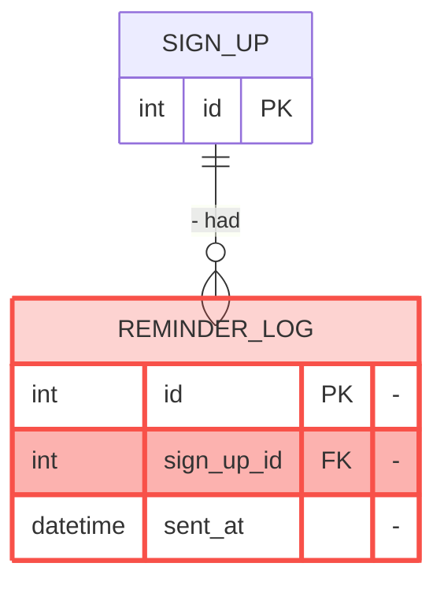

*The dropped table is tinted red and marked in every column and in its relationship, and the one thing to notice is that `SIGN_UP` stays plain, because only what changed carries colour.*

</details>

**Core 3.** Read the cardinality aloud: write, as a caption, what `HIKE_GROUP ||--o{ PROPOSAL : "has"` says.

<details><summary>Model solution</summary>

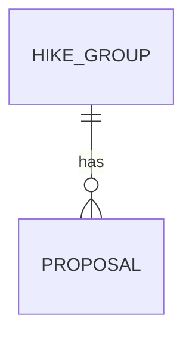

*One hike group has zero or more proposals, and each proposal belongs to exactly one hike group, and the one thing to notice is that each end's mark counts the entity it is next to.*

</details>

**Core 4.** This flowchart marks a removed step only with colour. Keep the palette but add a marker, so the meaning does not rest on colour.

```text
flowchart LR
    A["Old step"] --> B["New step"]
    class A removed
    classDef removed fill:#f8514940,stroke:#f85149,stroke-width:3px
```

<details><summary>Model solution</summary>

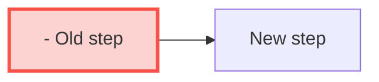

*The removed step is now marked in its label as well as tinted, and the one thing to notice is that a reader who cannot see the colour still reads that the step was removed.*

</details>

**Stretch 1.** Draw the whole of one PR's change: `PROPOSAL` changed (its `status` column changed), `APPROVAL` added with three columns, and the relationship between them added.

<details><summary>Model solution</summary>

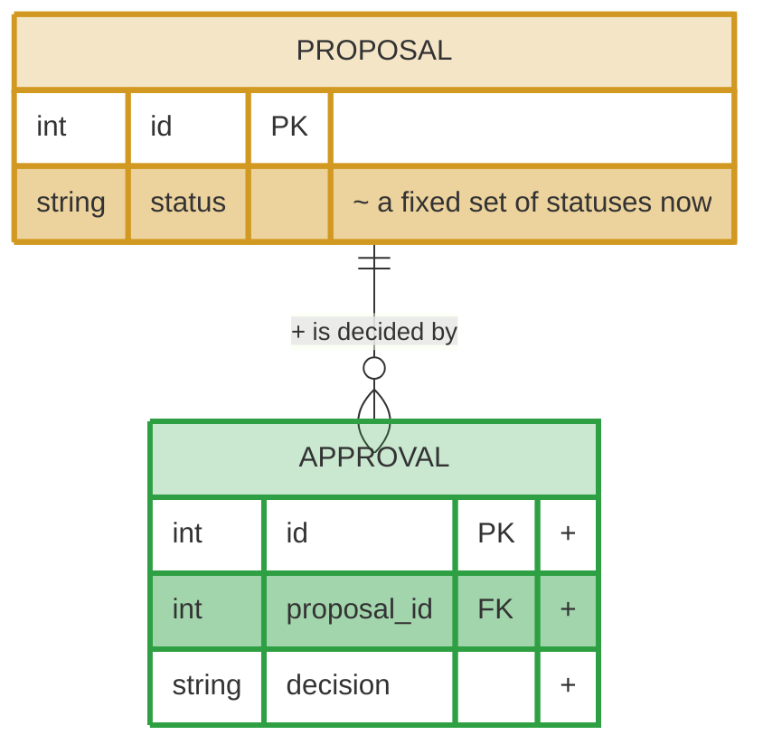

*The changed table is amber and the new one green, and the one thing to notice is that markers say which column and which relationship changed, the two things colour cannot point at.*

</details>

**Stretch 2.** Draw the fallback the standard names: the same change as Stretch 1, as a flowchart, with the palette on the nodes and the markers in the labels.

<details><summary>Model solution</summary>

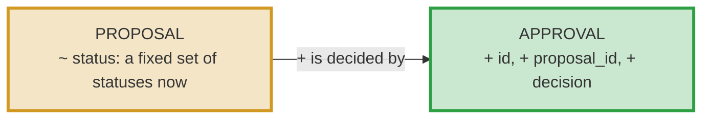

*The same change drawn as a flowchart, and the one thing to notice is that the markers move into the node labels and the edge label, so the meaning survives whichever kind of diagram GitHub styles.*

</details>

**Stretch 3.** The current-state diagram of a project is generated, never drawn. Draw the flow that produces and checks it, ending in "the PR fails" when the committed diagram differs.

<details><summary>Model solution</summary>

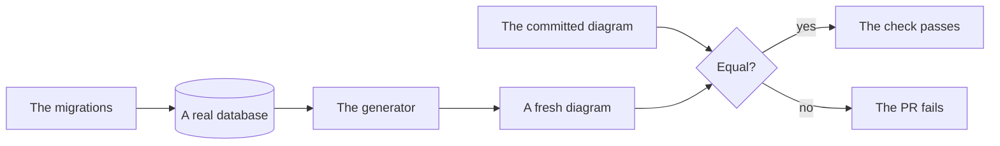

*The committed diagram is compared with a fresh one from the real database, and the one thing to notice is that the only way to pass is equality, so a hand-made diagram cannot survive a change of schema.*

</details>
