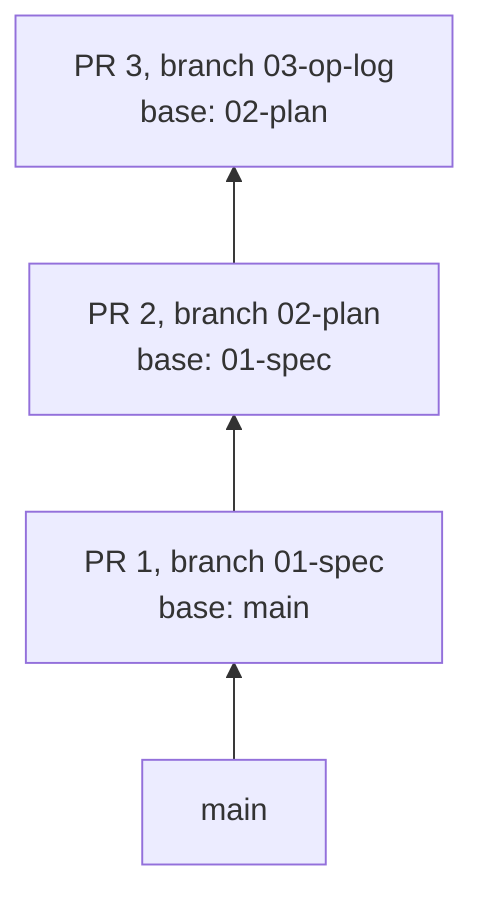
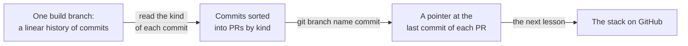
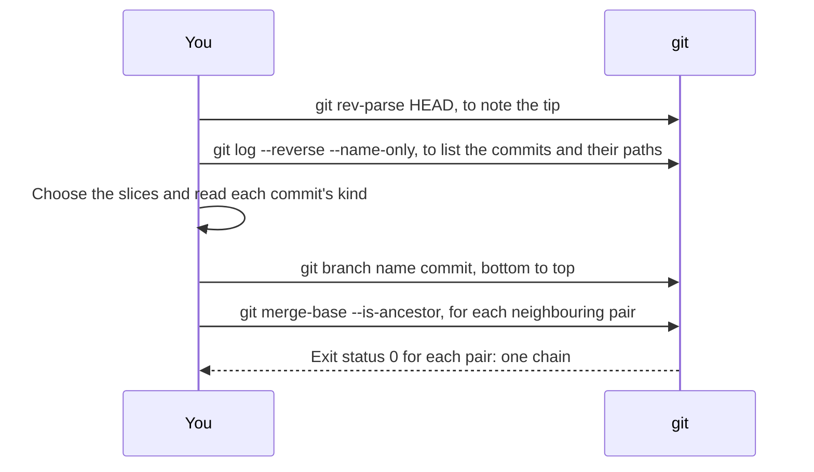
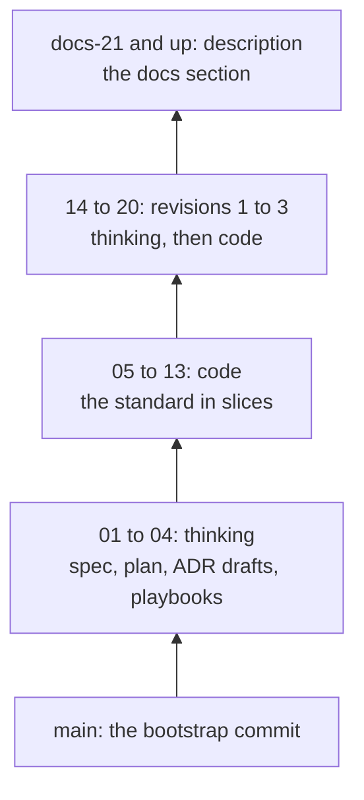

# A stack of pull requests

| Item | What it says |
|---|---|
| What you will learn | What a stack of pull requests is, and how this repository makes one by hand with plain git: bases, one linear history, pointer branches, the kind of each commit read from its paths, and the check that the branches form one chain. |
| What you should already know | No earlier lesson. The reader profile records git and GitHub as advanced and stacked PRs as beginner, so this lesson takes git for granted and explains stacks from the first command. |
| Reading time | 25 minutes, worked out from its length. |
| Files in this codebase | `standard/03-stack-model.md`, `docs/agents/stacks.md`, `baseline.yml` |
| Versions verified against | Commit `cb4fb22`, and git 2.54.0, with which every command's output below was captured. |
| Terms introduced | stack of pull requests, base, linear history, pointer, build branch, ancestor |

## Orientation

Every piece of work in this repository reaches GitHub as one stack of pull requests (PRs), and the repository's own first stack is twenty branches, `standard/01-spec` to `standard/20-revision-3-standard`, with the docs section on top. You will meet the stack the moment you read a PR description, because each one opens with a table of the whole stack, and the moment you look for a file, because most of the repository sits on branches above `main` until the stack is merged.

This lesson covers the half of a stack that is plain git and runs on your machine: how a stack is made from one line of commits, how each PR's kind is read, and how to check that the branches are in order. The next lesson, [gh stack link and the stack on GitHub](02-gh-stack-on-github.md), covers putting the stack on GitHub. After this one you can read a stack table, cut a stack from a linear history and check it, with every command explained.

## Mental model

The concept: in a stack, each PR is based on the branch of the PR below it, so each shows only what it adds.



*Each PR sits on the one below it, and the one thing to notice is the base written in each node: PR 3 is compared with PR 2's branch, not with main, which is why it shows only its own commits.*

The data flow: from one line of commits to a stack of PRs.



*The work is committed on one line and the stack is made from it by naming commits, and the one thing to notice is that no commit is copied or changed on the way: pointers only name what is already there.*

The sequence: the steps of a cut, in the order the playbook gives them.



*A cut is five commands and one decision, and the one thing to notice is that the only decision, where the slices end, is yours: git names the commits and checks the chain.*

Where it sits in this codebase: the repository's own stack, cut the same way.



*The first stack groups its branches by kind in reading order, and the one thing to notice is that the revisions sit as thinking PRs below the code that needed them, each pair on top of the earlier work.*

## Theory

**A PR and its base.** A pull request compares one branch, its head, with another, its base, and shows the commits that the head has and the base does not. An ordinary PR's base is `main`. In a stack, only the first PR's base is `main`; each later PR's base is the branch of the PR below it. That chain of bases is what makes each PR show only its own change. The PR nearest `main` is the **bottom**, the last is the **top**, and a PR is merged only after the ones below it.

**One line of commits.** The skills that build the work commit task by task on one branch, the **build branch**, so its commits form one line with no merges. That line is all the stack needs: to turn it into PRs, you name the last commit of each PR.

**Pointers.** `git branch <name> <commit>` creates a branch called `<name>` that points at `<commit>` and copies nothing. With no commit given, it points at the commit you are on. A branch made this way is a **pointer**. The PR for a pointer holds the commits after the pointer below it, up to its own commit, so four pointers on one line of five commits give four PRs whose commits do not overlap.

**Names.** A stack's branches are named `<topic>/<nn>-<slug>`, numbered in stack order, and a description PR's branch is `<topic>/docs-<nn>-<slug>`, its number carrying on from the rest. The number gives the order at a glance.

**The kind of a commit.** Each commit is read for its kind from the paths it touches, using `baseline.yml`: a path in the artifact map (the spec, the plan, another kept skill artifact) or another prescriptive document is thinking; a path in a stack folder is code, except that folder's own `README.md`, which is description, and its own `AGENTS.md`, which is thinking; `baseline.yml` is code; and a document of the docs section is description. A cut is pointer-only when each commit holds one kind; a commit that mixes kinds is split before any pointer is made.

**Checking the chain.** `git merge-base --is-ancestor <a> <b>` prints nothing and exits with status 0 if `<a>` is an ancestor of `<b>`, and with status 1 if it is not. In a correct stack every branch is an ancestor of the one above it, and the top branch is the tip of the build branch: `git rev-parse <top>` prints the same commit as `git rev-parse HEAD`. A shell keeps the exit status of the last command in `$?`, so `echo $?` shows it.

## In this codebase

The excerpts are verbatim, and a script compared each one with its file at commit `cb4fb22`. No standard of this project shaped them: `docs/standards/` holds no rule.

### The chain of bases

*Excerpt from [`standard/03-stack-model.md`](../../../../standard/03-stack-model.md), lines 41 to 41.*

```text
A PR is based on a branch, and an ordinary PR is based on `main`. In a stack, the first PR is based on `main`, the second is based on the first PR's branch, the third on the second's, and so on to the top. This chain of bases is why each PR shows only the changes it adds on top of the PR below. The PR nearest `main` is the **bottom** of the stack, the last PR is the **top**, and a PR is merged only after the ones below it.
```

The standard explains the stack from the base of each PR. Every term this lesson uses comes from this paragraph: the base, the bottom and the top, and the order of merging.

### Cutting from one line

*Excerpt from [`standard/03-stack-model.md`](../../../../standard/03-stack-model.md), lines 132 to 132.*

```text
The execution skills commit task by task on one branch, called here the **build branch**, so its commits form one line with no merges and no side branches. A **pointer** is a branch name that points at one commit of that line. Cutting the stack means making one pointer per PR, with `git branch <name> <commit>`, at the slice boundaries the agent chose. The PR for a pointer holds the commits after the pointer below it, up to its own commit. No commit is copied, re-made or edited, and the plan is not touched.
```

- "The build branch" is the one line of commits. In the baseline's own first build it was `standard/build`, which still points at PR 17, where that build ended; revision 3 was built the same way on `standard/revision-3`, which points at PR 20, the finished tip.
- "Cutting the stack means making one pointer per PR": nothing is re-committed.
- "No commit is copied, re-made or edited, and the plan is not touched": the history stays exactly as the skills produced it.

### The steps, as the playbook gives them

*Excerpt from [`docs/agents/stacks.md`](../../../agents/stacks.md), lines 165 to 178.*

````text
Cut like this:

1. **Note the tip** of the build branch with `git rev-parse HEAD`. Because: you compare against it in step 5.
2. **List the commits and read the kind of each from the paths it touches.** The base is the branch the stack is based on, `main` here. Because: the kind of a PR comes from the paths it touches, so the paths are what tell you where each commit belongs.

   ```bash
   git log --reverse --name-only --format='%h %s' main..HEAD
   ```

3. **Choose the slices.** Group the code commits into logical slices, in the order they were built, at about 400 changed lines each, and put a refactor or a move in a slice of its own. Record the grouping as a ruling. Because: the grouping is yours to decide, and the ruling shows the Software Engineer where to look.
4. **Route every commit** with the table below, splitting or moving commits until each one holds a single kind. Because: keeping each commit to one kind makes the cut pointer-only, and a PR of one kind is easier to review.
5. **After any split or move, check that the tree did not change.** `git diff <the tip you noted> HEAD` must print nothing. Because: splitting and moving change the order of the work, not the work. They should touch only commits that have not been pushed, and a repair that rewrites pushed history waits for the Software Engineer's yes (see "Opening and updating the stack").
6. **Cut the pointers**, bottom to top, named by the branch-name convention: `git branch sync-engine/03-op-log <commit>`. Because: a pointer is all the cut needs, and the number in each name fixes its place in the stack.
7. **Check the chain.** For each pair of neighbouring pointers, `git merge-base --is-ancestor <lower> <upper>` must exit with status 0, and when you have cut the whole stack the top pointer must be the tip: `git rev-parse <top pointer>` equals `git rev-parse HEAD`. Because: a stack whose branches are not in one chain cannot be linked with the right bases.
````

- Step 1 notes the tip so that step 5 can prove that a split or a move changed no file.
- Step 2 is the command that shows the paths of each commit, from which its kind is read.
- Steps 3 and 4 are the decisions: where the slices end, and splitting any commit that mixes kinds.
- Steps 6 and 7 are the cut and its check. The playbook's step 8, not quoted, checks out each pointer in turn and runs the project's checks.

### The same steps on a small history

The commands below build a small repository with a linear history of five commits on a build branch, with fixed names and dates, so that every commit id is the same each time it is built. Run them in an empty folder.

```bash
export GIT_AUTHOR_NAME="Alex Example" GIT_AUTHOR_EMAIL="alex@example.com"
export GIT_COMMITTER_NAME="Alex Example" GIT_COMMITTER_EMAIL="alex@example.com"
export GIT_AUTHOR_DATE="2026-11-18T12:00:00Z" GIT_COMMITTER_DATE="2026-11-18T12:00:00Z"
git init -q -b main sync-engine && cd sync-engine
printf 'stack_folders: [api]\n' > baseline.yml
git add baseline.yml && git commit -q -m "chore: bootstrap"
git switch -q -c build
mkdir -p docs/superpowers/specs docs/superpowers/plans api
printf '# Spec\n' > docs/superpowers/specs/spec.md && git add . && git commit -q -m "docs: the spec"
printf '# Plan\n' > docs/superpowers/plans/plan.md && git add . && git commit -q -m "docs: the plan"
printf 'table\n' > api/op_log.txt && git add . && git commit -q -m "feat(api): the op log table"
printf 'replay\n' > api/replay.txt && git add . && git commit -q -m "feat(api): replay the op log"
printf '# Sync engine\n' > README.md && git add . && git commit -q -m "docs: the reference docs"
```

Step 1, note the tip:

```bash
git rev-parse HEAD
```

```text
7c589ce056f2723cc9ba04910b9441ebeb9cd500
```

Step 2, list the commits and their paths:

```bash
git log --reverse --name-only --format='%h %s' main..HEAD
```

```text
8feb6b0 docs: the spec

docs/superpowers/specs/spec.md
05e9eee docs: the plan

docs/superpowers/plans/plan.md
9cf1f9e feat(api): the op log table

api/op_log.txt
9821f3e feat(api): replay the op log

api/replay.txt
7c589ce docs: the reference docs

README.md
```

`main..HEAD` means the commits on the current branch that `main` does not have, and `--reverse` lists them oldest first, which is stack order. Read against the small `baseline.yml`, whose only stack folder is `api`, and the default artifact map: the spec and the plan are thinking, the two commits in `api/` are code, and the root `README.md` is description. Each commit holds one kind, so the cut needs pointers only.

Steps 3 and 6, choose the slices and cut the pointers. The two code commits are one slice, the op log:

```bash
git branch sync-engine/01-spec 8feb6b0
git branch sync-engine/02-plan 05e9eee
git branch sync-engine/03-op-log 9821f3e
git branch sync-engine/docs-04-reference 7c589ce
git branch --list 'sync-engine/*'
```

```text
  sync-engine/01-spec
  sync-engine/02-plan
  sync-engine/03-op-log
  sync-engine/docs-04-reference
```

Step 7, check the chain. A pair in order exits with 0; the same pair reversed exits with 1:

```bash
git merge-base --is-ancestor sync-engine/02-plan sync-engine/03-op-log; echo $?
git merge-base --is-ancestor sync-engine/03-op-log sync-engine/02-plan; echo $?
git rev-parse sync-engine/docs-04-reference
```

```text
0
1
7c589ce056f2723cc9ba04910b9441ebeb9cd500
```

The top pointer prints the tip noted in step 1, so the whole stack is cut. What PR 3 will show its reviewer is the commits between its base and itself:

```bash
git log --format='%h %s' sync-engine/02-plan..sync-engine/03-op-log
```

```text
9821f3e feat(api): replay the op log
9cf1f9e feat(api): the op log table
```

### The repository's own stack

The same commands read the baseline's first stack. PR 13 holds two commits and three files:

```bash
git diff --name-only standard/12-docs-agent-standards-rules standard/13-seams-tooling-index
git log --format='%h %s' standard/12-docs-agent-standards-rules..standard/13-seams-tooling-index
```

```text
standard/21-skills-seams.md
standard/22-tooling-requirements.md
standard/README.md
9ff2902 feat(standard): keep the seams diagram to the spec and carry the practice-task patch check
9cb2806 feat(standard): add the skill seams, tooling requirements and the index
```

The output of every command in this part was captured on 2026-11-18 with git 2.54.0, and the commands on the repository's own stack were run again on 2026-11-19 with the same output; the small repository's commit ids are the same on every build, because its names and dates are fixed.

## Pitfalls

- **A pointer at the wrong commit.** If the op log's pointer is cut at `9cf1f9e` instead of `9821f3e`, the replay commit falls into the docs PR, which then mixes code and description. `git diff --name-only` between the two pointers shows it: `README.md` and `api/replay.txt` together.
- **A commit that mixes kinds.** It cannot be cut with pointers alone. Split it first, then check that `git diff <the tip you noted> HEAD` prints nothing.
- **Reading `..` the wrong way round.** `A..B` is what `B` has that `A` does not. `03-op-log..02-plan` lists nothing.
- **Trusting silence.** `git merge-base --is-ancestor` prints nothing either way; only the exit status says yes or no. Check `$?`.
- **Rewriting pushed history.** Splitting and moving commits is safe only before anything is pushed. A repair that rewrites pushed history waits for the Software Engineer's yes.

## Under the hood

A git branch is a name stored with the id of one commit; making one writes that id and nothing else, which is why a pointer costs nothing and changes no commit. A commit records its parent, so a linear history is a chain in which each commit names the one before. `git merge-base --is-ancestor` walks the parents from the second commit back and answers whether it meets the first. `A..B` is the same walk: every commit reachable from `B` that is not reachable from `A`. GitHub shows a PR's commits the same way, from its head back to its base. No claim is made here about how fast any of this runs, because nothing was measured.

## How it fails and scales

- **A broken chain.** If any branch is not an ancestor of the one above it, the stack cannot be linked with the right bases, and a reviewer would see the wrong diff. The chain check catches it before anything is pushed.
- **Many slices.** Each slice adds a pointer and a check, and nothing else; the check stays one command per neighbouring pair. The baseline's first stack has twenty branches below its docs section, and its chain check printed `ok` for every pair on 2026-11-19.
- **Size.** A code PR is to stay at about 400 changed lines, not counting tests and generated files; thinking and description PRs are exempt.
- **What to measure.** The exit status of each chain check, and `git diff` between the old tip and the new after any split or move.

## Summary and cheat sheet

| You want | Run |
|---|---|
| The tip, to compare against later | `git rev-parse HEAD` |
| The commits and their paths, in stack order | `git log --reverse --name-only --format='%h %s' main..HEAD` |
| A pointer at a commit | `git branch <topic>/<nn>-<slug> <commit>` |
| To move a pointer before anything is pushed | `git branch -f <name> <commit>` |
| Whether one branch is below another | `git merge-base --is-ancestor <lower> <upper>; echo $?`, 0 for yes |
| What a PR will show | `git log --format='%h %s' <base>..<branch>` and `git diff --name-only <base> <branch>` |
| That a split changed no file | `git diff <old tip> HEAD` prints nothing |

Further reading: [docs/agents/stacks.md](../../../agents/stacks.md), "Cutting the stack from linear history", and [standard/03-stack-model.md](../../../../standard/03-stack-model.md).

**What was verified.** Every excerpt, by a script; every command's output, by running it on 2026-11-18 with git 2.54.0, in the small repository and in this one, and the commands in this one again on 2026-11-19. **Not verified.** Nothing in this lesson depends on GitHub; the next lesson covers what does.

## Practice

Every exercise runs in the small repository of "In this codebase", built with the commands given there. A model solution is tested when its commands were run and gave the output shown; the solutions below were run on 2026-11-18.

### Ten theory questions

**Question 1 (predict).** In the small repository, what does `git log --format='%h %s' sync-engine/01-spec..sync-engine/02-plan` print?

<details><summary>Worked answer</summary>

One line, `05e9eee docs: the plan`: the plan's pointer has exactly one commit that the spec's pointer does not.

**Common wrong answers.** "Both the spec and the plan", which forgets that `01-spec..` leaves out everything the spec's branch already has. "Nothing", which reads the range backwards.

</details>

**Question 2 (predict).** What does `git merge-base --is-ancestor main sync-engine/docs-04-reference; echo $?` print, and why?

<details><summary>Worked answer</summary>

`0`. `main` is an ancestor of every branch of the stack, because the build branch started from it, and the docs pointer is at the tip of the build branch.

**Common wrong answers.** "1, because main is not in the stack", which confuses being a PR with being an ancestor. "Nothing", which forgets the `echo $?`.

</details>

**Question 3 (predict).** Before any pointer exists, how many PRs would `git branch` alone have made? What makes the PRs?

<details><summary>Worked answer</summary>

None. A PR exists only once a branch is pushed and a PR is opened for it. `git branch` makes the pointers on your machine, and the next lesson's `gh stack link` turns them into PRs on GitHub.

**Common wrong answers.** "Five, one per commit", which mistakes commits for PRs. "One, for the build branch", which forgets that the build branch is never a PR of the stack.

</details>

**Question 4 (diagnose).** After a cut, `git diff --name-only sync-engine/03-op-log sync-engine/docs-04-reference` prints `README.md` and `api/replay.txt`. What went wrong?

<details><summary>Worked answer</summary>

The op log's pointer was cut one commit too early, at `9cf1f9e`, so the replay commit, which is code, falls into the docs PR. The docs PR now mixes code and description. Move the pointer to `9821f3e` with `git branch -f`.

**Common wrong answers.** "The README is in the wrong folder", which is not the issue. "The docs PR should hold code too", which breaks one kind per PR.

</details>

**Question 5 (diagnose).** A chain check prints nothing at all for one pair. Is the pair in order?

<details><summary>Worked answer</summary>

You cannot tell from the output: `git merge-base --is-ancestor` prints nothing either way. Look at the exit status with `echo $?`, or use the runbook's loop, which prints `ok` or `BROKEN`.

**Common wrong answers.** "Yes, no output means no error", which is the trap. "No, it should print the common commit", which describes `git merge-base` without `--is-ancestor`.

</details>

**Question 6 (diagnose).** After splitting a mixed commit, `git diff <the old tip> HEAD` prints two lines of a file. What does that tell you?

<details><summary>Worked answer</summary>

The split changed the work, not only its order: a line was lost or added while the commit was taken apart. The tree must be the same as before, so undo the split and do it again until the diff is empty.

**Common wrong answers.** "That is expected after a split", which is the opposite of the rule. "The old tip is wrong", which might be true but is checked by `git rev-parse`, not assumed.

</details>

**Question 7 (design trade-offs).** The two op log commits could be two slices or one. What does each choice give the reviewer?

<details><summary>Worked answer</summary>

Two slices give two smaller PRs that each stand on their own, the table and then the replay. One slice gives a single PR that shows the whole feature at once. The playbook asks for logical slices of about 400 changed lines; here both are tiny, so one slice reads better, and the choice is recorded as a ruling.

**Common wrong answers.** "Always one commit per PR", which makes PRs that are not logical units. "Always one PR for all the code", which makes PRs too large to review.

</details>

**Question 8 (design trade-offs).** Why make the stack from pointers into one line rather than by making a branch for each PR while building?

<details><summary>Worked answer</summary>

Because the skills that build the work commit task by task on one branch and are not changed to do otherwise, so the history they produce is one line. Pointers turn that line into a stack without re-committing anything. Branching while building would mean changing how the skills work, which the baseline never does.

**Common wrong answers.** "Pointers are faster", which is not the reason. "GitHub needs it", which GitHub does not.

</details>

**Question 9 (systems reasoning).** Why must each commit hold one kind for the cut to be pointer-only? State the invariant.

<details><summary>Worked answer</summary>

A pointer can only split the line between commits, never inside one. If a commit holds code and a document, no pointer can put them in different PRs. The invariant is: every commit holds exactly one kind, so every boundary between kinds falls between commits.

**Common wrong answers.** "Because GitHub rejects mixed PRs", which it does not, and the baseline allows them with a notice. "It does not matter for the cut", which the pointer model disproves.

</details>

**Question 10 (systems reasoning).** A stack of twenty branches is checked pair by pair. What does a single failing pair in the middle mean for the PRs above it?

<details><summary>Worked answer</summary>

Every PR above it would be linked with a wrong base or would show the wrong commits, because the chain of bases is broken at that point. The fix is at that pair, and the check must pass for every pair before anything is pushed.

**Common wrong answers.** "Only that one PR is affected", which forgets that each base depends on the branch below. "It can be fixed after pushing", which needs a rewrite of pushed history and the Software Engineer's yes.

</details>

### Ten programming exercises

**Warm-up 1.** Build the small repository and note its tip. It prepares for step 1 of the cut.

<details><summary>Model solution</summary>

Run the commands of "The same steps on a small history", then `git rev-parse HEAD`. It prints `7c589ce056f2723cc9ba04910b9441ebeb9cd500`.

</details>

**Warm-up 2.** List the commits of the build branch with their paths, oldest first. It prepares for step 2.

<details><summary>Model solution</summary>

`git log --reverse --name-only --format='%h %s' main..HEAD`, which prints the five commits and their paths shown in "In this codebase".

</details>

**Warm-up 3.** Write the kind of each of the five commits, using the small `baseline.yml`. It prepares for reading kinds from paths in this repository.

<details><summary>Model solution</summary>

Spec: thinking. Plan: thinking. Op log table: code. Replay: code. Reference docs: description. Checked by the paths that step 2 printed: two in the artifact map, two in the stack folder `api`, one root `README.md`.

</details>

**Core 1.** Cut the four pointers and list them. The drill fails until `git branch --list 'sync-engine/*'` prints four names.

<details><summary>Model solution</summary>

The four `git branch` commands of step 6. `git branch --list 'sync-engine/*'` then prints the four names shown there.

</details>

**Core 2.** Make the cut wrong on purpose, see it, and fix it. Move the op log's pointer to `9cf1f9e`, show that the docs PR mixes kinds, and put the pointer back.

<details><summary>Model solution</summary>

```bash
git branch -f sync-engine/03-op-log 9cf1f9e
git diff --name-only sync-engine/03-op-log sync-engine/docs-04-reference
git branch -f sync-engine/03-op-log 9821f3e
git diff --name-only sync-engine/03-op-log sync-engine/docs-04-reference
```

The first diff prints `README.md` and `api/replay.txt`; after the fix it prints only `README.md`.

</details>

**Core 3.** Check the whole chain with one loop that prints `ok` or `BROKEN` for each pair, from `main` up. It prepares for step 1 of the deployment runbook.

<details><summary>Model solution</summary>

```bash
prev=main; for b in $(git branch --list 'sync-engine/[0-9]*' 'sync-engine/docs-*' --format='%(refname:short)'); do if git merge-base --is-ancestor "$prev" "$b"; then echo "ok $prev -> $b"; else echo "BROKEN $prev -> $b"; fi; prev="$b"; done
```

It prints:

```text
ok main -> sync-engine/01-spec
ok sync-engine/01-spec -> sync-engine/02-plan
ok sync-engine/02-plan -> sync-engine/03-op-log
ok sync-engine/03-op-log -> sync-engine/docs-04-reference
```

</details>

**Core 4.** Split a mixed commit. On a new branch from `7c589ce`, commit `api/conflicts.txt` and a change to `README.md` together; then split it into a code commit and a docs commit, and prove the tree did not change.

<details><summary>Model solution</summary>

```bash
git switch -q -c mixed 7c589ce
printf 'conflict rule\n' > api/conflicts.txt
printf '# Sync engine\n\nConflicts are resolved by the newest write.\n' > README.md
git add . && git commit -q -m "feat(api): the conflict rule, with its docs"
tip=$(git rev-parse HEAD)
git reset -q --soft HEAD~1
git restore -q --staged README.md
git commit -q -m "feat(api): the conflict rule"
git add README.md && git commit -q -m "docs: the conflict rule"
git diff $tip HEAD
```

The last command prints nothing: the two commits hold exactly what the mixed one held. `git log --format='%h %s' 7c589ce..HEAD` then shows `f907298 feat(api): the conflict rule` below `56c109d docs: the conflict rule`.

</details>

**Stretch 1.** Show, for each PR of the small stack, the commits a reviewer will see. Use one `git log` per neighbouring pair.

<details><summary>Model solution</summary>

`git log --format='%h %s' main..sync-engine/01-spec`, then `sync-engine/01-spec..sync-engine/02-plan`, `sync-engine/02-plan..sync-engine/03-op-log` and `sync-engine/03-op-log..sync-engine/docs-04-reference`. They show one, one, two and one commits: `8feb6b0 docs: the spec`; `05e9eee docs: the plan`; `9821f3e feat(api): replay the op log` and `9cf1f9e feat(api): the op log table`; and `7c589ce docs: the reference docs`.

</details>

**Stretch 2.** In the repository itself, find which PR of the first stack touches `baseline.yml`, using `git diff --name-only` between neighbouring branches.

<details><summary>Model solution</summary>

PR 17: `git diff --name-only standard/16-revision-2-decisions standard/17-revision-2-standard` lists `baseline.yml` among its files. Checked on 2026-11-19 by listing the paths of every PR of the stack, from PR 1 to PR 20.

</details>

**Stretch 3.** Explain, with the commands that prove it, why `standard/build` is not a PR of the first stack although it is a branch.

<details><summary>Model solution</summary>

`git rev-parse standard/build` and `git rev-parse standard/17-revision-2-standard` print the same commit: `standard/build` is the build branch, and its tip is already PR 17's pointer. A PR of `standard/build` would show nothing that PR 17 does not, so it is never linked. Both commands were run on 2026-11-19 and printed `9d4518e2b82532043f2b0bd092cc54d160367f24`. The same holds for `standard/revision-3` and PR 20's pointer, `standard/20-revision-3-standard`, which both print `cb4fb22400936eb1a2793a46ba0043b9eeb8e946`.

</details>
