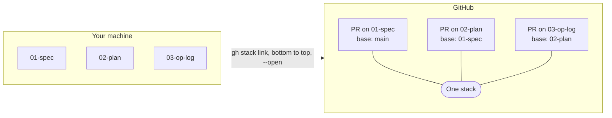
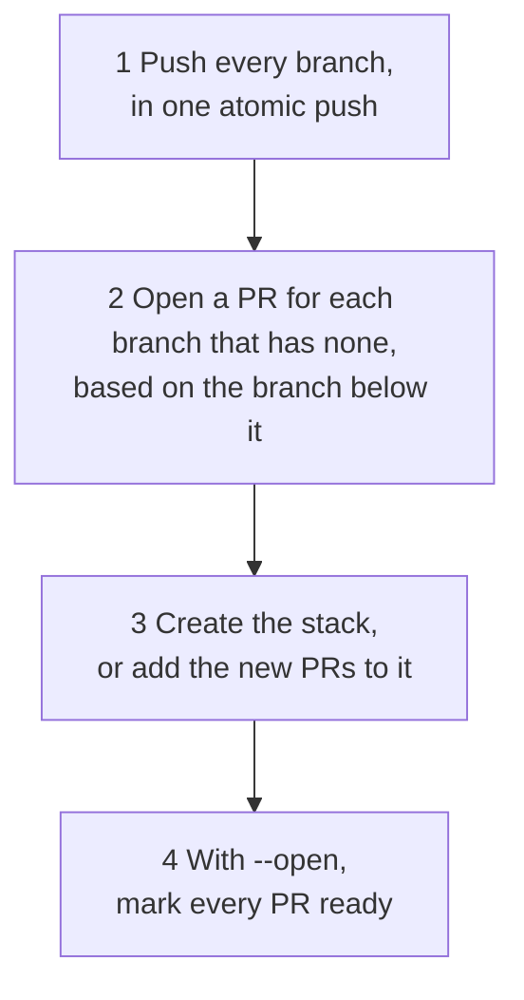
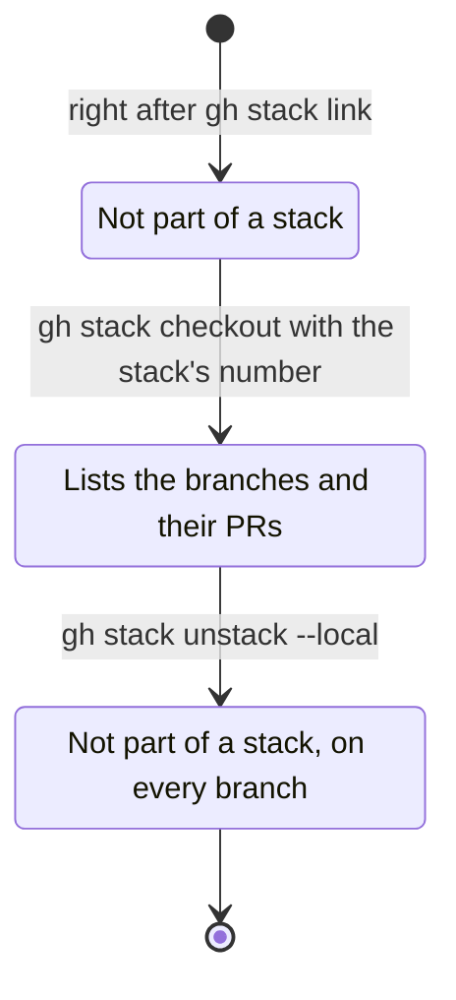
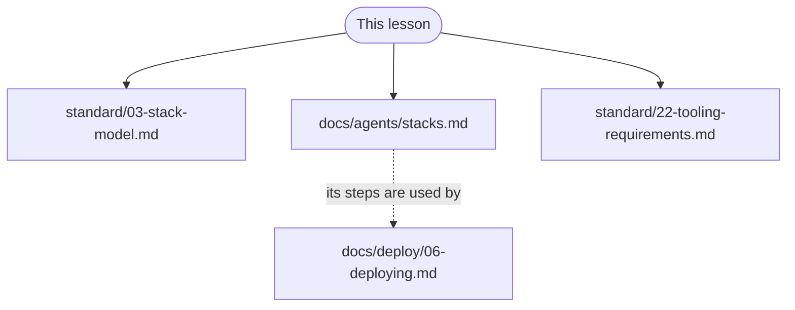

# gh stack link and the stack on GitHub

| Item | What it says |
|---|---|
| What you will learn | How a stack cut with plain git becomes a stack on GitHub with gh stack link, how to check that every PR has the right base and is ready, what gh stack view shows for such a stack, and which commands of gh stack the baseline never uses. |
| What you should already know | [A stack of pull requests](01-a-stack-of-pull-requests.md): bases, pointers and the chain check. |
| Reading time | 21 minutes, worked out from its length. |
| Files in this codebase | `standard/03-stack-model.md`, `docs/agents/stacks.md`, `standard/22-tooling-requirements.md` |
| Versions verified against | Commit `bd7b1ce`; `gh` 2.103.3 and `gh stack` 0.3.0, whose help and output below were captured on 2026-11-18, and the output on this repository again on 2026-11-19. |
| Terms introduced | gh stack, gh stack link, atomic push, draft, local tracking |

## Orientation

The previous lesson ended with pointers on your machine. This one takes them to GitHub. In this repository that is the step that waits for the Software Engineer's yes, because opening a stack's PRs is publishing (`AGENTS.md`, rule 4): PRs 1 and 2 were opened on 2026-11-18, and the rest of the first stack waits for the docs section and that yes. The commands in this lesson are the ones the deployment runbook uses ([docs/deploy/06-deploying.md](../../../deploy/06-deploying.md)).

`gh stack` is in public preview, so its own help is the authority when it behaves differently from what any document says; the baseline's text is taken from the help of version 0.3.0. After this lesson you can link a stack, check it, read what `gh stack view` tells you about it, and know which commands are not part of the baseline's flow and why.

## Mental model

The concept: one command turns pointers into PRs on GitHub.



*Three pointers become three PRs in one stack, and the one thing to notice is that each PR's base is the branch below it, set by the order in which the branches were given.*

The data flow: what `gh stack link` does, in order.



*The command does four things in a fixed order, and the one thing to notice is the first: the push is all or nothing, so a stack is never half pushed.*

The state view: what `gh stack view` showed for a stack made with `gh stack link`, in the three states checked on 2026-11-18.



*`gh stack view` depends on a local record that `gh stack link` does not keep, and the one thing to notice is that it reports a stack only after `gh stack checkout` has imported one, which is why the baseline relies on `gh pr list` instead.*

Where it sits in this codebase: the files that state the commands, and the runbook that uses them.



*The commands are stated in the standard and in the stacks playbook, and the one thing to notice is the dotted line to the deployment runbook, which runs them to publish this repository's stack.*

## Theory

**The extension.** `gh stack` is an extension of GitHub's command-line tool, `gh`, installed with `gh extension install github/gh-stack` and run as `gh stack <command>`. `gh stack --version` prints its version. It has two ways of working: most commands (`init`, `add`, `submit`, `sync`, `rebase`, `push`, `modify`, `checkout` and the navigation commands) work from a record of the stack kept on your machine, its **local tracking**; `gh stack link` keeps no such record and works from branch names you give it.

**Why the baseline uses `link`.** The branches of a stack here are pointers made with plain git, and the help of `gh stack link` says it is designed for branches managed outside `gh stack`. So the baseline makes its branches with `git branch` and registers them with `gh stack link`, and does not use the commands that need local tracking.

**What `link` does.** Given branch names bottom to top, it pushes them in one **atomic push**, so all update or none does; opens a PR for each branch that has none, based on the branch below it, the first on the repository's default branch unless `--base` says otherwise; creates the stack on GitHub or adds the new PRs to the stack they already belong to, never removing one; and, with `--open`, marks every PR ready for review, so none is left a **draft**. A stack needs at least two branches. Given a stack's number first, it appends the other arguments to the top of that stack.

**Checking a link.** `gh pr list --json number,headRefName,baseRefName,isDraft` lists the open PRs with their head and base branches and whether each is a draft. The link is right when the first PR's base is `main`, every other PR's base is the branch below it, and no PR is a draft. The list is not in stack order: the PR whose base is `main` is first, and each next PR is the one based on the previous PR's branch.

**What was checked against GitHub.** On 2026-11-18, with `gh stack` 0.3.0, branches cut as pointers linked cleanly in a throwaway repository, and the same command linked PRs 1 and 2 of this repository. GitHub's documented rules for stacks, that required checks run for every PR, that lower PRs wait for the top and that a stack merges bottom-up, have not been confirmed against GitHub's behaviour.

**What the baseline never runs on its own.** `gh stack merge` merges a stack, and nothing merges unless the Software Engineer asks. `gh stack unstack` removes a stack, which is not part of the normal flow.

## In this codebase

The excerpts are verbatim, and a script compared each one with its file at commit `bd7b1ce`. No standard of this project shaped them: `docs/standards/` holds no rule.

### The four things `link` does

*Excerpt from [`standard/03-stack-model.md`](../../../../standard/03-stack-model.md), lines 49 to 60.*

````text
The command that registers a stack on GitHub from branches made with plain git is `gh stack link`. It takes the names of branches in stack order, bottom to top, and does four things:

1. It pushes every branch to the remote in one atomic push, so that all of them update or none does.
2. It opens a PR for each branch that has none, based on the branch below it. The first is based on the repository's default branch, and `--base <branch>` changes that. A branch that already has a PR keeps it.
3. It creates the stack on GitHub, or adds the new PRs to the stack they already belong to. It never removes a PR that is in a stack.
4. With `--open`, it marks the PRs ready for review, so that none is left as a draft.

It keeps no local record of the stack, so it works on branches made with plain git, and a stack needs at least two branches. A stack of three branches is made like this, where `sync-engine` is the made-up topic of the stack:

```bash
gh stack link sync-engine/01-spec sync-engine/02-plan sync-engine/03-op-log --open
```
````

- The four numbered items are the order of the command's work, as its help gives it.
- "It keeps no local record of the stack": this is the property that lets it work on pointers made with plain git.
- The example links three branches and opens their PRs in one command.

### The check, and the extra look

*Excerpt from [`docs/agents/stacks.md`](../../../agents/stacks.md), lines 227 to 234.*

````text
**Check the result.** The `gh pr list` check is the one to rely on, and `gh stack view` is an extra look.

```bash
gh pr list --json number,headRefName,baseRefName,isDraft
gh stack view
```

It is done when the `gh pr list` output shows that the first PR's base is `main`, every other PR's base is the branch below it, and no PR is a draft. Because: a PR shows its changes against its base, so a wrong base shows the reviewer the wrong diff, and a draft is not ready for review. `gh stack view` lists the stack's branches and the status of each PR, but when this was checked it listed a stack made with `gh stack link` after `gh stack checkout <stack number>` had imported the stack and not before (see "The tool"), so nothing here depends on it.
````

- `gh pr list` is the check to rely on, because it reads each PR's base from GitHub.
- `gh stack view` is an extra look, because what it shows depends on local tracking, which a link does not create.

### What the help says, captured

The help of `gh stack link`, version 0.3.0, ends with its flags:

```bash
gh stack link --help
```

```text
Flags:
      --base string     Base branch for the bottom of the stack (defaults to the repository default branch)
  -h, --help            help for link
      --no-atomic       Disable atomic pushes (also set by GH_STACK_NO_ATOMIC)
      --open            Mark new and existing PRs as ready for review
      --remote string   Remote to push to (defaults to auto-detected remote)
```

The baseline uses `--open` and, for a stack not based on the default branch, `--base`. It never uses `--no-atomic`: the standard relies on the push being atomic, so that all branches update or none does.

### The check on this repository

The check, run on 2026-11-19 against this repository, where only PRs 1 and 2 are open:

```bash
gh pr list --json number,headRefName,baseRefName,isDraft
```

```text
[{"baseRefName":"standard/01-spec","headRefName":"standard/02-plan","isDraft":false,"number":2},{"baseRefName":"main","headRefName":"standard/01-spec","isDraft":false,"number":1}]
```

Read in stack order: PR 1's head is `standard/01-spec` and its base `main`; PR 2's head is `standard/02-plan` and its base `standard/01-spec`, the branch below it. Neither is a draft. The link of the first two PRs is right.

### What `gh stack view` says here

On a branch that is not part of a tracked stack, as every branch of a linked stack is on a machine that has not imported it:

```bash
gh stack view
```

```text
✗ current branch "standard/docs-23-stack-lessons" is not part of a stack
Checkout an existing stack using `gh stack checkout` or create a new stack using `gh stack init`
```

It exits with status 2. This is the first of the three states in the mental model, and it is expected.

## Pitfalls

- **Branches in the wrong order.** `gh stack link` sets each base from the order of its arguments, so a branch given out of order gets the wrong base and its PR shows the wrong diff. Give the branches bottom to top, and check with `gh pr list`.
- **Linking before the yes.** In this repository, linking is publishing. Wait for the Software Engineer's yes, PRs 1 and 2 included.
- **Trusting `gh stack view`.** For a linked stack it says "not part of a stack" until `gh stack checkout` imports the stack. Rely on `gh pr list`.
- **Using `--no-atomic`.** It allows a partial push, which leaves a stack half updated.
- **Leaving a draft.** Without `--open`, new PRs may be drafts, which are not ready for the review the stack exists for.
- **Running `gh stack merge`.** Merging is the Software Engineer's call.

Apart from the `gh stack view` message above, the errors these mistakes produce were not captured, because producing them would have meant pushing to GitHub: not verified.

## Under the hood

`gh stack link` is an extension command, so it runs on your machine and talks to GitHub through `gh`'s own sign-in. Its help says that it pushes branch arguments atomically before creating or looking up PRs, that it reuses the open PR of a branch that has one, and that a numeric first argument is treated as a stack only when it matches an existing stack, because stack and PR numbers never overlap. A stack on GitHub is a feature in public preview: GitHub records which PRs form a stack and in what order. How GitHub enforces checks and merges for a stack was not observed here, because nothing was merged.

## How it fails and scales

- **A partial push** would leave some branches updated and others not; the atomic push prevents it, and `--no-atomic` would allow it.
- **A wrong base** is the failure that `gh pr list` catches. It scales linearly: one line to read for each PR.
- **Growing a stack.** Listing every branch again, or giving the stack's number first, reuses every PR that exists and never removes one, so a stack can grow without losing or duplicating a PR.
- **What GitHub does at merge time** is not confirmed: the help of `gh stack merge` says that it merges up to the chosen PR in one all-or-nothing operation and that GitHub evaluates branch protection and repository rules when the merge runs. Nothing was merged to see it.

## Summary and cheat sheet

| You want | Run |
|---|---|
| The version | `gh stack --version` |
| To publish a stack, after the yes | `gh stack link <bottom> ... <top> --open` |
| To grow a stack | `gh stack link <every branch, bottom to top> --open`, or `gh stack link <stack number> <new branches> --open` |
| To check the bases and drafts | `gh pr list --json number,headRefName,baseRefName,isDraft` |
| To set a description | `gh pr edit <number> --title "<title>" --body-file <file>` |
| An extra look at a stack | `gh stack checkout <stack number>`, then `gh stack view` |
| Never, unless the Software Engineer asks | `gh stack merge` |

Further reading: `gh stack --help` and `gh stack <command> --help`; [docs/agents/stacks.md](../../../agents/stacks.md), "What gh stack is" and "Opening and updating the stack"; GitHub's documentation, at https://gh.io/stacks, which the help links.

**What was verified.** Every excerpt, by a script; the help text and the outputs of `gh pr list` and `gh stack view`, by running them on 2026-11-18 and again on 2026-11-19. **Not verified.** Linking, growing, merging and unstacking a stack, because each changes GitHub; the lesson relies on the check recorded in revision 1 for linking, and on the help for the rest.

## Practice

Exercises that would change GitHub are marked: their model solutions were checked against the help and the playbook, not run, because publishing waits for the Software Engineer's yes and no throwaway repository was made for them. The others were run.

### Ten theory questions

**Question 1 (predict).** `gh stack link a b c --open` is run on three pointers that have no PRs. What is the base of the PR for `b`?

<details><summary>Worked answer</summary>

`a`, the branch given before it. The first PR, for `a`, is based on the repository's default branch.

**Common wrong answers.** "`main`", which is the base of `a` only. "`c`", which reads the arguments top to bottom.

</details>

**Question 2 (predict).** PRs 1 and 2 already exist. What happens to them when the whole stack is linked again with every branch listed?

<details><summary>Worked answer</summary>

They are reused: a branch that already has a PR keeps it, and the command never removes a PR from a stack. Only the branches without PRs get new ones.

**Common wrong answers.** "They are closed and reopened", which the help rules out. "They are duplicated", which the reuse rule prevents.

</details>

**Question 3 (predict).** On a fresh machine, right after the stack was linked elsewhere, what does `gh stack view` print on one of its branches?

<details><summary>Worked answer</summary>

That the current branch is not part of a stack, because `gh stack link` keeps no local record and this machine has not imported the stack with `gh stack checkout`.

**Common wrong answers.** "The list of the stack's branches", which needs local tracking. "An error about GitHub", which it is not.

</details>

**Question 4 (diagnose).** After a link, `gh pr list` shows PR 3's base as `standard/01-spec`. What went wrong, and what does the reviewer of PR 3 see?

<details><summary>Worked answer</summary>

PR 3 was linked with the wrong branch below it: the plan's branch was left out or given out of order. Its reviewer sees the plan's commit as well as PR 3's own, because the diff runs from `01-spec`. Fix the order and link again; check with `gh pr list`.

**Common wrong answers.** "GitHub chose the base", which it did from the arguments. "Nothing, the content is the same", which forgets that a PR shows its changes against its base.

</details>

**Question 5 (diagnose).** `gh pr list` shows `"isDraft": true` for two PRs of a newly linked stack. Which flag was missing?

<details><summary>Worked answer</summary>

`--open`, which marks new and existing PRs as ready for review. Link again with it.

**Common wrong answers.** "`--base`", which sets the bottom PR's base. "`--no-atomic`", which controls the push.

</details>

**Question 6 (diagnose).** A push of six branches failed halfway because one branch was rejected. Which branches were updated?

<details><summary>Worked answer</summary>

None, if the push was atomic, which is `gh stack link`'s default: all branches update or none does. With `--no-atomic`, some could have been updated, which is why the baseline does not use it.

**Common wrong answers.** "The ones before the rejected branch", which describes a push that is not atomic. "All but one", which is the same mistake.

</details>

**Question 7 (design trade-offs).** The baseline relies on `gh pr list` rather than `gh stack view` to check a stack. What does that gain and lose?

<details><summary>Worked answer</summary>

It gains a check that reads the truth from GitHub, the base of every PR, whatever the local machine has tracked. It loses `gh stack view`'s compact display of the stack, which needs an import first.

**Common wrong answers.** "`gh stack view` is wrong", which it is not; it reports local tracking. "They are the same", which the three observed states disprove.

</details>

**Question 8 (design trade-offs).** Why publish the whole stack once the docs section is in, rather than each PR as it is built?

<details><summary>Worked answer</summary>

Because the stack is complete only with its docs section on top, and in this repository publishing waits for the Software Engineer's yes. PRs 1 and 2 are the exception: they are opened first, after the yes, so the Software Engineer can read the spec and the plan while the build runs.

**Common wrong answers.** "GitHub requires it", which it does not. "Single PRs are faster to review", which breaks the stack the review relies on.

</details>

**Question 9 (systems reasoning).** Two people link the same stack at the same time from two machines. What does the atomic push guarantee, and what does it not?

<details><summary>Worked answer</summary>

Each push is all or nothing, so neither leaves the branches half updated. It does not decide which push wins if they differ; that is ordinary git: a push of a branch that is behind the remote is rejected. A stack has one person cutting and publishing it, the agent at the Software Engineer's yes, so this does not arise in the baseline's flow.

**Common wrong answers.** "The atomic push merges the two", which it does not. "It is impossible", which ignores ordinary git rejection.

</details>

**Question 10 (systems reasoning).** The standard requires lower PRs to show "waiting for the docs section", pending and not red. Why does that depend on GitHub's stacked-PR feature, and what is its status?

<details><summary>Worked answer</summary>

Because a pending status on a lower PR while the tip decides is a behaviour of how GitHub evaluates checks for a stack. Neither that nor required checks on every PR has been confirmed; the standard says each is to be proven in a throwaway repository before it is relied on ([standard/22-tooling-requirements.md](../../../../standard/22-tooling-requirements.md)).

**Common wrong answers.** "It works today", which states a requirement as fact. "It does not depend on GitHub", which ignores that GitHub runs the checks.

</details>

### Ten programming exercises

**Warm-up 1.** Print the version of `gh stack` installed. Tested: it was run.

<details><summary>Model solution</summary>

`gh stack --version`, which printed `gh stack version 0.3.0` on 2026-11-18.

</details>

**Warm-up 2.** Find, in `gh stack link --help`, the flag that marks PRs ready for review. Tested: it was run.

<details><summary>Model solution</summary>

`--open`: "Mark new and existing PRs as ready for review", in the flags captured above.

</details>

**Warm-up 3.** Run the check on this repository and say, in stack order, each PR's base. Tested: it was run.

<details><summary>Model solution</summary>

`gh pr list --json number,headRefName,baseRefName,isDraft`. PR 1 is based on `main` and PR 2 on `standard/01-spec`, as the captured output shows.

</details>

**Core 1.** Write the command that publishes the small stack of the previous lesson. Not run: it would push to GitHub.

<details><summary>Model solution</summary>

`gh stack link sync-engine/01-spec sync-engine/02-plan sync-engine/03-op-log sync-engine/docs-04-reference --open`, the branches bottom to top. Checked against the help and the playbook, not run.

</details>

**Core 2.** The stack exists as stack number 7 with PRs for `01-spec` to `03-op-log`. Write the shortest command that adds `docs-04-reference` to its top. Not run.

<details><summary>Model solution</summary>

`gh stack link 7 sync-engine/docs-04-reference --open`: a stack number first appends the other arguments to the top of that stack. Checked against the help, not run.

</details>

**Core 3.** Given this `gh pr list` output, write the PRs in stack order and say whether the link is right. Tested by reading, against the rule.

```text
[{"baseRefName":"feature/02-plan","headRefName":"feature/03-api","isDraft":false,"number":12},{"baseRefName":"main","headRefName":"feature/01-spec","isDraft":false,"number":10},{"baseRefName":"feature/01-spec","headRefName":"feature/02-plan","isDraft":true,"number":11}]
```

<details><summary>Model solution</summary>

Stack order: #10 (`feature/01-spec`, base `main`), #11 (`feature/02-plan`, base `feature/01-spec`), #12 (`feature/03-api`, base `feature/02-plan`). The bases are right, but #11 is a draft, so the link is not done: link again with `--open`.

</details>

**Core 4.** Show what `gh stack view` says on a branch that is not part of a tracked stack, and its exit status. Tested: it was run.

<details><summary>Model solution</summary>

`gh stack view; echo $?` on a docs branch of this repository printed the "is not part of a stack" message shown above, and the exit status was 2.

</details>

**Stretch 1.** Write the four steps, with commands, that take this repository's first stack from cut to checked on GitHub, starting with the chain check. Not run past the chain check.

<details><summary>Model solution</summary>

1. The chain check loop of [docs/deploy/06-deploying.md](../../../deploy/06-deploying.md), step 1, which was run and printed `ok` for every pair. 2. After the Software Engineer's yes, `gh stack link` with every branch from `standard/01-spec` to the top docs branch and `--open`. 3. `gh pr list --json number,headRefName,baseRefName,isDraft`, checking every base and that no PR is a draft. 4. `gh pr edit` for each PR's title and description. Steps 2 to 4 were not run.

</details>

**Stretch 2.** Explain, with the help as the source, why `gh stack link 7 48 ui-polish` treats `7` as a stack and `48` as a PR. Tested by reading the help.

<details><summary>Model solution</summary>

The help says a numeric first argument is treated as a stack only when it matches an existing stack, because stack and PR numbers never overlap; later numeric arguments are checked first as PR numbers and otherwise treated as branch names. So `7` is the stack and `48` a PR, if both exist.

</details>

**Stretch 3.** A reviewer asks for the stack to be shown with `gh stack view`. Write the commands that make it show the stack's branches on your machine, and the command that removes that local record again without touching GitHub. Not run: checkout imports from GitHub.

<details><summary>Model solution</summary>

`gh stack checkout <stack number>`, then `gh stack view`; and `gh stack unstack --local` to remove the local tracking only. These are the three states checked in a throwaway repository on 2026-11-18 (revision 1, section 3); not run here.

</details>
