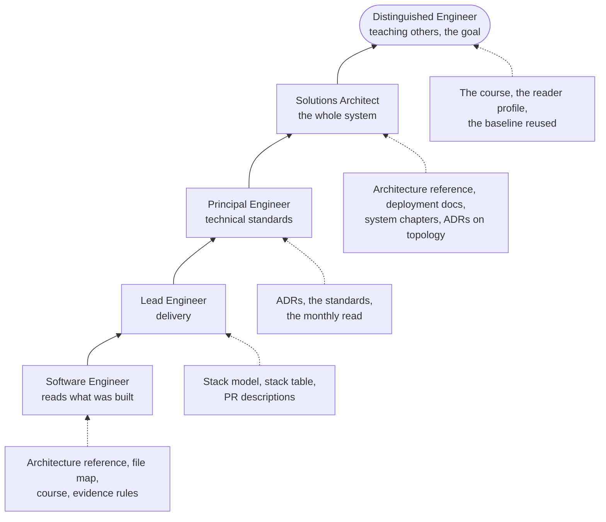
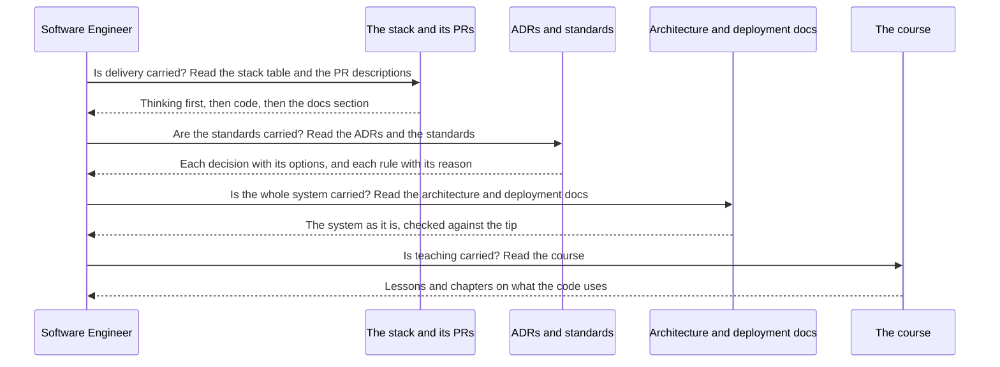
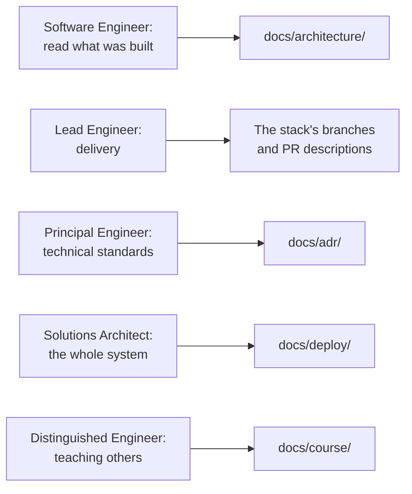
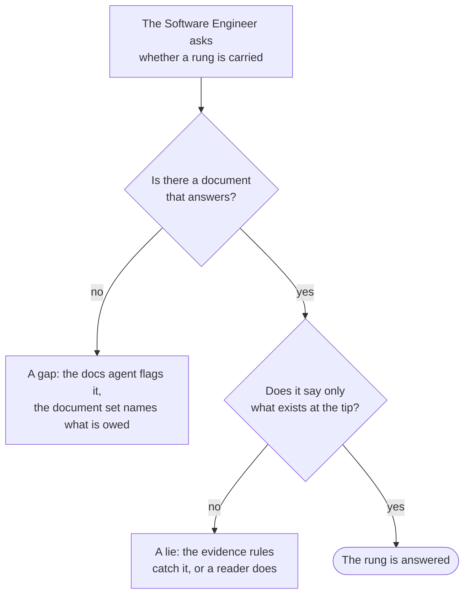
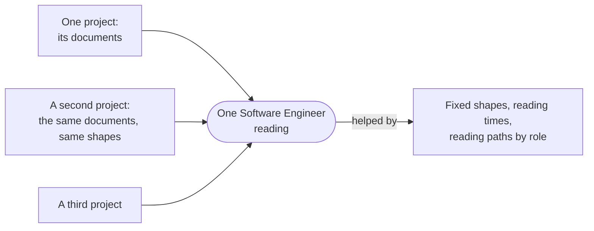

# Why this exists

| Item | What it says |
|---|---|
| What you will learn | Why the baseline exists, the ladder from Software Engineer to Distinguished Engineer, and which documents and workflows carry each rung, so that every later chapter can be read as serving one of them. |
| Lessons to read first | None. This chapter opens the course. |
| Reading time | 16 minutes, worked out from its length. |
| Files it covers | `standard/01-why-and-scope.md`, `standard/README.md`, `docs/adr/0031-software-engineer-and-the-ladder.md`, `README.md` |
| Versions verified against | Commit `bd7b1ce`, and git 2.54.0 for the commands of part 7; every diagram rendered in dark and light with mermaid-cli 12.2.0. |

This chapter and the six after it are "How we build", the course on the baseline itself. The baseline has no language or stack code of its own beyond Markdown, Mermaid, YAML and git, so its course takes the form of system chapters, one for each flow of the framework, after this one on its why (design 1, section 16.4). In these chapters, "the real code on both sides" of a hop is the real artifacts on both sides: a rule of the standard, a playbook, an ADR, a PR. "Observe it" is reading the recorded first stack. The labs are tabletop exercises, marked "not verified", because the checkers and the worked example that would let them run do not exist.

## The scenario

The Software Engineer wants to know, from the documents alone, whether each responsibility they have taken on is being carried on a project: delivery, technical standards, the system as a whole, and teaching others. They open the repository and, rung by rung, find the document or workflow that answers for that rung. This is the sixth thing the standard says success looks like ([standard/01-why-and-scope.md](../../../standard/01-why-and-scope.md)).

## The whole picture

Every part of the baseline exists to serve one rung of the ladder.



*Each rung is carried by its own documents, and the one thing to notice is that the arrows of the ladder run upward while every document points sideways into one rung: a document that served no rung would have no reason to exist.*

The happy path of the scenario, as the Software Engineer reads the documents:



*The Software Engineer asks one question of each group of documents, and the one thing to notice is that the answers come from the documents alone: no question needs the build conversation.*

## Hop by hop

### Hop 1: from the goal to the rungs

The first side is the standard's statement of the ladder; the second is what the baseline gives for each rung.

*Excerpt from [`standard/01-why-and-scope.md`](../../../standard/01-why-and-scope.md), lines 34 to 40.*

```text
| Rung | The responsibility the Software Engineer takes on | What the baseline gives them to carry it |
|---|---|---|
| **Software Engineer** | Turns a problem into working software, here by directing agents and reading, running and checking what they produce. | The architecture reference, the file map and the guided course, so they can read what was built; the evidence rules, so every claim is checked. |
| **Lead Engineer** | Leads delivery: slices the work, orders it, keeps each step reviewable and makes sure it ships working. | The stack model (spec, plan, slices, docs section), the stack table and PR descriptions that teach. |
| **Principal Engineer** | Owns technical quality across the codebase: the standards the code follows and the hard technical calls. | ADRs with the options explored, `docs/standards/` and the monthly line-by-line read of the documents. |
| **Solutions Architect** | Owns how the whole system fits together and fits its purpose: structure, boundaries, contracts between parts, deployment and operation, and the trade-offs among them. | The architecture reference, the deployment docs, the system chapters of the course, and ADRs on topology, trust boundaries and contracts. |
| **Distinguished Engineer** | Sets technical direction beyond one project and makes the people and agents around them better. | The guided course, the reader profile as the hiring bar, and the baseline itself, reused in every project. |
```

| The contract covers | Here |
|---|---|
| Format or schema | A Markdown table: the rung, its responsibility, what the baseline gives. |
| Versions | The standard at commit `bd7b1ce`; the ladder is ADR 0031, Proposed. |
| Timeouts | Not applicable: nothing waits on this hop. |
| Retries | Not applicable: nothing is sent. |
| Ordering | The rungs are in order, and each is kept on the way up. |
| Idempotency | Reading it twice gives the same answer. |
| Authentication | Not applicable: the repository is read by whoever can open it on GitHub, where it is private. |

The ladder and the goal are the Software Engineer's words; the two right-hand columns, what each rung's responsibility is and what the baseline gives to carry it, are the writer's call in design 1, as ADR [0031](../../adr/0031-software-engineer-and-the-ladder.md) records.

### Hop 2: from the rungs to what success looks like

*Excerpt from [`standard/01-why-and-scope.md`](../../../standard/01-why-and-scope.md), lines 73 to 78.*

```text
1. A new project gets a complete document set that takes a reader at the stated level from zero to contributing, with the architecture always fully documented.
2. A reader who reviews a stack reads the thinking first (spec, plan, decisions), then the code, then the documents that describe what was built.
3. Every factual claim in a descriptive document was checked against the code or a real run, and anything that could not be checked says so.
4. The monthly line-by-line read by the team and architects finds documents that match the code.
5. The repository itself is a teaching and review resource that the team can use to learn the approach and contribute to it.
6. The Software Engineer can tell from the documents alone whether each rung of the ladder is being carried: delivery (the stacks), technical standards (ADRs and `docs/standards/`), the system as a whole (architecture and deployment), and teaching others (the course).
```

Item 6 is the scenario of this chapter. Items 1 to 5 are what each rung's documents must achieve for the answer to be yes: a complete document set, a stack read thinking first, every claim checked, a monthly read that finds the documents true, and a repository the team can learn from.

| The contract covers | Here |
|---|---|
| Format or schema | A numbered list of six outcomes. |
| Versions | The standard at commit `bd7b1ce`. |
| Timeouts, retries | Not applicable. |
| Ordering | Not significant: the six hold together. |
| Idempotency | The same documents give the same answer to item 6. |
| Authentication | Not applicable. |

### Hop 3: from the rungs to this repository

The baseline follows its own standard, so this repository is the first answer to the scenario. Its README opens with the same ladder, and its index of the standard repeats it ([standard/README.md](../../../standard/README.md)). Part 7 shows how to find, in this repository, the documents that answer for each rung.



*Each rung has a place to look in this repository, and the one thing to notice is that delivery has no folder: it is carried by the stack itself, its branches and its PR descriptions, not by a document.*

## Invariants

| Invariant | Who enforces it | Where it is tested |
|---|---|---|
| The reader's level shapes the documents only, never what is built. | The docs agent, which pitches documents from the profile and never changes code; the Software Engineer, who reviews | No test exists. The standard requires no check of it. |
| Every rung has documents that answer for it. | The standard's document set, which every project keeps | No test exists. The required docs-structure check is to verify the required sections of each document type that is present. |
| A descriptive document says only what exists at the tip. | The docs agent and the evidence rules | No test exists; the docs agent checks by hand and records it in each description PR. |

## How it fails

The scenario fails when the documents cannot answer a rung's question, or answer it wrongly.

| Failure | What it is here | What the Software Engineer sees | How it recovers |
|---|---|---|---|
| Slow | The documents are long and the read takes hours. | No answer yet. | Reading paths by role in the reader profile; each document's reading time. |
| Down | A rung has no document. | Nothing to read for that question. | The document set is fixed, so a missing document is a gap the docs agent flags. |
| Duplicated | The same fact in two documents, which drift apart. | Two different answers. | The matrix of access lives on one page only; indexes are generated. |
| Reordered | Documents written before the work. | Documents that describe what was meant. | The docs section is written last, from the finished tip. |
| Lying | A document claims what is not built. | A confident wrong answer. | The evidence rules: say only what exists, mark what is not verified. |



*A rung can fail to be answered in two ways, and the one thing to notice is that the worse one is the lie: a missing document is visible as a gap, while a wrong one reads like an answer.*

## How it scales and what breaks first

The bottleneck is the one person reading. At commit `bd7b1ce`, the standard alone is 4,845 lines and 77,367 words in 22 files and its index, the playbooks 1,260 lines and the 35 ADR drafts 3,836 lines (`wc -l` and `wc -w`, run on 2026-11-19). Reading every document of every project in full does not scale, which is why each document has a fixed shape a reader can rely on, a reading time, and a place in a reading path by role. What breaks first is the time to read, not the structure.



*Every project adds documents for the same one reader, and the one thing to notice is that what helps is sameness: one structure for every project means the second project's documents are found where the first's were.*

## Observe it

Find, in this repository, the documents that answer for each rung. Run from the repository root.

```bash
git branch --list 'standard/[0-9]*' --format='%(refname:short)' | wc -l
```

```text
      20
```

```bash
ls docs/adr | wc -l
```

```text
      36
```

```bash
ls docs/architecture docs/deploy
```

```text
docs/architecture:
01-overview.md
02-the-standard.md
03-the-stack-model.md
04-the-docs-agent.md
05-decisions-and-adrs.md
06-standards-and-the-reader-profile.md
07-evidence-and-checks.md
08-cross-cutting.md
README.md

docs/deploy:
01-topology.md
02-environments.md
03-infrastructure-as-code.md
04-configuration-and-secrets.md
05-build-and-release-pipeline.md
06-deploying.md
07-rollback-and-recovery.md
08-operations.md
09-security-and-hardening.md
10-cost.md
11-troubleshooting.md
README.md
```

```bash
ls docs/course
```

```text
README.md
languages
reference
stacks
system
```

Output captured on 2026-11-19, after the docs section was rebased onto revision 3; `wc` pads its numbers with spaces on the machine where it ran.

## Summary and cheat sheet

| Rung | The question | Where to look in this repository |
|---|---|---|
| Software Engineer | Can I read what was built? | `docs/architecture/`, `docs/course/reference/file-map.md`, the course |
| Lead Engineer | Is delivery carried? | The stack's branches and PR descriptions |
| Principal Engineer | Are the standards carried? | `docs/adr/`, `docs/standards/` |
| Solutions Architect | Is the whole system carried? | `docs/architecture/`, `docs/deploy/`, these chapters |
| Distinguished Engineer | Are others taught? | `docs/course/`, `docs/reader-profile.md` |

The principle that outranks all others: the reader's level shapes the documents only.

Further reading: [standard/01-why-and-scope.md](../../../standard/01-why-and-scope.md) and ADR [0031](../../adr/0031-software-engineer-and-the-ladder.md).

**What was verified.** The excerpts, by a script; every diagram, by rendering it in dark and light with mermaid-cli 12.2.0; the counts of lines and words, and the commands of part 7, by running them. **Not verified.** The labs below, which are tabletop exercises.

## Practice

### Ten theory questions

**Question 1 (predict).** If the Software Engineer reads only the ADRs, which rungs can they answer for, and which not?

<details><summary>Worked answer</summary>

The Principal Engineer's, technical standards, and part of the Solutions Architect's, through the ADRs on topology, trust boundaries and contracts. Not delivery, which needs the stack, and not teaching, which needs the course.

**Common wrong answers.** "All of them, since every decision is there", which confuses why with what was built. "None", which ignores what the ADRs are for.

</details>

**Question 2 (predict).** A beginner team joins a distributed-database project. What changes in the project because of the reader profile?

<details><summary>Worked answer</summary>

Only the documents: they explain more basics. The code, the scope and the architecture do not change, by the principle that outranks all others.

**Common wrong answers.** "Simpler code", which is anti-goal A3. "Fewer documents", which C6 rules out.

</details>

**Question 3 (predict).** Which rung does the stack table at the top of a PR serve?

<details><summary>Worked answer</summary>

The Lead Engineer's: delivery, where the shape of the work is seen before any code.

**Common wrong answers.** "The Solutions Architect's", which is the whole system, not the work's delivery.

</details>

**Question 4 (diagnose).** The Software Engineer finds the architecture reference describing a component that does not exist. Which failure of part 5 is it, and which rule was broken?

<details><summary>Worked answer</summary>

Lying: the document claims what is not built. The first evidence rule, say only what exists at the tip, was broken.

**Common wrong answers.** "Down", which is a missing document. "Reordered", which is about when documents are written, though writing early is a common cause.

</details>

**Question 5 (diagnose).** Two pages give two different access rules for the same role. Which failure is it, and what does the standard do to prevent it?

<details><summary>Worked answer</summary>

Duplicated. The standard keeps the who-can-do-what matrix on the Users and access page only, and the architecture reference links to it rather than copying it.

**Common wrong answers.** "Lying", which may be true of one page but misses the cause, two copies.

</details>

**Question 6 (diagnose).** A reviewer cannot tell which document answers for teaching. Where should they look in this repository?

<details><summary>Worked answer</summary>

The course, `docs/course/`, and the reader profile, whose levels are also the hiring bar.

**Common wrong answers.** "The README", which is the front door, not the course.

</details>

**Question 7 (design trade-offs).** The ladder's two right-hand columns are the writer's call, not the Software Engineer's words. What does keeping that distinction in ADR 0031 buy?

<details><summary>Worked answer</summary>

A reader can tell what the Software Engineer decided from what an agent filled in, and challenge the second without reopening the first. The cost is a more careful record.

**Common wrong answers.** "Nothing, it is all approved", which loses who said what.

</details>

**Question 8 (systems reasoning).** Why does the principle that outranks all others protect the project across hires?

<details><summary>Worked answer</summary>

Because the team changes and the profile changes with it, but what was built is fixed by the problem. If the level shaped the code, every change of team would change the system; because it shapes only the documents, a change of team means regenerating documents, not rewriting code.

**Common wrong answers.** "Because the code is hidden from the team", which is not true.

</details>

**Question 9 (systems reasoning).** Part 6 says the bottleneck is the one reader. What property of the document set keeps the read from growing with every project?

<details><summary>Worked answer</summary>

One structure for every project: the same documents, the same shapes, the same places. The reader learns where to look once.

**Common wrong answers.** "Shorter documents", which C6 rules out.

</details>

**Question 10 (systems reasoning).** Which invariant of part 4 would a lie break, and why is that the most expensive failure for a team that reads line by line?

<details><summary>Worked answer</summary>

That a descriptive document says only what exists at the tip. One wrong sentence costs more than a missing one, because a reader acts on it.

**Common wrong answers.** "The reader-level invariant", which is about pitch, not truth.

</details>

### Labs

Each lab is a tabletop exercise on this repository. **Not verified:** no checker or worked example exists to run them against, so the outcomes are checked by reading.

| Kind | What you do | A checkable outcome |
|---|---|---|
| Run it | Take the scenario: for each rung, name the folder of this repository that answers for it, using part 7. | Five rungs, each with a folder that exists in `git ls-files`. |
| Break it on purpose | Pick one sentence of the architecture reference and rewrite it to describe something that does not exist. Which failure of part 5 is it? | You name "lying" and the evidence rule it breaks. |
| Trace what happened | Follow the ladder from `standard/01-why-and-scope.md` to the README of this repository and to ADR 0031. | You show the same five rungs, in the same order, in all three. |
| Fix it | A made-up README has no "Where to go next". Which rung is left without a path, and what part of the README fixes it? | You name part 2 of the README and the reading paths of the reader profile. |
