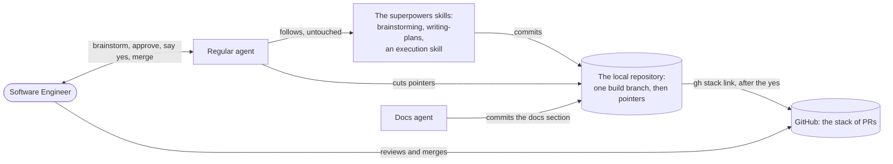
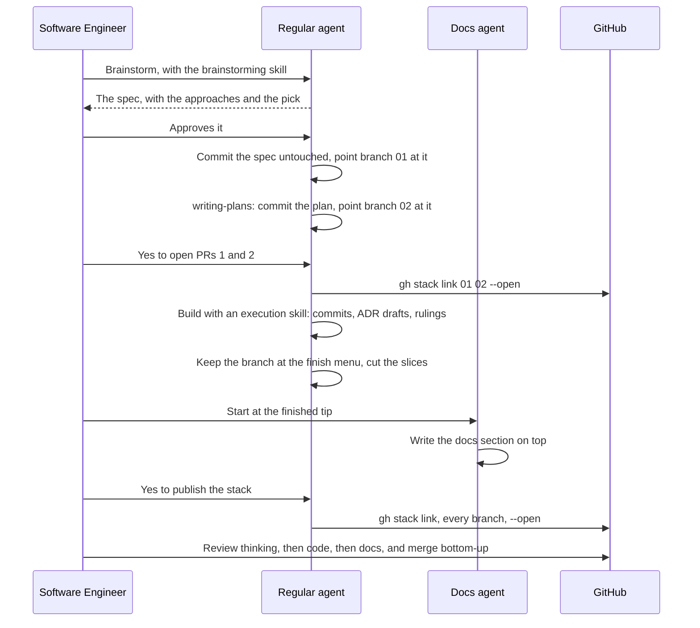
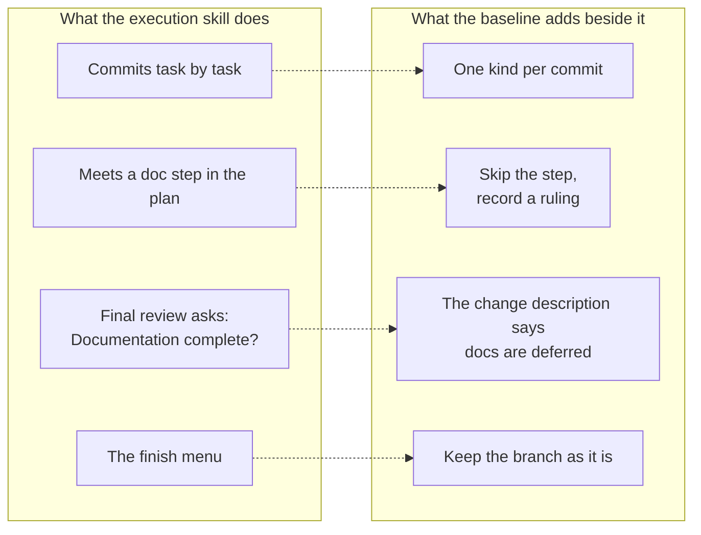
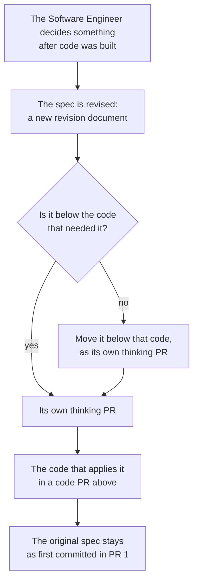
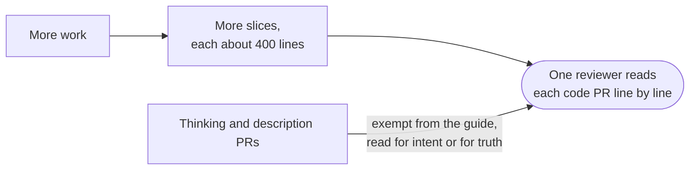

# A feature goes from brainstorm to merged stack

| Item | What it says |
|---|---|
| What you will learn | How one piece of work travels from a brainstorm to a merged stack: the spec and the plan as the first two PRs, the build that the baseline leaves untouched, the cut, the docs section on top, the publish and the merge, and where each step can go wrong. |
| Lessons to read first | [A stack of pull requests](../stacks/gh-stack/01-a-stack-of-pull-requests.md) and [gh stack link and the stack on GitHub](../stacks/gh-stack/02-gh-stack-on-github.md). |
| Reading time | 20 minutes, worked out from its length. |
| Files it covers | `standard/03-stack-model.md`, `standard/21-skills-seams.md`, `docs/agents/stacks.md`, `AGENTS.md`, `docs/superpowers/specs/2026-11-14-baseline-standard-design.md` |
| Versions verified against | Commit `9d4518e`; git 2.54.0, `gh` 2.103.3 and `gh stack` 0.3.0 for parts 3 and 7; every diagram rendered in dark and light with mermaid-cli 12.2.0. |

## The scenario

The Software Engineer wants a new piece of work built. They brainstorm it with an agent until there is a spec they approve. The agent writes a plan, builds the work task by task, and cuts it into a stack of PRs. A fresh docs agent writes the documents on top. Once the Software Engineer says yes, the whole stack goes up on GitHub, they review it, thinking first, and merge it from the bottom up. The baseline's own first stack is the recorded example: its spec and plan have been open as PRs 1 and 2 since 2026-11-18, and the rest of it waits for its docs section and the Software Engineer's yes.

## The whole picture

Every component the scenario touches:



*The work passes through the local repository before it reaches GitHub, and the one thing to notice is that the skills only commit: the cut, the docs and the publish are done around them, so no skill is changed.*

The happy path across them:



*The work goes up in two publishes and comes down in one merge, and the one thing to notice is that the Software Engineer appears at each turn where the work leaves the agents' hands: approval, each publish and the merge.*

## Hop by hop

### Hop 1: the brainstorm becomes PR 1

On one side is the spec, committed exactly as the skill produced it. This repository's spec opens with its status as the skill wrote it:

*Excerpt from [`docs/superpowers/specs/2026-11-14-baseline-standard-design.md`](../../superpowers/specs/2026-11-14-baseline-standard-design.md), lines 1 to 3.*

```text
# The Baseline Standard: design 1 of 3

**Design document** · 2026-11-14 · status: **draft for approval**
```

On the other side is the rule that puts it, untouched, at the bottom of the stack, with the plan above it and when the two are opened:

*Excerpt from [`standard/03-stack-model.md`](../../../standard/03-stack-model.md), lines 116 to 118.*

```text
1. **The spec is PR 1.** When brainstorming finishes and the Software Engineer approves the spec, the spec is committed on the stack's first branch, untouched. Because: thinking goes below the code it governs, so the reviewer reads the intent first, and the spec stays as the skill produced it and the Software Engineer approved it.
2. **The plan is PR 2.** When the plan is written, it is committed on the next branch, untouched. Because: the plan is thinking too and goes below the code it governs, and PR 2 stays as first written even if the plan is revised later (rule 8).
3. **PRs 1 and 2 are opened immediately.** Where the project's `AGENTS.md` or the conversation asks for the Software Engineer's yes before anything is opened, they are opened once the Software Engineer has said yes. Because: they contain only documents, nothing merges early, and the Software Engineer can read and comment while the build runs.
```

| The contract covers | Here |
|---|---|
| Format or schema | The spec is whatever the skill writes, at the path the artifact map records (`docs/superpowers/specs/**`); the baseline sets no shape for it. |
| Versions | The spec is dated; a later revision is a new file in its own thinking PR, and PR 1 stays as first committed. |
| Timeouts | Not applicable: nothing waits on a clock. |
| Retries | Not applicable. |
| Ordering | The spec is PR 1 and the plan PR 2, below every code PR. |
| Idempotency | Committing the same spec twice adds nothing: it is committed once, untouched. |
| Authentication | The Software Engineer's approval of the spec, and in this repository their yes before PRs 1 and 2 are opened. |

The status line still reads "draft for approval" although the Software Engineer approved the design: the spec stays as the skill produced it, and the approval is in the conversation and in the stack, not in the file.

### Hop 2: opening PRs 1 and 2

*Excerpt from [`AGENTS.md`](../../../AGENTS.md), lines 37 to 39.*

```text
4. **Nothing merges, deploys or publishes unless the Software Engineer asks.** Opening the PRs of a stack is publishing, so it waits for their yes too, the first two PRs included, and the rest of the stack waits until its docs section is in.

   Because: merging, deploying and publishing are the Software Engineer's calls, and the merge of a stack is also the acceptance of its ADRs. The rest of the stack waits for its docs section because the stack is complete only with the docs section on top (`stacks.md` has the rules of a stack).
```

This repository asks for the yes before anything is opened, so rule 3's "opened immediately" waited for it. The two PRs as GitHub holds them, captured on 2026-11-18:

```bash
gh pr view 1 --json number,headRefName,baseRefName,isDraft,state
```

```text
{"baseRefName":"main","headRefName":"standard/01-spec","isDraft":false,"number":1,"state":"OPEN"}
```

| The contract covers | Here |
|---|---|
| Format or schema | Two branches, linked with `gh stack link --open`; PR 1 based on `main`, PR 2 on PR 1's branch. |
| Versions | `gh stack` 0.3.0. |
| Timeouts, retries | Not applicable for the baseline; the push is atomic. |
| Ordering | Bottom to top: the spec, then the plan. |
| Idempotency | Linking again reuses the existing PRs. |
| Authentication | The Software Engineer's own GitHub sign-in through `gh`, and their yes. |

### Hop 3: the build, beside the skills

The execution skill commits task by task on one branch and stops only for its own reasons. The baseline adds two rules for the agent that runs it, and one pick at the finish menu:

*Excerpt from [`standard/21-skills-seams.md`](../../../standard/21-skills-seams.md), lines 49 to 51.*

```text
| **Doc steps in plans** | `writing-plans` folds documentation steps into task steps. | Execution rule: skip any step that writes one of the baseline's doc families. The plan file stays as produced. |
| **Final reviewer** | Its checklist asks "Documentation complete?". | Execution rule: the change description says descriptive docs are deferred to the docs section, so the checklist item is not flagged and no fix loop writes docs into code PRs. |
| **Finish menu** | Runs straight after the final review, before the docs exist. | The Software Engineer's pick at the menu is "Keep the branch as-is" until the docs are in, then the stack is published with `gh stack`. Option 2 ("push and create a PR") would open one PR, so it is never used for stack work. |
```

| The contract covers | Here |
|---|---|
| Format or schema | Commits with conventional prefixes, one kind each; rulings as `Ruling: what, why, cost if wrong`. |
| Versions | The seams were checked against the skill files of superpowers 7.0.2. |
| Timeouts | Not applicable. |
| Retries | A review's fix round is a new commit, as the skills run it. |
| Ordering | Commits in build order; ADR drafts committed apart from code, at decision time. |
| Idempotency | Not applicable. |
| Authentication | Not applicable: the agent works in the Software Engineer's repository on their machine. |



*Each step of the skill has a small rule beside it, and the one thing to notice is that every line between the boxes is dotted: the baseline acts next to the skill and never inside it.*

### Hop 4: the cut and the docs section

The agent cuts a pointer at each slice boundary, as [the stack lesson](../stacks/gh-stack/01-a-stack-of-pull-requests.md) shows, and records the grouping as a ruling. The Software Engineer then starts a fresh docs agent at the finished tip, which commits the docs section on top ([How the docs agent writes the docs section](04-docs-agent-writes-the-docs-section.md)).

### Hop 5: the publish and the merge

With the Software Engineer's yes, `gh stack link` lists every branch, bottom to top, with `--open`; PRs 1 and 2 are reused. The Software Engineer reviews the whole stack, docs section included, and merges it bottom-up in one sitting. The runbook is [docs/deploy/06-deploying.md](../../deploy/06-deploying.md); its publish and merge steps are not verified, because both are the Software Engineer's.

## Invariants

| Invariant | Who enforces it | Where it is tested |
|---|---|---|
| Thinking sits below the code it governs. | The agent that cuts the stack, by moving a thinking commit below the code that needed it | No test exists. |
| Each PR holds one kind, for easier review. | The agent, by splitting mixed commits before the cut | No test exists. The PR rules are required to infer each PR's kind; a mixed PR is to get a notice that never blocks. |
| Every PR leaves the repository working. | The agent, by checking out each pointer and running the project's checks | This repository has no checks to run. |
| Nothing merges, deploys or publishes unless the Software Engineer asks. | Every agent, by `AGENTS.md` rule 4 | No test exists, and none could see an ask. |
| The docs section is last. | The docs agent, by committing on top of the finished tip | No test exists. The stack gate is required to keep lower PRs pending until the tip passes. |

## How it fails

| Failure | What it is here | What is seen | How it recovers |
|---|---|---|---|
| Slow | The Software Engineer is busy. | Work waits for a yes. | The agents do everything that does not need them and hand over the rest with the exact command. |
| Down | A skill is not available. | Nothing is produced at that step. | The baseline's steps are plain git and `gh`; the skill's step waits. |
| Duplicated | The stack is linked twice. | Nothing new. | `gh stack link` reuses existing PRs and never removes one. |
| Reordered | The spec is revised after code that needed it. | A thinking change above code. | The revision becomes its own thinking PR, moved below the code that needed it; PR 2 stays as first written. |
| Lying | A PR description claims a check that was not run. | A false "verified". | The evidence rules: say what was not verified. |

The failure flow for the reordered case, which this repository met twice, with revisions 1 and 2:



*A later decision becomes a thinking PR placed below the code it governs, and the one thing to notice is that the original spec is never edited: this repository's revisions are PRs 14 and 16, each below the code PR that applies it.*

## How it scales and what breaks first

The bottleneck is the review. Each code PR is to stay at about 400 changed lines, because it is read for correctness line by line; thinking and description PRs are exempt. The first stack, measured with `git diff --shortstat` between neighbouring branches on 2026-11-18:

| PR | Kind | Lines added | Lines removed |
|---|---|---|---|
| 1 | thinking | 1,372 | 0 |
| 2 | thinking | 654 | 0 |
| 3 | thinking | 3,415 | 0 |
| 4 | thinking | 1,363 | 0 |
| 5 | code | 398 | 0 |
| 6 | code | 399 | 0 |
| 7 | code | 599 | 0 |
| 8 | code | 762 | 0 |
| 9 | code | 737 | 0 |
| 10 | code | 551 | 0 |
| 11 | code | 309 | 0 |
| 12 | code | 580 | 0 |
| 13 | code | 488 | 0 |
| 14 | thinking | 195 | 14 |
| 15 | code | 27 | 18 |
| 16 | thinking | 95 | 6 |
| 17 | code | 18 | 16 |

Six of the nine code PRs of the first build, 7 to 10, 12 and 13, are above the size guide of about 400 lines. Rule 6 makes the grouping of the code into slices a ruling; no ruling in the list the docs agent was given records why the code was grouped this way, so the reason is not recorded.



*The stack grows by slices of a bounded size, and the one thing to notice is that the reviewer's line-by-line read applies to code PRs only, which is why only they carry the size guide.*

## Observe it

Read the recorded first stack from the repository root.

```bash
git branch --list 'standard/[0-9]*' --format='%(refname:short)'
```

```text
standard/01-spec
standard/02-plan
standard/03-adr-drafts
standard/04-playbooks
standard/05-foundations
standard/06-profile-and-layout
standard/07-feature-and-architecture
standard/08-course
standard/09-adrs-deployment-readme
standard/10-pr-descriptions-and-agents
standard/11-diagrams-and-evidence
standard/12-docs-agent-standards-rules
standard/13-seams-tooling-index
standard/14-revision-1-decisions
standard/15-revision-1-standard
standard/16-revision-2-decisions
standard/17-revision-2-standard
```

```bash
gh pr list --json number,headRefName,baseRefName,isDraft
```

```text
[{"baseRefName":"standard/01-spec","headRefName":"standard/02-plan","isDraft":false,"number":2},{"baseRefName":"main","headRefName":"standard/01-spec","isDraft":false,"number":1}]
```

```bash
git diff --shortstat standard/04-playbooks standard/05-foundations
```

```text
 3 files changed, 398 insertions(+)
```

Output captured on 2026-11-18, while the docs section was being written.

## Summary and cheat sheet

| Step | Who | What | Where it is set |
|---|---|---|---|
| Brainstorm | Software Engineer and agent | The spec, approved | `brainstorming`, untouched |
| PRs 1 and 2 | Agent, after the yes | Spec and plan, untouched | Rules 1 to 3 |
| Build | Agent with an execution skill | Commits, ADR drafts, rulings; doc steps skipped | The seams |
| Cut | Agent | Pointers at slice boundaries, a ruling | Rule 12 |
| Docs section | Docs agent | Description PRs on top | Rule 7 |
| Publish | Agent, after the yes | `gh stack link`, every branch | `AGENTS.md` rule 4 |
| Merge | Software Engineer | Bottom-up, one sitting | Rule 10 |

Further reading: [standard/03-stack-model.md](../../../standard/03-stack-model.md), [standard/21-skills-seams.md](../../../standard/21-skills-seams.md) and [docs/agents/stacks.md](../../agents/stacks.md).

**What was verified.** The excerpts, by a script; every diagram, by rendering it in dark and light with mermaid-cli 12.2.0; the sizes of the PRs, the PR on GitHub and the commands of part 7, by running them on 2026-11-18. **Not verified.** The publish of the whole stack and the merge, which have not happened; and the labs.

## Practice

### Ten theory questions

**Question 1 (predict).** A skill revises the plan after slice 2 is built, to fix slice 3. Where does the revision go in the stack?

<details><summary>Worked answer</summary>

In its own thinking PR, between slice 2 and slice 3, below the code that needed it. PR 2 stays as first written.

**Common wrong answers.** "In PR 2, edited", which rewrites what the reviewer read. "In slice 3's PR", which mixes kinds.

</details>

**Question 2 (predict).** At the finish menu, which option does the Software Engineer pick for stack work, and why not "push and create a PR"?

<details><summary>Worked answer</summary>

"Keep the branch as-is", until the docs are in. "Push and create a PR" would open one PR, where stack work needs a stack.

**Common wrong answers.** "Merge locally", which merges without the review the stack exists for.

</details>

**Question 3 (predict).** The plan has a task step "update the README". What does the agent running it do?

<details><summary>Worked answer</summary>

It skips the step, leaves the plan file as produced, and records the skipped step as a ruling. Descriptive documents are written only by the docs agent, from the finished tip.

**Common wrong answers.** "It updates the README", which writes what was meant. "It edits the plan to remove the step", which edits a skill's document.

</details>

**Question 4 (diagnose).** A reviewer of PR 9 finds a paragraph of the feature docs in it. What went wrong?

<details><summary>Worked answer</summary>

A descriptive document was written during the build and committed in a code PR, mixing kinds. The doc step should have been skipped, and the docs agent writes the feature docs in the docs section.

**Common wrong answers.** "The feature docs belong with the code they describe", which is the docs-per-slice idea that was rejected.

</details>

**Question 5 (diagnose).** After the publish, the reviewer of PR 7 sees the commits of PR 6 as well. Which hop failed?

<details><summary>Worked answer</summary>

The publish: PR 7 was given the wrong base, because a branch was missing or out of order in `gh stack link`. `gh pr list` shows the base; link again with every branch in order.

**Common wrong answers.** "The cut", which may be fine; the chain check would have shown a broken pair.

</details>

**Question 6 (diagnose).** Six of the first stack's nine code PRs are above the size guide. Is that a broken rule?

<details><summary>Worked answer</summary>

It departs from a guide, "about 400 changed lines", and the grouping is the agent's call, recorded as a ruling. The reviewer can ask for a different grouping before merging, because the grouping is visible in the stack table.

**Common wrong answers.** "No, the guide is only for thinking PRs", which reverses it. "Yes, the PRs must be split now", which is the Software Engineer's call to make in review.

</details>

**Question 7 (design trade-offs).** Why publish PRs 1 and 2 early but hold the rest until the docs section is in?

<details><summary>Worked answer</summary>

The spec and the plan are documents that can be read while the build runs and nothing merges early, so opening them lets the Software Engineer comment. The rest is complete only with its docs section on top. The cost is two publishes instead of one.

**Common wrong answers.** "GitHub needs PRs 1 and 2 first", which it does not.

</details>

**Question 8 (systems reasoning).** Which invariant would break if the docs agent's commits came before the last code PR, and what would a reader then get?

<details><summary>Worked answer</summary>

"The docs section is last." The documents would describe an earlier state of the work, so a reader of the merged stack would read about code that later PRs changed.

**Common wrong answers.** "Only the order of PRs would change", which ignores what the documents say.

</details>

**Question 9 (systems reasoning).** The flow has the Software Engineer at four points. What happens to the work at each when they are busy, and what never waits?

<details><summary>Worked answer</summary>

The approval, each publish and the merge wait for them; everything else, building, ADR drafts, rulings, the cut and the docs, goes on, and the rest is handed over with the exact command. What never waits is any call not on their list.

**Common wrong answers.** "Everything stops", which the working rules forbid. "Nothing waits", which would take their calls from them.

</details>

**Question 10 (systems reasoning).** Why is the skill never changed, even where its default does not fit the stack, such as folding doc steps into tasks?

<details><summary>Worked answer</summary>

Because the baseline sits beside the skills and changes nothing about how they work; it handles each mismatch with a small rule for the agent at the seam, such as skipping the doc step and recording it. A changed skill would have to be maintained against every new version of the skill.

**Common wrong answers.** "Skills cannot be changed", which is not the reason; they could be, and the baseline chooses not to.

</details>

### Labs

**Not verified:** these are tabletop exercises on this repository's recorded stack, checked by reading, because no checker or worked example exists to run them against.

| Kind | What you do | A checkable outcome |
|---|---|---|
| Run it | Follow the scenario through the first stack: for each of the 17 branches, name its kind from its paths with `git diff --name-only`. | Your list matches the stack table: 1 to 4, 14 and 16 thinking; 5 to 13, 15 and 17 code. |
| Break it on purpose | Pretend the spec revision of PR 14 had been committed after PR 15. Say where it would have to move. | You place it below PR 15, as its own thinking PR. |
| Trace what happened | Trace revision 1 from its document to the standard: which files PR 14 and PR 15 change. | `git diff --name-only` shows the revision document and the playbooks in PR 14, and nine files of `standard/` in PR 15. |
| Fix it | A made-up code PR holds `standard/16-diagrams.md` and `docs/features/README.md`. Fix the stack. | You move the feature page out of the code PR, into the docs section. |
