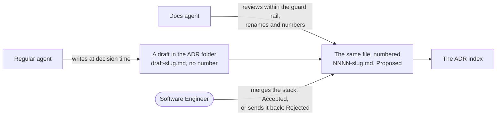
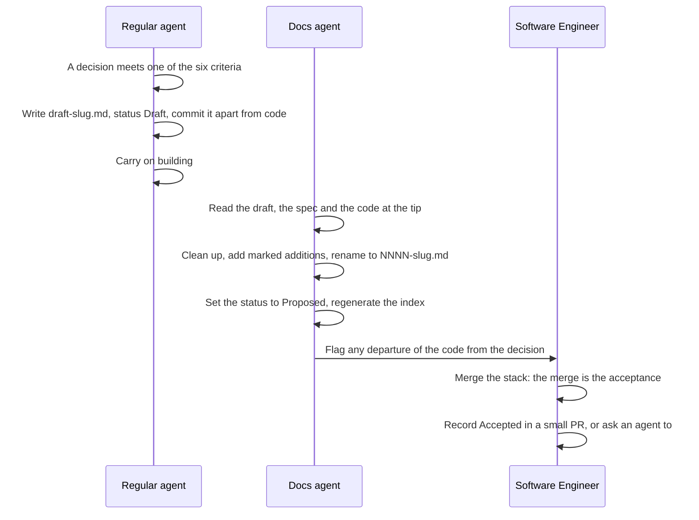
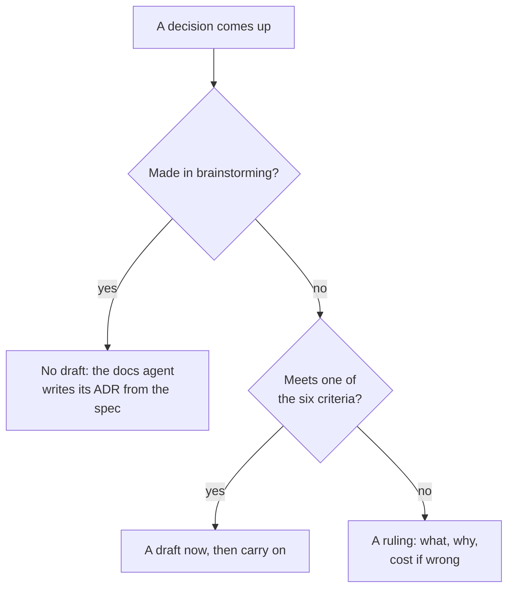
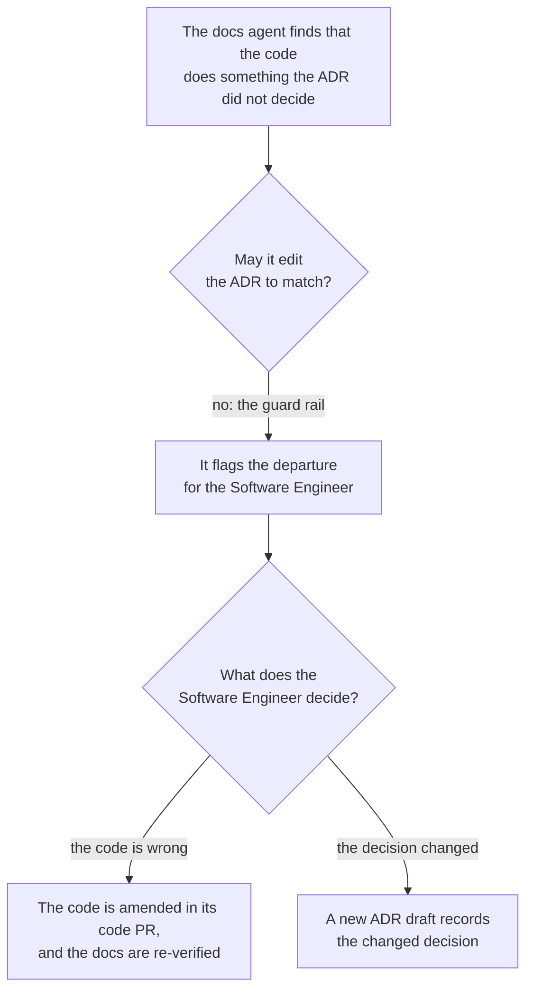
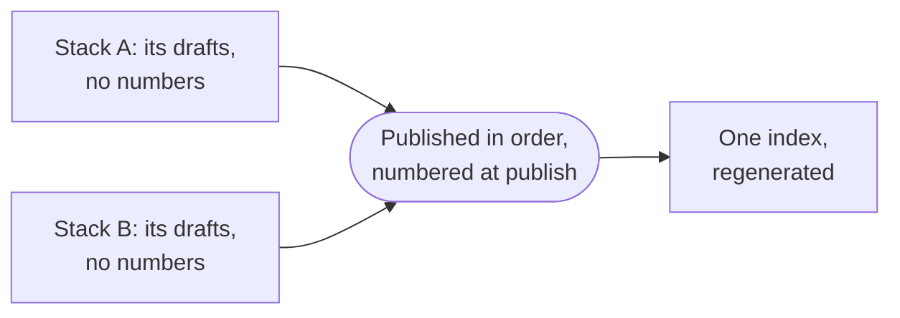

# A decision becomes an ADR

| Item | What it says |
|---|---|
| What you will learn | How a decision becomes an ADR: the test that tells a decision of impact from a ruling, the draft written at decision time, the docs agent's review within its guard rail, the number and the move to Proposed, and acceptance at the merge. |
| Lessons to read first | [Sequence and state diagrams](../languages/mermaid/02-sequence-and-state-diagrams.md), for the ADR lifecycle, and [A stack of pull requests](../stacks/gh-stack/01-a-stack-of-pull-requests.md). |
| Reading time | 18 minutes, worked out from its length. |
| Files it covers | `standard/11-adrs.md`, `docs/agents/adrs.md`, `docs/superpowers/specs/2026-11-14-baseline-decision-trail.md`, `docs/adr/0001-adrs-with-options-explored.md`, `docs/adr/README.md` |
| Versions verified against | Commit `bd7b1ce`, and git 2.54.0 for parts 3 and 7; every diagram rendered in dark and light with mermaid-cli 12.2.0. |

## The scenario

During a build, the regular agent has to pick between options for something that matters: a new dependency, the shape of the data, something hard to take back. It writes down the options as they stand, with the evidence it has, as a draft decision record, and carries on building. At the end, a fresh docs agent reviews the draft without rewriting its reasoning, numbers it and moves it to Proposed. When the Software Engineer merges the stack, the decision is accepted. This repository's 31 ADRs went the same way, with one difference set by design 1: their decisions were made in the brainstorm and drafted from its decision trail.

## The whole picture



*One file travels from draft to numbered ADR, and the one thing to notice is that three different hands touch it, each for one step: the regular agent writes it, the docs agent numbers it, the Software Engineer accepts it.*

The happy path:



*A decision of impact becomes an accepted ADR in three moves by three roles, and the one thing to notice is the third line: nothing waits for an approval at the time of the decision.*

## Hop by hop

### Hop 1: is it a decision of impact?

The agent tests each decision against six criteria, as it makes it:

*Excerpt from [`standard/11-adrs.md`](../../../standard/11-adrs.md), lines 140 to 147.*

```text
The regular agent writes an ADR draft when it makes or adopts a decision of impact, which is a decision that meets any one of these six criteria:

- **A new technology or dependency.** Something the project did not use before, such as a language, a framework, a service or a package.
- **A data model or public interface.** How the data is shaped, or what other code or other people can call.
- **A security or trust boundary.** Where one party's data or authority ends and another's begins.
- **The deployment topology.** Where and how the parts of the system run.
- **A contract between stacks.** What two technology stacks, such as a front end and a back end, promise each other.
- **Anything hard to reverse.** A choice that is costly or impossible to take back once other work depends on it.
```

A decision that meets one gets a draft at once; a smaller call stays a ruling. A decision made in brainstorming needs no draft, because the spec's Approaches section already records it, and the docs agent writes its ADR from the spec.



*A decision lands in one of three records, and the one thing to notice is that none of the branches waits for an approval: the criteria sort a decision, they do not gate it.*

| The contract covers | Here |
|---|---|
| Format or schema | Six criteria, any one of which makes a decision of impact. |
| Versions | The standard at commit `bd7b1ce`. |
| Timeouts | Not applicable. |
| Retries | Not applicable. |
| Ordering | The test is made as the decision is made, never afterwards. |
| Idempotency | The same decision always gives the same answer. |
| Authentication | Not applicable: the agent decides without stopping, and the Software Engineer sees every draft at review. |

### Hop 2: from the record of the decision to the draft

In this repository, the first side is the decision trail, which records the brainstorm behind each decision; the second is the ADR drafted from it. Decision 0001 in the trail:

*Excerpt from [`docs/superpowers/specs/2026-11-14-baseline-decision-trail.md`](../../superpowers/specs/2026-11-14-baseline-decision-trail.md), lines 16 to 24.*

```text
## 0001. Record decisions as ADRs with the options explored

- **Context.** The Software Engineer's first request names "architectural decision records documenting the technical decisions that were taken, options explored". The reference projects' records are thin: the-way's template is Context, Decision, Consequences (its ADR 0003 is 15 lines); my-quote keeps nine decisions in one file with Decision, Why, Consequences.
- **Drivers.** Options and evidence must be visible; records must be durable and reviewable by architects in the monthly read.
- **Options.** (a) the-way's three-part template: short, but no alternatives. (b) my-quote's one-file Decision/Why: better on the why, still no alternatives. (c) a full skeleton: context, ranked drivers, options with how-it-works diagram, pros, cons and evidence, comparison, decision, consequences, revisit signals, links.
- **Pick.** (c). **Software Engineer** bar: "options explored".
- **Evidence.** Reading `docs/adr/0003-sqlite-as-the-database.md` and `docs/deployment/ARCHITECTURE_DECISIONS.md`.
- **Consequences.** Heavier records; the guard rail and decision-time drafting are needed to keep the reasoning honest.
- **Revisit when.** The skeleton proves too heavy for small decisions, which would move them to rulings.
```

And the head of the ADR it became, after the docs agent's review:

*Excerpt from [`docs/adr/0001-adrs-with-options-explored.md`](../../adr/0001-adrs-with-options-explored.md), lines 1 to 7.*

```text
# 0001. Record decisions as ADRs with the options explored

Status: Proposed

Date: 2026-11-14

Deciders: the Software Engineer
```

- The trail gives the context, the drivers, the options, the pick and the reason, the evidence, the consequences and the revisit signal. The ADR's template has a part for each.
- The title now carries the number 0001, which the draft's own links gave: "Design 1, Appendix A, 0001".
- The status reads Proposed: the docs agent's review moved it from Draft.
- The three header lines are separate paragraphs, so that GitHub does not join them into one.

| The contract covers | Here |
|---|---|
| Format or schema | The template of [standard/11-adrs.md](../../../standard/11-adrs.md): title, three header lines, then eight parts in order. |
| Versions | The trail at commit `bd7b1ce`; the ADR as the reference PR of the docs section left it. |
| Timeouts, retries | Not applicable. |
| Ordering | The draft's options come before its decision. |
| Idempotency | Where the trail records nothing, the ADR says "Not recorded", so drafting it again from the trail gives the same gaps. |
| Authentication | Not applicable. |

### Hop 3: the docs agent's review

*Excerpt from [`docs/agents/adrs.md`](../../agents/adrs.md), lines 117 to 123.*

```text
| The docs agent may | The docs agent may not |
|---|---|
| Clean up the draft. | Rewrite the decision. |
| Add to it, marking each addition "Added at review". | Rewrite the drivers. |
| Review it. | Rewrite the options. |
| Give it its number and move it to Proposed. | Rewrite the rationale. |
| Flag where the built code departs from the decision. | Edit the ADR so that it matches the code. |
```

The review changes the file name, the title, the status and, where the docs agent adds something, marked lines. This repository's ADR 0001 shows the steps in its history:

```bash
git log --follow --format='%h %s' -- docs/adr/0001-adrs-with-options-explored.md
```

```text
6b0953e docs: link the system chapters from the reference documents and the indexes
af2d4e4 docs(adr): number the 31 ADR drafts and move them to Proposed
5f62712 docs(adr): render each draft header line on its own line on GitHub
6c6530a docs(adr): add draft decisions on scope and approach
```

Read bottom to top: the regular agent's draft, a fix of its header during the build, the docs agent's review, which `--follow` traces through the rename from `draft-adrs-with-options-explored.md`, and a link marked "Added at review" that the docs agent added when it wrote these chapters.

### Hop 4: acceptance at the merge

The Software Engineer's merge of the stack is the acceptance of every ADR in it, and their send-back of one is its rejection. They, or an agent at their ask, then record the change of status in a small PR. Where that PR sits for a rejection, in a stack that has not merged, is left open by revision 2. Once accepted, an ADR is append-only: only its status and its links are ever edited again.

## Invariants

| Invariant | Who enforces it | Where it is tested |
|---|---|---|
| A draft is written at decision time, never afterwards. | The regular agent | No test exists, and none could see when a draft was thought. |
| A draft has no number until the docs agent publishes it. | The regular agent, by naming it `draft-<slug>.md` | No test exists. |
| The docs agent never rewrites the decision, drivers, options or rationale. | The docs agent, within the guard rail | No test exists. |
| No Accepted ADR is rewritten. | Every agent | No test exists. The checker is required to verify it on every PR. |
| Every changed manifest, schema or interface is covered by an ADR or a ruling. | The regular agent; by hand while no checker exists | No test exists. The stack gate is required to check it over the whole change. |

## How it fails

| Failure | What it is here | What is seen | How it recovers |
|---|---|---|---|
| Slow | The review waits for the end of the build. | A draft stays Draft until the docs section. | Nothing waits on it: the build carries on. |
| Down | A decision of impact got no draft. | A change with no recorded reason. | The presence check, by hand today, finds the changed file with no record. |
| Duplicated | Two stacks in flight number an ADR the same. | Two ADRs with one number. | Drafts carry no number, so it cannot happen; numbers are given at publish. |
| Reordered | The rationale is written after the decision. | Backfilled rationale. | The draft is written at decision time; a gap says "Not recorded". |
| Lying | An ADR is edited to match code that departs from it. | A record that no longer says what was decided. | The guard rail: the docs agent flags the departure and leaves the ADR. |

The failure flow when the built code departs from the decision:



*A departure is never fixed by editing the record, and the one thing to notice is that both ways out keep the old reasoning intact: either the code changes, or a new record says what changed.*

## How it scales and what breaks first

At commit `bd7b1ce` the repository holds 35 ADR drafts, 3,836 lines with 162 diagrams, all reviewed in one docs section. What grows with a project is the number of decisions per stack, and what breaks first is the review at the end: a stack with many drafts gives the docs agent and the Software Engineer many records to read at once. Two properties keep it bounded: drafts sit in small PRs directly beneath the slice that depends on them, so they are read beside the code they govern, and numbers are given at publish, so stacks in flight never wait on each other.



*Several stacks can each carry drafts at once, and the one thing to notice is that numbering happens only at publish, so the stacks never collide on a number while they are in flight.*

## Observe it

```bash
git log --follow --format='%h %s' -- docs/adr/0019-generated-indexes.md
```

```text
6b0953e docs: link the system chapters from the reference documents and the indexes
775aaa3 docs(adr): number the four drafts of revision 3 and move them to Proposed
af2d4e4 docs(adr): number the 31 ADR drafts and move them to Proposed
1464590 docs(adr): add draft decisions on documents and diagrams
```

ADR 0019 keeps the text of its decision. Its two later commits only add links marked "Added at review": one to ADR 0032, the draft that extends it to five indexes, and one to this course.

```bash
grep -l '^Status: Proposed' docs/adr/0*.md | wc -l
```

```text
      35
```

Output captured on 2026-11-19, after the docs section was rebased onto revision 3; `wc` pads its numbers with spaces on the machine where it ran.

## Summary and cheat sheet

| Stage | Who | File name | Status |
|---|---|---|---|
| Decision of impact made | Regular agent | `draft-<slug>.md` | Draft |
| Review within the guard rail | Docs agent | `<NNNN>-<slug>.md` | Proposed |
| The stack is merged | Software Engineer | unchanged | Accepted, recorded in a small PR |
| Sent back | Software Engineer | unchanged | Rejected |
| Replaced by a later ADR | Not stated by the standard | unchanged | Superseded by NNNN |

Further reading: [standard/11-adrs.md](../../../standard/11-adrs.md), [docs/agents/adrs.md](../../agents/adrs.md) and the [ADR index](../../adr/README.md).

**What was verified.** The excerpts, by a script; every diagram, by rendering it in dark and light with mermaid-cli 12.2.0; the history of ADR 0001 and the commands of part 7, by running them. **Not verified.** Acceptance and rejection, which happen at a merge that has not taken place; and the labs.

## Practice

### Ten theory questions

**Question 1 (predict).** An agent bumps a library to a newer version that the tests show is safe. Draft or ruling?

<details><summary>Worked answer</summary>

A ruling. A new dependency is a decision of impact; a bump that tests show is safe is a smaller call.

**Common wrong answers.** "A draft, because the manifest changed", which confuses the presence check, which a ruling satisfies, with the criteria.

</details>

**Question 2 (predict).** Two stacks in flight each add a draft. What numbers do the drafts have?

<details><summary>Worked answer</summary>

None. Drafts are unnumbered until the docs agent of each stack publishes them, so they cannot collide.

**Common wrong answers.** "The next free numbers, 0032 and 0033", which is exactly the collision the rule prevents.

</details>

**Question 3 (predict).** Which edits can an Accepted ADR still receive?

<details><summary>Worked answer</summary>

Its status, such as "Superseded by NNNN", and its links. Everything else is append-only.

**Common wrong answers.** "None", which forgets supersession. "Typo fixes", which the rule does not allow.

</details>

**Question 4 (diagnose).** A reviewer finds an option's "Pros" filled in with an argument nobody made at the time. Which anti-goal is it?

<details><summary>Worked answer</summary>

A4, backfilled rationale. Where nothing was recorded, the ADR says "Not recorded".

**Common wrong answers.** "A6", which is about unverified claims in descriptive documents.

</details>

**Question 5 (diagnose).** The docs agent is unsure whether rewording a sentence of a draft's Decision changes its meaning. What does it do?

<details><summary>Worked answer</summary>

It treats the edit as a rewrite, leaves the text as it is and flags it. When in doubt, the guard rail wins.

**Common wrong answers.** "It makes the edit and marks it Added at review", which is for additions, not rewrites.

</details>

**Question 6 (diagnose).** A stack changes `package.json` and no ADR or ruling mentions it. What catches it today?

<details><summary>Worked answer</summary>

Nothing automatic. The presence check is made by hand with `git diff --name-only main...HEAD` before the report; the stack gate that is to make it does not exist.

**Common wrong answers.** "The checker blocks it", which states a requirement as if it ran.

</details>

**Question 7 (design trade-offs).** Why is there no approval gate before code for a decision of impact?

<details><summary>Worked answer</summary>

Because brainstorming already gates the big decisions, and a second gate would collide with the execution skills, which run continuously. The trade is that a surprising decision is seen only at the stack's review, where rework is still possible. ADR 0011 records it.

**Common wrong answers.** "Because ADRs are not important", which the whole model contradicts.

</details>

**Question 8 (systems reasoning).** Why does putting drafts in a small PR directly beneath the first slice that depends on them help the reviewer?

<details><summary>Worked answer</summary>

The reviewer reads the thinking first, then the code that follows from it, one kind per PR. The decision is fresh in mind when the code is read.

**Common wrong answers.** "It keeps the code PR small", which is a side effect, not the reason.

</details>

**Question 9 (systems reasoning).** What would break if the docs agent edited an ADR to match code that departs from it?

<details><summary>Worked answer</summary>

The record would no longer show what was decided at the time, so the departure would disappear instead of reaching the Software Engineer as a decision. The guard rail exists to keep that departure visible.

**Common wrong answers.** "Nothing, the ADR would just be up to date", which is the backfilling the model exists to prevent.

</details>

**Question 10 (systems reasoning).** Revision 1 of this repository changed how many indexes are generated, from the four that ADR 0019 names to five. What should have recorded that change, and why is it flagged rather than fixed in the ADR?

<details><summary>Worked answer</summary>

A new ADR draft, because a change to a decision is a new ADR draft and not only an edit of the spec. It is flagged for the Software Engineer because the docs agent may not edit ADR 0019 to match the built standard. In this repository that is what happened: the first docs run flagged it, the Software Engineer approved a new draft (revision 3, D1), and the draft became [ADR 0032](../../adr/0032-five-generated-indexes.md), while ADR 0019 keeps its text.

**Common wrong answers.** "The docs agent should update ADR 0019", which breaks the guard rail.

</details>

### Labs

**Not verified:** tabletop exercises on this repository, checked by reading, because no checker or worked example exists to run them against.

| Kind | What you do | A checkable outcome |
|---|---|---|
| Run it | Follow decision 0006 from its entry in the decision trail to `docs/adr/0006-comparisons-in-marked-asides.md`. | You find each part of the trail entry in a part of the ADR, and "Not recorded" where the trail records nothing. |
| Break it on purpose | Take a made-up decision, "store reminders in the database", made mid-build. Sort it with the six criteria. | You name "a data model" and so a draft, not a ruling. |
| Trace what happened | Trace ADR 0019's file through its history with `git log --follow`. | The output shows the draft commit and the docs agent's numbering commit. |
| Fix it | A made-up draft is named `0032-reminder-store.md` by the agent that wrote it. Fix it. | You rename it `draft-reminder-store.md`, with no number, and leave the numbering to the docs agent. |
