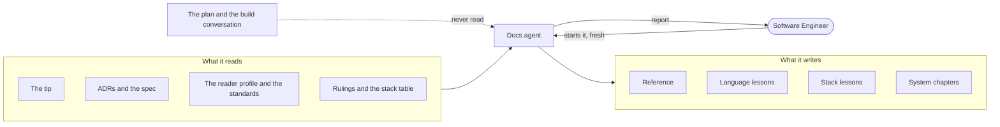
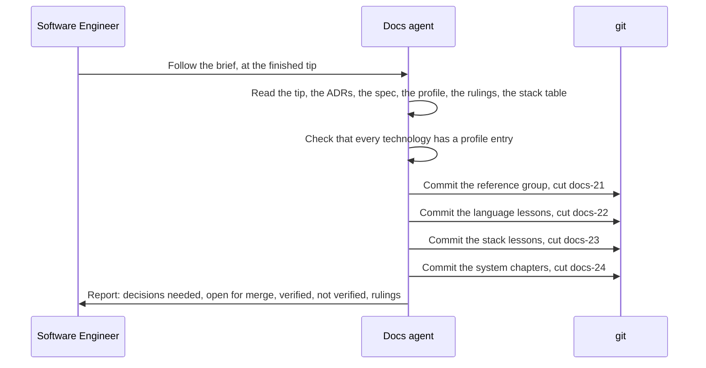
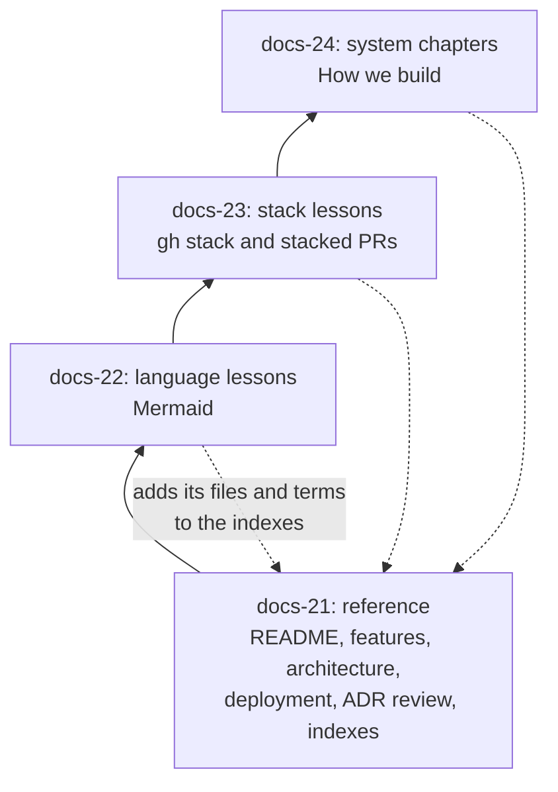
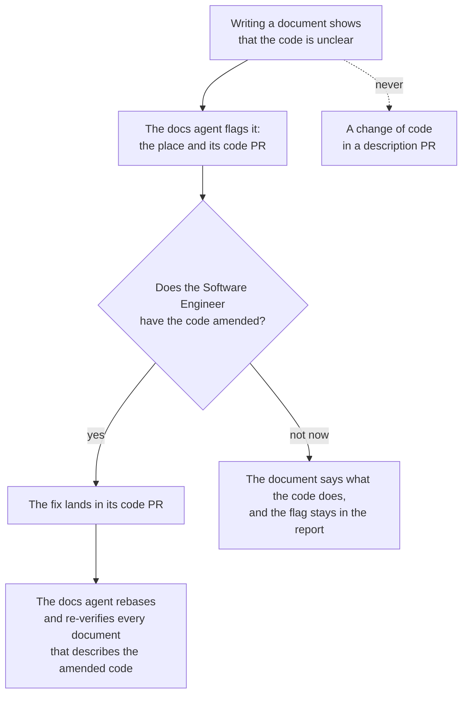
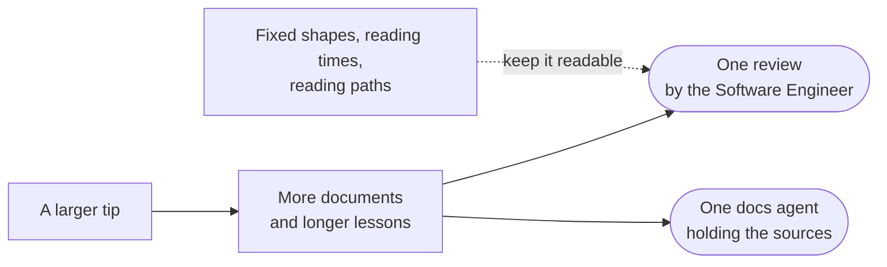

# The docs agent writes the docs section

| Item | What it says |
|---|---|
| What you will learn | How a fresh docs agent turns a finished tip into the docs section: how it is started, what it reads and never reads, the four groups it writes in reading order, how it checks each claim, and how it hands over. |
| Lessons to read first | [Flowcharts](../languages/mermaid/01-flowcharts.md), because every document carries diagrams, and [A stack of pull requests](../stacks/gh-stack/01-a-stack-of-pull-requests.md). |
| Reading time | 21 minutes, worked out from its length. |
| Files it covers | `docs/agents/docs-agent.md`, `standard/18-docs-agent.md`, `standard/17-evidence-and-truth.md`, `docs/reader-profile.md`, `docs/course/reference/file-map.md` |
| Versions verified against | Commit `cb4fb22`, and git 2.54.0 for part 7; every diagram rendered in dark and light with mermaid-cli 12.2.0. |

## The scenario

The build is finished. The Software Engineer opens a new session at the repository root, on the tip of the stack, with no earlier conversation, and tells it to follow the docs agent's brief. The agent reads the code at the tip, the ADRs, the spec, the standards, the reader profile, the "Rulings I made" lists and the stack table, and never the plan or the build conversation. It writes the reference documents, then the language lessons, the stack lessons and the system chapters, each group on its own branch above the last, and hands over in a report. The documents you are reading are the recorded example: this chapter is part of the first docs section of this repository, written that way.

## The whole picture



*The docs agent sits between what it reads and what it writes, and the one thing to notice is the dotted line from the plan: what was meant never reaches the documents, only what exists and why.*

The happy path:



*Four groups, four branches, one report, and the one thing to notice is that nothing is opened on GitHub: in this repository the report waits for the Software Engineer's yes.*

## Hop by hop

### Hop 1: the start

*Excerpt from [`docs/agents/docs-agent.md`](../../agents/docs-agent.md), lines 17 to 17.*

```text
**How you are started.** The Software Engineer starts you by hand: a fresh session at the repository root, on the tip of the stack, with no earlier conversation, told to follow this file, for example "Follow `docs/agents/docs-agent.md` to write the docs section for this repository." A fresh session needs no kit to start. The first run of a docs agent, in the baseline's own repository on 2026-11-18, was started this way with a start text that also named the folder and the branch to work in, the paths of two files that held the "Rulings I made" list and the stack table (the PRs were not open yet, so they had no descriptions), and what not to do: push, open a PR, merge or publish. That worked, and the docs agent wrote the docs section. Its report said what neither this file nor those two files had told it. The standard now answers two of those points: a part of the deployment docs that does not apply has no diagram, and the product glossary is written from the terms that the feature pages use. The others, which the docs agent had to find out or decide, were how a course adapts to a product made only of Markdown and which technologies count as used by the code; how the "Rulings I made" list divides between PRs; where to keep PR descriptions while no PR is open, how to refresh the stack tables and the lesson links in "Ideas introduced", and how to name a PR that has no number yet; the format of the generated indexes and how to work out a reading time; how a reference page draws on lessons that come in later PRs; and that drawing the diagrams needed approval to install a renderer, as did read-only `gh` calls and `git ls-remote`, which the Software Engineer gave. If you need something else that this brief does not give you, say so in your report. Because: only you can say what you were missing, and what a start has to hold is learned from what each run lacked.
```

The brief records how its first run was started: by hand, with a start text that also named the folder and the branch, gave the rulings and the stack table as two files, by path, and said what not to do, which is the way revision 1 picked. It also lists what that run reported it lacked, and marks the two points that the standard now answers. This repository's first docs section is that run. When it was rebased onto revision 3, the descriptions of PRs 1 to 20 had been written as files, so the re-check read the rulings and the stack table from them.

| The contract covers | Here |
|---|---|
| Format or schema | A start instruction naming the brief, and, while the PRs are not open, the rulings and the stack table as files. |
| Versions | The finished tip: commit `cb4fb22` for this repository. |
| Timeouts | Not applicable. |
| Retries | Not applicable: a run that stops can be started again from the same tip. |
| Ordering | The docs agent starts only after the build is finished. |
| Idempotency | Starting from the same tip with the same inputs gives the same sources to read. |
| Authentication | The Software Engineer starts it by hand; no agent starts it on its own. |

### Hop 2: what it may not read

*Excerpt from [`docs/agents/docs-agent.md`](../../agents/docs-agent.md), lines 76 to 81.*

```text
Do not read the plan or the build conversation.

- **The plan.** Its path is listed under `plan` in the `artifact_map` of `baseline.yml`. Because: a plan says what was meant, and a descriptive document says only what exists at the tip. Where the built code differs from the plan, that shows in the "Rulings I made" lists, which the execution skills promise are exhaustive, while the plan file's history shows only the edits that were actually made.
- **The build conversation**, which is the building agent's chat, and any summary of it. If either is put in front of you, do not use it. Because: the agent that built the code tends to document what it meant, which is the reason you are a fresh agent. What matters from the building reaches you through the ADRs, the spec and the rulings.

**Where nothing you may read says why the code does something, write what the code does, say that the reason is not recorded, and put the gap in your report under "Decisions needed".** Because: intent that never reached an ADR shows up to a fresh agent as a gap to fix, and a reason that you guessed would document what you imagined was meant.
```

- The plan and the build conversation say what was meant; the docs agent writes what exists.
- Where nothing it may read gives a reason, it writes what the code does, says that the reason is not recorded and puts the gap in its report. This chapter has an example: the size and grouping of the first stack's code PRs, whose reason is not recorded in any source it reads ([A feature goes from brainstorm to merged stack](02-brainstorm-to-merged-stack.md)).

| The contract covers | Here |
|---|---|
| Format or schema | Two sources named as never read: the plan, found under `plan` in the artifact map, and the build conversation. |
| Versions, timeouts, retries | Not applicable. |
| Ordering | Not applicable. |
| Idempotency | Not applicable. |
| Authentication | Nothing enforces it but the docs agent: no check could see what an agent read. |

### Hop 3: the four groups, in reading order

*Excerpt from [`docs/agents/docs-agent.md`](../../agents/docs-agent.md), lines 89 to 96.*

```text
The docs section is in reading order, from foundational to integrated. A group with nothing to write gets no PR.

| Order | PR | What it holds |
|---|---|---|
| 1 | Reference | The README, the architecture reference, the feature docs, the deployment docs, the reference pages (the file map, the glossaries and the "what else it offers" maps), the ADR review and the ADR index. |
| 2 | Language lessons | The lessons of the guided course for each language the code uses. |
| 3 | Stack lessons | The lessons for each technology stack, such as a front end or a back end, each in its own stack folder. |
| 4 | System chapters | One chapter for each end-to-end flow and one for each concern that cuts across stacks, such as authentication or data consistency. |
```

Each group is one description PR, and a group with nothing to write gets none. In this repository all four have something: the reference documents; the Mermaid lessons; the `gh stack` lessons; and these chapters. Each document follows the anatomy that its file of the standard sets, and every claim follows the eleven evidence rules.



*The four groups stack in reading order, and the one thing to notice is the dotted arrows back to the reference pages: each later group regenerates the indexes with what it adds, so no PR links to a page that does not exist.*

| The contract covers | Here |
|---|---|
| Format or schema | Four description PRs, each a branch `<topic>/docs-<nn>-<slug>`; each description has a header and four parts. |
| Versions | Each document names the commit it was verified against. |
| Timeouts, retries | Not applicable. |
| Ordering | Foundational to integrated: reference, language lessons, stack lessons, system chapters. |
| Idempotency | The indexes are regenerated, not appended to, so writing them again from the same documents gives the same pages. |
| Authentication | Not applicable. |

### Hop 4: the hand-over

*Excerpt from [`docs/agents/docs-agent.md`](../../agents/docs-agent.md), lines 254 to 262.*

```text
When the docs section is written, hand it over in a report, in the five parts of `working-with-the-engineer.md`, in this order.

1. **Decisions needed.** The questions you put and the answers still missing, the ADR departures you flagged, the gaps where no reason was recorded, and the flagged code that waits for a fix.
2. **What is open for merge, in order.** Your description PRs, bottom to top, above the code PRs, with any hazard.
3. **What was verified, as command and result.**
4. **What was not verified, and why.**
5. **Rulings made.** Every decision you took without stopping, each as `Ruling: what, why, cost if wrong`.

Because: what the Software Engineer has to do is what they read the report for, and the evidence supports it and can be read after. If anything this brief did not tell you made your work harder, say so in the report too, because what a start has to hold is learned from what each run lacked.
```

The report puts first what the Software Engineer has to do, then the evidence. Flagged code is not fixed by the docs agent: the fix is made in the code PR it belongs to, and the docs are then rebased and re-verified. In this repository the loop has run once, for decisions rather than code. The first report put nine numbered decisions, the Software Engineer approved the recommendations, and the regular agent built the answers as revision 3, PRs 18 to 20, below the docs section. The docs section was then rebased onto them, its branches renumbered from `docs-18` to `docs-21` and up, and every document re-checked against the new tip ([revision 3](../../superpowers/specs/2026-11-18-baseline-standard-revision-3-design.md)). The Software Engineer approved the second report's recommendations too. Only one of them changed a file: the standard's index, whose row for file 15 still named two rules for the files themselves. The index is a description path, so the docs agent corrected the row in the reference PR.

## Invariants

| Invariant | Who enforces it | Where it is tested |
|---|---|---|
| The docs agent never changes code. | The docs agent | Checkable by hand: `git diff --name-only` between the finished tip and the top of the docs section lists no path in `standard/` and not `baseline.yml` (part 7). |
| It never reads the plan or the build conversation. | The docs agent | No test exists, and none could. |
| Its deviations list comes only from the "Rulings I made" lists. | The docs agent | No test exists. |
| Indexes have a single writer in the stack while no generator exists. | The docs agent | No test exists. The checker is required to verify that each index matches a fresh generation. |
| A technology's course is written only when the profile has its entry. | The docs agent, which stops and asks | No test exists. The stack gate is required to check every new technology has an entry and course files. |

## How it fails

| Failure | What it is here | What is seen | How it recovers |
|---|---|---|---|
| Slow | A large tip takes long to document. | The docs section is not in yet, so the stack waits. | Nothing else waits on it: the build is finished. |
| Down | A technology has no profile entry. | That technology's course stops. | The docs agent asks, carries on with the rest, and writes the course once the entry is recorded. |
| Duplicated | Two PRs of the stack edit the same index. | Rebase conflicts. | One writer of the indexes in the stack, the docs agent. |
| Reordered | The docs are written before the tip is finished, or a lower PR changes afterwards. | Documents that describe an older state. | The docs agent starts from the finished tip and re-verifies after any amendment below. |
| Lying | A document says what was meant. | A confident wrong sentence. | A fresh agent with no build conversation, and the evidence rules. |

The failure flow when a document exposes unclear code:



*Unclear code is fixed where it was built or left flagged, and the one thing to notice is the dotted line marked never: a description PR never carries a change of code, whatever the Software Engineer decides.*

## How it scales and what breaks first

The work grows with the tip: more code, more documents, more lessons. In this repository's first docs section the first three groups changed 81 files, adding 6,017 lines and removing 71, against the finished tip (`git diff --shortstat standard/20-revision-3-standard standard/docs-23-stack-lessons`, run on 2026-11-19), and this fourth group adds the seven chapters. What breaks first is the read at review: the Software Engineer reviews every document, and the standard has no length budget, so the shapes, the reading times and the reading paths are what keep it manageable. The second limit is the docs agent's own: it has to hold the tip, the sources and the anatomies at once, which is why the brief lists exactly what to read and what not to.



*Both the review and the docs agent grow with the tip, and the one thing to notice is that the standard answers with sameness of shape, not with shorter documents: detail is always at its maximum.*

## Observe it

Read the first three groups of this docs section, the ones below this chapter's own PR, from the repository root.

```bash
git log --format='%h %s' standard/20-revision-3-standard..standard/docs-23-stack-lessons
```

```text
ebe5a3c docs: re-check the gh stack lessons against revision 3
9644e81 docs: add the gh stack lessons to the indexes and the reading paths
277c548 docs: write the gh stack lessons and the gh stack what-else-it-offers map
51f0792 docs: re-check the Mermaid lessons against revision 3
a4b2859 docs: add the Mermaid lessons to the indexes, the README and the reading paths
9ce80b5 docs: write the Mermaid lessons and Mermaid's what-else-it-offers map
1b7d163 docs: name the third rule of file 15 in the standard's index
fd2dbe5 docs: re-check the reference documents against revision 3
4e6f26e docs(adr): number the four drafts of revision 3 and move them to Proposed
7a421a7 docs: write the course index, the file map and the glossaries
8b7bf6b docs: generate the reader profile's three sections from its header
0475fb8 docs: write the README
46f38c7 docs: write the feature docs and the deployment docs
8eca734 docs: write the architecture reference and the ADR index
dca2207 docs(adr): number the 31 ADR drafts and move them to Proposed
```

```bash
git diff --name-only standard/20-revision-3-standard standard/docs-23-stack-lessons | grep -E '^(standard/|baseline\.yml)' || echo 'no path in standard/ and not baseline.yml'
```

```text
standard/README.md
```

Output captured on 2026-11-19, after the docs section was rebased onto revision 3. Each group ends with its re-check commit, the work of the loop described under hop 4, and the reference group then with one more: the correction of the standard's index that the Software Engineer approved after the second report. That index, `standard/README.md`, is the one path in `standard/` the second command finds. It is a description path, so its correction goes in a description PR, and the docs section changes no code path and not `baseline.yml`.

## Summary and cheat sheet

| Step | What the docs agent does |
|---|---|
| Start | A fresh session at the finished tip, by the Software Engineer's hand |
| Read | The tip, the ADRs, the spec, the standards, the reader profile, the rulings, the stack table |
| Never read | The plan and the build conversation |
| Stop and ask | When a technology has no profile entry |
| Write | Reference, language lessons, stack lessons, system chapters, one branch each |
| Check | Every claim against the tip: quoted, captured, measured or marked "not verified" |
| Review ADRs | Number, move to Proposed, add only what is marked "Added at review" |
| Hand over | A report in five parts; nothing opened without the yes |

Further reading: [docs/agents/docs-agent.md](../../agents/docs-agent.md) and [standard/18-docs-agent.md](../../../standard/18-docs-agent.md).

**What was verified.** The excerpts, by a script; every diagram, by rendering it in dark and light with mermaid-cli 12.2.0; the commands of part 7 and the size of the docs section, by running them. **Not verified.** The fix-and-re-verify loop, which did not run in this docs section; and the labs.

## Practice

### Ten theory questions

**Question 1 (predict).** The docs agent finds that a feature's code does something no ADR, spec section or ruling explains. What does the document say?

<details><summary>Worked answer</summary>

What the code does, and that the reason is not recorded; the gap goes into the report under "Decisions needed".

**Common wrong answers.** "The likely reason", which documents what it imagined was meant.

</details>

**Question 2 (predict).** The project starts using a new technology that the reader profile does not list. What happens to the docs section?

<details><summary>Worked answer</summary>

The docs agent stops writing that technology's course and asks the Software Engineer for a level and a comparison setting; it carries on with everything else.

**Common wrong answers.** "The whole docs section waits", which loses work. "It picks average", which guesses.

</details>

**Question 3 (predict).** In which PR does the docs agent's renaming of an ADR draft go?

<details><summary>Worked answer</summary>

The reference PR, the first of the docs section, which may edit ADR files: the one crossover of kinds.

**Common wrong answers.** "A thinking PR of its own", which the standard does not ask for.

</details>

**Question 4 (diagnose).** A description PR's diff includes a change to `standard/16-diagrams.md`. What is wrong?

<details><summary>Worked answer</summary>

The docs agent changed code. The change belongs in the code PR that holds the file, as a fix the docs agent flagged; the description PR is then rebased and re-verified.

**Common wrong answers.** "It is fine, it was only a typo", which hides a code change in a PR read for whether documents match the code.

</details>

**Question 5 (diagnose).** The deviations list of a description PR mentions a choice that no ruling records but that the plan's history shows. Which rule was broken?

<details><summary>Worked answer</summary>

The deviations list is taken only from the "Rulings I made" lists, never from the plan file's history, and the docs agent never reads the plan.

**Common wrong answers.** "None, the plan is a valid source", which it is not for the docs agent.

</details>

**Question 6 (diagnose).** After the docs section was written, PR 9 is amended. Which documents must be checked again?

<details><summary>Worked answer</summary>

Every document that quotes or describes the amended code. Until the checker that is to name the drifted documents exists, the docs agent finds them itself.

**Common wrong answers.** "Only the README", which is too narrow. "None, the docs were already verified", which ignores that a change below can make a sentence untrue.

</details>

**Question 7 (design trade-offs).** A fresh agent costs more runs than letting the building agent write its own documents. What does the baseline buy with that cost?

<details><summary>Worked answer</summary>

Documents that say what was built, not what was meant, and gaps that show where intent never reached a record. ADR 0008 records the choice and its cost.

**Common wrong answers.** "Faster documents", which is the opposite.

</details>

**Question 8 (systems reasoning).** The reference pages draw on lessons written in later PRs. How does this docs section keep every PR's links resolving?

<details><summary>Worked answer</summary>

Each PR writes the reference pages with what exists at that PR, and each later PR regenerates them with its own lessons and chapters added. The docs agent, as the single writer of the stack, can do that without conflicts.

**Common wrong answers.** "The reference PR links to pages that come later", which would leave broken links in the lower PRs.

</details>

**Question 9 (systems reasoning).** Why does the docs agent stop for a missing profile entry, but not for the order of its own work?

<details><summary>Worked answer</summary>

A profile entry changes who the documents are for and who is hired, which is the Software Engineer's call; the order of work, names and groupings are calls the agents decide and record as rulings.

**Common wrong answers.** "It stops for everything to be safe", which would stall the work.

</details>

**Question 10 (systems reasoning).** Two independent stacks each run a docs agent that writes the indexes by hand. What protects them, and when does that protection end?

<details><summary>Worked answer</summary>

Each is the single writer of the indexes in its own stack, and the stacks are merged one after the other, so the second rebases onto the first. It ends when a generator lands: the generator takes over, and the checks reconcile any difference.

**Common wrong answers.** "They never conflict", which ignores that both edit the same files.

</details>

### Labs

**Not verified:** tabletop exercises on this repository's docs section, checked by reading, because no checker or worked example exists to run them against.

| Kind | What you do | A checkable outcome |
|---|---|---|
| Run it | List the four docs branches and the commits of each, with `git log` between neighbouring branches. | Four branches, `standard/docs-21-reference` to `standard/docs-24-system-chapters`, each holding only description paths and ADR files. |
| Break it on purpose | Suppose a technology were missing from `docs/reader-profile.md`. Say which parts of this docs section would stop and which would go on. | Only that technology's course stops; everything else goes on. |
| Trace what happened | Trace ADR 0019 from draft to Proposed in the reference PR. | `git log --follow` shows the docs agent's numbering commit on the reference branch. |
| Fix it | A made-up description PR fixes a typo in `standard/03-stack-model.md`. Fix the stack. | You move the fix to the code PR that holds the file and flag it in the description PR. |
