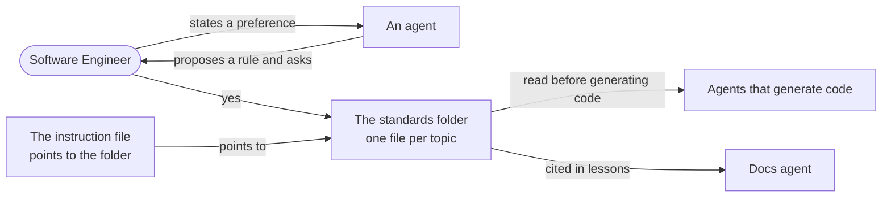
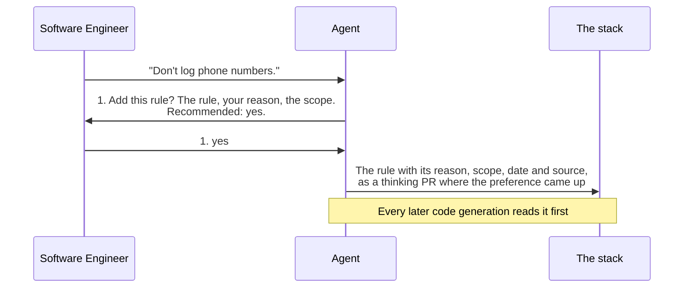
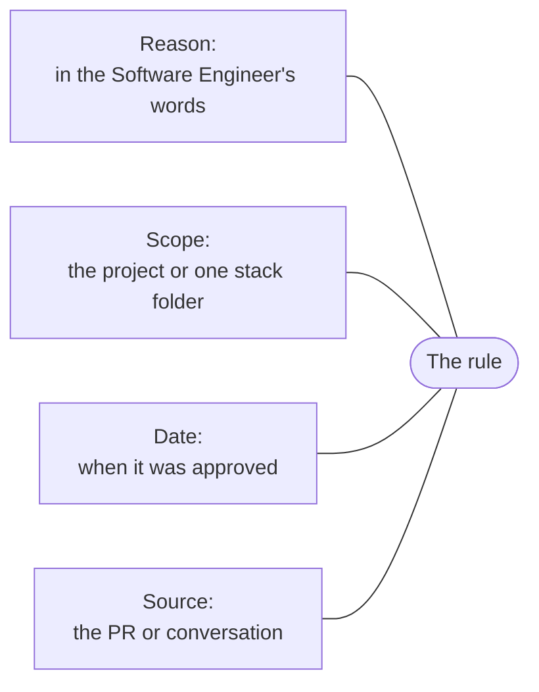
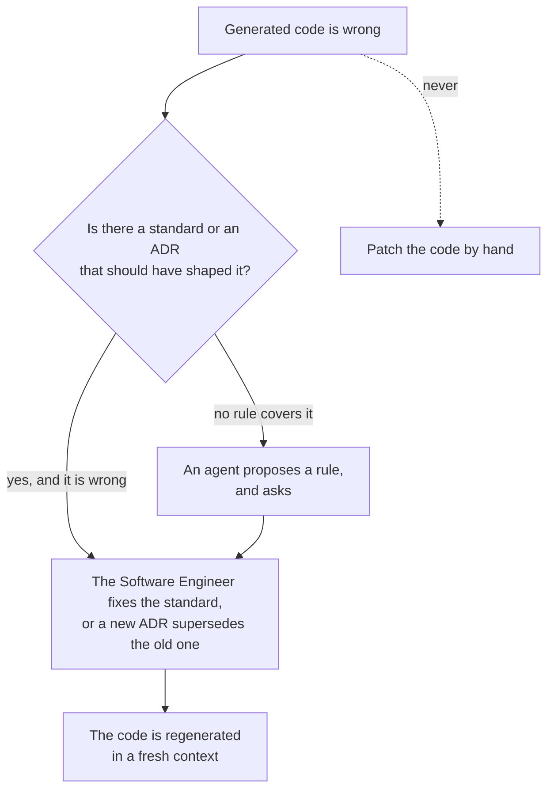
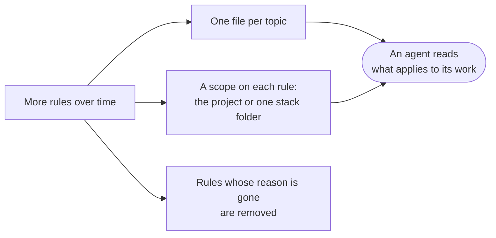

# A preference becomes a standard

| Item | What it says |
|---|---|
| What you will learn | How a preference the Software Engineer states becomes a standard that drives code: the proposal in the chat, the yes that alone writes it, the four records beside the rule, the thinking PR where it lands, and how agents read it and the docs agent cites it. |
| Lessons to read first | [Flowcharts](../languages/mermaid/01-flowcharts.md). |
| Reading time | 16 minutes, worked out from its length. |
| Files it covers | `standard/19-standards-mechanism.md`, `docs/agents/standards.md`, `docs/standards/README.md`, `AGENTS.md` |
| Versions verified against | Commit `cb4fb22`, and git 2.54.0 for part 7; every diagram rendered in dark and light with mermaid-cli 12.2.0. |

## The scenario

While a project is being built, the Software Engineer says in the conversation how they want something done: do not log phone numbers. An agent notices, proposes it as a rule with the reason in their words and its scope, and asks. They say yes. The rule is written into `docs/standards/` as a thinking PR at the point in the stack where the preference came up, and from then on every agent reads it before generating code. This flow has not run in this repository: it opted in to standards, and its folder holds only the README that explains how it fills. The example is the standard's own, for the made-up hiking club app.

## The whole picture



*A rule reaches the folder only through the Software Engineer's yes, and the one thing to notice is that agents find it through the instruction file, never through a change to a skill.*

The happy path:



*The rule is written only after the yes, and the one thing to notice is that it lands as thinking where the preference came up, so the reviewer reads it before the code that follows it.*

## Hop by hop

### Hop 1: from a preference to a proposal

The standard's example of the exchange:

*Excerpt from [`standard/19-standards-mechanism.md`](../../../standard/19-standards-mechanism.md), lines 71 to 82.*

```text
Software Engineer, in the conversation: "Don't log phone numbers. A log is read by more
people than the member agreed to."

Agent, in the chat:
1. Add this rule to docs/standards/?
   Rule: Never put a member's phone number in a log line.
   Reason, in your words: "A log is read by more people than the member agreed to."
   Scope: the whole project
   Recommended: yes, because you said it in this conversation.
   Other option: do not add a rule, and keep the preference to this conversation.

Software Engineer: 1. yes
```

- The proposal is a numbered decision, in the form every decision takes: the rule, the reason in the Software Engineer's own words, the scope, a recommendation first and the other option.
- The answer comes back by number.

| The contract covers | Here |
|---|---|
| Format or schema | A numbered decision with the rule, the reason, the scope, a recommendation and the other option. |
| Versions | Not applicable. |
| Timeouts | Not applicable: the agent asks and goes on with what does not need the answer. |
| Retries | "Elaborate" asks for the trade-off again in plain words, with a recommendation again. |
| Ordering | The proposal comes before anything is written. |
| Idempotency | A no writes nothing, so asking does not change the folder. |
| Authentication | Only the Software Engineer's yes writes a rule. |

### Hop 2: from a yes to a rule in the folder

The rule as it is recorded, in the standard's illustration:

*Excerpt from [`standard/19-standards-mechanism.md`](../../../standard/19-standards-mechanism.md), lines 101 to 105.*

```text
Rule: Never put a member's phone number in a log line.
Reason: "A log is read by more people than the member agreed to." (the Software Engineer)
Scope: the whole project
Date: 2027-03-02
Source: the conversation after slice 1 was built
```

- The four records, reason, scope, date and source, sit beside the rule. The standard fixes the four and not their layout.
- The scope is the whole project here; it can be one stack folder.
- The source places the preference in the stack, which is where its thinking PR goes.



*A rule never stands alone, and the one thing to notice is that each of the four records answers a later reader's question: why, where, since when and from what.*

| The contract covers | Here |
|---|---|
| Format or schema | A rule with its four records, in a file for its topic in `docs/standards/`. |
| Versions | The date records when it was approved; git keeps every later change. |
| Timeouts, retries | Not applicable. |
| Ordering | The thinking PR sits where the preference came up, below the code that follows. |
| Idempotency | Not applicable. |
| Authentication | The Software Engineer's yes, and their review of the thinking PR. |

### Hop 3: from the folder to every agent

The repository's own pointer, in `AGENTS.md`:

*Excerpt from [`AGENTS.md`](../../../AGENTS.md), lines 96 to 96.*

```text
  - `docs/standards/` holds the standards, the preferences the Software Engineer has approved, each with its reason, scope, date and source. Read it before you generate code, when the folder exists. Because: the standards and the ADRs are the only documents that drive code, and the skills run untouched, so this pointer is how the standards reach you. The docs agent cites them in the lessons it writes. [docs/standards/README.md](docs/standards/README.md) explains how the folder fills.
```

And this repository's folder, which says the same from the folder's side:

*Excerpt from [`docs/standards/README.md`](../../standards/README.md), lines 32 to 36.*

```text
1. **An agent notices a preference.** It comes up in a conversation or in a review comment. Because: those are the places where the Software Engineer says how they want the work done, and the folder is built from what they say over time.
2. **The agent proposes a rule in the chat and asks.** The proposal gives the rule, the reason in the Software Engineer's words and the scope, which is the whole project or one stack folder. Because: the reason and the scope are what the Software Engineer needs in order to answer, and what a later reader needs to judge whether the rule still holds.
3. **Only the Software Engineer's approval lets the rule be written.** Nothing is inferred silently, and if the answer is no, nothing is written. Because: a standard steers every later generation of code, so a rule nobody approved would steer it wrongly and no one would notice.
4. **The approved rule is written as a thinking PR, at the point in the stack of PRs where the preference came up.** A thinking PR is the kind that holds prescriptive documents: the spec, the plan, decisions and standards. Because: a standard says how work is done, so it is read for intent and soundness, and at that point in the stack the reviewer reads it before the code that follows it.
5. **Agents read it.** Agents find the standards through a pointer in `AGENTS.md`, and the docs agent, the fresh agent that writes the descriptive documents from the finished code, cites them in the "In this codebase" part of the lessons it writes. Because: `AGENTS.md` is the primary instruction file for working in the repository, so a pointer there reaches every agent, and a lesson that shows code a standard shaped should say so.
```

| The contract covers | Here |
|---|---|
| Format or schema | A pointer in `AGENTS.md`; the folder's README explains how it fills. |
| Versions | Not applicable. |
| Timeouts, retries | Not applicable. |
| Ordering | Read before generating code. |
| Idempotency | Reading changes nothing. |
| Authentication | Not applicable: every agent that works in the repository reads `AGENTS.md`. |

## Invariants

| Invariant | Who enforces it | Where it is tested |
|---|---|---|
| No rule is written without the Software Engineer's yes. | Every agent | No test exists, and none could see the yes. |
| Every rule carries its reason, scope, date and source. | The agent that writes it | No test exists. |
| The folder exists only if the project opted in at the intake. | The intake; an agent never creates it on its own | No test exists. |
| Wrong generated code is fixed in the standard or the ADR and regenerated, never patched. | Every agent | No test exists. |
| A rule whose reason is gone is removed, in a thinking PR. | Any agent that notices, at the Software Engineer's decision | No test exists. |

## How it fails

| Failure | What it is here | What is seen | How it recovers |
|---|---|---|---|
| Slow | The Software Engineer has not answered. | The rule is not written yet. | Nothing is inferred while waiting; the agents go on with the rest. |
| Down | The project did not opt in. | There is no folder. | The preference stays in the conversation; an agent does not create the folder. |
| Duplicated | The same preference is proposed twice. | A second proposal. | The Software Engineer answers again; a rule already in force needs no second one. |
| Reordered | A rule is written before it is approved. | A rule nobody approved. | It is the failure the mechanism exists to prevent: nothing is inferred silently. |
| Lying | A rule's reason is not the Software Engineer's. | A reason they never gave. | The reason is recorded in their words, and a reason that is not theirs is never written as if it were. |

The failure flow when generated code is wrong:



*Wrong code sends the fix to the text that drives code, and the one thing to notice is the dotted line marked never: a patch would leave the standard that produced the mistake unchanged.*

## How it scales and what breaks first

At commit `cb4fb22` this repository's standards folder holds one file, its README, and no rule. The nearest case is revision 3's two link rules: the agent proposed each with a reason, the Software Engineer approved both, and they were written in `standard/AGENTS.md`, `standard/15-agents-md-and-playbooks.md` and `AGENTS.md`, not in `docs/standards/` ([revision 3, D8](../../superpowers/specs/2026-11-18-baseline-standard-revision-3-design.md)). As a project's standards grow, what breaks first is finding the rule that applies: the folder has one file for each topic, and each rule's scope says where it applies, so an agent reads only what concerns the work in front of it. The second limit is rules that outlive their reasons, which the removal rule answers: a rule whose reason is gone is removed, and git keeps its history.



*The folder grows with the project's preferences, and the one thing to notice is that removal is part of the design: rules leave when their reasons do, unlike ADRs, which are only ever superseded.*

## Observe it

```bash
git ls-files docs/standards
```

```text
docs/standards/README.md
```

```bash
grep -n '^standards_enabled' baseline.yml docs/reader-profile.md
```

```text
baseline.yml:2:standards_enabled: true
docs/reader-profile.md:4:standards_enabled: true
```

Output captured on 2026-11-19, after the docs section was rebased onto revision 3.

## Summary and cheat sheet

| Step | Who | What |
|---|---|---|
| A preference is stated | Software Engineer | In a conversation or a review comment |
| A rule is proposed | An agent | A numbered decision: rule, reason in their words, scope |
| The answer | Software Engineer | Yes writes it; no writes nothing |
| The rule is written | An agent | With reason, scope, date and source, as a thinking PR where it came up |
| It is read | Every agent | Before generating code, through `AGENTS.md` |
| It is cited | Docs agent | In the "In this codebase" part of a lesson, where it shaped an excerpt |
| It is removed | At the Software Engineer's decision | When its reason is gone, in a thinking PR |

Further reading: [standard/19-standards-mechanism.md](../../../standard/19-standards-mechanism.md), [docs/agents/standards.md](../../agents/standards.md) and [docs/standards/README.md](../../standards/README.md).

**What was verified.** The excerpts, by a script; every diagram, by rendering it in dark and light with mermaid-cli 12.2.0; the commands of part 7, by running them. **Not verified.** The flow itself, which has not run in this repository; and the labs.

## Practice

### Ten theory questions

**Question 1 (predict).** The Software Engineer answers "1. no" to a proposed rule. What is in the folder afterwards?

<details><summary>Worked answer</summary>

Nothing new. A no writes nothing, and the preference stays in the conversation.

**Common wrong answers.** "A rule marked rejected", which the mechanism does not keep.

</details>

**Question 2 (predict).** A project answered no at the intake. An agent notices a strong preference. What does it do?

<details><summary>Worked answer</summary>

It does not create the folder: the answer is part of the reader profile, and changing it is the Software Engineer's call. It can put that question to them.

**Common wrong answers.** "It creates the folder and writes the rule", which takes the Software Engineer's call.

</details>

**Question 3 (predict).** Which part of a lesson names a standard, and when?

<details><summary>Worked answer</summary>

The "In this codebase" part, where a standard shaped the code that an excerpt shows.

**Common wrong answers.** "The summary", which is not where the standard puts it.

</details>

**Question 4 (diagnose).** A rule in the folder has no source. Which record is missing, and why does it matter?

<details><summary>Worked answer</summary>

The source, the PR or conversation where the preference came up. Without it the rule cannot be traced back to what prompted it.

**Common wrong answers.** "None: the date is enough", which records when, not where.

</details>

**Question 5 (diagnose).** An agent writes a rule because the Software Engineer "seemed to prefer" a pattern. What went wrong?

<details><summary>Worked answer</summary>

A rule was inferred silently, without a proposal and a yes. The rule must come out and be proposed properly.

**Common wrong answers.** "Nothing, it matches their style", which is the inference the mechanism forbids.

</details>

**Question 6 (diagnose).** Generated code logs phone numbers although the rule forbids it. Where does the fix go first?

<details><summary>Worked answer</summary>

To the text that drives code: check that the rule is clear and that agents read it, fix the standard if it is wrong, and regenerate the code in a fresh context. The code is not patched by hand.

**Common wrong answers.** "Edit the log line", which is the patch the standard rules out.

</details>

**Question 7 (design trade-offs).** Standards are removed when their reasons are gone; ADRs are superseded and kept. Why the difference?

<details><summary>Worked answer</summary>

An ADR records why a decision was made at the time, which stays true history; a standard keeps a preference only as long as it holds. A dead rule would steer every later generation of code with no living reason.

**Common wrong answers.** "No difference", which the two mechanisms contradict.

</details>

**Question 8 (systems reasoning).** Why do agents find the standards through `AGENTS.md` and not through a change to a skill?

<details><summary>Worked answer</summary>

The skills run untouched, so the baseline never delivers a rule by changing how a skill works; `AGENTS.md` is the primary instruction every agent reads, and superpowers ranks it above its skills.

**Common wrong answers.** "Skills cannot read files", which is not the reason.

</details>

**Question 9 (systems reasoning).** A rule's scope is one stack folder. What does that protect against as the project grows to several technology stacks?

<details><summary>Worked answer</summary>

A preference for one stack being applied to another, where it may be wrong. The scope tells an agent where the rule applies and nowhere else.

**Common wrong answers.** "Nothing, every rule applies everywhere", which ignores the scope record.

</details>

**Question 10 (systems reasoning).** The standards never depend on the reader's level. What would break if they did?

<details><summary>Worked answer</summary>

The code would change when the team changed, because standards drive code. The principle that outranks all others keeps the level to the documents only.

**Common wrong answers.** "Beginners would get simpler rules", which is exactly the failure, anti-goal A3.

</details>

### Labs

**Not verified:** tabletop exercises, checked by reading, because no checker or worked example exists to run them against, and this repository has no rule yet.

| Kind | What you do | A checkable outcome |
|---|---|---|
| Run it | Write the numbered proposal an agent would make for "commit messages say why", in the form of hop 1. | The proposal has the rule, the reason in the Software Engineer's words, a scope, a recommendation first and the other option. |
| Break it on purpose | Write the same rule with no reason. Which record is missing and what does a later reader lose? | You name the reason, and say that a reader cannot judge whether the rule still holds. |
| Trace what happened | Trace how an agent working in this repository would find a rule: from `CLAUDE.md` to the folder. | `CLAUDE.md` points to `AGENTS.md`, whose repo map points to `docs/standards/`. |
| Fix it | A made-up stack puts an approved rule in the code PR that followed the conversation. Fix the stack. | You give the rule its own thinking PR, below that code PR. |
