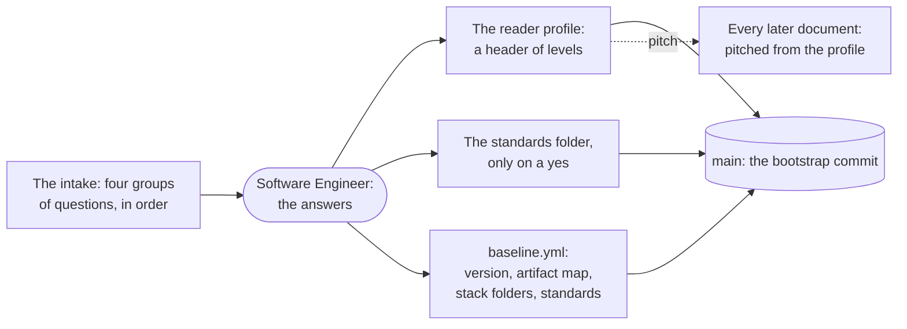
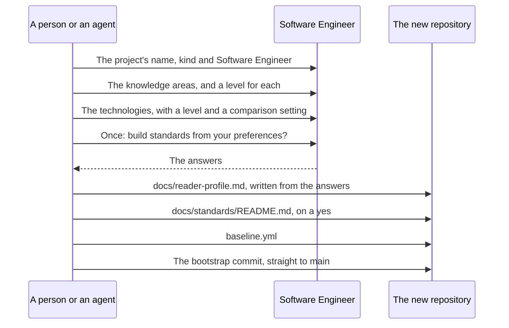
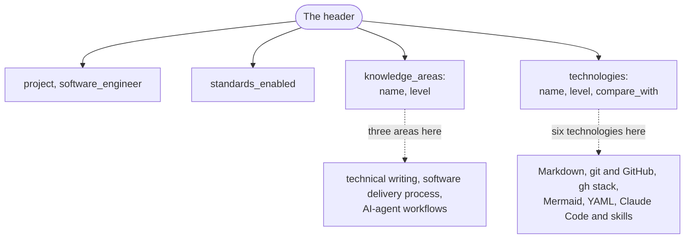
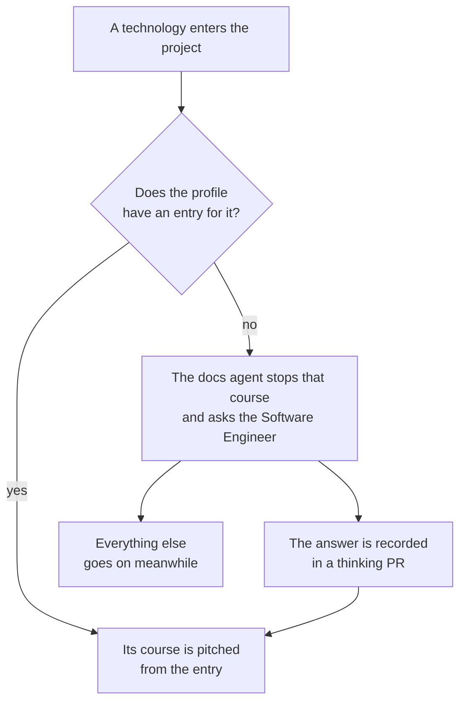
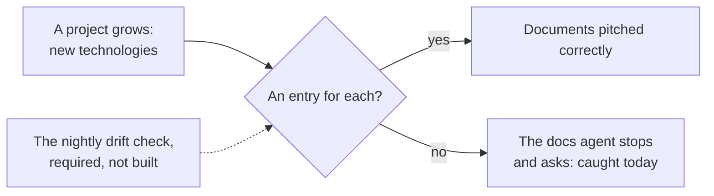

# A project starts with the intake

| Item | What it says |
|---|---|
| What you will learn | How a project starts on the baseline: the intake's four groups of questions, the reader profile and the standards folder they produce, baseline.yml, the one commit that goes straight to main, and what adopting the baseline in an existing repository is to do. |
| Lessons to read first | [A stack of pull requests](../stacks/gh-stack/01-a-stack-of-pull-requests.md), for what comes after the bootstrap. |
| Reading time | 15 minutes, worked out from its length. |
| Files it covers | `standard/04-reader-profile.md`, `standard/05-project-layout.md`, `standard/22-tooling-requirements.md`, `docs/reader-profile.md`, `baseline.yml` |
| Versions verified against | Commit `cb4fb22`, and git 2.54.0 for part 7; every diagram rendered in dark and light with mermaid-cli 12.2.0. |

## The scenario

A new project begins. Before any document is written, someone puts the intake's questions to the Software Engineer, in order: the project, the knowledge areas and their levels, the technologies and theirs, and once, whether to build standards from their preferences. The answers become `docs/reader-profile.md`, and on a yes an empty `docs/standards/` with its README; `baseline.yml` records the configuration. All of it goes into the one commit that goes straight to `main`. The baseline's skills are to do this as `/baseline:init`; they do not exist, so it is done by hand. This repository started exactly that way, on 2026-11-14.

## The whole picture



*The intake's answers become three things in one commit, and the one thing to notice is the dotted line: from here on, every document the docs agent writes is pitched from that profile.*

The happy path, done by hand:



*Four questions, three files and one commit, and the one thing to notice is that nothing goes into a PR yet: there is nothing to base a PR on until the first commit exists.*

## Hop by hop

### Hop 1: the questions

*Excerpt from [`standard/04-reader-profile.md`](../../../standard/04-reader-profile.md), lines 68 to 75.*

```text
The intake asks, in this order:

1. The project's name, its kind (for example a web app, a distributed system, a data pipeline or an AI system) and the Software Engineer.
2. The knowledge areas. The intake suggests some from the kind of project, the Software Engineer adds or removes, and then gives a level for each.
3. The technologies already chosen, with a level and a comparison setting for each.
4. Once, whether to build standards from the Software Engineer's preferences over time. A yes creates an empty `docs/standards/` folder with a README that explains how it fills, and a no means there is no folder (`19-standards-mechanism.md`).

It then writes `docs/reader-profile.md` from the answers.
```

| The contract covers | Here |
|---|---|
| Format or schema | Four groups of questions, in a fixed order. |
| Versions | The standard at commit `cb4fb22`. |
| Timeouts | Not applicable. |
| Retries | Not applicable: an answer can be changed later, in the intake's update mode. |
| Ordering | Fixed: the project first, the standards question last and once. |
| Idempotency | The same answers give the same file. |
| Authentication | Only the Software Engineer answers; an agent asks and never answers for them. |

### Hop 2: the answers become the reader profile

The header of this repository's profile, written from its intake:

*Excerpt from [`docs/reader-profile.md`](../../reader-profile.md), lines 1 to 31.*

```text
---
project: baseline-framework
software_engineer: Chandan
standards_enabled: true
knowledge_areas:
  - name: technical writing
    level: average
  - name: software delivery process
    level: advanced
  - name: AI-agent workflows
    level: average
technologies:
  - name: Markdown
    level: advanced
    compare_with: none
  - name: git and GitHub
    level: advanced
    compare_with: none
  - name: gh stack and stacked PRs
    level: beginner
    compare_with: none
  - name: Mermaid
    level: average
    compare_with: none
  - name: YAML
    level: average
    compare_with: none
  - name: Claude Code and skills
    level: average
    compare_with: none
---
```

- The block between the two `---` lines is front matter: YAML that a program can read, in the file a person reads.
- `knowledge_areas` have a `name` and a `level`; `technologies` add a `compare_with`, which is `none` for all six here, a plain word, not YAML's empty value.
- `standards_enabled: true` is the answer to the last question.



*The header has five keys, and the one thing to notice is that only technologies carry a comparison setting: a knowledge area has a level and nothing else.*

| The contract covers | Here |
|---|---|
| Format or schema | Five keys: `project`, `software_engineer`, `standards_enabled`, `knowledge_areas`, `technologies`. |
| Versions | Git keeps the history; the file holds only the current answers. |
| Timeouts, retries | Not applicable. |
| Ordering | Not significant within the lists. |
| Idempotency | Regenerating the generated sections from the same header gives the same sections. |
| Authentication | Every change to the header is the Software Engineer's, in a thinking PR. |

### Hop 3: the configuration

*Excerpt from [`baseline.yml`](../../../baseline.yml), lines 1 to 8.*

```text
baseline_version: 0.1.0
standards_enabled: true
artifact_map:
  spec: ["docs/superpowers/specs/**"]
  plan: ["docs/superpowers/plans/**"]
  other: []
# Folders whose changes are code for PR-kind purposes, apart from each folder's own README.md and AGENTS.md
stack_folders: [standard, kit, checkers, skills, examples]
```

The same `standards_enabled` answer is recorded here too. Neither record wins over the other, because both record the intake's one answer; how a difference is reported is left to the tooling's design.

### Hop 4: the commit straight to main

This repository's bootstrap commit, captured on 2026-11-19:

```bash
git show --stat --format='%h %ad %s' --date=short main
```

```text
47615da 2026-11-14 chore: bootstrap the repository with its reader profile, standards folder and baseline.yml

 .gitignore               |  2 ++
 baseline.yml             |  8 +++++
 docs/reader-profile.md   | 78 ++++++++++++++++++++++++++++++++++++++++++++++++
 docs/standards/README.md | 71 +++++++++++++++++++++++++++++++++++++++++++
 4 files changed, 159 insertions(+)
```

The very first commit of a new repository is the one exception to "everything is a PR", since there is nothing yet to branch from. The foundation itself, CI, the document skeleton and the first code, is then its own stack. In this repository the playbooks and `AGENTS.md` came as PR 4 of the first stack, a thinking PR, not in the bootstrap.

### Hop 5: adopting the baseline in an existing repository

*Excerpt from [`standard/22-tooling-requirements.md`](../../../standard/22-tooling-requirements.md), lines 160 to 161.*

```text
| `/baseline:init` | The intake, the kit and the one direct-to-main commit. | [04-reader-profile.md](04-reader-profile.md) for the intake, and [03-stack-model.md](03-stack-model.md) for the commit. |
| `/baseline:adopt` | The same for an existing repository, with the docs agent documenting the current code as a docs-only stack, a stack made only of description PRs. | [18-docs-agent.md](18-docs-agent.md) |
```

`/baseline:adopt` is a requirement on the skills, which do not exist. No by-hand procedure for adopting is written, as one is for the intake.

## Invariants

| Invariant | Who enforces it | Where it is tested |
|---|---|---|
| The intake runs before any document is written. | Whoever starts the project | No test exists. |
| The profile records the target team, not the Software Engineer's own skill. | The Software Engineer, who answers | No test exists. |
| The standards folder exists only on a yes. | The intake; an agent never creates it | No test exists. |
| Every technology the project uses has an entry. | The docs agent, which stops and asks | No test exists. The nightly check is required to report drift between the profile and the code; the stack gate, that every new technology has an entry and course files. |
| Only the bootstrap commit goes straight to main. | Every agent | No test exists. |

## How it fails

| Failure | What it is here | What is seen | How it recovers |
|---|---|---|---|
| Slow | The Software Engineer has not answered. | No profile yet. | No document is written until it exists. |
| Down | The skills that would run the intake do not exist. | No `/baseline:init`. | The intake is run by hand, in the same order. |
| Duplicated | `standards_enabled` differs between its two records. | Two answers. | Neither wins; the tooling is to report the difference, by a design not yet made. |
| Reordered | Documents are written before the intake. | Documents pitched for nobody in particular. | The intake comes first, because a technology with no entry stops the docs agent. |
| Lying | The profile records the Software Engineer's own level instead of the team's. | Documents pitched for the wrong reader, and a wrong hiring bar. | The profile records the target team; ADR 0004 records why. |

The failure flow when a technology enters the project later, with no entry:



*A missing entry stops one course and nothing else, and the one thing to notice is that the answer enters the header through a thinking PR: the docs agent never writes the entry itself.*

## How it scales and what breaks first

The intake is asked once per project and is short: this repository's profile header is 31 lines, its whole file 78 lines at the bootstrap, and `baseline.yml` 8 lines (`wc -l`, run on 2026-11-18). What grows is the list of technologies and areas as the project grows, and what breaks first is a profile that no longer matches the code: the nightly drift check that is to catch it does not exist, so the docs agent's stop for a missing entry is what catches it today.



*The profile must keep up with the code, and the one thing to notice is that today the only catch is the docs agent's stop; the nightly check reaches the question only by a dotted line, because it is not built.*

## Observe it

```bash
git log --oneline main
```

```text
47615da chore: bootstrap the repository with its reader profile, standards folder and baseline.yml
```

```bash
grep -c '    compare_with:' docs/reader-profile.md
```

```text
6
```

Output captured on 2026-11-19, after the docs section was rebased onto revision 3.

## Summary and cheat sheet

| Question, in order | Where the answer goes |
|---|---|
| The project's name, kind and Software Engineer | `project`, `software_engineer` in the profile's header |
| The knowledge areas and a level for each | `knowledge_areas` |
| The technologies, each with a level and a comparison setting | `technologies` |
| Once: build standards from preferences? | `standards_enabled` in the header and in `baseline.yml`; on a yes, `docs/standards/README.md` |
| Then | The bootstrap commit, straight to `main` |

Levels: beginner, from the first line of syntax; average, idioms and sharp edges; advanced, only what is specific or non-obvious.

Further reading: [standard/04-reader-profile.md](../../../standard/04-reader-profile.md), [standard/05-project-layout.md](../../../standard/05-project-layout.md) and the [README](../../../README.md)'s "Get it running", which does the intake by hand.

**What was verified.** The excerpts, by a script; every diagram, by rendering it in dark and light with mermaid-cli 12.2.0; the bootstrap commit and the commands of part 7, by running them. **Not verified.** `/baseline:init` and `/baseline:adopt`, which do not exist; and the labs.

## Practice

### Ten theory questions

**Question 1 (predict).** An intake records Rust as average with `compare_with: Go`. What appears in the Rust lessons that would not otherwise?

<details><summary>Worked answer</summary>

Marked "Coming from Go" asides in the pitfalls, saying where the analogy breaks. The native explanation stays, and the code stays idiomatic Rust.

**Common wrong answers.** "The lessons explain Rust through Go", which is anti-goal A5.

</details>

**Question 2 (predict).** Which files does the bootstrap commit hold for a project that answered no to standards?

<details><summary>Worked answer</summary>

The reader profile and `baseline.yml`, with `standards_enabled: false`, and no `docs/standards/` folder.

**Common wrong answers.** "An empty standards folder", which exists only on a yes.

</details>

**Question 3 (predict).** In the header, what does `compare_with: none` mean, and how does YAML read it?

<details><summary>Worked answer</summary>

That the technology is treated as brand new, with no aside. YAML reads `none` as the plain word "none", not as an empty value, which in YAML would be `null` or `~`.

**Common wrong answers.** "That the field is empty", which is the sharp edge the standard warns about.

</details>

**Question 4 (diagnose).** The docs agent stops with a question about a technology. What is missing?

<details><summary>Worked answer</summary>

An entry for that technology in the profile's header: a name, a level and a comparison setting.

**Common wrong answers.** "The technology's lessons", which are what the entry makes possible.

</details>

**Question 5 (diagnose).** A project's profile says every technology is advanced, but the team hired is new to half of them. Which failure of part 5 is it?

<details><summary>Worked answer</summary>

Lying, in effect: the profile records someone's skill other than the target team's, so the documents skip what the team needs and the hiring bar is wrong. The profile records the target team.

**Common wrong answers.** "Down", which would be a missing entry.

</details>

**Question 6 (diagnose).** `baseline.yml` says `standards_enabled: false` and the profile header says `true`. Which one is right?

<details><summary>Worked answer</summary>

Neither wins: both record the intake's one answer, so the difference is itself the problem, and how it is reported is for the tooling's design. The Software Engineer decides what the answer is.

**Common wrong answers.** "The profile, because it is the intake's output", which revision 2 rejected.

</details>

**Question 7 (design trade-offs).** Why is the bootstrap a commit straight to `main` and not a PR?

<details><summary>Worked answer</summary>

A PR needs something to be based on, and a new repository has nothing before its first commit. Everything after it, the foundation included, is a stack.

**Common wrong answers.** "Because the intake does not need review", which is not the reason.

</details>

**Question 8 (systems reasoning).** Why must the intake run before any document is written, and not when the docs agent first needs it?

<details><summary>Worked answer</summary>

Because the profile is a prescriptive input: it decides how every document is pitched and who is hired. Asking only when the docs agent needs it would stall the docs section at the end of every build.

**Common wrong answers.** "The kit needs it", which is not the reason given.

</details>

**Question 9 (systems reasoning).** The profile is also the hiring bar. What keeps a change of hiring from changing the code?

<details><summary>Worked answer</summary>

The principle that outranks all others: a level shapes the documents only. A change of level regenerates the documents whose basics change, never the code.

**Common wrong answers.** "Nothing, simpler code for a junior team", which is anti-goal A3.

</details>

**Question 10 (systems reasoning).** A technology enters a project and nobody notices for several stacks. What catches it today, and what is to catch it?

<details><summary>Worked answer</summary>

Today, the docs agent, which stops when a technology has no entry. What is to catch it is the nightly drift check and the stack gate, which do not exist.

**Common wrong answers.** "The checker blocks the PR today", which states a requirement as fact.

</details>

### Labs

**Not verified:** tabletop exercises, checked by reading, because the intake's commands and the checkers do not exist.

| Kind | What you do | A checkable outcome |
|---|---|---|
| Run it | Run the intake by hand for a made-up project, following the README's "Get it running" in an empty folder. | `git log --oneline` shows one commit on `main`, and `git show --stat` lists the profile, `baseline.yml` and, on a yes, the standards README. |
| Break it on purpose | Give a made-up profile a technology with no `compare_with`. Which rule does it break? | You name "give every technology an entry, with all of its fields". |
| Trace what happened | Trace this repository's `standards_enabled` answer to both its records. | `true` in `baseline.yml` and in the profile's header, both from the bootstrap commit `47615da`. |
| Fix it | A made-up repository has its first document in a PR but no profile. Fix the order. | The intake runs first; the document is pitched from its profile afterwards. |
