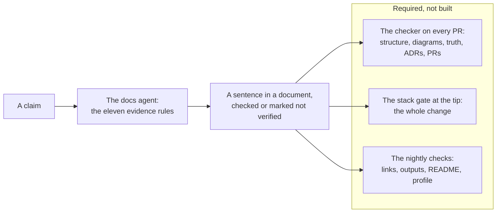
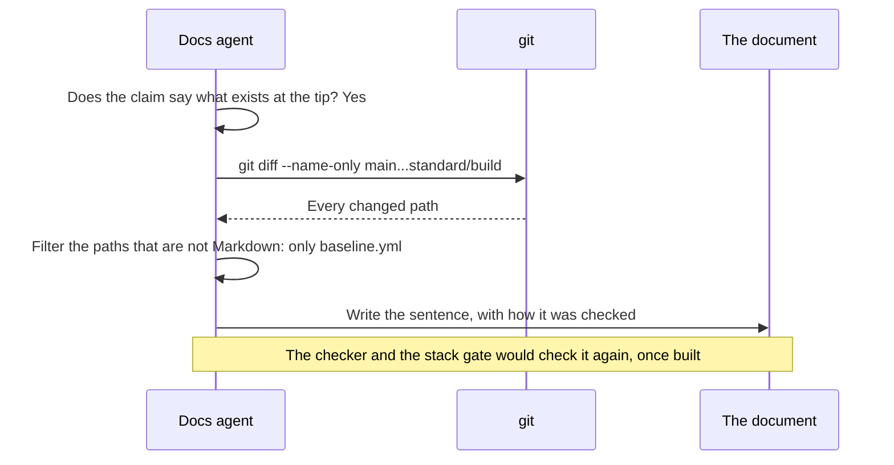
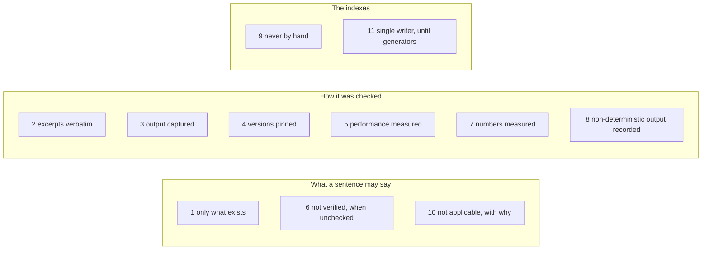
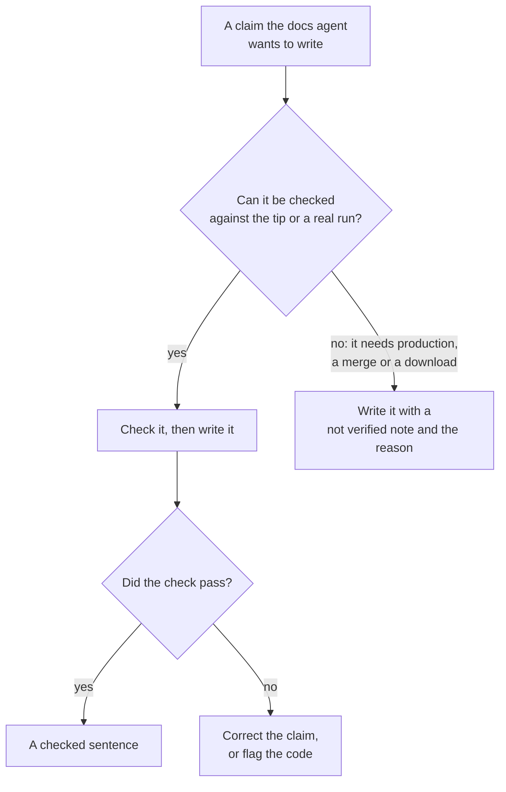
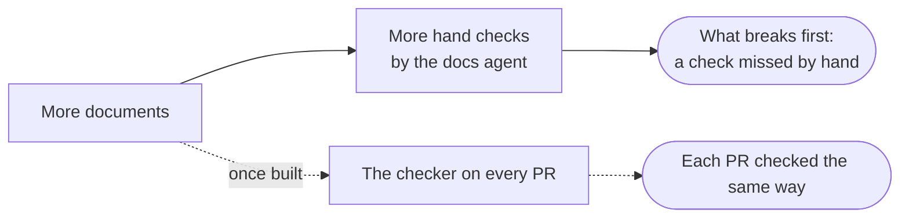

# How documents stay true

| Item | What it says |
|---|---|
| What you will learn | How the baseline keeps its documents true: the eleven evidence rules a claim passes through, the indexes with a single writer until generators exist, the checks and the stack gate that the standard requires of its tooling, and what can be checked by hand today. |
| Lessons to read first | [Flowcharts](../languages/mermaid/01-flowcharts.md), for the diagram rules, and [A stack of pull requests](../stacks/gh-stack/01-a-stack-of-pull-requests.md), for the whole change from `main` to the tip. |
| Reading time | 18 minutes, worked out from its length. |
| Files it covers | `standard/17-evidence-and-truth.md`, `standard/22-tooling-requirements.md`, `standard/16-diagrams.md`, `standard/10-course-reference-pages.md`, `docs/agents/docs-agent.md` |
| Versions verified against | Commit `9d4518e`, and git 2.54.0 for parts 3 and 7; every diagram rendered in dark and light with mermaid-cli 12.2.0. |

## The scenario

The docs agent wants to write a sentence: "the first stack changes no dependency manifest and no schema". Before it can, the claim must say what exists at the tip, be checked against the code, and be written either as a checked sentence or with a "not verified" note. Later, when the tooling exists, the checker is to verify the documents on every PR, the stack gate is to check the whole change at the tip, and nightly checks are to re-run what was captured. Today only the first layer exists: the docs agent applies the rules by hand. This chapter follows the claim through both layers, and part 7 runs the checks that can be run by hand.

## The whole picture



*A claim passes through the docs agent into a document and then, once the tooling exists, through three kinds of check, and the one thing to notice is the box: today everything after the docs agent is a requirement, not a check that runs.*

The happy path for the scenario's claim:



*The claim becomes a sentence only after it was checked against the repository, and the one thing to notice is that the check is a command a reader can run again: the sentence carries its own evidence.*

## Hop by hop

### Hop 1: from a claim to a sentence

The first three of the eleven rules:

*Excerpt from [`standard/17-evidence-and-truth.md`](../../../standard/17-evidence-and-truth.md), lines 23 to 25.*

```text
1. **Say only what exists at the tip.** Plans and "coming later" live in the spec and the plan, and never in the architecture reference, the feature docs or the course. Because: a descriptive document that says what was meant instead of what exists is the failure that anti-goal A2 names, and when a team reads line by line, one wrong sentence costs more than a missing one.
2. **Quote code verbatim.** A captioned excerpt is a verbatim excerpt of the file it names, and a gap in it is a marked ellipsis. A script checks this: the standard requires the checker to verify that every captioned excerpt is verbatim (`22-tooling-requirements.md`). Because: when a team reads line by line, one wrong sentence costs more than a missing one.
3. **Capture output by running it.** Output is never written from memory. The standard also requires a check on a nightly schedule that re-runs captured command outputs and compares them with what was captured, for the outputs that are marked deterministic (`22-tooling-requirements.md`). Because: when a team reads line by line, one wrong sentence costs more than a missing one, and a statement about output that nobody ran is an unverified claim (anti-goal A6).
```

Every rule has a home in each document's anatomy: the architecture reference's header pins the commit, a lesson's part 4 holds the verbatim excerpts, a chapter's part 7 the captured output, part 8 of both what was not verified.



*The eleven rules fall into three groups, and the one thing to notice is that the largest group is about how a claim was checked: most of the rules exist so that a reader can repeat the check.*

| The contract covers | Here |
|---|---|
| Format or schema | Eleven rules, each applying to every document the docs agent writes. |
| Versions | Each document's header names the commit, and a lesson's the versions, it was verified against. |
| Timeouts | Not applicable. |
| Retries | A claim that fails its check is not written as checked; it is corrected or marked "not verified". |
| Ordering | The check comes before the sentence. |
| Idempotency | A captured output marked deterministic is to give the same output when re-run; the nightly check is to compare them. |
| Authentication | Not applicable. |

### Hop 2: from a document to the required checks

The checks that the standard requires over the whole change, at the tip:

*Excerpt from [`standard/22-tooling-requirements.md`](../../../standard/22-tooling-requirements.md), lines 97 to 104.*

```text
The standard requires the stack gate to be made over the whole change, from `main` to the tip of the stack, and not over one PR, and to verify four things. The table gives the file of the standard that sets each.

| What the gate verifies | Where the standard sets it |
|---|---|
| Every new technology has a reader-profile entry and its course files. | [04-reader-profile.md](04-reader-profile.md) and [08-course-lessons.md](08-course-lessons.md) |
| Every new source file is on the file map. | [10-course-reference-pages.md](10-course-reference-pages.md) |
| Quoted numbers are measured. | Rule 7 in [17-evidence-and-truth.md](17-evidence-and-truth.md) |
| Every dependency, schema or interface change is covered by an ADR or a ruling. | "The presence check" in [11-adrs.md](11-adrs.md) |
```

- The gate looks at the whole change, from `main` to the tip, not at one PR.
- Each of its four checks is set in another file of the standard, which the table names.
- None of it runs: the checkers are part of the tooling of design 3.

| The contract covers | Here |
|---|---|
| Format or schema | Four checks over the whole change; the lower PRs pending, the tip listing what is owed or passing. |
| Versions | The checkers and CI are to be pinned in a project. |
| Timeouts, retries | Not stated by the standard. |
| Ordering | Lower PRs wait for the tip; the Software Engineer merges only when the tip passes. |
| Idempotency | Not stated. |
| Authentication | Not applicable. |

### Hop 3: the indexes, while no generator exists

*Excerpt from [`standard/17-evidence-and-truth.md`](../../../standard/17-evidence-and-truth.md), lines 76 to 78.*

```text
Rule 9 says that an index is generated and never hand-edited, and the indexes that it names are the course index, the architecture reference's index, the file map, the glossaries and the ADR index. [05-project-layout.md](05-project-layout.md) gives the place of the course index and of the architecture reference's index, [07-architecture-reference.md](07-architecture-reference.md) sets the architecture reference's index, [10-course-reference-pages.md](10-course-reference-pages.md) says how the file map and the glossaries are produced, and [11-adrs.md](11-adrs.md) sets the ADR index. In a repository whose generators do not exist yet, nothing generates them. Rule 11 is the one exception to rule 9, and it is for that case: a repository whose generators do not exist yet, which is only the baseline's own repository, during its first stacks.

In such a repository the docs agent writes the indexes itself, in the format that the generators will produce, as the single writer of its stack. When a generator lands, which is to say when it is merged into the repository, it takes over, and the checks reconcile any difference. The playbook [docs-agent.md](../docs/agents/docs-agent.md) gives the same exception from the docs agent's side.
```

This repository is that case. The docs agent wrote the five indexes, and wrote them again in each PR of the docs section as the lessons and chapters were added, so that no PR links to a page that does not exist. No format for a generator's output is written anywhere, so their form is the docs agent's.

## Invariants

| Invariant | Who enforces it | Where it is tested |
|---|---|---|
| A descriptive document says only what exists at the tip. | The docs agent | No test exists. |
| Every captioned excerpt is verbatim. | The docs agent | The docs agent ran its own script on every excerpt of this docs section; the script is not in the repository. The checker is required to verify it. |
| Every statement nobody ran is marked "not verified". | The docs agent | No test exists. |
| A generated index has one writer in the stack, or a generator. | The docs agent | No test exists. The checker is required to compare each index with a fresh generation. |
| Every changed manifest, schema or interface is covered by an ADR or a ruling. | The regular agent; by hand while no checker exists | By hand, with the command of part 7. The stack gate is required to check it. |

## How it fails

| Failure | What it is here | What is seen | How it recovers |
|---|---|---|---|
| Slow | The nightly checks would re-run captured outputs. | Not applicable today: they do not run. | Not applicable. |
| Down | No checker exists. | Nothing blocks a wrong sentence. | The docs agent's hand checks, listed in each description PR. |
| Duplicated | Two PRs edit the same index by hand. | A rebase conflict. | The single writer; later, a generator. |
| Reordered | A lower PR changes after the docs were checked. | A sentence that was true and is not any more. | The docs agent re-verifies every document that describes the amended code. |
| Lying | A sentence states a requirement as if it ran. | "The checker blocks it" when no checker exists. | Rule 1, and the standard's own wording: every tooling statement is a requirement. |

The failure flow when a claim cannot be checked:



*A claim that cannot be checked still reaches the page, but only with its note and its reason, and the one thing to notice is that a failed check never becomes a sentence: it becomes a correction or a flag.*

## How it scales and what breaks first

The checks that would scale, the ones a machine runs on every PR, do not exist, so the work grows with the docs agent's hand checks. In this docs section the docs agent checked 43 captioned excerpts, each compared by a script with the lines it names; every internal link and anchor of the documents it wrote, with a script; and 400 diagrams, the 146 of its own documents, the 147 of the ADRs and the 107 of the standard, the playbooks and the standards folder, each rendered in dark and light with mermaid-cli 12.2.0. What breaks first is the hand check: every new document adds excerpts, links and numbers to check, and a hand check misses what a script on every PR would catch. That is the reason the standard requires the checks, and the reason a "not verified" note says what was not done.



*Hand checks grow with every document, and the one thing to notice is that the scaling path, the checker on every PR, is drawn dotted: it is a requirement waiting for its tooling.*

## Observe it

Run the checks that can be run by hand, from the repository root.

```bash
git diff --name-only main...standard/build | grep -v '\.md$'
```

```text
baseline.yml
```

```bash
git ls-tree -r --name-only 9d4518e | wc -l
```

```text
      71
```

```bash
grep -rl '^Not applicable:' docs | sort
```

```text
docs/architecture/07-evidence-and-checks.md
docs/architecture/08-cross-cutting.md
docs/deploy/03-infrastructure-as-code.md
docs/deploy/07-rollback-and-recovery.md
docs/deploy/08-operations.md
```

Output captured on 2026-11-18, while the docs section was being written; `wc` pads its numbers with spaces on the machine where it ran.

## Summary and cheat sheet

| Rule | What it asks |
|---|---|
| 1 | Say only what exists at the tip. |
| 2 | Quote code verbatim, as a captioned excerpt checked by a script. |
| 3 | Capture output by running it. |
| 4 | Pin the versions in each document's header. |
| 5 | Measure performance claims. |
| 6 | Say what you could not verify, in a "not verified" note. |
| 7 | Measure the numbers you quote. |
| 8 | Record the seed, the model and the versions of output that is not deterministic, or mark it illustrative. |
| 9 | Never hand-edit a generated index. |
| 10 | Keep a minimum section that does not apply as one line, `Not applicable: why`. |
| 11 | Where no generator exists, write the indexes as the single writer of the stack. |

Further reading: [standard/17-evidence-and-truth.md](../../../standard/17-evidence-and-truth.md), [standard/22-tooling-requirements.md](../../../standard/22-tooling-requirements.md) and [standard/16-diagrams.md](../../../standard/16-diagrams.md).

**What was verified.** The excerpts, by a script; every diagram, by rendering it in dark and light with mermaid-cli 12.2.0; the presence check and the commands of part 7, by running them. **Not verified.** Every required check, which does not exist; and the labs.

## Practice

### Ten theory questions

**Question 1 (predict).** A document states that a page loads in under a second, with no benchmark. Which rule does it break?

<details><summary>Worked answer</summary>

Rule 5, measure performance claims: keep the benchmark in the repository or cite a source. Without one, the sentence needs a "not verified" note or must go.

**Common wrong answers.** "Rule 7", which is about numbers in general; rule 5 is the one for performance.

</details>

**Question 2 (predict).** What does the presence check print for the first stack, and what does that mean?

<details><summary>Worked answer</summary>

Filtering `git diff --name-only main...standard/build` to the paths that are not Markdown prints only `baseline.yml`. The one file a tool would read changed only in PR 17's comment, which revision 2 records.

**Common wrong answers.** "Nothing, because there is no code", which forgets `baseline.yml`.

</details>

**Question 3 (predict).** A section of the architecture reference does not apply to the system. What stays in the document?

<details><summary>Worked answer</summary>

One line under its heading, `Not applicable: why`, with the reason as a fact about the system, and no diagram.

**Common wrong answers.** "Nothing", which hides that it was considered. "A not verified note", which is for a section that applies but could not be checked.

</details>

**Question 4 (diagnose).** A lesson's excerpt differs from its file by one line. What should have caught it, and what catches it today?

<details><summary>Worked answer</summary>

The checker, which is required to verify every captioned excerpt. Today only the docs agent's own script, run by hand, catches it.

**Common wrong answers.** "The reviewer", who might, but rule 2 asks for a script.

</details>

**Question 5 (diagnose).** A README says "CI runs the get-it-running steps every night" in a repository with no CI. What is wrong?

<details><summary>Worked answer</summary>

A requirement stated as fact. The standard requires such a job; the document must say what exists, so either the job exists or the sentence says the steps were run by hand and the rest is not verified.

**Common wrong answers.** "Nothing, it is in the standard", which confuses the standard with the project.

</details>

**Question 6 (diagnose).** Two PRs of a stack each edited the file map by hand, and the second no longer rebases. Which rule was broken?

<details><summary>Worked answer</summary>

Rule 9, never hand-edit a generated index, or, where no generator exists, rule 11's single writer: only the docs agent writes the indexes in its stack.

**Common wrong answers.** "The size guide", which is about code PRs.

</details>

**Question 7 (design trade-offs).** Why does the standard prefer a sentence with a "not verified" note to leaving the sentence out?

<details><summary>Worked answer</summary>

Because some claims matter even when they cannot be checked here, such as a step that only runs in production; the note tells the reader where to look. A sentence with no note would read as checked, which is worse than either.

**Common wrong answers.** "It always prefers leaving it out", which loses useful information.

</details>

**Question 8 (systems reasoning).** The stack gate keeps lower PRs pending, not red. Why does that matter for a stack whose docs section comes last?

<details><summary>Worked answer</summary>

Because every lower PR is incomplete until the docs section is on top, by design; a red status would mark normal work as failed. Pending says "waiting for the docs section", and only the tip decides. That GitHub shows such a status for a stack is not yet confirmed.

**Common wrong answers.** "It does not matter", which ignores how a reviewer reads a red PR.

</details>

**Question 9 (systems reasoning).** After an amendment to PR 9, which documents drift, and what is to name them?

<details><summary>Worked answer</summary>

Every document that quotes or describes the amended code. The checker is required to name exactly which documents drifted; until it exists, the docs agent re-checks them itself.

**Common wrong answers.** "Only documents in the same PR", which forgets that the docs sit on top of the whole stack.

</details>

**Question 10 (systems reasoning).** Why are the indexes generated rather than kept by hand, at the scale of many stacks?

<details><summary>Worked answer</summary>

A file that every PR of a stack edits conflicts at every rebase, and with many stacks in flight the conflicts multiply; a generated index is never edited, so nothing conflicts. Anti-goal A7 names the failure.

**Common wrong answers.** "Generated indexes are prettier", which is not the reason.

</details>

### Labs

**Not verified:** tabletop exercises, checked by reading or with the hand commands of part 7, because the checkers and the worked example do not exist.

| Kind | What you do | A checkable outcome |
|---|---|---|
| Run it | Run the presence check of part 7 on the first stack. | It prints `baseline.yml` and nothing else. |
| Break it on purpose | Change one word inside an excerpt of a lesson, in a scratch copy. Which rule now fails, and how would you find it? | You name rule 2, and find the difference by comparing the excerpt with the lines its caption names. |
| Trace what happened | Trace one number in the architecture reference, such as the 71 tracked files at commit `9d4518e`, to the command that measures it. | `git ls-tree -r --name-only 9d4518e` piped to `wc -l` prints 71. |
| Fix it | A made-up deployment doc says a runbook command "works in production". Fix it under the honesty rule. | You rewrite it as run in staging or a local reproduction, with production marked "not verified". |
