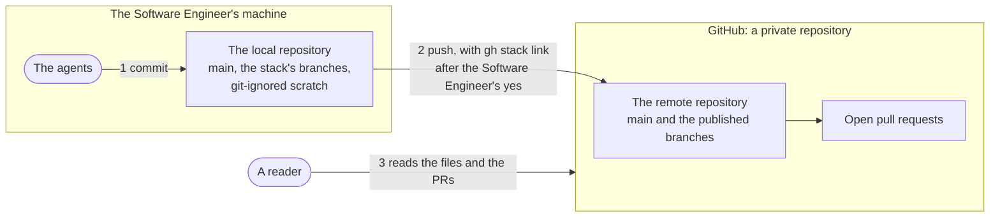

# Topology

The baseline has no hosts, clusters, networks, datastores or queues. It is one git repository that lives in two places: a local repository on the Software Engineer's machine, where the agents commit their work, and a private repository on GitHub, `chandanbsd/baseline-framework`, where work is published and read.



*Work moves from the agents to the local repository to GitHub, where readers read it, and the one thing to notice is that the only way from the machine to GitHub is a push that waits for the Software Engineer's yes: nothing is pushed by the agents on their own.*

The numbers on the arrows are the path that work takes to a reader. The trust boundary is GitHub's access control on a private repository, and [09-security-and-hardening.md](09-security-and-hardening.md) says what was and was not checked about it.

At the time of writing the two places hold different things. The remote holds three branches, `main`, `standard/01-spec` and `standard/02-plan`, and two open pull requests, #1 and #2. The local repository holds those and the rest of the first stack's branches, which wait to be published.

```bash
git ls-remote --heads origin
```

Output, captured on 2026-11-18:

```text
47615dad80be4d0519d862e1a1b559b756dc685e	refs/heads/main
21a666b021ca2730dfdcebeb1dd0bbe065061ee2	refs/heads/standard/01-spec
50bf4c8c11a02dabebf362be657712a0ce6fea14	refs/heads/standard/02-plan
```
