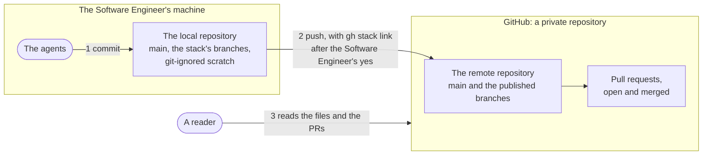

# Topology

The baseline has no hosts, clusters, networks, datastores or queues. It is one git repository that lives in two places: a local repository on the Software Engineer's machine, where the agents commit their work, and a private repository on GitHub, `chandanbsd/baseline-framework`, where work is published and read.



*Work moves from the agents to the local repository to GitHub, where readers read it, and the one thing to notice is that the only way from the machine to GitHub is a push that waits for the Software Engineer's yes: nothing is pushed by the agents on their own.*

The numbers on the arrows are the path that work takes to a reader. The trust boundary is GitHub's access control on a private repository, and [09-security-and-hardening.md](09-security-and-hardening.md) says what was and was not checked about it.

On 2026-11-20 the two places hold the same history. The remote's `main` is `37ecd09`, the merge of the first stack, and the remote still holds the stack's 24 branches and its 24 merged pull requests, #1, #2 and #4 to #25. The local repository holds the same branches, and any work that is not published yet.

```bash
git ls-remote --heads origin
```

Output, captured on 2026-11-20:

```text
37ecd0931692db0d9393cdfa9f23796fd0db4f46	refs/heads/main
21a666b021ca2730dfdcebeb1dd0bbe065061ee2	refs/heads/standard/01-spec
50bf4c8c11a02dabebf362be657712a0ce6fea14	refs/heads/standard/02-plan
4c9eb4fa6904a358235ccb8d83cad611389110a2	refs/heads/standard/03-adr-drafts
199863a40411945240c777fc958f9a5a0545d013	refs/heads/standard/04-playbooks
e8371bd541482f42f76dbae9b325df4a7abe4a69	refs/heads/standard/05-foundations
e6f1ea63a75c32644d783c526c33d5d8c4a9800f	refs/heads/standard/06-profile-and-layout
0f2d293a9e9635b07eba19f475d90ecb3c4b0f44	refs/heads/standard/07-feature-and-architecture
0a3893d4a31533bb2d6e066c13f94ae78ed0b1b7	refs/heads/standard/08-course
52cbee36fe5ffdaa649a00fa9397116f372322e6	refs/heads/standard/09-adrs-deployment-readme
269fa75f9697e4643179961bac61d9138fea3c9b	refs/heads/standard/10-pr-descriptions-and-agents
0c7074db5ec82b5881164101d3282b76b10c79ce	refs/heads/standard/11-diagrams-and-evidence
730927b7702ecb9e1b9b448da4652e185384af7a	refs/heads/standard/12-docs-agent-standards-rules
9ff29026041dbb948c5f884af2d94430a3b8a2fb	refs/heads/standard/13-seams-tooling-index
3abc974875039137d2f8c9824b5f6ae1ac417374	refs/heads/standard/14-revision-1-decisions
ecb13962fd495522b4f1ac0b0e515afac87036f9	refs/heads/standard/15-revision-1-standard
c3e288d35622b2b2b80869c7db897b6a7141a5f9	refs/heads/standard/16-revision-2-decisions
9d4518e2b82532043f2b0bd092cc54d160367f24	refs/heads/standard/17-revision-2-standard
812ff48219094b94dc4f31b025c39f6bcd66e33a	refs/heads/standard/18-revision-3-decisions
696d270432fb636a3739981dd0e608bde9488bf8	refs/heads/standard/19-revision-3-adr-drafts
bd7b1ce21f7340ca5593d9e06b062b76e13ecefa	refs/heads/standard/20-revision-3-standard
8eac1bf143dba65c0bbdce972c1a804d551e408b	refs/heads/standard/docs-21-reference
6c54bc28015a3dcade634eb7117118bb5b55b85f	refs/heads/standard/docs-22-language-lessons
488301736a7cdbd56b26a11449507b14b9770a50	refs/heads/standard/docs-23-stack-lessons
ac2f60485be771231c5248417a4ac48d5526f464	refs/heads/standard/docs-24-system-chapters
```
