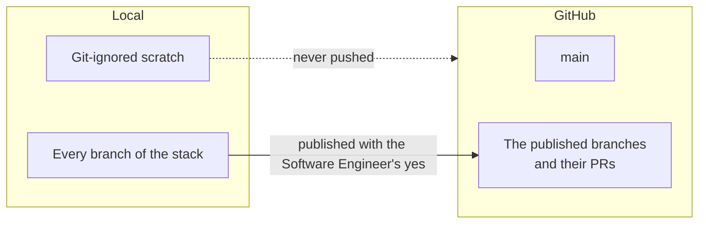

# Environments

The baseline has two environments, and neither runs anything.

| Environment | Purpose | How it was created | What lives there | Who has access |
|---|---|---|---|---|
| The local repository | Where the agents commit, cut the stack's branches and write the documents. | The bootstrap commit on `main`, `47615da`, on 2026-11-14, with `origin` set to the GitHub repository. | Every branch of the stack, and git-ignored scratch such as `.DS_Store` and `__pycache__/`. | Whoever uses the Software Engineer's machine. |
| GitHub | Where work is published, reviewed and merged, and where readers read it. | The private repository `chandanbsd/baseline-framework`; `main` and PRs 1 and 2 were pushed on 2026-11-18, and the rest of the stack on 2026-11-19. | `main`, with the first stack merged into it on 2026-11-20, the stack's 24 branches and its 24 merged PRs, #1, #2 and #4 to #25. | The repository's collaborators on GitHub. Who they are was not checked: not verified. |

There is no CI environment: the repository has no `.github/` folder and no workflow. There is no staging and no production, because nothing is deployed.

*The two environments hold what has been published, and the one thing to notice is the dotted line from the scratch files: they are git-ignored, so they never leave the local repository.*
