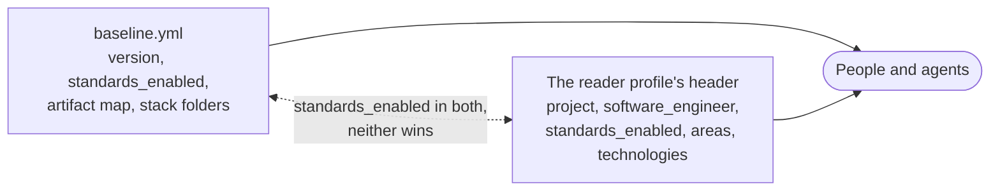

# Configuration and secrets

The baseline's configuration for this repository is in two files: `baseline.yml` at the root, and the YAML header of `docs/reader-profile.md`. Nothing else is configured, and no tool reads either file at this tip: they are read by people and agents.

| Name | Purpose | Default | Where set | Secret or not |
|---|---|---|---|---|
| `baseline_version` | The version of the baseline that the repository follows. Here `0.1.0`. | None | `baseline.yml` | Not secret |
| `standards_enabled` | Whether standards are built from the Software Engineer's preferences. Here `true`. | None: it is the intake's answer | `baseline.yml`, and the reader profile's header | Not secret |
| `artifact_map.spec` | Where skills write the spec. Here `docs/superpowers/specs/**`. | `docs/superpowers/specs/**` | `baseline.yml` | Not secret |
| `artifact_map.plan` | Where skills write the plan. Here `docs/superpowers/plans/**`. | `docs/superpowers/plans/**` | `baseline.yml` | Not secret |
| `artifact_map.other` | Where skills write any other kept document. Here empty. | Empty | `baseline.yml` | Not secret |
| `stack_folders` | The folders whose changes are code, apart from each folder's own README and AGENTS.md. Here `standard`, `kit`, `checkers`, `skills` and `examples`, of which only `standard` exists. | None | `baseline.yml` | Not secret |
| `project` | The project's name. Here `baseline-framework`. | None | The reader profile's header | Not secret |
| `software_engineer` | The person who decides. Here `Chandan`. | None | The reader profile's header | Not secret |
| `knowledge_areas` | Each subject the project depends on, with a level. | None | The reader profile's header | Not secret |
| `technologies` | Each technology the project uses, with a level and a comparison setting. | None | The reader profile's header | Not secret |

The defaults are those that [standard/05-project-layout.md](../../standard/05-project-layout.md) gives: the artifact map defaults to the superpowers paths with `other` empty, and the standard gives no default for the other keys. When `standards_enabled` differs between its two records, neither wins, and how the difference is reported is left to the tooling's design.

## Secrets

The repository has no secrets: no setting above is secret, no file holds a credential, and nothing needs one to run, because nothing runs. Pushing to GitHub uses the Software Engineer's own git and `gh` sign-in, which lives outside the repository.

*All the configuration is in two files that people and agents read, and the one thing to notice is the one key that appears in both, joined by a dotted line, because neither record wins over the other.*
