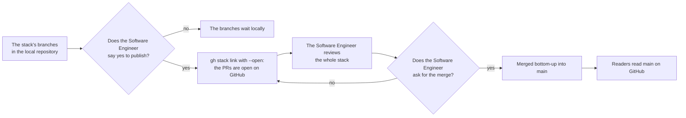

# Build and release pipeline

The repository has no CI workflow, no build and no release workflow: there is no `.github/` folder, and `git tag` lists no tags. Nothing is built, because the product is the text itself. A stack that the Software Engineer merges into `main` on GitHub is, from then on, what a reader of `main` reads.

*The only gates between the stack and its readers are two decisions of the Software Engineer, and the one thing to notice is that there is no build or check between them: the stack gate and the checks that the standard requires do not exist yet.*

## Versioning and promotion

The baseline's versions follow semver: a patch version for fixes, a minor version for optional additions and a major version for new required structure, with an upgrade guide ([standard/README.md](../../standard/README.md)). This repository's `baseline.yml` pins `baseline_version: 0.1.0`. No version has been released or tagged. There is no promotion, because there is only one place that readers read, `main` on GitHub.

## Approvals

Two approvals are the Software Engineer's: the yes to publish, because in this repository opening a stack's PRs is publishing (`AGENTS.md`, rule 4), and the merge, because nothing merges unless the Software Engineer asks. The standard requires a stack gate that keeps the lower PRs pending until the tip passes; it does not exist ([standard/22-tooling-requirements.md](../../standard/22-tooling-requirements.md)).
