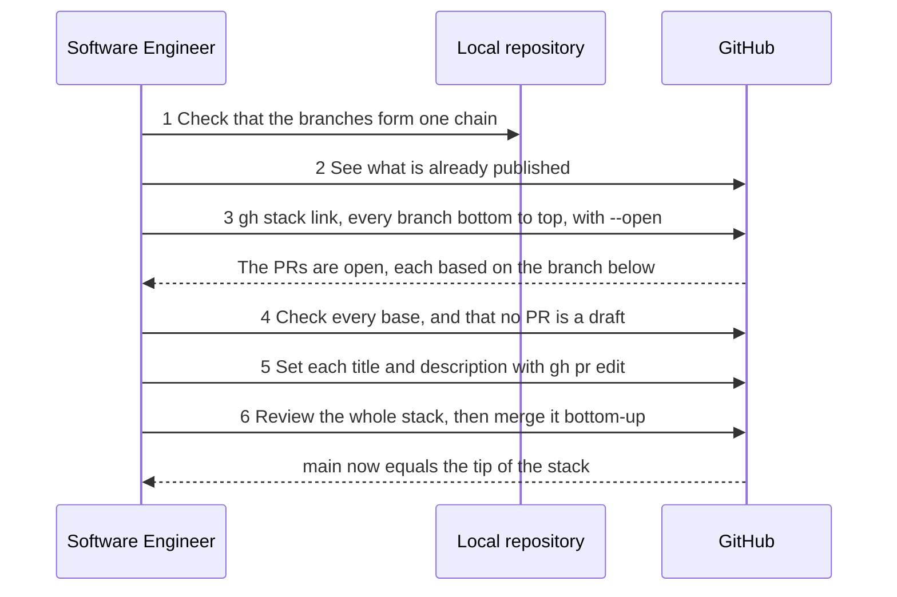

# Deploying

Nothing is deployed: the baseline's equivalent of a deploy is publishing a stack on GitHub and merging it into `main`. Both are the Software Engineer's calls. Publishing waits for their yes, because opening a stack's PRs is publishing in this repository (`AGENTS.md`, rule 4), and nothing merges unless they ask. The steps come from [stacks.md](../agents/stacks.md), "Opening and updating the stack".

There is one component, the repository, so there is no order across components.



*The publish runs from a local check to a merged main, and the one thing to notice is that step 3 is the only step that changes GitHub before the merge, which is why it waits for the Software Engineer's yes.*

## The runbook

1. **Check that the branches form one chain.** Each branch must contain the one below it, from `main` up. Run from the repository root:

   ```bash
   prev=main; for b in $(git branch --list 'standard/[0-9]*' 'standard/docs-*' --format='%(refname:short)'); do if git merge-base --is-ancestor "$prev" "$b"; then echo "ok $prev -> $b"; else echo "BROKEN $prev -> $b"; fi; prev="$b"; done
   ```

   Output, captured on 2026-11-19, after the docs section was rebased onto revision 3:

   ```text
   ok main -> standard/01-spec
   ok standard/01-spec -> standard/02-plan
   ok standard/02-plan -> standard/03-adr-drafts
   ok standard/03-adr-drafts -> standard/04-playbooks
   ok standard/04-playbooks -> standard/05-foundations
   ok standard/05-foundations -> standard/06-profile-and-layout
   ok standard/06-profile-and-layout -> standard/07-feature-and-architecture
   ok standard/07-feature-and-architecture -> standard/08-course
   ok standard/08-course -> standard/09-adrs-deployment-readme
   ok standard/09-adrs-deployment-readme -> standard/10-pr-descriptions-and-agents
   ok standard/10-pr-descriptions-and-agents -> standard/11-diagrams-and-evidence
   ok standard/11-diagrams-and-evidence -> standard/12-docs-agent-standards-rules
   ok standard/12-docs-agent-standards-rules -> standard/13-seams-tooling-index
   ok standard/13-seams-tooling-index -> standard/14-revision-1-decisions
   ok standard/14-revision-1-decisions -> standard/15-revision-1-standard
   ok standard/15-revision-1-standard -> standard/16-revision-2-decisions
   ok standard/16-revision-2-decisions -> standard/17-revision-2-standard
   ok standard/17-revision-2-standard -> standard/18-revision-3-decisions
   ok standard/18-revision-3-decisions -> standard/19-revision-3-adr-drafts
   ok standard/19-revision-3-adr-drafts -> standard/20-revision-3-standard
   ok standard/20-revision-3-standard -> standard/docs-21-reference
   ok standard/docs-21-reference -> standard/docs-22-language-lessons
   ok standard/docs-22-language-lessons -> standard/docs-23-stack-lessons
   ok standard/docs-23-stack-lessons -> standard/docs-24-system-chapters
   ```

   Every line must start with `ok`. A `BROKEN` line means a branch does not contain the one below it, and the stack cannot be linked with the right bases until it is cut again.

2. **See what is already published.**

   ```bash
   git ls-remote --heads origin
   ```

   Output, captured on 2026-11-19:

   ```text
   47615dad80be4d0519d862e1a1b559b756dc685e	refs/heads/main
   21a666b021ca2730dfdcebeb1dd0bbe065061ee2	refs/heads/standard/01-spec
   50bf4c8c11a02dabebf362be657712a0ce6fea14	refs/heads/standard/02-plan
   ```

3. **Publish the whole stack, after the Software Engineer's yes.** List every branch from the first to the last, bottom to top. PRs 1 and 2 already exist and are reused.

   ```bash
   gh stack link standard/01-spec standard/02-plan standard/03-adr-drafts standard/04-playbooks standard/05-foundations standard/06-profile-and-layout standard/07-feature-and-architecture standard/08-course standard/09-adrs-deployment-readme standard/10-pr-descriptions-and-agents standard/11-diagrams-and-evidence standard/12-docs-agent-standards-rules standard/13-seams-tooling-index standard/14-revision-1-decisions standard/15-revision-1-standard standard/16-revision-2-decisions standard/17-revision-2-standard standard/18-revision-3-decisions standard/19-revision-3-adr-drafts standard/20-revision-3-standard standard/docs-21-reference standard/docs-22-language-lessons standard/docs-23-stack-lessons standard/docs-24-system-chapters --open
   ```

   **Not verified.** Running this command publishes the stack, which waits for the Software Engineer's yes, so it was not run. Its behaviour over branches cut as pointers was checked on 2026-11-18 with `gh stack` 0.3.0 in a throwaway repository and for PRs 1 and 2 of this repository ([revision 1, section 3](../superpowers/specs/2026-11-18-baseline-standard-revision-1-design.md)).

4. **Check every base, and that no PR is a draft.**

   ```bash
   gh pr list --json number,headRefName,baseRefName,isDraft
   ```

   It is done when the first PR's base is `main`, every other PR's base is the branch below it, and no PR has `"isDraft": true`. **Not verified**: it can be run meaningfully only after step 3.

5. **Set every title and description**, each from a file, with `gh pr edit <number> --title "<title>" --body-file <file>`, and then rebuild the stack table in every PR's description, as [pr-descriptions.md](../agents/pr-descriptions.md) says. **Not verified**: it follows step 3.

6. **Review the whole stack, docs section included, and merge it bottom-up in one sitting**, when the Software Engineer asks for the merge. `gh stack merge` merges a stack on GitHub in one operation, and it is never run unless the Software Engineer asks. **Not verified**: nothing has been merged, and how GitHub merges a stack bottom-up has not been confirmed.

## What success looks like

After step 3, `gh pr list` shows one open PR for each branch, none a draft, each based on the branch below it. After step 6, every PR of the stack is merged, and `main` on GitHub holds the same files as the tip of the stack: `git ls-tree -r --name-only origin/main` after a `git fetch` lists what `git ls-tree -r --name-only` lists for the top branch. **Not verified**: neither state has been reached.
