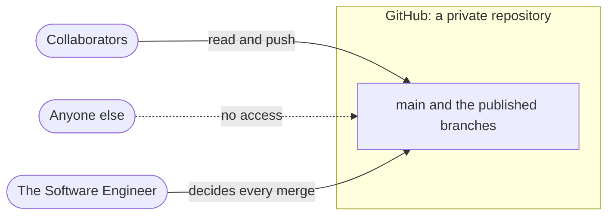

# Security and hardening

The baseline runs no service, so it has no network rules, no hardening steps and no audit log of its own. What it has is a repository, and its security is the access to that repository.

| Part | What is true | How it was checked |
|---|---|---|
| Visibility on GitHub | The repository `chandanbsd/baseline-framework` is private. | `gh repo view --json visibility` reported `PRIVATE` on 2026-11-18 and again on 2026-11-19. |
| Who can read and push on GitHub | GitHub's collaborators of the repository. | Not verified: the list of collaborators was not read. |
| Who can merge | Only the Software Engineer decides a merge, by the standard. | The rule is text (`AGENTS.md`, rule 4); no branch protection was checked. Not verified. |
| The local repository | Whoever uses the Software Engineer's machine. | Not verified. |
| Credentials | None in the repository; pushing uses the Software Engineer's own git and `gh` sign-in. | The tracked files were listed, and the only non-Markdown files are `baseline.yml` and `.gitignore`. |
| Audit log | GitHub keeps the history of the repository's PRs and pushes. | Not verified: GitHub's audit log was not read. |

*Access is GitHub's access to a private repository, and the one thing to notice is that the Software Engineer's control of merging is a rule of the standard: no branch protection that would enforce it was checked.*
