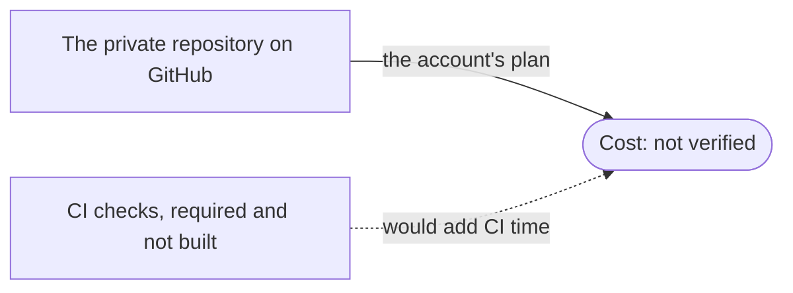

# Cost

The baseline runs no compute, storage service or network of its own, so no component of it has a running cost. The one thing that hosts it is the private repository on GitHub.

| Component | What it costs today | What grows it |
|---|---|---|
| The private repository on GitHub | Whatever the account's GitHub plan charges for a private repository. Not verified: the plan was not checked. | Not recorded: the standard sets no limit, and no CI runs, so no minutes are used. |

When the tooling of design 3 exists, CI is to run the checks on every PR, at the tip of a stack and every night ([standard/22-tooling-requirements.md](../../standard/22-tooling-requirements.md)), and that would use CI time. It does not run today.

*The only cost today is the repository's hosting, and the one thing to notice is that the CI checks reach the cost only by a dotted line, because they are required and not built.*
