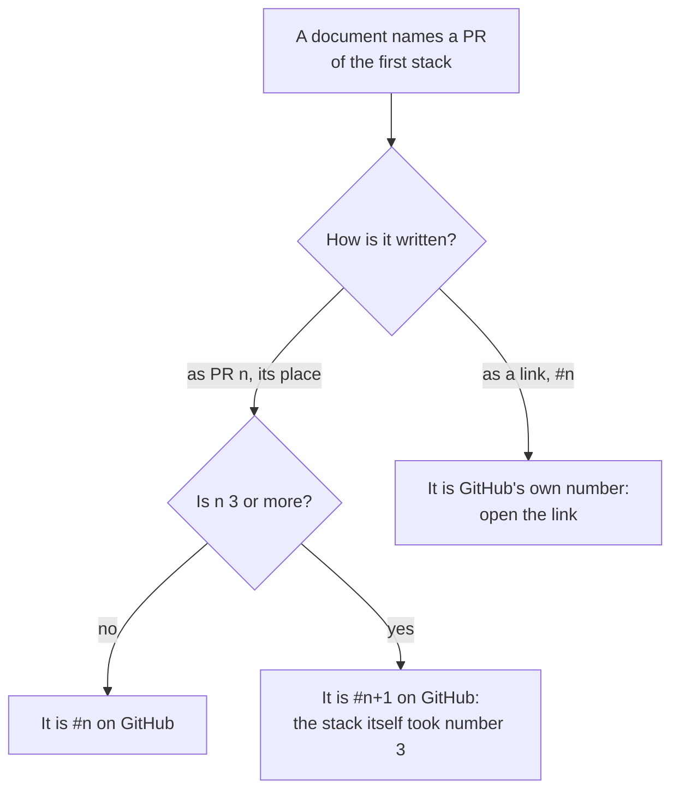

# Troubleshooting

| Symptom | Check | Fix |
|---|---|---|
| On GitHub, #5 is not PR 5 of the stack. | `gh pr list --state all --json number,headRefName` pairs each PR's number with its branch; without `--state all` it lists only open PRs, and on 2026-11-20 none was open. That day PRs 1 and 2 were #1 and #2, and PRs 3 to 24 were #4 to #25, because GitHub gave number 3 to the stack itself. | Nothing to fix: the documents name a PR by its place in the stack, and its branch name carries the place, so `standard/05-foundations` is PR 5, which is #6. |
| `gh stack view` prints `✗ current branch "<branch>" is not part of a stack`. | It printed that on 2026-11-20 for a branch outside the first stack, and on 2026-11-19 for the top branch of the linked stack. | Nothing to fix: `gh stack link` keeps no local record, so `gh stack view` knows a stack only after `gh stack checkout <stack number>`. Use `gh pr list --state all --json number,headRefName,baseRefName,state` instead ([06-deploying.md](06-deploying.md)). |
| `gh stack` is not found. | `gh extension list` lists the installed extensions; on the machine where this was written it listed `gh stack github/gh-stack v0.3.0`. | Install the extension `github/gh-stack` with `gh extension install github/gh-stack`. Not verified: the install was not run, because the extension was already installed. |

*A PR named by its place maps to GitHub's number by one rule, and the one thing to notice is the step at 3: from there up, GitHub's number is the place plus one, because the stack itself took number 3.*
