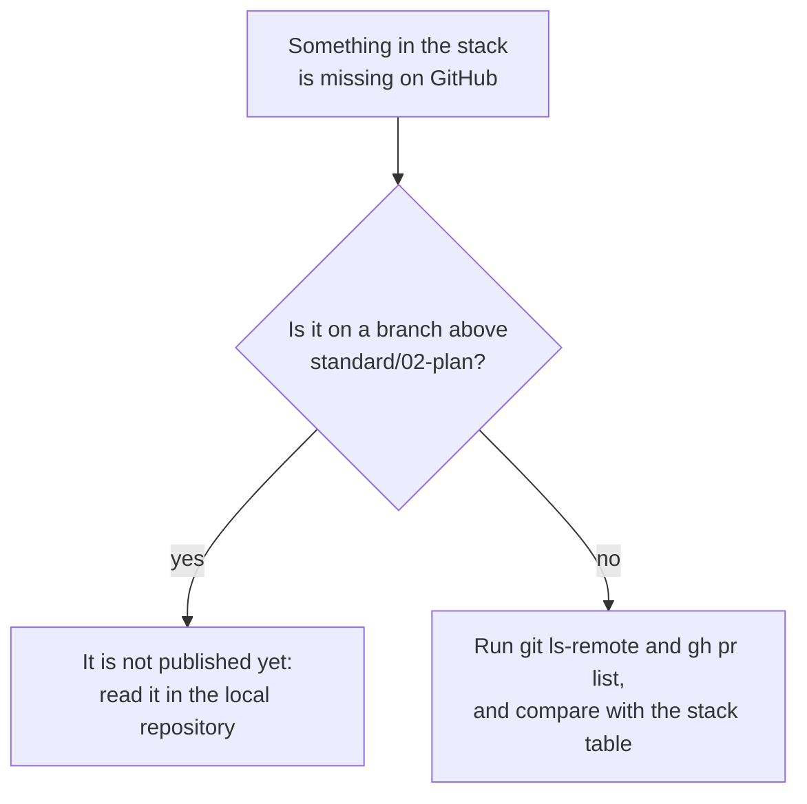

# Troubleshooting

| Symptom | Check | Fix |
|---|---|---|
| A branch named in a stack table, such as `standard/05-foundations`, is not on GitHub. | `git ls-remote --heads origin` lists only the branches that are published. On 2026-11-18 it listed `main`, `standard/01-spec` and `standard/02-plan`. | Nothing to fix: PRs 3 and up are published only once the docs section is in and the Software Engineer says yes ([06-deploying.md](06-deploying.md)). Read the branch in the local repository instead. |
| `main` on GitHub has none of the standard. | `git ls-tree -r --name-only origin/main` lists four files: `.gitignore`, `baseline.yml`, `docs/reader-profile.md` and `docs/standards/README.md`. | Nothing to fix: `main` holds only the bootstrap commit until the stack is merged. The standard is on the stack's branches. |
| `gh stack` is not found. | `gh extension list` lists the installed extensions; on the machine where this was written it listed `gh stack github/gh-stack v0.3.0`. | Install the extension `github/gh-stack` with `gh extension install github/gh-stack`. Not verified: the install was not run, because the extension was already installed. |
| A link to a PR number, such as one written as PR 5, leads nowhere. | `gh pr list --state all` lists the PRs that exist; on 2026-11-18 it listed #1 and #2. | Nothing to fix until the stack is published: PRs 3 and up are named by their place in the stack and their branch until GitHub gives them numbers. |

*Most of what seems missing on GitHub is simply not published yet, and the one thing to notice is that the first question is where in the stack the thing is: everything above PR 2 waits for the docs section and the Software Engineer's yes.*
