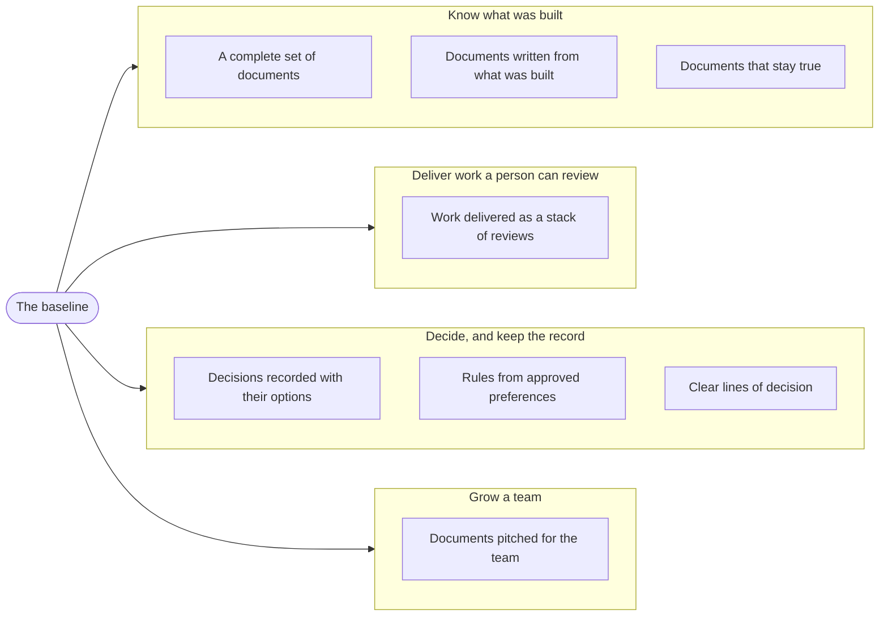

# What the baseline gives a project

*Verified against commit 9d4518e.*

## What the product is and who uses it

The baseline is a written standard for running a software project: which documents the project keeps, who writes each of them and when, how the work is put in front of a reviewer, and how the preferences of the person in charge become rules that shape the code. It works for a project of any kind, in any technology, because what changes between projects is what the documents say, not which documents there are.

It is written for the **Software Engineer**, the person who decides on a project. Their goal is to work as a Distinguished Engineer, taking on, one step at a time, the responsibilities of a Lead Engineer, a Principal Engineer and a Solutions Architect, while AI agents write most of the code. The baseline is what lets one person carry those responsibilities: it gives them a way to read what was built, to review it in order and to keep the decisions and the rules on record.

Three others use it alongside the Software Engineer:

- **the regular agent**, the AI agent that plans and builds the work;
- **the docs agent**, a fresh AI agent that writes the documents that describe what was built;
- **the team**, the people who read the documents, review the work and join the project later.

Today the baseline is the written standard and the guides for agents that come with it. The tools that are to apply it for a project, a starter kit, automatic checks and commands for the agents, do not exist yet, so everything it offers is done by following the text by hand.

## A capability map

*The map groups what the baseline offers under four goals, and the one thing to notice is that each group is named for what the Software Engineer wants to achieve, such as Know what was built, and not for a part of the standard.*

## The features

| Feature | Who it is for | Page |
|---|---|---|
| A complete set of documents | The Software Engineer and the team | [The document set](document-set.md) |
| Documents written from what was built | The Software Engineer, who starts the docs agent, and the team, who read what it writes | [Documents written from what was built](documents-from-what-was-built.md) |
| Documents that stay true | Everyone who reads the documents | [Documents that stay true](documents-that-stay-true.md) |
| Work delivered as a stack of reviews | The Software Engineer and the agents that build | [Work delivered as a stack](delivery-as-a-stack.md) |
| Decisions recorded with their options | The Software Engineer, the agents and the team | [Decision records](decision-records.md) |
| Rules from approved preferences | The Software Engineer and the agents that write code | [Standards](standards.md) |
| Clear lines of decision | The Software Engineer and the agents | [Working with the Software Engineer](working-with-the-software-engineer.md) |
| Documents pitched for the team | The Software Engineer, who hires, and the team, who read | [Documents pitched for the team](documents-pitched-for-the-team.md) |

## Who can do what

What each person and each agent may do is on one page only: the [who-can-do-what matrix](access.md#the-who-can-do-what-matrix) on the Users and access page. This page holds no copy of it.

## More on users and access

- The kinds of user, people and agents: [The kinds of user](access.md#the-kinds-of-user).
- The roles and what refines them: [The roles and the claims that refine them](access.md#the-roles-and-the-claims-that-refine-them).
- How a person or an agent gains, changes and loses what it may do: [How access is gained, changed and lost](access.md#how-access-is-gained-changed-and-lost).

The words these pages use are explained in the [glossary](glossary.md).
