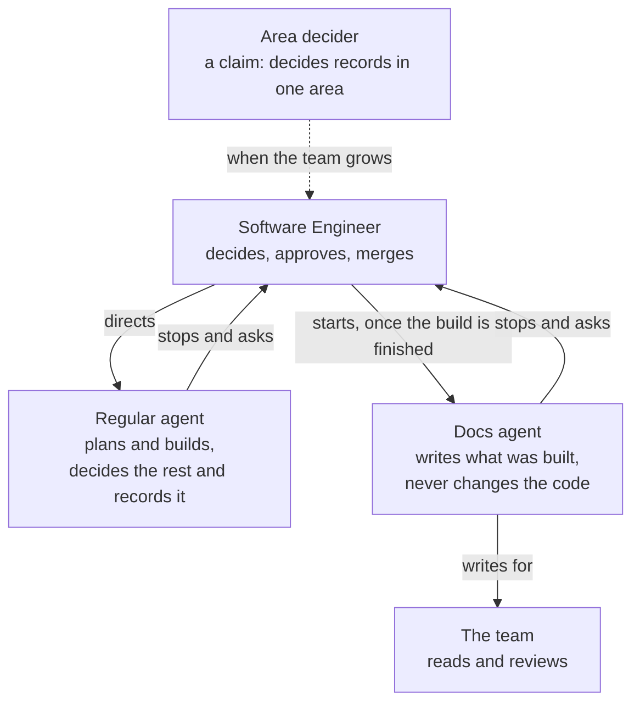
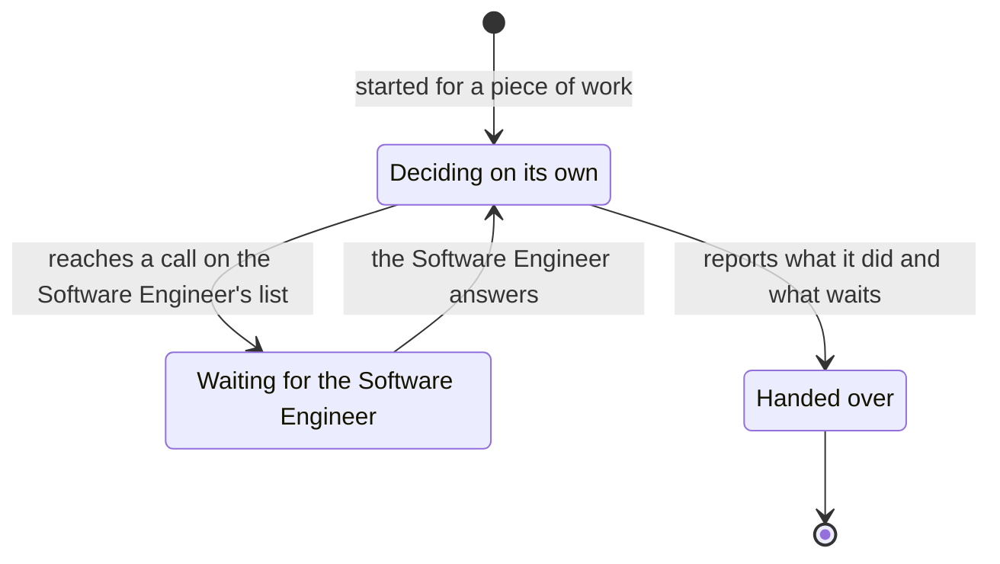
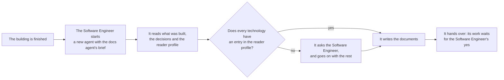

# Users and access

*Verified against commit 9d4518e.*

This page holds everything about who can do what under the baseline, once. The feature pages name the roles and link here.

## The kinds of user

Whoever can act in the work is a kind of user, and under the baseline two kinds act: people and AI agents. No device and no automatic service acts today, because the tools that would be services, the automatic checks and the commands for agents, do not exist yet.

| Kind | Who they are |
|---|---|
| A person | The Software Engineer, who decides. The team, who read the documents, review the work and join the project later. |
| An agent | The regular agent, which plans and builds. The docs agent, a fresh agent that writes the documents describing what was built. |

GitHub hosts the work and the AI skills guide the agents, but neither acts on its own in the baseline: the agents and the Software Engineer act through them.

## The roles and the claims that refine them

A role is a named bundle of what someone may do. The baseline has three roles that act, and the team, who read.

- **Software Engineer.** Decides what only they can decide: what to build and why, how work is done, merging and publishing, anything that cannot be undone, whether a decision record is accepted, and who the documents are for. Approves every rule before it is written.
- **Regular agent.** Plans and builds. Decides everything that is not on the Software Engineer's list, such as the order of the work and how it is grouped, and records each such decision with what it would cost if it were wrong. Writes a decision record at the moment it makes a decision of impact.
- **Docs agent.** Starts fresh once the building is finished. Writes the documents that describe what was built, reviews and numbers the decision records, and never changes the code.
- **The team.** Reads and reviews. The baseline gives the team no decision of its own; what it gives them is documents pitched for them.

Two claims refine the roles:

- **An agent at the Software Engineer's ask** may record that a decision record was accepted or rejected, after the Software Engineer has merged or sent it back.
- **An area decider.** When the team grows, an area of the project may have its own decider, who is then named as the decider of a decision record in that area. The baseline says nothing more about what an area decider may do.

*The Software Engineer is at the centre, with both agents stopping to ask them, and the one thing to notice is that the area decider hangs from the Software Engineer by a dotted line: it is a claim that exists only once the team has grown.*

## The conditions that change rights

The same role can do different things depending on the circumstances.

| Condition | What it changes | An example |
|---|---|---|
| Status | What may be done with a decision record, or with a technology's course, depends on where it stands. | The docs agent may review a draft decision record, but no one may rewrite one that has been accepted. The docs agent may not write the course for a technology that the reader profile does not yet cover. |
| Ownership | What may be changed depends on whose a file is. | An update of the baseline may replace the files that belong to the baseline, and never the files that belong to the project. No one edits a document that an AI skill produced to make it fit the baseline. |
| Tenant | Does not apply: each project has its own repository, and the baseline sets no shares within one. | None |
| Time | What may be done depends on where the work is. | The docs agent starts only once the building is finished. In this repository nothing is put up for review on GitHub before the Software Engineer says yes. A decision record is accepted when the Software Engineer merges the work, and not before. |

## How access is gained, changed and lost

The Software Engineer is named in the project's instruction file, and that is how a project knows who decides. The baseline does not describe how the Software Engineer changes.

An agent gains its role when it is started for a piece of work and keeps it until it hands the work over. Along the way it may have to stop and wait for the Software Engineer, which changes what it may do next.

*An agent decides on its own until it reaches a call that is not its to make, and the one thing to notice is that waiting is the only way back to deciding: an agent never takes a call on the Software Engineer's list by itself.*

The docs agent's access starts differently from the regular agent's: the Software Engineer starts it by hand, as a new agent with no earlier conversation, once the building is finished. This access journey shows the steps.

*A docs agent gains its access when the Software Engineer starts it and gives it up when it hands over, and the one thing to notice is that it never begins from the building agent's conversation: it starts fresh.*

A person joins the team through the hiring that the reader profile supports: the levels in the profile are both how the documents are pitched and the bar the Software Engineer hires against. The baseline does not describe how a person leaves.

## The who-can-do-what matrix

Each row is one thing that someone may or may not do, and the architecture reference maps each row to the rule that states it.

| Capability | Software Engineer | Regular agent | Docs agent |
|---|---|---|---|
| Decide what to build and why | Yes, including the approach picked during brainstorming | No: it stops and asks | No: it stops and asks |
| Change how work is done | Yes | No: it stops and asks | No: it stops and asks |
| Merge the work, or put it up for review on GitHub | Yes | Only when the Software Engineer asks, and in this repository only after their yes | No: it prepares its work and waits for the yes |
| Accept or reject a decision record | Yes, by merging the work or sending the record back | No, though it may record the outcome at the Software Engineer's ask | No: it moves a draft only as far as Proposed |
| Change who the documents are for | Yes | No: it proposes and asks | No: it asks when a technology is not covered, and writes only the parts generated from the profile |
| Approve a rule for the project | Yes | No: it proposes the rule and writes it only after a yes | No: it proposes like any agent, and cites the rules that exist |
| Write a draft decision record | The baseline does not say | Yes, at the moment it makes a decision of impact | No, except the records of decisions made while brainstorming that have no draft |
| Review and number a draft decision record | The baseline does not say | No | Yes, within limits: it may tidy and add, never rewrite the decision or its reasons |
| Write a document describing what was built | The baseline does not say | No | Yes, from the finished work |
| Change the code | The baseline does not say | Yes | Never: it flags unclear code for the pull request it belongs to |
| Read the plan | Yes | Yes | Never |
| Record a decision it took on its own, with what it would cost if wrong | Not needed: they decide | Yes, for every call not on the Software Engineer's list | Yes, for the calls of its own work |
| Edit a document that an AI skill produced, to fit the baseline | The baseline does not say | Never | Never |

## The diagrams of the page

The page carries the three diagrams that the baseline asks of it: how the roles relate, under "The roles and the claims that refine them"; how an agent's access changes, under "How access is gained, changed and lost"; and the access journey of the docs agent, in the same part.
