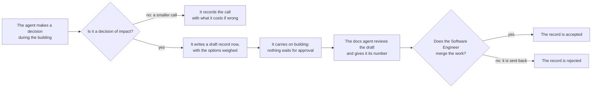
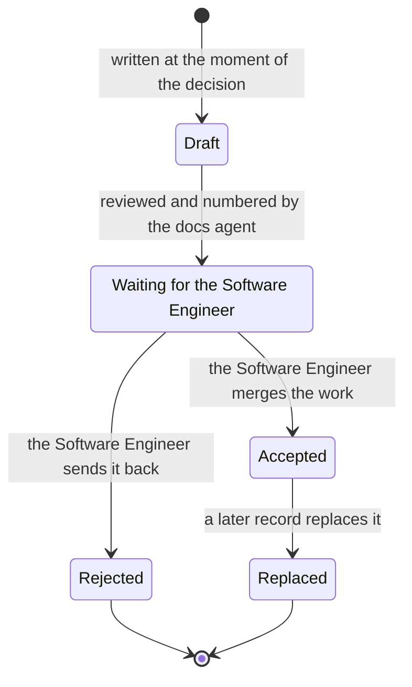

# Decision records

*Verified against commit bd7b1ce.*

## What it is and why it exists

Every decision that matters is recorded in a file of its own: the problem, what mattered most, the options that were weighed with the evidence for each, what was chosen and why it beats the others, what follows from it, and what would reopen it. The record is written at the moment the decision is made, not afterwards. A fresh agent later reviews it and gives it its number, and the Software Engineer accepts it by merging the work it belongs to.

It exists because a record is worth having only if it shows the options as they stood when the decision was made. "Options explored" is the Software Engineer's bar for a decision record. A record written afterwards would justify the choice instead of showing what was weighed, so a gap in the evidence is marked "not recorded" and never filled in later.

## Who can use it

| Who | Can do | Under which conditions |
|---|---|---|
| The regular agent | Write a draft record | At the moment it makes a decision of impact |
| The docs agent | Review a draft, add to it and number it | It may tidy and add, marking each addition, and never rewrite the decision or its reasons |
| The Software Engineer | Accept a record by merging the work, or send it back | Accepting and rejecting are theirs alone |
| The team | Read every record | None |

The [Users and access page](access.md) says what each role is.

## What a person can do

- Read, for any decision of impact, the options that were weighed and the evidence for each.
- See exactly what was not recorded, marked as such.
- Know whether a decision is a draft, waiting for the Software Engineer, accepted, rejected or replaced.
- Follow a decision to the pull requests that put it into the work.
- Change an accepted decision only by writing a new record that replaces it, leaving the old one as it was.

## Journeys

*A decision of impact becomes a draft at once and an accepted record at the merge, and the one thing to notice is that the agent carries on building straight after the draft: the record is a test of the decision, not a gate.*

A decision of impact is one of six kinds: something new the project depends on, how its data is shaped or what others can call, where one party's authority ends and another's begins, where and how the parts run, what two parts of the system promise each other, or anything hard to take back. A decision taken while brainstorming the design needs no draft, because the design already records its options; its record is written from the design.

This repository keeps 35 decision records. Thirty-one were drafted from the record of the brainstorm. Four were drafted later, from the records of decisions taken after the first stack was built, and each extends one of the earlier records, which keeps what it decided. The docs agent numbered all 35 and moved them to waiting for the Software Engineer.

**Evidence.** The written standard: its part on decision records sets the six kinds, the parts of a record and its life, and the repository's 35 records were counted in their folder. Both were read at the commit above, the numbering in the first group of documents.

## The rules a person experiences

- A record is written at the moment of the decision, and nothing waits for it to be approved.
- It weighs at least two real options and "do nothing", each drawn as a diagram.
- Where nothing was recorded, it says so.
- The docs agent may tidy and add to a draft, and never rewrites its decision, what mattered, its options or its reasons.
- Once accepted, a record is never rewritten. A change is a new record that replaces it.

*A record moves from draft to waiting to accepted, and the one thing to notice is that the only way on from accepted is a new record that replaces it: an accepted record is kept as it was written.*

## When things go wrong

- **The work departs from the decision.** The docs agent points it out to the Software Engineer and does not change the record to match; the Software Engineer decides whether the work changes or a new record is written.
- **It is unclear whether an edit tidies a draft or changes its reasoning.** The docs agent treats it as a change, leaves the text alone and points it out.
- **A decision changes after it was recorded.** The change is a new record, not an edit of the design or of the old record.

## Limits today

- No check confirms that a record's status is valid, that its index matches or that an accepted record was not rewritten.
- No check confirms that a change to what the project depends on, or to what others can call, is covered by a record or a recorded call.
- Three of the four records written after the first stack weigh one real option and "do nothing", because the record of the decision held no other, and the docs agent may not add one.

## Related

- [Work delivered as a stack](delivery-as-a-stack.md) and [Standards](standards.md).
- For engineers: [decisions and decision records](../architecture/05-decisions-and-adrs.md) in the architecture reference, and the [index of the records](../adr/README.md).
