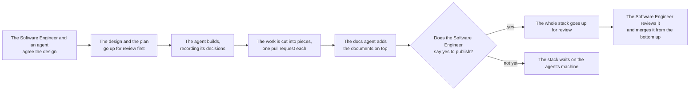
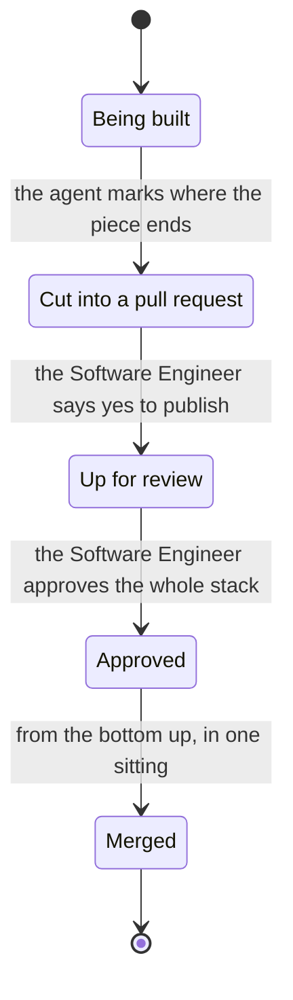

# Work delivered as a stack

*Verified against commit cb4fb22.*

## What it is and why it exists

Every piece of work goes in front of a reviewer as one stack: an ordered series of pull requests, each a proposed change put up for review, each built on the one below it and merged from the bottom up. The stack has three kinds of pull request. The thinking ones, at the bottom, hold the design, the plan and the decisions. The ones in the middle hold the work itself. The ones on top hold the documents that describe what was built.

It exists so that a person can review work that agents built. Each kind is easier to review on its own, and the order lets the reviewer read the intent first, then the work, then the description of what was built, one piece at a time.

## Who can use it

| Who | Can do | Under which conditions |
|---|---|---|
| The regular agent | Build the work, group it into pieces and prepare the stack | It decides the grouping and records it |
| The docs agent | Add the documents on top of the stack | Once the building is finished |
| The Software Engineer | Say yes to putting the stack up for review, review it and merge it | Nothing is merged unless they ask |
| The team | Read the stack | The baseline gives the team no part in approving or merging it |

The [Users and access page](access.md) says what each role is.

## What a person can do

- Read the design and the plan as the first two pull requests, while the building goes on.
- See the shape of the whole change at the top of every pull request, in a table of the whole stack.
- Review one kind of change at a time: thinking for whether it is sound, work for whether it is correct, documents for whether they match the work.
- Merge the whole stack in one sitting, from the bottom up, once the documents are on top.
- Handle a change with no design as one pull request, or as two when it also changes what the documents say.

## Journeys

*Work goes up for review in two steps, the design and plan first and the rest once the documents are on top, and the one thing to notice is that each step waits for the Software Engineer's yes in this repository.*

This repository is itself delivered this way. Its design and its plan have been up for review since the 18th of November 2026, and the rest of its first stack waits on the Software Engineer's machine for the documents and for their yes.

**Evidence.** The written standard: its part on the stack model sets the three kinds, the order and the thirteen rules, and the repository's instruction file asks for the Software Engineer's yes before anything goes up for review. Both were read at the commit above, and what is up for review was checked on GitHub on the 18th of November 2026.

## The rules a person experiences

- The design is the first pull request and the plan the second, each exactly as it was produced.
- Each pull request holds one kind of change. A mixed one is allowed, and only harder to review.
- The documents that describe the work go on top, last.
- Every pull request leaves the project working.
- Nothing is merged, released or published unless the Software Engineer asks. In this repository, putting the stack up for review counts as publishing.
- A fix after the stack is up for review goes on top as a new pull request, so that what the reviewer already read stays as it was.

*A piece of work moves from being built to merged, and the one thing to notice is that it is approved with the whole stack and never on its own, because the stack is complete only with its documents on top.*

## When things go wrong

- **A piece of work mixes kinds.** It is split before the stack is cut, so each pull request holds one kind.
- **Something needs fixing after the stack is up for review.** The fix goes on top as a new pull request; rewriting what is already up waits for the Software Engineer's yes.
- **The design or the plan changes during the building.** The change gets its own pull request, placed below the work that needed it, and the original stays as first written.

## Limits today

- There is no command that cuts and publishes a stack; an agent does it by hand with the steps in its guide.
- How GitHub treats a stack in some respects is not yet confirmed: that every pull request's checks run, that lower pull requests wait for the top, and that the stack merges from the bottom up. What has been confirmed is that a stack cut this way can be put up for review cleanly.
- There is no automatic check of the stack as a whole.

## Related

- [Decision records](decision-records.md), [Documents written from what was built](documents-from-what-was-built.md) and [Working with the Software Engineer](working-with-the-software-engineer.md).
- For engineers: [the stack model](../architecture/03-the-stack-model.md) in the architecture reference.
