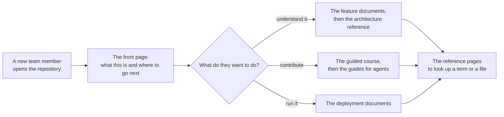
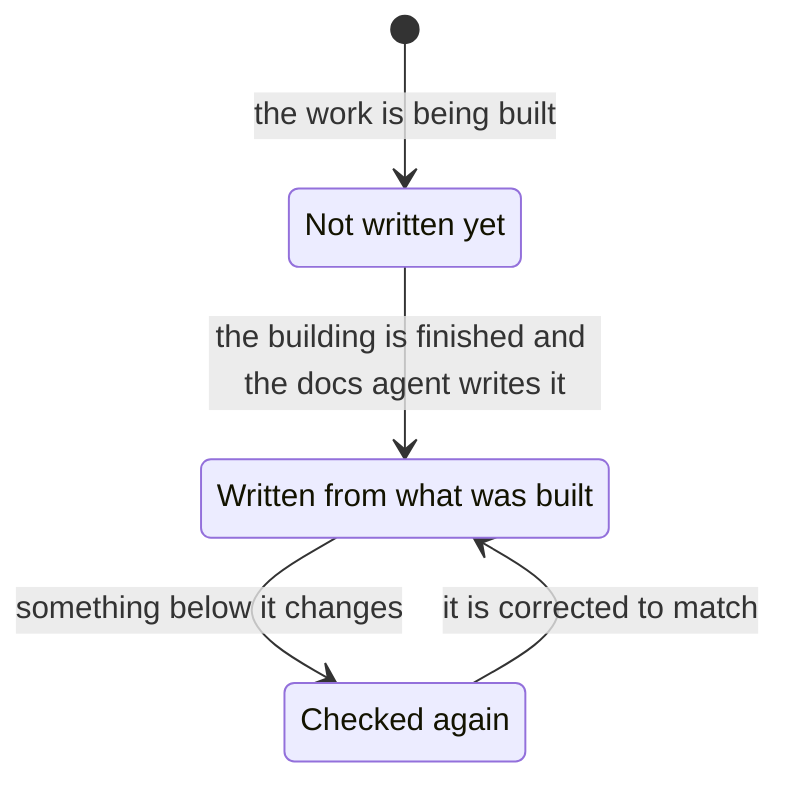

# The document set

*Verified against commit bd7b1ce.*

## What it is and why it exists

Every project that follows the baseline keeps the same set of documents, whatever it builds. The set has two halves. The first half says what will be built and how the work is done: the design of the work, the plan, the decision records, the project's rules, the record of who the documents are for, and the guides that tell the AI agents how to work. These are written before the work or alongside it. The second half says what was built: the feature documents, the architecture reference, a guided course, the deployment documents, the front page of the repository, and the reference pages for looking up a term or a file. These are written after the work is built, from what was built.

It exists because, when AI agents write most of the code, the people in charge keep control only if they can understand the system well enough to read it, review it and challenge it. The documents are how they do that. One fixed set means that a person who knows one project knows where to look in the next.

## Who can use it

| Who | Can do | Under which conditions |
|---|---|---|
| The Software Engineer | Read every document, and decide what goes into the first half | The first half is theirs to approve |
| The regular agent | Write the documents of the first half that its work produces, such as decision records | At the moment of the work, never after |
| The docs agent | Write every document of the second half | Only once the building is finished |
| The team | Read every document | None |

The [Users and access page](access.md) says what each role is.

## What a person can do

- See which documents a project has, and know that the next project has the same ones.
- Know who writes each document and when.
- Find each document in the same place in every project.
- Read what the product can do without reading any code, in the feature documents.
- Read how it is built, in the architecture reference, which is always complete.
- Learn the codebase through a guided course in three tiers: the languages, each technology, and how the whole system works together.
- Look up a term or a file in the reference pages.

## Journeys

A person new to a project uses the set from the front page inward. The front page sends them on by what they want to do: understand the product, contribute to it or run it.

*A new reader starts at the front page and branches by what they want to do, and the one thing to notice is that every branch can end at the reference pages, which are for looking up and not for reading through.*

The Software Engineer uses the set differently after a build: they read what was built in the order it was built, the thinking first, then the work, then the documents that describe it.

**Evidence.** The baseline is made only of text, so the evidence is the written standard: its project layout names the two halves and where each document lives, and its part on the front page sets the links by what the reader wants to do. Both were read at the commit above.

## The rules a person experiences

- The documents that describe what was built appear only after the building is finished, all together, on top of the work.
- They describe only what exists. A plan or a "coming later" never appears in them.
- They are always as detailed as the system needs. Who the documents are written for changes only which basics they explain.
- The indexes, the lists that point into the documents, are produced by a tool and never edited by hand. Until that tool exists, the docs agent writes them, and it is the only one who does.

*A document that describes the work does not exist while the work is being built, and the one thing to notice is that a change to the work sends the document back to be checked: it is never left saying what used to be true.*

## When things go wrong

- **A document says something the work does not do.** That is a fault in the document, and it is corrected to say what exists. Where the work itself is unclear, the docs agent flags the place, and the fix goes into the work, never into the document.
- **A part of a document does not apply to the project.** The part stays, as one line that says it does not apply and why, so the reader sees it was considered.
- **A technology is not covered by the record of who the documents are for.** Its course waits until the Software Engineer has said how much the team knows about it; the rest of the documents go ahead.

## Limits today

- There is no starter kit, so a new project does not receive the set automatically: the documents are created by following the standard.
- There are no tools that produce the indexes, so the docs agent writes them.
- Nothing checks the set automatically: no check confirms that every document has its parts or its diagrams.

## Related

- [Documents written from what was built](documents-from-what-was-built.md) and [Documents that stay true](documents-that-stay-true.md).
- For engineers: [the standard and its files](../architecture/02-the-standard.md) in the architecture reference.
- For engineers, in the course: the course chapter [Why this exists](../course/system/01-why-this-exists.md).
