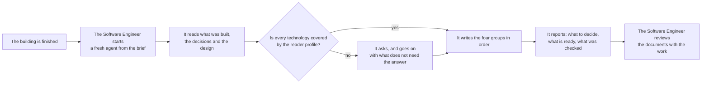
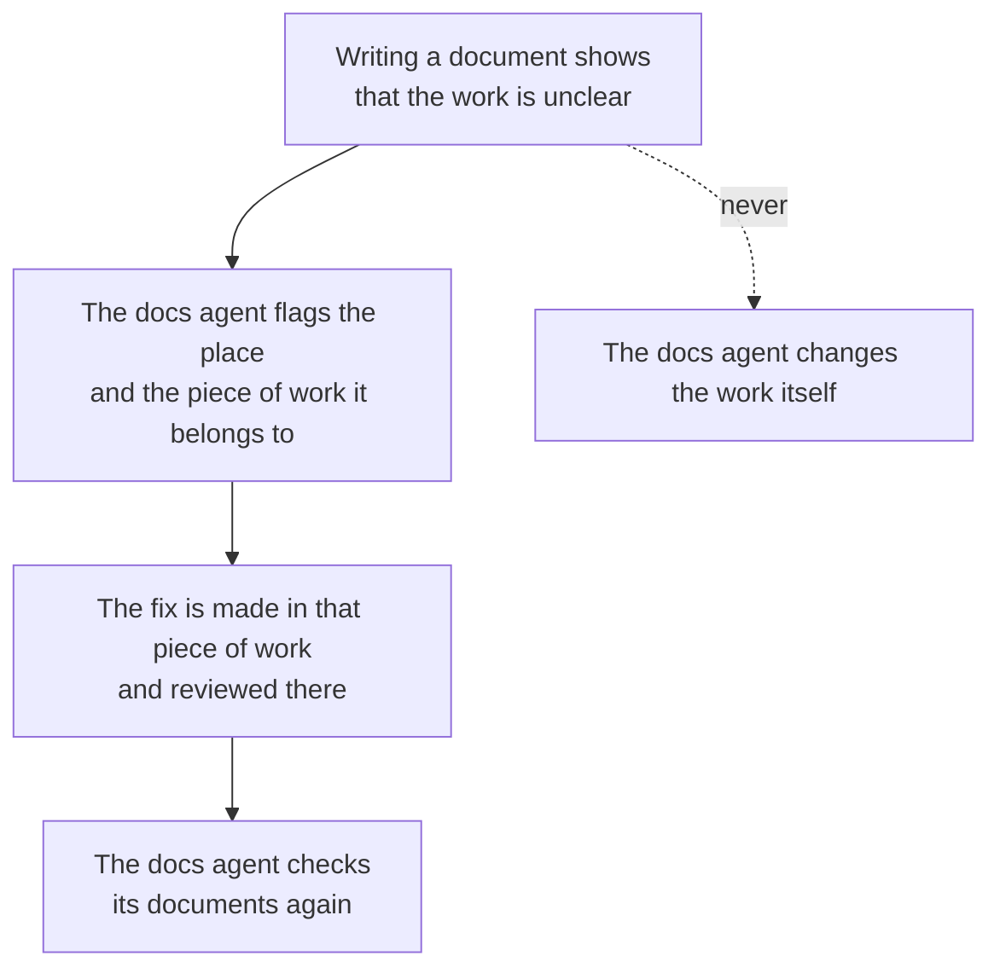

# Documents written from what was built

*Verified against commit cb4fb22.*

## What it is and why it exists

The documents that describe a project are written by a fresh AI agent, the docs agent, once the building is finished. It starts with no memory of how the work was built. It reads what was built, the decision records, the design and the record of who the documents are for, and writes from them. It never reads the plan or the conversation in which the work was built.

It exists because an agent that built something tends to write down what it meant to build, and cannot tell when the work does not say it. A fresh agent has only what exists to go on, so where the reason for something was never written down, the gap shows up instead of being filled with a guess.

## Who can use it

| Who | Can do | Under which conditions |
|---|---|---|
| The Software Engineer | Start the docs agent, and review what it writes | Once the building is finished |
| The docs agent | Write the documents that describe what was built | It never changes the work and never reads the plan |
| The regular agent | Nothing in this feature | It writes none of these documents |
| The team | Read the documents | None |

The [Users and access page](access.md) says what each role is.

## What a person can do

- Start a fresh agent from a written brief, by hand, once the building is finished.
- Receive the documents in four groups, read in order: the reference documents first, then the lessons on the languages, then the lessons on each technology, then the chapters on how the system works together.
- See, for every group, what was checked and how, and what could not be checked.
- See where the work departs from the plan, taken from the decisions the building agents recorded.
- See the places where the work was unclear to a fresh reader, each with the piece of work its fix belongs to.

## Journeys

*The docs agent goes from the finished work to a report, and the one thing to notice is that a missing entry in the reader profile stops only the course for that technology: the rest of the writing goes on while the question waits.*

**Evidence.** The written standard: its part on the docs agent and the agent's brief set this order, and both were read at the commit above. In this repository the brief is also how the docs agent was started for these very documents.

## The rules a person experiences

- The docs agent is started only by the Software Engineer, and only once the building is finished.
- It never changes the work. Where the work is unclear, it flags the place, the fix is made in the piece of work it belongs to, and the documents are checked again afterwards.
- Where nothing it may read says why the work does something, it writes what the work does and says that the reason is not recorded.
- Its documents wait, with the rest of the work, for the Software Engineer's review before anything is merged.

*Unclear work is fixed where it was built, and the one thing to notice is the dotted line marked never: the docs agent's only way to touch the work is a flag.*

## When things go wrong

- **The reason for something was never recorded.** The document says what the work does and that the reason is not recorded, and the gap goes to the Software Engineer as a decision to make.
- **The work departs from a recorded decision.** The docs agent flags it for the Software Engineer and leaves the decision record as it was written; the Software Engineer decides whether the work or the decision changes.
- **A piece of the work changes after the documents are written.** Every document that describes the changed part is checked again.

## Limits today

- There is no command that starts the docs agent: the Software Engineer starts it by hand, from its brief.
- How a fresh docs agent is best started, and what its brief must hold, has been tried once, with this repository's first documents. The Software Engineer started it with a short instruction that named where to work, the two files that held what it could not read from the pull requests, and what not to do. Its report said what it had to find out on its own, and its brief now lists those points. One run is not yet proof.
- Nothing checks automatically which documents a change made untrue, so the docs agent finds them by reading.

## Related

- [The document set](document-set.md), [Decision records](decision-records.md) and [Work delivered as a stack](delivery-as-a-stack.md).
- For engineers: [the docs agent](../architecture/04-the-docs-agent.md) in the architecture reference.
