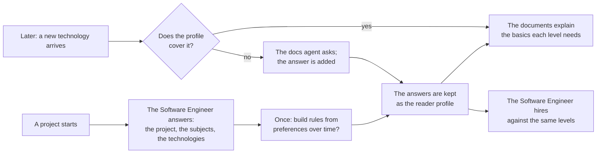
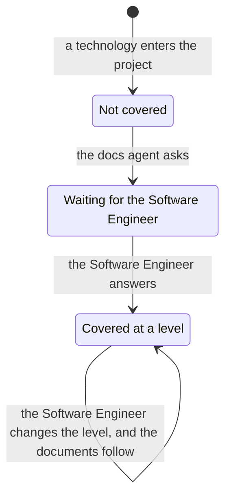

# Documents pitched for the team

*Verified against commit bd7b1ce.*

## What it is and why it exists

When a project starts, the Software Engineer answers a short set of questions: for each subject the project depends on and each technology it uses, how much the team that will work on it already knows. The answers are kept as the project's reader profile. They decide how much basic material each document explains, and they are also the bar the Software Engineer hires against. They never change what is built: a team new to a technology gets more explanation, never simpler work.

It exists because the people who join a project later vary in skill and in number, and documents that explain too much or too little fail them. Keeping one record that serves both the documents and the hiring means the documents are written for the team the project actually wants.

## Who can use it

| Who | Can do | Under which conditions |
|---|---|---|
| The Software Engineer | Answer the questions, and change any answer | Every change is theirs to decide |
| An agent | Propose a change to an answer | It asks and never edits the answers itself |
| The docs agent | Read the answers to decide which basics each document explains, and generate the sections that follow from them | It stops and asks when a technology has no answer |
| The team | Read documents pitched for them, and see the bar they were hired against | None |

The [Users and access page](access.md) says what each role is.

## What a person can do

- Set, for each technology, whether the team is new to it, comfortable with it or fluent in it.
- Set the same for each subject the project depends on.
- Ask, for each technology, for comparisons with a technology the team already knows, kept in marked asides that say where the comparison breaks; or treat it as brand new.
- Read who can contribute, what to know before starting, and which documents to read in which order for each role, all generated from the answers.
- Rely on every document being as detailed as the system needs, whatever the level.

## Journeys

*The answers given at the start feed both the documents and the hiring, and the one thing to notice is that a technology the profile does not cover sends the docs agent back to the Software Engineer instead of to a guess.*

This repository's reader profile was made by answering the questions by hand. It records the team as fluent in Markdown, in git and GitHub, and in the software delivery process; comfortable with Mermaid diagrams, YAML, Claude Code and its skills, technical writing and AI-agent workflows; and new to stacked pull requests. No technology is compared with another.

**Evidence.** The written standard: its part on the reader profile sets the questions, their order and what the answers decide, and this repository's profile was read. Both were read at the commit above.

## The rules a person experiences

- A level changes only which basics a document explains, never how deep it goes or what is built.
- The feature documents, these pages, are always in plain language, whatever the levels say.
- A comparison with a known technology appears only in a marked aside and never replaces the explanation of the technology itself.
- Every change to the answers is the Software Engineer's, and the documents that depend on them are written again afterwards.

*A technology has to be covered before its course is written, and the one thing to notice is that only the Software Engineer moves it on: the docs agent asks and never guesses a level.*

## When things go wrong

- **A technology is missing from the profile.** The docs agent stops that technology's course and asks; everything else goes on, and the course is written once the answer is recorded.
- **A level turns out to be wrong.** An agent that thinks so proposes the change and asks; once the Software Engineer changes it, the documents that depend on it are written again.
- **A comparison would mislead.** It stays in its marked aside, which says where it breaks and which a reader can skip.

## Limits today

- There is no command that asks the questions; they are asked by hand, in the same order.
- Nothing checks every night whether the profile still matches the technologies the project uses.

## Related

- [The document set](document-set.md) and [Standards](standards.md).
- For engineers: [standards and the reader profile](../architecture/06-standards-and-the-reader-profile.md) in the architecture reference.
