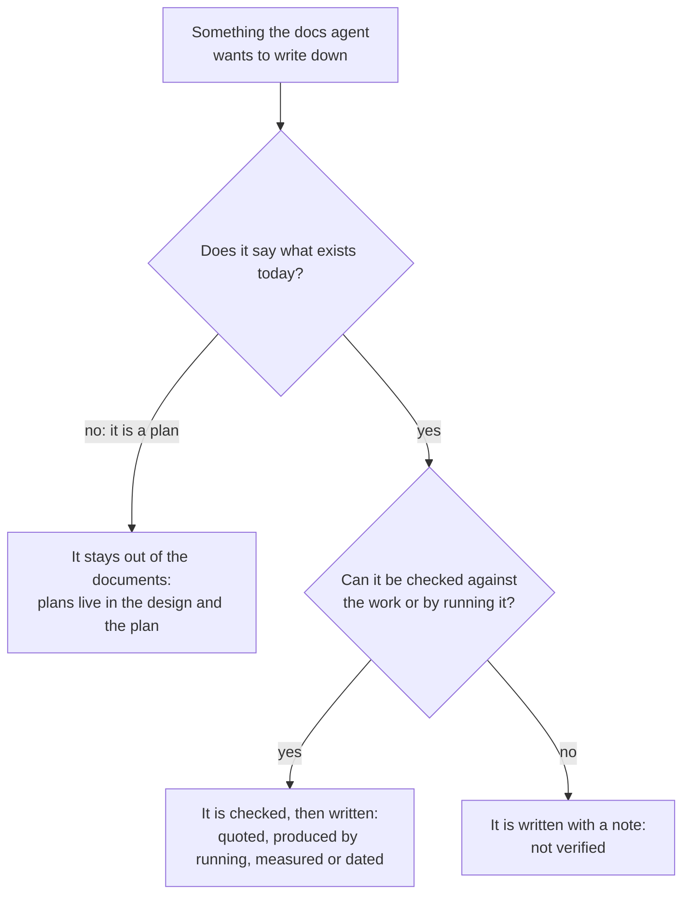
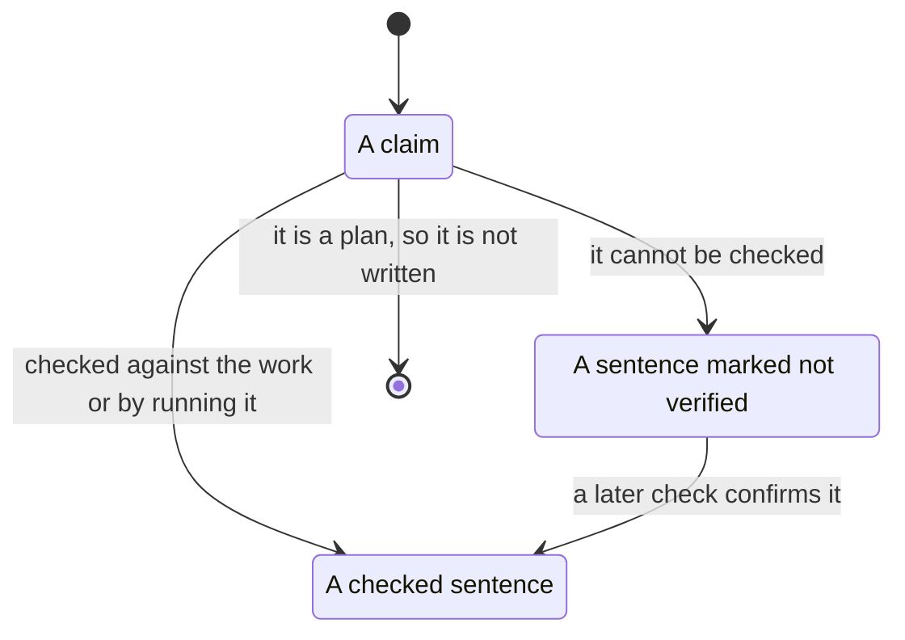

# Documents that stay true

*Verified against commit bd7b1ce.*

## What it is and why it exists

The documents that describe a project follow eleven rules that keep each sentence true: they say only what exists, they quote the work word for word, they show output that was actually produced, they name the version they were checked against, they measure every number and every claim about speed, and they say plainly what could not be checked. Their diagrams are readable in both the dark and the light theme, and colour never carries a meaning on its own.

It exists because a team that reads its documents line by line pays more for one wrong sentence than for a missing one. A sentence that nobody checked can be wrong without anyone knowing, so the rules make every sentence either checked or marked as not checked.

## Who can use it

| Who | Can do | Under which conditions |
|---|---|---|
| The docs agent | Apply the rules to every document it writes | Always |
| The Software Engineer | See, for each group of documents, what was checked and what was not | When they review the work |
| The team | Rely on every sentence that is not marked "not verified" | None |

The [Users and access page](access.md) says what each role is.

## What a person can do

- Trust that a quoted passage is word for word what the work says.
- Trust that shown output was produced by running the thing, not written from memory.
- See which version of the work a document was checked against.
- See, in a note marked "not verified", every statement that could not be checked.
- Read every diagram in either theme, with its meaning carried by shapes, labels and lines.
- Find a part that does not apply kept as one line that says why, instead of filled with something invented.

## Journeys

A claim goes through one decision after another before it becomes a sentence.

*A claim becomes a plain sentence only if it says what exists and was checked, and the one thing to notice is that a claim that cannot be checked still reaches the page, but only with its "not verified" note.*

**Evidence.** The written standard: its part on evidence and truth lists the eleven rules in this order, and its part on diagrams sets the two themes. Both were read at the commit above. In a product made only of text, as this one is, the written text is the evidence, because there is nothing to run.

## The rules a person experiences

- A plan or a "coming later" never appears in a document that describes the work.
- Each quoted passage is word for word, and a gap in it is marked.
- Output is shown only as it was produced by running.
- Every document names the version it was checked against.
- Every number is measured.
- What could not be checked says so.
- Every diagram has a one-line caption that says what it shows and the one thing to notice.
- Colour is never the only carrier of meaning, and the only colours a diagram may set are an approved set for added, changed and removed.

*Every claim ends as one of two kinds of sentence or is left out, and the one thing to notice is that a marked sentence can become a checked one later, while a plan never becomes a sentence at all.*

## When things go wrong

- **A sentence turns out to be wrong.** It is corrected to say what exists; where the work itself is wrong or unclear, the fix goes into the work and the document is checked again.
- **Something can only be checked where the docs agent cannot reach**, such as the live system. It is marked "not verified", with the reason.
- **A diagram is hard to read in one theme.** The diagram is the fault: diagrams set no colours of their own except the approved set, which follows the reader's theme.

## Limits today

- No automatic check runs: nothing yet confirms that quoted passages are word for word, that links resolve, that numbers were measured or that diagrams draw in both themes. The docs agent makes these checks by hand and lists them in the description of each group of documents.
- No check runs at night to produce the shown output again and compare it.
- The approved colours read well in both themes, though their contrast in the dark theme is a little below the usual accessibility mark for normal text, and their final values are left for the tools to confirm.

## Related

- [The document set](document-set.md) and [Documents written from what was built](documents-from-what-was-built.md).
- For engineers: [evidence and checks](../architecture/07-evidence-and-checks.md) in the architecture reference.
